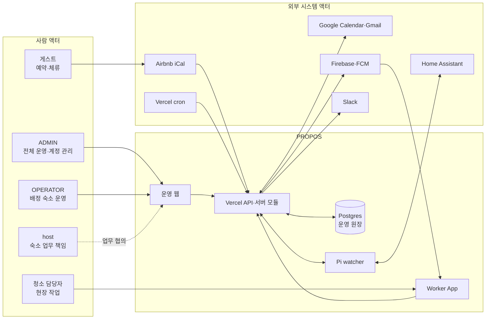
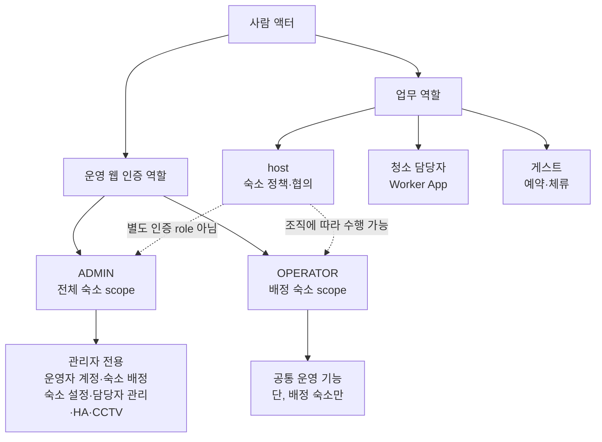
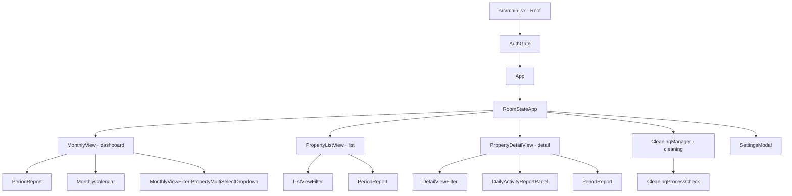
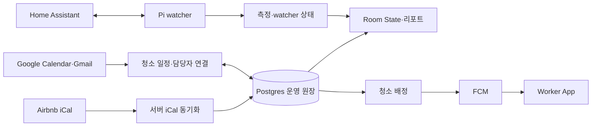

# PROPOS 액터·UI·사용 시나리오

> 목적: 사람이 PROPOS를 **누가 왜 쓰는지**부터 이해한 뒤, 실제 화면·행동·시스템 연결까지 내려가도록 안내한다.  
> 대상 독자: 운영 책임자, 호스트, 청소 담당자, 기획자, 개발자, 테스트 담당자  
> 읽는 순서: [1. 역할 구분](#actor-role-boundary) → [2. 액터 지도](#actor-map) → [4. UI 트리](#ui-navigation) → [6. 시나리오](#actor-scenarios) → [8. 남은 결정](#evidence-index)  
> 마지막 동기화: 2026-11-26 (Asia/Seoul) — DP-08, 검증 기준은 [doc_plan.md](doc_plan.md#validation)  
> 사실 범위: 현재 저장소 구현을 설명한다. 배포·환경·실기 상태는 날짜가 붙은 운영 근거 없이는 확정하지 않는다.  
> 상위 문서: [design_overview.md](design_overview.md) · 계획: [doc_plan.md](doc_plan.md)  
> 검색 키워드: `[AC-]` `[UI-]` `[SCN-]` `[MAP-]` `[CURRENT]` `[LIMIT]`

---

<a id="actor-role-boundary"></a>

## 1. 먼저 구분할 것: 로그인 역할과 업무 역할

PROPOS에서 `ADMIN`과 `OPERATOR`는 서버가 식별하는 **인증 역할**이다. `host`와 청소 담당자, 게스트는 업무 흐름에서의 **업무 역할**이다. 두 종류를 같은 권한 계층으로 해석하면 안 된다.

| 종류 | 이름 | 현재 구현에서의 의미 | 주의점 |
| --- | --- | --- | --- |
| 인증 역할 | `ADMIN` | 전체 숙소 scope, 운영자 계정·배정 관리 | 이메일 없이 관리자 비밀번호로 로그인하는 구현 |
| 인증 역할 | `OPERATOR` | 계정에 배정된 숙소만 조회·처리 | 배정이 없으면 조회 결과도 없어야 하는 기본 거부 구조 |
| 업무 역할 | host | 숙소 운영 정책·일정·청소 협의를 책임지는 사람 | 별도 `host` 세션 role은 현재 코드에서 확인되지 않음 |
| 업무 역할 | 청소 담당자 | Worker App에서 요청을 받고 예약·거절·협의를 수행 | 웹 `OPERATOR`와 다른 앱·인증·업무 흐름 |
| 업무 역할 | 게스트 | 예약·체크인·체류·체크아웃의 대상이자 이벤트 발생 주체 | 운영 웹이나 Worker App의 로그인 사용자가 아님 |

현재 인증 동작은 `PROPOS_AUTH_MODE`에 의존한다. `off`·`log`에서는 전체 scope를 허용하고, `enforce`일 때 세션 인증이 실제 접근을 막는다. 따라서 코드에 로그인 화면이 있다는 사실만으로 특정 배포에서 인증이 강제된다고 단정하지 않는다. 운영(`www.proposonline.com`)은 2026-11-10~14 관측에서 로그인 없는 API 호출이 401로 거절돼 그 시점에 `enforce`였다([MD-R26](refactoring_mdfile.md#md-r26)). 근거: [operatorAuth.js](server/auth/operatorAuth.js), [AuthGate.jsx](src/components/AuthGate.jsx).

---

<a id="actor-map"></a>

## 2. 액터 지도

<a id="actor-context-diagram"></a>

### 2.1 사람과 시스템의 관계



- 보여주는 것: 사람의 진입 채널과 외부 시스템의 상위 협업 관계.
- 보여주지 않는 것: API method·path, 요청 필드, 재시도 규칙.
- 구현 근거: [웹 루트](src/main.jsx), [Worker App 루트](worker-app/App.tsx), [API 진입점](api), [청소 서버 모듈](server/cleaning).
- 미검증 범위: 실제 배포 환경변수 값(인증 모드는 [MD-R26](refactoring_mdfile.md#md-r26)의 날짜 붙은 관측만), 외부 계정 연결 상태, 실기 수신 상태.

<a id="actor-hierarchy"></a>

### 2.2 액터·권한 하이어라키



`host`와 `ADMIN`은 동의어가 아니다. 한 사람이 두 역할을 함께 수행할 수는 있지만, 현재 서버 권한 모델은 `admin`/`operator`만 세션에 저장한다. 이 관계를 제품 정책으로 더 세분화하려면 문서 충돌 대장에서 별도 결정이 필요하다.

<a id="actor-catalog"></a>

### 2.3 사람 액터 카탈로그

| ID | 액터 | 목표 | 주 진입점 | 현재 구현 권한·행동 | 성공 기준 |
| --- | --- | --- | --- | --- | --- |
| AC-01 | ADMIN | 전체 숙소와 운영 계정을 통제 | 운영 웹 로그인 | 전체 scope 조회, 운영자 추가·정지·복구·비밀번호 변경·숙소 배정 | 필요한 숙소와 계정을 제한 없이 관리 |
| AC-02 | OPERATOR | 맡은 숙소의 상태와 예외를 처리 | 운영 웹 로그인 | 배정 숙소 조회·업무 처리, 관리자 전용 기능 제외 | 자기 scope 밖 데이터를 보지 않고 맡은 업무 완료 |
| AC-03 | host | 예약·숙소·청소 운영을 책임지고 현장과 협의 | 조직에 따라 운영 웹 또는 연락 채널 | 별도 세션 role 없음; 청소 요청 payload의 연락처로 협의 대상이 됨 | 예약과 현장 작업 사이의 정책·협의 완료 |
| AC-04 | 청소 담당자 | 요청을 확인하고 수락·거절·협의 | Worker App | 관리자가 미리 저장한 전화번호·이메일로 앱 연결(문자 인증 없음), FCM 수신, Google Calendar 예약 화면, 거절 API, host와 문자 협의 | 작업 배정 여부가 명확해지고 현장 일정 반영 |
| AC-05 | 게스트 | 예약한 숙소에 입실·체류·퇴실 | Airbnb·숙소 현장 | 운영 UI 직접 사용은 확인되지 않음; 예약·도어·센서 이벤트의 업무 대상 | 예약 일정과 실제 체류 상태가 운영 흐름에 반영 |

<a id="system-actors"></a>

### 2.4 시스템 액터 카탈로그

| ID | 시스템 액터 | PROPOS에 주는 것 | PROPOS가 요청하는 것 | 현재 책임 경계 |
| --- | --- | --- | --- | --- |
| AC-S01 | Airbnb iCal | 예약 일정 원천 | iCal 동기화 요청 | 브라우저가 직접 원천을 읽지 않고 서버 동기화 후 Postgres를 읽음 |
| AC-S02 | Google Calendar/Gmail | 청소 일정·참석자·예약 페이지·메일 연계 | 일정 생성·배정 확인·변경 | 외부 일정과 내부 청소 작업을 연결 |
| AC-S03 | Home Assistant | 센서·기기 상태 | area 조회·서비스 제어 | Pi/서버·브라우저 client를 통해 숙소 상태와 제어에 사용 |
| AC-S04 | Pi watcher | 숙소 watcher 상태·측정·스냅샷 | watcher 설정·이벤트 요청 | 예약 원장이 아니라 현장 HA watcher 메타데이터·측정 책임 |
| AC-S05 | Vercel cron | 시간 기반 실행 신호 | morning/evening 및 하위 작업 실행 | 사람 없이 예약 동기화·청소·상태 점검을 시작 |
| AC-S06 | Firebase/FCM | 앱 토큰·푸시 전달 채널 | 청소 요청·토큰 갱신 | 접수 성공과 실제 사용자 확인은 구분해야 함 |
| AC-S07 | Slack | 운영 알림 수신 채널 | 실패·보류·상태 알림 | 업무 원장이나 상세 로그의 대체물이 아님 |
| AC-S08 | Postgres | 숙소·예약·청소·인증·운영 기록 | 조회·갱신·감사 근거 | 외부 원천을 복사한 캐시가 아니라 내부 업무 판단의 원장 |

---

<a id="permission-matrix"></a>

## 3. 액터별 기능 범위

`현재 저장소 구현` 기준의 상위 매트릭스다. API별 정확한 method와 세부 scope 판정은 후속 인터페이스 문서에서 다룬다.

| 기능 | ADMIN | OPERATOR | host | 청소 담당자 | 게스트 |
| --- | :---: | :---: | :---: | :---: | :---: |
| 운영 웹 로그인 | 전체 scope | 배정 scope | 별도 role 없음 | 해당 없음 | 해당 없음 |
| Room State 조회 | 가능 | 배정 숙소 한정이 목표인 서버 scope | 조직 역할에 따라 간접 | 불가 | 불가 |
| 운영자 계정·숙소 배정 | 가능 | 불가 | 별도 role 없음 | 불가 | 불가 |
| 숙소 설정·청소 담당자 관리 | 관리자 전용 UI 설명에 명시 | 불가 | 별도 role 없음 | 불가 | 불가 |
| 청소 요청 수신 | 관리 화면에서 상태 확인 | scope 내 상태 확인 | 협의 상대 | Worker App FCM | 불가 |
| 청소 요청 수락 | 관리 화면 직접 수락 흐름과 구분 | 동일 | 협의 | Google Calendar 예약 페이지로 이동 | 불가 |
| 청소 요청 거절 | 상태 확인·후속 배정 | 상태 확인 | 협의 | 거절 API 호출 | 불가 |
| 현장 입실·퇴실 이벤트 발생 | 관측·대응 | 관측·대응 | 관측·대응 | 청소 작업 이벤트 | 실제 행동 주체 |

중요한 현재 한계:

- `OPERATOR` scope는 서버 API에서 강제돼야 한다. 화면에 컴포넌트가 보이는 것만으로 권한이 보장되는 것은 아니다.
- Worker App의 “수락” 버튼은 현재 코드상 Google Calendar 예약 WebView를 연다. 그 버튼 자체가 내부 DB의 `ASSIGNED` 상태를 직접 갱신한다고 표현하지 않는다.
- host는 업무 개념이므로 별도의 로그인 권한으로 추정하지 않는다.

---

<a id="ui-navigation"></a>

## 4. 전체 UI Navigation Tree

<a id="web-navigation"></a>

### 4.1 운영 웹

```text
브라우저 진입 · src/main.jsx
├─ /privacy-policy, /privacy → PrivacyPolicy
├─ /terms-of-service, /terms → TermsOfService
└─ 나머지 경로 → AuthGate
   ├─ checking → 빈 렌더
   ├─ login → PROPOS 운영자 로그인
   └─ open → App
      ├─ 기본 screen: rsm → RoomStateApp
      │  ├─ dashboard → MonthlyView
      │  │  ├─ 상태 카드/필터 → list
      │  │  ├─ 월간 캘린더 숙소 선택 → detail
      │  │  ├─ 동기화·설정 → SettingsModal
      │  │  └─ 청소 관리 → cleaning
      │  ├─ list → PropertyListView
      │  │  └─ 숙소 선택 → detail
      │  ├─ detail → PropertyDetailView
      │  │  └─ 뒤로 → list
      │  └─ cleaning → CleaningManager
      │     └─ 뒤로 → dashboard
      ├─ landing → v1 운영 랜딩 또는 v2 OperationsPortal
      │  ├─ Command Center → cc
      │  ├─ 대표 숙소 상세 → ha
      │  └─ Room State → rsm
      ├─ cc → CommandCenter v1/v2
      │  ├─ 숙소 상세 → ha
      │  └─ 단계 콘솔 → d1/s02/s03/s04/s05
      ├─ ha → HomeAssistant v1/v2
      ├─ d1 → D1AutomationPanel
      ├─ s02 → S02CheckinPanel
      ├─ s03 → S03MonitoringPanel
      ├─ s04 → S04CheckoutPanel
      ├─ s05 → S05RevenuePanel
      ├─ marketing → LandingPageV2
      ├─ v1 → LandingPageV1
      └─ v2 → LandingPage

AuthGate의 open 상태 보조 UI
├─ enforce 인증 + ADMIN → 운영자 관리, 로그아웃
├─ enforce 인증 + OPERATOR → 로그아웃
└─ off/log 또는 인증 API 부재 → 보조 인증 UI 없이 앱 진입
```

`App`의 초기값은 현재 `screen = "rsm"`, `uiVersion = "v1"`이다. `uiVersion = "v2"`에서 Command Center와 Home Assistant는 현재 “개발 예정” 화면이며, S01~S05 패널은 v1 구현을 계속 사용한다. 근거: [App.jsx](src/components/App.jsx), [v2 CommandCenter](src/components/v2/CommandCenter.jsx), [v2 HomeAssistant](src/components/v2/HomeAssistant.jsx).

<a id="worker-navigation"></a>

### 4.2 Worker App

```text
Worker App 시작
├─ 등록 상태 확인 중 → ActivityIndicator
├─ 미등록 → PhoneAuthScreen (한 화면)
│  └─ 전화번호 + 이메일 입력 (관리자가 PROPOS에 미리 저장한 값)
│     └─ FCM token과 함께 등록 → 둘 다 맞으면 Home, 하나라도 다르면 연결하지 않음
└─ 등록됨 → Navigation
   ├─ HomeScreen
   │  ├─ heartbeat 전송
   │  ├─ 포그라운드 FCM → JobScreen
   │  ├─ 백그라운드 알림 탭 → JobScreen
   │  └─ 종료 상태 알림 탭 → JobScreen
   └─ JobScreen
      ├─ 수락 → Google Calendar 예약 WebView
      ├─ 거절 → 확인 → decline API → 완료/실패
      └─ 협의 필요 → host 전화번호로 SMS 앱 열기
```

근거: [App.tsx](worker-app/App.tsx), [navigation](worker-app/src/navigation/index.tsx), [PhoneAuthScreen](worker-app/src/screens/PhoneAuthScreen.tsx), [HomeScreen](worker-app/src/screens/HomeScreen.tsx), [JobScreen](worker-app/src/screens/JobScreen.tsx).

---

<a id="component-hierarchy"></a>

## 5. 주요 화면과 컴포넌트 하이어라키

<a id="room-state-hierarchy"></a>

### 5.1 Room State



화면 전환의 정본은 URL router가 아니라 `App.screen`과 `RoomStateApp.view` 상태다. 따라서 브라우저 주소만 보고 내부 화면을 식별할 수 있다고 가정하지 않는다.

<a id="screen-data-map"></a>

### 5.2 화면 → state/hook → API → 데이터 연결 [MAP-01]

| 화면 | state·hook·client | 주요 API | 주요 데이터 의미 | 구현 근거 |
| --- | --- | --- | --- | --- |
| 로그인·세션 | `AuthGate` local state, 전역 fetch 401 감지 | `/api/auth/me`, `/api/auth/login`, `/api/auth/logout` | 세션 role·인증 필요 여부 | [AuthGate.jsx](src/components/AuthGate.jsx) |
| 운영자 관리 | `OperatorManager` local state | `/api/cleaning/operators`, `/api/cleaning/properties?view=names` | 운영자·숙소 배정 | [OperatorManager.jsx](src/components/OperatorManager.jsx) |
| Room State 루트 | `RoomStateApp` state·polling, monitoring/weather clients | `/api/cleaning/properties`, `/api/cleaning/ical-sync`, `/api/properties`, `/api/monitoring/*`, `/api/weather` | Postgres 숙소·예약 원장 + Pi/HA 측정·메타데이터 | [RoomStateApp.jsx](src/components/v2/RoomStateApp.jsx) |
| 현황 대시보드 | `usePropertySelection`, `useMonthlyCalendar`, `useFutureCleaningStats` | `/api/stats/calendar`, 통계·청소 조회 | 선택 숙소의 상태·기간 리포트·미래 청소 | [MonthlyView.jsx](src/components/v2/MonthlyView.jsx) |
| 숙소 목록 | `usePropertySelection`, 로컬 Gantt window | 통계는 `PeriodReport` 하위 hook 사용 | 여러 숙소의 상태·예약 시간축 | [PropertyListView.jsx](src/components/v2/PropertyListView.jsx) |
| 숙소 상세 | `useMonthlyCalendar`, local timeline·operation callbacks | 상위 `RoomStateApp`의 monitoring event, 하위 보고 API | 단일 숙소 센서·기기·체류·청소·보고 | [PropertyDetailView.jsx](src/components/v2/PropertyDetailView.jsx) |
| 청소 관리 | `CleaningManager` local state·`apiFetch` | `/api/cleaning/*` | 담당자·작업·숙소·배정·처리 상태 | [CleaningManager.jsx](src/components/v2/CleaningManager.jsx) |
| Worker 등록 | `PhoneAuthScreen`, FCM service | `/api/workers/register` | 관리자가 저장한 전화번호·이메일 확인 후 FCM 기기 연결 | [Worker API client](worker-app/src/services/api.ts) |
| Worker 대기 | `HomeScreen`, FCM listener | `/api/workers/heartbeat` | 앱 활동·푸시 수신 대기 | [HomeScreen](worker-app/src/screens/HomeScreen.tsx) |
| Worker 작업 | `JobScreen` | `/api/cleaning/d?token=…&format=api`, Google Calendar URL | 거절 처리·외부 예약·host 협의 | [JobScreen](worker-app/src/screens/JobScreen.tsx) |

데이터 경계 요약:



- 보여주는 것: 화면이 섞어 보여주는 원장 데이터와 실시간 측정 데이터의 출처 차이.
- 보여주지 않는 것: 테이블명·SQL·API 필드의 전체 계약.
- 핵심 원칙: 예약·iCal·청소 일정의 정본과 Pi watcher 메타데이터를 같은 저장소로 취급하지 않는다.

---

<a id="actor-scenarios"></a>

## 6. 액터별 사용 시나리오

<a id="admin-scenarios"></a>

### SCN-01 · ADMIN이 운영자와 숙소 접근을 관리한다

| 구분 | 내용 |
| --- | --- |
| 액터·목표 | ADMIN · 운영자에게 필요한 숙소만 보이게 한다 |
| 진입 | 인증 강제 상태에서 관리자 로그인 → `운영자 관리` |
| 정상 흐름 | 운영자 추가 → 이메일·임시 비밀번호 입력 → 숙소 선택 → 저장 → 필요 시 정지·복구·비밀번호 재설정 |
| 성공 기준 | 서버가 운영자와 `property_ids`를 저장하고, 다음 요청부터 변경 scope가 반영됨 |
| 예외 흐름 | 잘못된 이메일·짧은 비밀번호·중복 계정·서버 오류 → 대화상자 내 오류 표시 |
| 보안 경계 | OPERATOR에는 관리 버튼이 보이지 않으며 서버도 관리자 scope를 확인해야 함 |
| 구현 근거 | [OperatorManager.jsx](src/components/OperatorManager.jsx), [operatorAccounts.js](server/auth/operatorAccounts.js), [operatorAdmin.js](server/auth/operatorAdmin.js) |

<a id="operator-scenarios"></a>

### SCN-02 · OPERATOR가 배정된 숙소의 현황을 확인한다

| 구분 | 내용 |
| --- | --- |
| 액터·목표 | OPERATOR · 맡은 숙소의 현재 상태와 예외를 빠르게 찾는다 |
| 진입 | 이메일+비밀번호 로그인 → 기본 `rsm` 화면 |
| 정상 흐름 | MonthlyView에서 상태·기간·숙소 필터 → 목록 → 숙소 상세 → 필요한 운영 조치 |
| 성공 기준 | 배정된 숙소만 API 결과에 포함되고 선택·보고·상세가 같은 scope를 유지 |
| 예외 흐름 | 세션 만료·정지·비밀번호 재설정 → API 401 → AuthGate가 로그인 화면으로 전환 |
| 거부 흐름 | 미배정 숙소 단건 접근은 조회 결과에서 숨기거나 404로 처리하는 서버 원칙 |
| 구현 근거 | [AuthGate.jsx](src/components/AuthGate.jsx), [operatorAuth.js](server/auth/operatorAuth.js), [operatorAccounts.js](server/auth/operatorAccounts.js) |

<a id="host-scenarios"></a>

### SCN-03 · host가 청소 일정과 현장 협의를 연결한다

| 구분 | 내용 |
| --- | --- |
| 액터·목표 | host · 예약 뒤 필요한 청소가 담당자에게 전달되고 일정으로 확정되게 한다 |
| 진입 | 조직의 운영 웹 계정 또는 Worker App에서 온 SMS 협의 |
| 정상 흐름 | 예약 동기화 → 청소 작업 생성·배정 → 담당자 알림 → 담당자가 일정 예약 → 운영 화면에서 상태 확인 |
| 예외 흐름 | 담당자 거절·미응답·앱 미설치·일정 충돌 → 다음 tier·bulk·운영자 개입 경로 |
| 현재 한계 | host 전용 계정·화면은 확인되지 않으며, host 전화번호는 Worker payload의 협의 연락처로 사용됨 |
| 구현 근거 | [청소 자동화 설계](docs/cleaning-automation-design.md), [Worker JobScreen](worker-app/src/screens/JobScreen.tsx), [dispatch](server/cleaning/_dispatch.js) |

<a id="cleaner-scenarios"></a>

### SCN-04 · 청소 담당자가 처음 앱을 등록한다

| 구분 | 내용 |
| --- | --- |
| 액터·목표 | 청소 담당자 · 관리자가 미리 만들어 둔 자기 담당자 정보에 알림 받을 기기를 연결한다 |
| 선행 조건 | 관리자가 PROPOS에 담당자의 이름·전화번호·이메일을 먼저 저장한다. 앱 등록으로 새 담당자가 생기지 않는다 |
| 정상 흐름 | 전화번호·이메일 입력 → FCM 토큰 획득 → `/api/workers/register` → 서버가 두 값이 모두 맞는 기존 담당자를 확인하고 기기 연결 → 등록 상태 저장 → Home |
| 성공 기준 | 서버 등록 성공 뒤 로컬 `registered`가 저장되고 token refresh 감시가 시작됨 |
| 예외 흐름 | 번호 형식 오류·두 값 중 하나 불일치·이미 다른 기기에 연결된 번호·FCM token 없음 → 등록 완료로 전환하지 않음 |
| 현재 한계 | 문자 인증이 없어 두 값을 아는 사람이 대신 연결할 수 있다(사용자가 감수하기로 함). 앱 연결과 실제 업무 승인 `active`는 같은 의미가 아님. 설치용 앱(APK)에는 아직 반영되지 않음 — [docs/refactoring.md 3절](docs/refactoring.md) |
| 구현 근거 | [Worker App](worker-app/App.tsx), [PhoneAuthScreen](worker-app/src/screens/PhoneAuthScreen.tsx), [Worker API](api/workers/%5B...slug%5D.js) |

### SCN-05 · 청소 담당자가 요청을 수락·거절·협의한다

| 구분 | 내용 |
| --- | --- |
| 액터·목표 | 청소 담당자 · 새 요청에 명확히 응답한다 |
| 정상 흐름 A | FCM 알림 탭 → JobScreen → 수락 → Google Calendar 예약 WebView에서 일정 처리 |
| 정상 흐름 B | 거절 → 확인 → token 기반 decline API → 완료 화면 → 다음 담당자 전달 |
| 정상 흐름 C | 협의 필요 → host 전화번호로 SMS 앱 열기 |
| 예외 흐름 | 이미 처리된 요청·연결 실패 → “처리 불가”; throw → 재시도 안내 |
| 해석 주의 | 수락 버튼은 외부 Calendar 페이지를 여는 동작이며, 내부 `ASSIGNED` 확정은 후속 Calendar 연계 흐름과 구분 |
| 구현 근거 | [HomeScreen](worker-app/src/screens/HomeScreen.tsx), [JobScreen](worker-app/src/screens/JobScreen.tsx), [api.ts](worker-app/src/services/api.ts) |

<a id="guest-scenarios"></a>

### SCN-06 · 게스트의 예약부터 퇴실까지 운영 상태가 이어진다

| 단계 | 게스트 행동·상태 | PROPOS의 관측·처리 | 관련 기존 시나리오 |
| --- | --- | --- | --- |
| 예약 | Airbnb에서 예약 | iCal 동기화 후 내부 예약 원장 반영 | S01 준비 입력 |
| 입실 전 | 체크인 예정 | D-1 준비, PIN·메시지·HA 준비 모델 | S01 |
| 입실 | 입실 시각 도래·실제 입장 | 입실 시각에 체류로 바뀐다. 입장이 확인되면 체류 기기 제어, 그날 자정까지 확인되지 않으면 `입실 미감지` 문제와 운영자 알림 | S02 |
| 체류 | 센서·메시지·기기 사용 | 이상·에너지·민원 관측과 운영자 대응 | S03 |
| 퇴실 | 퇴실 시각 도래·실제 퇴장 | 퇴실 시각에 청소대기로 바뀐다. 퇴장이 확인되면 청소 모드 기기 제어, 20분 안에 확인되지 않으면 `퇴실 지연`, 센서가 꺼져 있으면 `확인 불가` — 기기 제어는 운영자에게 넘긴다. 청소는 일정의 시작 시각에 청소중, 끝 시각에 공실 | S04 |
| 사후 | 매출·운영 결과 | 기간 리포트·정산 모델 | S05 |

상태는 예약·청소 일정이 정하고, 센서 감지는 그 구간에서 기대한 일이 일어났는지 확인해 안 되면 문제로 남기는 데 쓴다(DEC-10·16·17, [room-state-machine.md 0절](docs/room-state-machine.md)). 이 표는 기존 S01~S05의 제품 시나리오를 현재 UI·데이터 구조에 연결하기 위한 상위 설명이다. 실제 운영에서 모든 단계가 자동 실행된다는 증거는 아니다. 운영에서 실제로 검증된 범위는 청소 자동화뿐이다(DEC-04). 입·퇴실 감지(S02·S04)는 현관 움직임 센서가 10월 30일부터 연결되지 않아, 입장은 문 뒤 스위치·조명 같은 보조 신호로 확인할 수 있지만(DEC-18) 퇴장은 확인할 수 없다. S01은 미검증, S03은 연결만 확인, S05 정산은 데모만 있다.

<a id="system-scenarios"></a>

### SCN-07 · 시스템이 사람 없이 동기화와 점검을 실행한다

| 트리거 | 시스템 행동 | 사람이 확인하는 곳 | 실패 시 책임 |
| --- | --- | --- | --- |
| Vercel cron | morning/evening 및 하위 청소·동기화·헬스체크 action 호출 | 운영 웹, DB 상태, Slack | 작업별 로그·알림·운영자 개입 |
| Pi watcher | 서버가 보낸 예약·청소 일정대로 숙소 상태를 바꾸고, 센서·HA로 기대한 일이 일어났는지 확인·snapshot 제공 | 숙소 상세, Slack, HA 앱 | 확인하지 못하면 기기 제어 없이 운영자에게 넘김(DEC-11·16); watcher·HA 연결 상태 확인 |
| FCM | 청소 요청을 앱으로 전달 | Worker JobScreen | 전달 실패 분류·fallback·운영 알림 |
| Google 연계 | 일정·참석자 변화로 청소 담당자 연결 | 청소 관리·Room State | webhook·동기화·담당자 매칭 확인 |

상세 실행 순서와 cron 하위 작업 구조는 [런타임 협업 문서](runtime_interfaces_and_collaboration.md#collaboration-sequences)에서 확인한다.

---

<a id="legacy-scenarios"></a>

## 7. 기존 S01~S05와 현재 UI의 관계

| 구분 | 기존 레지스트리·UML | 현재 구현에서의 위치 | 문서 해석 |
| --- | --- | --- | --- |
| 운영 탐색 | Command Center·Home Assistant | `cc`, `ha`; v1 구현과 v2 개발 예정 화면 공존 | 버전과 구현 상태를 함께 표시해야 함 |
| S01 | D-1 자동화 | `d1`, `checkinPreparationService` | 단계별 batch console 모델 |
| S02 | 체크인 당일 | `s02`, `checkinService` | 이벤트 기반 입실 모델 |
| S03 | 체류 모니터링 | `s03`, `monitoringService`; Room State 상세에도 측정 표시 | 기존 패널과 현재 RSM을 동일 화면으로 보면 안 됨 |
| S04 | 퇴실·청소 | `s04`, `checkoutService`; 별도 CleaningManager·Worker App 존재 | 청소 운영의 현재 범위가 기존 UML보다 큼 |
| S05 | 정산 | `s05`, `settlementService`; Room State reporting 컴포넌트 존재 | 정산 시나리오와 기간 운영 리포트는 구분 |

정본 관계:

- S01~S05 등록 정보: [docs/scenarios.yaml](docs/scenarios.yaml)
- 기존 시퀀스: [myPlantUML](myPlantUML)
- 현재 화면 전환: [App.jsx](src/components/App.jsx), [RoomStateApp.jsx](src/components/v2/RoomStateApp.jsx)
- 현재 Worker 흐름: [worker-app](worker-app)

기존 UML을 폐기하거나 현재 전체 구조라고 이름만 바꾸지 않는다. 기존 도식은 S01~S05의 제한된 범위를 설명하는 자료로 유지하고, 이 문서가 현재 액터와 UI의 상위 지도를 담당한다.

---

<a id="evidence-index"></a>

## 8. 근거와 남은 결정

코드·API·데이터·테스트의 전체 매핑은 [TR-10](documentation_traceability.md#tr-10)이 소유한다. 이 문서에서는 화면과 시나리오를 이해하는 데 필요한 근거만 본문 가까이에 연결한다.

### 남은 검증·결정

| ID | 항목 | 현재 처리 |
| --- | --- | --- |
| LIMIT-01 | 실제 배포에서 `PROPOS_AUTH_MODE`가 무엇인지 | 운영 관측(2026-11-10~14): 로그인 없는 호출 401 → `enforce`. 환경변수 값 자체는 확인하지 않음([MD-R26](refactoring_mdfile.md#md-r26)) |
| LIMIT-02 | host를 별도 계정 역할로 둘지 | 현재 구현에 없으므로 제품 결정으로 남김 |
| LIMIT-03 | Worker “수락”의 내부 확정 시점 | [런타임 SEQ-03](runtime_interfaces_and_collaboration.md#seq-03)에서 단계별로 구분 |
| LIMIT-04 | UI v1/v2의 최종 유지 범위 | 현재 공존 상태만 기록하고 임의 통합하지 않음 |

문서에서 발견한 용어 충돌·중복·결정 필요 항목은 [refactoring_mdfile.md](refactoring_mdfile.md)에 연결하고, 실제 소스 리팩터링 상태는 복제하지 않는다.
