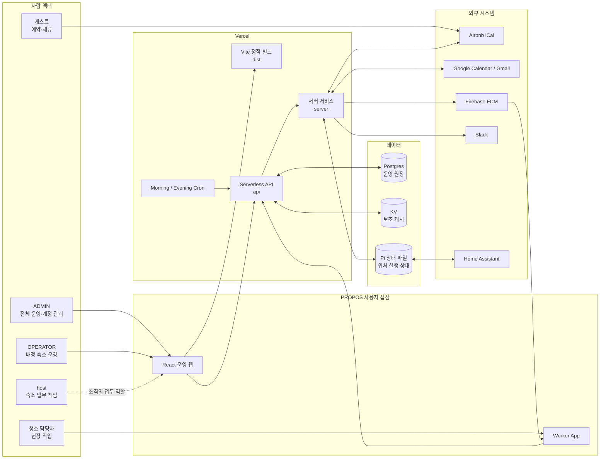
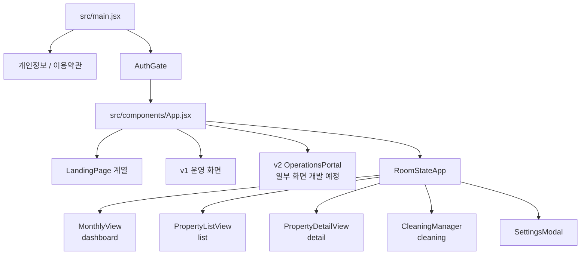
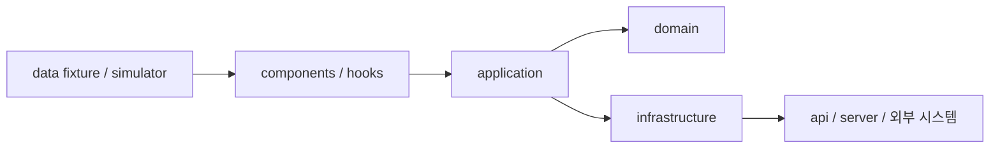
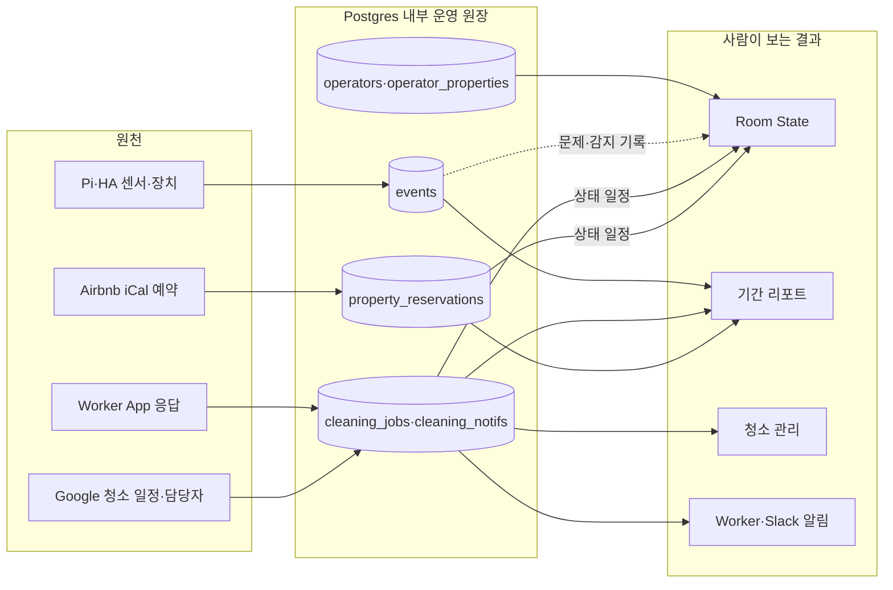

# PROPOS Design Overview

> 작성일: 2026-11-12 · 통합 문서 보강·재검증: 2026-11-17 (Asia/Seoul)  
> 목적: 비개발자가 사람의 사용 시나리오부터 이해하고, 개발자가 UI·인터페이스·데이터·코드·오류 근거까지 내려가는 단일 시작점  
> 대상 독자: 운영자, 호스트, 청소 담당자, 기획자, 개발자, 테스트·운영 담당자  
> 권장 읽기 순서: 이 문서 → [액터·UI·시나리오](actor_ui_scenarios.md) → [런타임 인터페이스](runtime_interfaces_and_collaboration.md) → [오류·관측](error_observability.md) → [추적성](documentation_traceability.md)  
> 기준일: 2026-11-17 (Asia/Seoul) · 저장소 구현과 운영 배포 상태는 구분  
> 문서 정합성 문제와 리팩터링 제안: [refactoring_mdfile.md](refactoring_mdfile.md)  
> 테스트 케이스 리팩터링 계획: [refactoring_TC.md](refactoring_TC.md)  
> 실제 소스 리팩터링 상태: [docs/refactoring.md](docs/refactoring.md#sec-02)  
> 정책→문서→코드→데이터→테스트 연결: [documentation_traceability.md](documentation_traceability.md)  
> 검색 키워드: `[START]` `[ARCH]` `[FOLDER]` `[FLOW]` `[DOCS]` `[SOT]` `[TEST]`

<a id="start"></a>

## 1. 어디서 시작할까 [START]

| 알고 싶은 것 | 먼저 볼 곳 | 다음으로 볼 곳 |
| --- | --- | --- |
| PROPOS가 누구를 위한 어떤 시스템인가 | [1.1 프로젝트 한눈에 보기](#project-at-a-glance) | [actor_ui_scenarios.md](actor_ui_scenarios.md) |
| 관리자·운영자·호스트·청소 담당자·게스트의 차이 | [액터·UI·시나리오](actor_ui_scenarios.md#actor-map) | [권한 하이어라키](actor_ui_scenarios.md#actor-hierarchy) |
| 사람은 어떤 화면에서 무엇을 하는가 | [전체 UI Navigation Tree](actor_ui_scenarios.md#ui-navigation) | [액터별 시나리오](actor_ui_scenarios.md#actor-scenarios) |
| 시스템과 주요 컴포넌트가 어떻게 협업하는가 | [런타임 지도](runtime_interfaces_and_collaboration.md#runtime-map) | [주요 Sequence](runtime_interfaces_and_collaboration.md#collaboration-sequences) |
| API·외부 시스템 계약과 cron 구조 | [API 계약](runtime_interfaces_and_collaboration.md#api-contracts) | [cron 하이어라키](runtime_interfaces_and_collaboration.md#cron-hierarchy) |
| 오류·재시도·로그·Slack 책임 | [오류·관측](error_observability.md) | [현재 구현](error_observability.md#current-error-model), [권장 목표](error_observability.md#target-model) |
| 프로젝트를 실행하고 검증하는 법 | [9. 실행·검증 명령](#commands) | [README.md](README.md), [package.json](package.json) |
| 현재 완료·진행·대기 작업 | [docs/refactoring.md](docs/refactoring.md#sec-02) | [docs/handoff-to-claude.md](docs/handoff-to-claude.md) |
| 테스트 케이스 구조와 리팩터링 계획 | [refactoring_TC.md](refactoring_TC.md) | [실행 단계](refactoring_TC.md#phases), [완료 기준](refactoring_TC.md#definition-of-done) |
| 전체 Markdown 문서 목록 | [7. 전체 Markdown 가이드](#markdown-guide) | [6. 정본과 근거](#source-of-truth) |
| 전체 파일·폴더 구조 | [3. 저장소 아키텍처](#repository-architecture) | [4. 계층별 파일 가이드](#folder-guide) |
| 시스템이 어떻게 연결되는가 | [2. 시스템 아키텍처](#system-architecture) | [5. 주요 데이터 흐름](#core-flows) |
| 시나리오와 코드·테스트 연결 | [8. 사용자 시나리오](#scenario-map) | [docs/scenarios.yaml](docs/scenarios.yaml) |
| 숙소 상태와 이벤트 | [docs/room-state-machine.md](docs/room-state-machine.md) | [docs/event-detection-design.md](docs/event-detection-design.md) |
| 데이터 정본과 관계 | [docs/data-architecture-and-simulator.md](docs/data-architecture-and-simulator.md) | [docs/data-storage-design.md](docs/data-storage-design.md) |
| 청소 배정·알림 | [docs/cleaning-automation-design.md](docs/cleaning-automation-design.md) | [docs/cleaning-scenario-matrix.md](docs/cleaning-scenario-matrix.md) |
| 레포트 계산과 UI | [docs/report-architecture.md](docs/report-architecture.md) | [docs/reporting-feature-design.md](docs/reporting-feature-design.md) |
| 문서끼리 충돌하는 부분 | [refactoring_mdfile.md](refactoring_mdfile.md#review-findings) | 해당 항목에 연결된 분야별 문서 |
| 정책부터 테스트까지 연결 | [documentation_traceability.md](documentation_traceability.md#trace-matrix) | 연결된 MD-R 문서 갭 |

<a id="project-at-a-glance"></a>

### 1.1 프로젝트 한눈에 보기

**PROPOS는 숙박 예약, 숙소 상태, 청소 배정, 현장 장치, 운영 보고를 한 흐름으로 연결해 사람이 예외와 다음 행동을 빠르게 판단하도록 돕는 운영 시스템이다.**

```text
누가 왜 쓰는가
  → 어떤 화면에서 무엇을 하는가
    → 시스템들이 어떤 순서로 협업하는가
      → 데이터가 어디서 와서 어디에 저장되는가
        → 코드와 API가 어디에 있는가
          → 실패하면 무엇이 재시도되고 누가 확인하는가
            → 어떤 테스트·운영 근거로 확인됐는가
```

### 1.2 문서 메뉴 트리

```text
design_overview.md                         ← 모든 독자의 단일 시작점
├─ actor_ui_scenarios.md                   누가·왜·어떤 화면에서 무엇을 하는가
├─ runtime_interfaces_and_collaboration.md API·외부 시스템·컴포넌트가 어떻게 협업하는가
├─ error_observability.md                  실패·예외·재시도·로그·Slack은 어떻게 처리되는가
├─ documentation_traceability.md           정책부터 코드·데이터·테스트·운영 근거까지의 연결
├─ refactoring_mdfile.md                   Markdown 중복·충돌·모호성·정리 순서
├─ refactoring_TC.md                       TC 구조·안전·ID·gate 리팩터링 계획
├─ doc_plan.md                             통합 문서 소유권·유지보수 계획
└─ docs/refactoring.md                     실제 소스 리팩터링 상태·결정·감사 기록
```

세 리팩터링 문서의 책임은 다르다. `docs/refactoring.md`는 실제 소스 작업, `refactoring_mdfile.md`는 Markdown 품질, `refactoring_TC.md`는 테스트 구조 계획을 관리한다. 서로의 진행 상태나 상세 내용을 복제하지 않고 링크로만 연결한다.

### 구조 요약

- React/Vite 운영 화면과 Worker App이 사용자 접점이다.
- Vercel API와 Postgres가 예약·청소·이벤트·레포트를 연결한다.
- Raspberry Pi·Home Assistant, Google Calendar/Gmail, Firebase FCM이 현장 자동화와 외부 알림을 담당한다.
- 문서 설명, 저장소 구현, 배포·운영 관측은 서로 다른 근거이므로 [추적성 표](documentation_traceability.md)에서 구분한다.

<a id="system-architecture"></a>

## 2. 시스템 아키텍처 [ARCH]



이 도식에서 `ADMIN`·`OPERATOR`는 인증 역할이고, `host`·청소 담당자·게스트는 업무 역할이다. host 전용 session role이 구현됐다는 뜻이 아니다. 자세한 권한 계층은 [액터·권한 하이어라키](actor_ui_scenarios.md#actor-hierarchy)를 본다.

### 핵심 경계

- 브라우저는 Home Assistant를 직접 호출하지 않고 `/api/ha/*` 또는 모니터링 API를 거친다.
- 예약·청소 작업·이벤트의 운영 원장은 Postgres다. Pi 상태 파일, KV, 브라우저 캐시는 역할과 수명이 다른 보조 저장소다.
- REAL과 SIMULATED는 같은 DB 구조를 사용하고 `data_origin`으로 구분한다. DEMO는 명시적으로 선택하는 fixture 프로필이다.
- `dist/`는 `src/`에서 생성되는 빌드 결과이므로 직접 수정하지 않는다.
- 운영 스케줄은 `vercel.json`의 morning/evening cron이 실행 기준이다.
- 인증·숙소 범위 기능은 구현되어 있으나 실제 강제 여부는 배포 환경의 `PROPOS_AUTH_MODE`에 따른다.
- 청소 담당자 알림은 FCM·SMS 선택 코드와 운영 정책·시점별 관측을 분리해 읽는다. 상세 구분은 [MD-R07](refactoring_mdfile.md#md-r07)과 [외부 인터페이스](runtime_interfaces_and_collaboration.md#external-interfaces)를 본다.

<a id="repository-architecture"></a>

## 3. 저장소 아키텍처 [FOLDER]

```text
propos-project-v2/
├─ src/                    React 화면과 클라이언트 계층
│  ├─ components/          화면·UI 컴포넌트, v1/v2 운영 화면
│  ├─ application/         유스케이스 조합·서비스
│  ├─ domain/              순수 업무 규칙·상태 계산
│  ├─ infrastructure/      DB/HA/날씨/모니터링 접근 어댑터
│  ├─ hooks/               React 데이터 조회·상태 훅
│  ├─ config/              공개 설정·이벤트·임계값
│  ├─ data/                fixture·시뮬레이터·화면 상태 저장
│  ├─ lib/                 분석 초기화 등 공통 라이브러리
│  ├─ styles/              전역 스타일
│  └─ main.jsx             브라우저 진입점
├─ api/                    Vercel serverless HTTP 진입점
├─ server/                 API가 호출하는 서버 도메인·외부 연동
│  ├─ auth/                관리자/운영자 인증과 숙소 범위
│  └─ cleaning/            청소 배정·알림·캘린더·동기화
├─ data/                   Postgres 스키마와 마이그레이션 SQL
├─ scripts/                검증·마이그레이션·seed·ERD·운영 도구
├─ tests/                  unit/functional/integration/e2e/smoke
├─ worker-app/             React Native 청소 담당자 앱
├─ docs/                   설계·감사·인수인계 문서
├─ public/                 정적 이미지·SVG 아이콘
├─ myPlantUML/             시나리오·구조 다이어그램 원본
├─ dist/                   Vite 생성물
├─ artifacts/              검증 실행 결과
├─ vercel.json             배포·cron·rewrite 기준
├─ vite.config.mjs         로컬 개발·빌드 설정
├─ package.json            명령어·의존성
├─ README.md               저장소 시작점
├─ design_overview.md      이 전체 가이드
├─ actor_ui_scenarios.md   액터·권한·UI·사용 시나리오
├─ runtime_interfaces_and_collaboration.md  API·외부 인터페이스·협업
├─ error_observability.md  오류·재시도·로그·운영 알림
├─ documentation_traceability.md  정책·문서·코드·데이터·테스트 연결
├─ refactoring_mdfile.md   문서 정합성 리뷰와 정리 제안
├─ refactoring_TC.md       TC 구조·안전·추적성 리팩터링 계획
└─ doc_plan.md             통합 문서 작업 단계·검증 계획
```

### 생성물·외부 영역

| 경로 | 의미 | 수정 원칙 |
| --- | --- | --- |
| `dist/` | Vite 빌드 결과 | 직접 수정하지 않고 `npm run build` 또는 동기화 명령 사용 |
| `artifacts/` | 검증 로그·요약 | 실행 결과 확인용 |
| `test-results/` | Playwright 등 시험 결과 | 생성물 |
| `node_modules/` | 외부 패키지 | 문서·코드 분석 범위에서 제외 |
| `.vercel/` | 로컬 Vercel 연결 정보 | 운영 문서나 공개 설정으로 취급하지 않음 |
| `.env.local` | 로컬 비밀 환경값 | 출력·커밋 금지 |

<a id="folder-guide"></a>

## 4. 계층별 파일 가이드 [FOLDER]

### 4.1 브라우저 진입과 화면



| 경로 | 책임 | 대표 파일 |
| --- | --- | --- |
| [`src/main.jsx`](src/main.jsx) | 앱 부팅, 공개 법률 페이지 분기, 인증 게이트, Analytics | `main.jsx` |
| [`src/components/App.jsx`](src/components/App.jsx) | 화면 상태 기반 루트 라우팅, v1/v2 선택 | `App.jsx` |
| [`src/components/v2/`](src/components/v2) | 현재 운영 포털·숙소 목록/상세·월간·청소 관리 | [RoomStateApp](src/components/v2/RoomStateApp.jsx), [OperationsPortal](src/components/v2/OperationsPortal.jsx), [CleaningManager](src/components/v2/CleaningManager.jsx) |
| [`src/components/v1/`](src/components/v1) | 이전 UI 버전의 운영 화면 | `CommandCenter.jsx`, `HomeAssistant.jsx`, S01~S05 패널 |
| [`src/components/v2/reporting/`](src/components/v2/reporting) | 레포트 패널·행·드릴다운 표현 | [ReportPanel](src/components/v2/reporting/ReportPanel.jsx), [EventMatrixPanel](src/components/v2/reporting/EventMatrixPanel.jsx), [DrilldownSheet](src/components/v2/reporting/DrilldownSheet.jsx) |
| `src/components/ui/` | 작은 공통 UI primitive | `button.jsx`, `card.jsx` |
| `src/hooks/` | 화면의 API 조회·선택·기간 상태 | `useReportingStats.js`, `useMonthlyCalendar.js` |

- 현재 `App`의 초기 화면 상태는 `rsm`이며 `RoomStateApp`으로 진입한다.
- URL 기반 라우터가 아니라 컴포넌트 내부의 `screen` 상태로 주요 화면을 전환한다.
- 전체 웹·Worker App 화면 트리는 [actor_ui_scenarios.md의 UI Navigation Tree](actor_ui_scenarios.md#ui-navigation)를 본다.

### 4.2 애플리케이션·도메인·인프라 계층



| 경로 | 책임 | 예시 |
| --- | --- | --- |
| `src/application/` | 여러 도메인 규칙과 I/O를 한 유스케이스로 조합 | `reportingService.js`, `eventService.js`, `preStayOptimizationController.js` |
| `src/domain/` | 기간·상태·예약·청소·지표의 순수 계산 | `room-state/roomStateDomain.js`, `periodDomain.js`, `reservationHistoryDomain.js` |
| `src/infrastructure/` | Postgres 쿼리, HA, KV, 날씨, Pi 모니터링 어댑터 | `eventRepository.js`, `cleaningJobRepository.js`, `haClient.js` |
| `src/config/` | 이벤트 타입, 모니터링 임계값, 운영 모델, 공개/비공개 설정 경계 | `eventTypes.js`, `monitoringThresholds.js`, `publicConfig.js` |
| `src/data/` | DEMO/fixture, 시뮬레이션 검수, 화면 상태 데이터 | `dataSimulator.js`, `roomStateMockData.js` |

- 의도된 의존 방향은 화면 → application → domain/infrastructure다.
- `domain`은 화면이나 DB를 직접 알지 않고, `infrastructure`는 저장·외부 통신에 집중한다.
- `application`이 순수 domain 규칙을 호출한다. 위 다이어그램의 화살표는 코드 의존 방향만 표시한다.

### 4.3 API와 서버

| HTTP 영역 | 진입 파일 | 서버 책임 |
| --- | --- | --- |
| `/api/cleaning/*` | `api/cleaning/[...slug].js` | 숙소 설정, 예약 동기화, 청소 작업, 배정, 블로커, 관리자 기능 |
| `/api/workers/*` | `api/workers/[...slug].js` | Worker App 등록·heartbeat·FCM token |
| `/api/events/*` | `api/events/[...slug].js` | Pi 이벤트 인증·검증·저장·조회 |
| `/api/cron/*` | `api/cron/[...slug].js` | 아침·저녁 보고와 청소 후속 처리 |
| `/api/stats*` | `api/stats.js` | 기간별 레포트·캘린더·드릴다운 |
| `/api/ha/*` | `api/ha/[...slug].js` | HA 상태·서비스 프록시와 권한 범위 |
| `/api/monitoring/*` | `api/monitoring/[...slug].js` | Pi 워처 상태·설정·업무 이벤트 중계 |
| `/api/properties` | `api/properties.js` | Pi 워처용 숙소 메타데이터 |
| `/api/camera/snapshot` | `api/camera/snapshot.js` | 권한이 적용된 워처 CCTV 스냅샷 |
| `/api/config`, `/api/auth/*` | `api/config.js` | ADMIN 설정 조회와 rewrite된 로그인·세션 API |
| `/api/ical`, `/api/weather` | 개별 파일 | iCal·날씨 서버 중계 |

- `server/auth/`는 계정·세션·숙소 범위·HA/워처 권한을 관리한다.
- `server/cleaning/`은 청소 상태 전이, 최초 요청 선점, 알림 인터페이스, Calendar/Gmail 동기화를 담당한다.
- method·path·호출자·인증·요청·응답·멱등성은 [runtime_interfaces_and_collaboration.md의 API 계약](runtime_interfaces_and_collaboration.md#api-contracts)을 본다.

### 4.4 데이터·운영 스크립트

| 경로 | 역할 | 대표 파일 |
| --- | --- | --- |
| `data/schema.sql` | 이벤트 기본 스키마 | `events` |
| `data/schema-cleaning.sql` | 숙소·예약·청소·알림·블로커 스키마 | 청소 도메인 테이블 |
| `data/migrate-*.sql` | 시점별 스키마 변경 | operator, FK cascade, initial delivery 등 |
| `scripts/data-simulator.mjs` | fixture/JSON/실DB 관계 검수 | `npm run data:check*` |
| `scripts/run-verification.mjs` | 전체 검증 체인 | `npm run verify:all` |
| `scripts/verify-*.mjs` | 시나리오·배포·dist 검사 | CI/로컬 공용 |
| `scripts/generate-erd.mjs` | 스키마에서 ERD 생성·검사 | `npm run erd`, `erd:check` |
| `scripts/seed-simulated-data.mjs` | SIMULATED 데이터를 비파괴 upsert | REAL과 충돌 시 중단 |

### 4.5 Worker App

```text
worker-app/
├─ App.tsx
└─ src/
   ├─ navigation/             화면 이동
   ├─ screens/                PhoneAuth, Home, Job
   ├─ services/api.ts         Worker API 호출
   ├─ services/fcm.ts         토큰·알림 처리
   └─ config/                 앱 설정
```

- Worker App은 FCM 알림, 청소 예약 링크, 거절 API, 토큰 갱신을 처리한다.
- 최초 연결은 관리자가 미리 저장한 전화번호·이메일이 둘 다 맞는 기존 담당자에만 된다. 문자 인증은 없고 앱이 담당자를 새로 만들지 않는다(`4ea6801`).
- 최종 `ASSIGNED` 확정은 Google Calendar 예약과 서버 webhook 경로를 따른다.

### 4.6 테스트

테스트는 `unit / functional / integration / e2e / smoke`로 나뉜다. 기능별 대표 테스트는 [추적성 표](documentation_traceability.md#trace-matrix), 실행 명령은 [README.md](README.md)와 [package.json](package.json)을 본다. 이 허브에서는 테스트 목록을 다시 복제하지 않는다.

<a id="core-flows"></a>

## 5. 주요 데이터 흐름 [FLOW]

### 5.0 원천 → 내부 운영 원장 → 화면·리포트



숙소 상태(공실·입실전·체류중·청소대기·청소중)는 예약·청소 일정이 정한다. 이벤트는 그 일정 구간에서 기대한 일이 실제로 일어났는지와, 일어나지 않았을 때의 문제를 보여줄 뿐 상태를 바꾸지 않는다(DEC-10, [room-state-machine.md 0절](docs/room-state-machine.md)). Pi의 watcher 상태·snapshot과 HA live sensor는 화면에 합쳐질 수 있지만 예약·청소 원장과 같은 데이터는 아니다. 상세 데이터 협업은 [런타임 데이터 흐름](runtime_interfaces_and_collaboration.md#data-collaboration), 테이블 관계는 [요약 ERD](myPlantUML/PROPOS_DB_ERD_summary.png)를 본다.

### 5.1 상세 흐름의 소유 문서

허브에는 데이터 계보만 유지한다. 실행 순서와 업무 규칙은 아래 문서가 각각 소유한다.

| 흐름 | 상세 소유 문서 |
| --- | --- |
| 로그인·scope, 예약→청소, Worker, HA, cron | [런타임 Sequence](runtime_interfaces_and_collaboration.md#collaboration-sequences) |
| 숙소 상태와 센서 이벤트 | [room-state-machine.md](docs/room-state-machine.md), [event-detection-design.md](docs/event-detection-design.md) |
| 레포트 계산과 화면 | [report-architecture.md](docs/report-architecture.md), [reporting-feature-design.md](docs/reporting-feature-design.md) |
| 입실 준비 정책과 현장 적용 | [pre-stay-optimization.md](docs/pre-stay-optimization.md), [pre-stay-field-review.md](docs/pre-stay-field-review.md) |
| 정책→코드→데이터→테스트 근거 | [documentation_traceability.md](documentation_traceability.md#trace-matrix) |

<a id="source-of-truth"></a>

## 6. 정본과 근거의 계층 [SOT]

| 종류 | 기준 | 의미 |
| --- | --- | --- |
| 제품 정책·결정 | [.claude/rules/decisions.md](.claude/rules/decisions.md), `docs/refactoring.md`의 후속 DEC | 승인된 의도·선택·폐기안 |
| 저장소 구현 | `src/`, `api/`, `server/`, 스키마·`vercel.json` | 현재 작업 트리가 구현한 동작과 설정. 배포·활성 상태를 자동으로 뜻하지 않음 |
| 배포·운영 관측 | 날짜가 붙은 audit, 배포·DB·환경·실기 확인 | 특정 시점과 범위에서 관측한 상태. 이후 현재 상태로 일반화하지 않음 |
| 외부 원천 | Airbnb iCal, Google Calendar/Gmail, Home Assistant | 예약·청소 확정·물리 센서 관측의 외부 입력 |
| 내부 운영 원장 | Postgres의 숙소·예약·청소·이벤트 테이블 | 화면·레포트가 재구성하는 내부 업무 기록 |
| 현재 작업 상태 | [docs/refactoring.md](docs/refactoring.md#sec-02) | 완료·진행·대기·다음 실행 |
| 통합 탐색 | [design_overview.md](design_overview.md) | 전체 문서의 단일 메뉴·읽기 순서 |
| 액터·UI 해설 | [actor_ui_scenarios.md](actor_ui_scenarios.md) | 인증/업무 역할·화면·사용 시나리오의 코드 근거 연결 |
| 런타임 해설 | [runtime_interfaces_and_collaboration.md](runtime_interfaces_and_collaboration.md) | API·외부 인터페이스·sequence·cron의 코드 근거 연결 |
| 오류·관측 해설 | [error_observability.md](error_observability.md) | 현재 오류·재시도·로그와 미구현 목표의 분리 |
| TC 리팩터링 계획 | [refactoring_TC.md](refactoring_TC.md) | TC 안전·식별자·계층·gate·추적성의 단계별 개선 계획 |
| 문서 유지보수 계획 | [doc_plan.md](doc_plan.md) | 통합 문서의 소유권·변경 순서·검증 기준 |
| 시나리오 연결 | `docs/scenarios.yaml` | 시스템 페이지→시나리오→코드→다이어그램→테스트 |
| 숙소 상태 | [docs/room-state-machine.md](docs/room-state-machine.md) | Main/Sub 상태와 전환 |
| 이벤트 감지 | [docs/event-detection-design.md](docs/event-detection-design.md) | 센서 입력에서 이벤트를 만드는 규칙 |
| 데이터 관계 | [docs/data-architecture-and-simulator.md](docs/data-architecture-and-simulator.md) | REAL/SIMULATED/DEMO와 저장 책임 |
| 레포트 모델 | [docs/report-architecture.md](docs/report-architecture.md) | 기간·템플릿·지표 계산 |
| 입실 준비 정책 | [docs/pre-stay-optimization.md](docs/pre-stay-optimization.md)와 코드 `PREPARATION_POLICY` | 센서·목표·완료·실패 계약 |

- 문서의 “구현 완료” 표시는 저장소 구현·테스트·배포·현장 검증 중 어디까지인지 날짜와 함께 대조한다.
- 알려진 불일치는 [refactoring_mdfile.md](refactoring_mdfile.md#review-findings)에 정리돼 있다.
- 정책부터 테스트까지의 연결과 근거 범위는 [documentation_traceability.md](documentation_traceability.md#trace-rules)를 따른다.

<a id="markdown-guide"></a>

## 7. 전체 Markdown 가이드 [DOCS]

### 7.1 시작점·상태·인수인계

| 문서 | 역할 | 읽을 때 주의 |
| --- | --- | --- |
| [README.md](README.md) | 실행·빌드·보안·검증 시작점 | 세부 운영 상태는 최신 감사와 대조 |
| [CLAUDE.md](CLAUDE.md) | 에이전트 코딩 규칙과 오래된 운영 메모 | 2026-08-06 이후 구조와 충돌하는 부분 존재 |
| [design_overview.md](design_overview.md) | 전체 문서의 단일 시작점 | 상세 내용을 복제하지 않고 각 문서로 연결 |
| [actor_ui_scenarios.md](actor_ui_scenarios.md) | 액터·권한·웹/Worker UI·사용 시나리오 | 인증 역할과 업무 역할을 구분 |
| [runtime_interfaces_and_collaboration.md](runtime_interfaces_and_collaboration.md) | API·외부 인터페이스·sequence·cron | 저장소 계약과 실제 배포 상태를 구분 |
| [error_observability.md](error_observability.md) | 예외·업무 실패·HTTP·재시도·로그·Slack | `CURRENT`와 `TARGET · 미구현`을 구분 |
| [docs/refactoring.md](docs/refactoring.md) | 현재 작업·사용자 시나리오·감사·결정 연결 | 현재 상태는 SEC-02부터 확인 |
| [documentation_traceability.md](documentation_traceability.md) | 정책·설계·코드·데이터·테스트 연결 | 작업 상태나 새 제품 정본으로 사용하지 않음 |
| [refactoring_mdfile.md](refactoring_mdfile.md) | Markdown 충돌·중복·용어·정리 순서 | 실제 구현 작업 상태는 `docs/refactoring.md`에서 확인 |
| [refactoring_TC.md](refactoring_TC.md) | TC 안전·ID·계층·gate·추적성 리팩터링 계획 | 계획 문서이며 테스트 수정 상태로 해석하지 않음 |
| [doc_plan.md](doc_plan.md) | 통합 문서 작업 단계·검증 기준 | 제품 설계 정본이 아니라 작업 계획 |
| [docs/current-task.md](docs/current-task.md) | 2026-11-04 청소 시각·담당자 작업 기록 | 현재 할 일이 아니라 스냅샷 |
| [docs/handoff-to-claude.md](docs/handoff-to-claude.md) | 2026-11-10 인수인계 | 11월 12일 후속은 refactoring 문서 우선 |
| [docs/handoff-to-codex.md](docs/handoff-to-codex.md) | 2026-09-29 과거 인수인계 | 최신 사실로 사용하지 않음 |

### 7.2 결정·콘텐츠·시나리오

| 문서 | 역할 |
| --- | --- |
| [.claude/rules/decisions.md](.claude/rules/decisions.md) | D-001~D-035 활성·폐기 결정 |
| [docs/content-guide.md](docs/content-guide.md) | 운영 UI 제목·버튼·상태·오류 문구 |
| `docs/scenarios.yaml` | Markdown은 아니지만 S01~S05와 코드·테스트의 매핑 정본 |

### 7.3 상태·이벤트·데이터

| 문서 | 역할 |
| --- | --- |
| [docs/room-state-machine.md](docs/room-state-machine.md) | 숙소 상태 전환 정본 |
| [docs/event-detection-design.md](docs/event-detection-design.md) | EXIT/ENTRY·의심 추적·soft 이벤트 감지 |
| [docs/data-architecture-and-simulator.md](docs/data-architecture-and-simulator.md) | 데이터 출처·관계·검수기 |
| [docs/data-storage-design.md](docs/data-storage-design.md) | 이벤트 스키마·outbox·KV/Blob·보존 설계 |
| [docs/event-ingestion-audit.md](docs/event-ingestion-audit.md) | 이벤트 수신 경로 감사·수정·운영 반영 이력 |

### 7.4 청소 자동화·Worker App

| 문서 | 역할 |
| --- | --- |
| [docs/cleaning-automation-design.md](docs/cleaning-automation-design.md) | 청소 우선순위·상태·Calendar/Gmail·알림 설계 |
| [docs/cleaning-scenario-matrix.md](docs/cleaning-scenario-matrix.md) | 시나리오·위험·구현 갭·복구 SOP |
| [docs/cleaning-notification-reliability-audit.md](docs/cleaning-notification-reliability-audit.md) | 최초 요청 저장·선점·결과·복구 감사 |
| [docs/worker-app-spec.md](docs/worker-app-spec.md) | Worker App 등록·FCM·수락/거절·생명주기 |

### 7.5 입실 준비·Home Assistant

| 문서 | 역할 |
| --- | --- |
| [docs/pre-stay-optimization.md](docs/pre-stay-optimization.md) | 센서 기반 입실 준비 요구사항 정본 |
| [docs/pre-stay-field-review.md](docs/pre-stay-field-review.md) | 실제 센서·IR·날씨·인증·기초 시험 조사 |
| [docs/ha-websocket-migration.md](docs/ha-websocket-migration.md) | HA 폴링→WebSocket 전환 설계 |
| [docs/ha-integration-test-setup.md](docs/ha-integration-test-setup.md) | HA 통합/E2E 시험 환경 설정 |

### 7.6 레포트·분석

| 문서 | 역할 |
| --- | --- |
| [docs/report-architecture.md](docs/report-architecture.md) | 레포트 데이터 모델·3-Axis·템플릿·집계 |
| [docs/reporting-feature-design.md](docs/reporting-feature-design.md) | 레포트 UI·KPI·Slack·API 설계 |
| [docs/analytics-strategy.md](docs/analytics-strategy.md) | 랜딩페이지 퍼널·행동 분석 전략 |

### 7.7 UI·에셋·개발 도구

| 문서 | 역할 |
| --- | --- |
| [docs/ui-test-guide.md](docs/ui-test-guide.md) | UC-001~005 UI 수동 검증 |
| [public/icons/icon-style-guide.md](public/icons/icon-style-guide.md) | Scene-1 SVG 스타일 |
| [.agents/skills/dev-tunnel/SKILL.md](.agents/skills/dev-tunnel/SKILL.md) | dev 서버 터널 절차 |
| [.claude/skills/dev-tunnel/SKILL.md](.claude/skills/dev-tunnel/SKILL.md) | 위 dev-tunnel 문서의 동일 복제본 |

### 7.8 생성물·독립 보조 도구

아래 문서는 저장소에 함께 존재하지만 PROPOS 제품 정책·설계의 근거는 아니다. 제품 문서 검색 결과와 섞이지 않도록 별도 묶음으로 본다.

| 문서 | 역할 | 취급 |
| --- | --- | --- |
| [dist/icons/icon-style-guide.md](dist/icons/icon-style-guide.md) | 빌드 결과에 복사된 아이콘 가이드 | [public 원본](public/icons/icon-style-guide.md)을 수정하고 생성본은 직접 수정하지 않음 |
| [Claude-Code-Usage-Monitor/README.md](Claude-Code-Usage-Monitor/README.md) | 독립적인 Claude 사용량 모니터 도구의 시작점 | PROPOS 제품 아키텍처 범위 밖 |
| [Claude-Code-Usage-Monitor/CHANGELOG.md](Claude-Code-Usage-Monitor/CHANGELOG.md) | 보조 도구 변경 이력 | 보조 도구 내부 문서 |
| [Claude-Code-Usage-Monitor/CONTRIBUTING.md](Claude-Code-Usage-Monitor/CONTRIBUTING.md) | 보조 도구 기여 지침 | 보조 도구 내부 문서 |
| [Claude-Code-Usage-Monitor/DEVELOPMENT.md](Claude-Code-Usage-Monitor/DEVELOPMENT.md) | 보조 도구 개발 환경 | 보조 도구 내부 문서 |
| [Claude-Code-Usage-Monitor/RELEASE.md](Claude-Code-Usage-Monitor/RELEASE.md) | 보조 도구 릴리스 절차 | 보조 도구 내부 문서 |
| [Claude-Code-Usage-Monitor/TROUBLESHOOTING.md](Claude-Code-Usage-Monitor/TROUBLESHOOTING.md) | 보조 도구 문제 해결 | 보조 도구 내부 문서 |
| [Claude-Code-Usage-Monitor/VERSION_MANAGEMENT.md](Claude-Code-Usage-Monitor/VERSION_MANAGEMENT.md) | 보조 도구 버전 관리 | 보조 도구 내부 문서 |

보조 도구의 `venv/` 아래 Markdown은 설치된 외부 패키지의 라이선스 생성물이라 문서 메뉴 대상에서 제외한다.

<a id="scenario-map"></a>

## 8. 사용자 시나리오와 코드 연결

현재 전체 사용자 흐름은 [actor_ui_scenarios.md](actor_ui_scenarios.md#actor-scenarios)의 SCN-01~SCN-07이 소유한다. 이 허브에서는 시나리오 본문을 반복하지 않는다.

| 시나리오 묶음 | 사람의 목표 | 상세 위치 |
| --- | --- | --- |
| ADMIN 계정·scope 관리 | 운영자에게 필요한 숙소만 배정 | [SCN-01](actor_ui_scenarios.md#admin-scenarios) |
| OPERATOR 숙소 운영 | 배정된 숙소의 상태·예외 처리 | [SCN-02](actor_ui_scenarios.md#operator-scenarios) |
| host 청소 운영 | 예약과 청소 일정·현장 협의 연결 | [SCN-03](actor_ui_scenarios.md#host-scenarios) |
| 청소 담당자 Worker App | 등록·요청 수락·거절·협의 | [SCN-04~05](actor_ui_scenarios.md#cleaner-scenarios) |
| 게스트 여정 | 예약→입실→체류→퇴실 | [SCN-06](actor_ui_scenarios.md#guest-scenarios) |
| 시스템 자동 실행 | cron·Pi·FCM·Google 흐름 | [SCN-07](actor_ui_scenarios.md#system-scenarios) |

S01~S05는 기존 단계별 제품·데모 시나리오다. 세부 경로·서비스·다이어그램·테스트 매핑은 [docs/scenarios.yaml](docs/scenarios.yaml)이 소유하고, 현재 UI와의 범위 차이는 [기존 S01~S05와 현재 UI의 관계](actor_ui_scenarios.md#legacy-scenarios)에서만 설명한다.

<a id="commands"></a>

## 9. 실행·검증 명령 찾기 [TEST]

명령 목록은 [README.md](README.md)와 [package.json](package.json)이 소유한다. 시나리오·데이터·ERD 검증의 근거 연결은 [documentation_traceability.md](documentation_traceability.md)에서 찾는다.

<a id="search"></a>

## 10. 검색 인덱스

| 검색어 | 찾을 내용 |
| --- | --- |
| `SEC-02` | 최신 작업 상태 |
| `D-0` / `DEC-0` | 과거 결정 / 후속 결정 |
| `RF-` / `ACT-` | 감사 항목 / 실행 작업 |
| `TR-01`~`TR-12` | 정책·문서·코드·데이터·테스트 추적 |
| `MD-R01`~`MD-R29` | 문서 충돌·중복·형식 검토 항목 |
| `SCN-01`~`SCN-07` | 현재 액터·UI·시스템 사용 시나리오 |
| `AC-01`~`AC-05` / `AC-S01`~`AC-S08` | 사람 액터 / 시스템 액터 ([actor_ui_scenarios.md](actor_ui_scenarios.md#actor-catalog)). `ACT-`는 `docs/refactoring.md`의 실행 작업 번호 |
| `T0`~`T6` | TC 계획의 시험 수준 ([refactoring_TC.md](refactoring_TC.md)). 테스트 파일의 `L0`~`L3`은 기존 뜻 |
| `IF-` | API·외부 인터페이스 계약 |
| `ERR-` | 현재 오류·업무 실패·관측 패턴 |
| `TC-R` / `TCR-` | TC 구조 문제 / TC 리팩터링 실행 단계 |
| `TC-<영역>-<계약>-<번호>` | 목표 TC 식별자 |
| `S01`~`S05` | 제품 시나리오 |
| `sNN` | 테스트 스위트 |
| `REAL`, `SIMULATED`, `DEMO`, `HYBRID` | 데이터 프로필 |
| `VACANT`, `PRE_STAY_READY`, `OCCUPIED`, `CLEANING` | 숙소 상태 |
| `PENDING`, `ASSIGNED`, `COMPLETED`, `CANCELLED` | 청소 작업 상태 |
| `iCal`, `reservation_uid`, `checkout_at` | 숙박 예약·청소 작업 연결 |
| `FCM`, `SMS`, `NotificationService` | 청소 알림 |
| `Postgres`, `KV`, `outbox` | 저장·캐시·전송 신뢰성 |

## 11. 이 가이드의 범위

- 제외 범위 밖의 현재 Markdown은 모두 7.1~7.8에서 직접 연결한다. 제품·운영·에이전트 문서는 역할별로, 독립 보조 도구와 생성본은 7.8에서 분리했다.
- `docs/scenarios.yaml`, 핵심 코드·설정·폴더 구조도 함께 연결했지만 Markdown 문서 수를 제품 범위의 의미로 사용하지 않는다.
- `.git`, `node_modules`, `build`, `coverage`, `artifacts`, 보조 도구의 `venv` 내부 문서는 생성물·의존성 범위로 제외했다. `dist`의 Markdown은 생성본임을 알 수 있도록 7.8에만 표시했다.
- 이 문서는 현재 구조를 찾기 위한 지도이며, 분야별 설계 정본이나 현재 작업 상태를 대체하지 않는다.
- 문서의 중복·충돌·용어 문제와 정리 순서는 [refactoring_mdfile.md](refactoring_mdfile.md)에만 기록한다.
- 정책·설계·코드·데이터·테스트의 연결은 [documentation_traceability.md](documentation_traceability.md)에만 기록한다.

