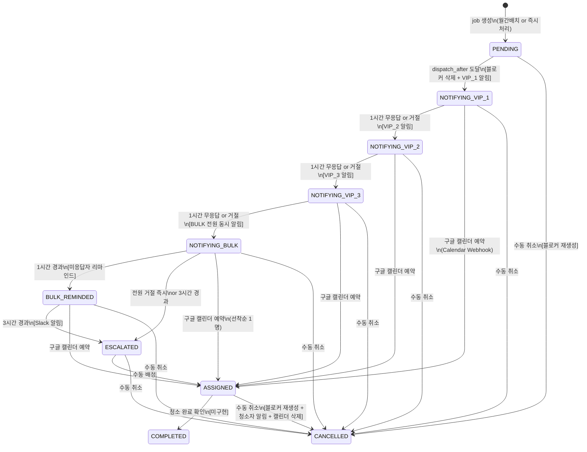
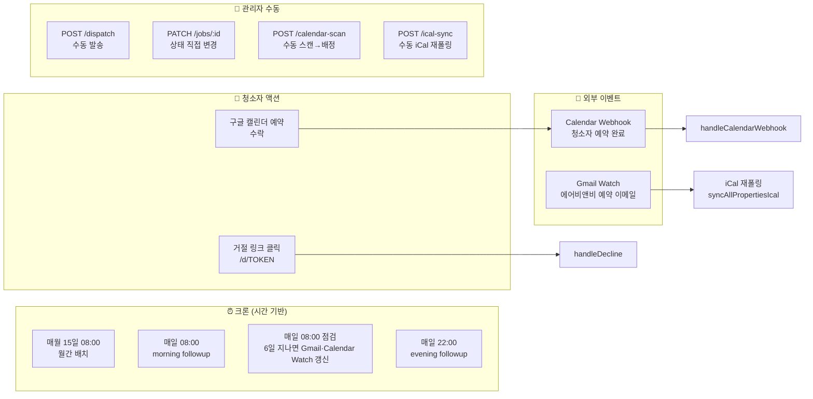
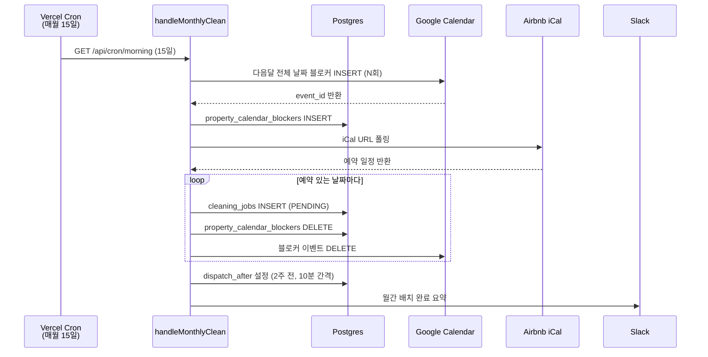
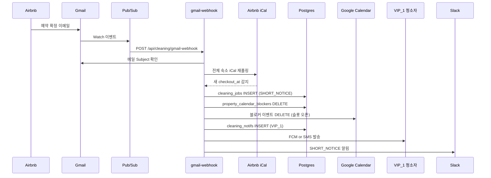
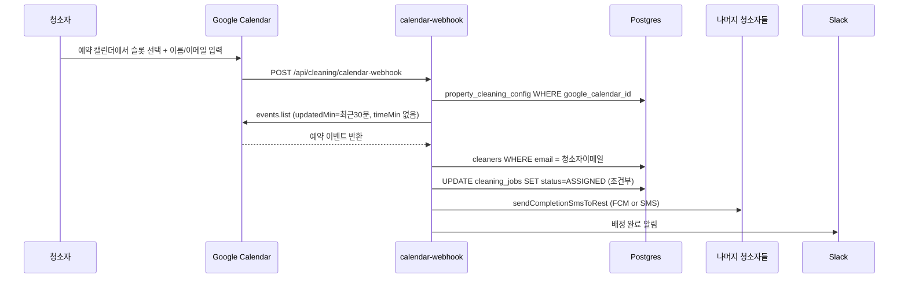
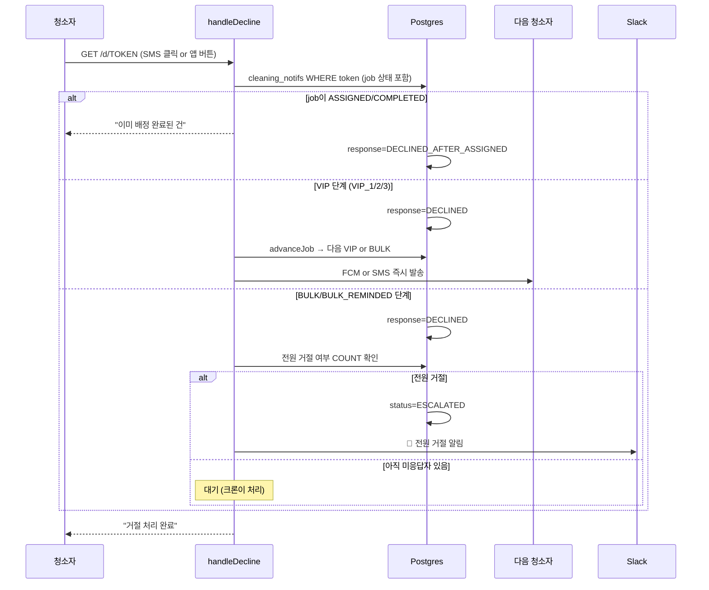
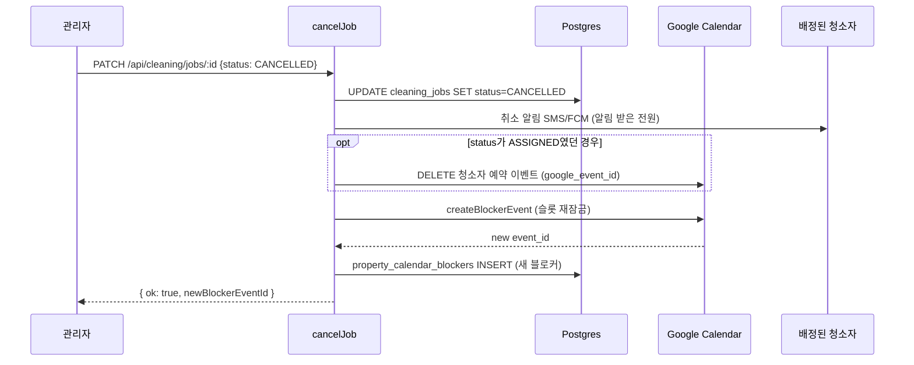

# PROPOS 청소 자동화 — 시나리오 매트릭스

> 작성: 2026-09-05 | 최종 검토: 2026-09-05 | **버그 수정: 2026-09-05** | 2026-11-26 갱신: 예약 취소 자동 반영(RF-16)·후속 처리 주기·운영 API 로그인·예시의 캘린더 ID | 목적: 시나리오 미스·데이터 불일치 방지를 위한 완전 명세
>
> **설계 원칙**: 이 문서는 MD 설계(cleaning-automation-design.md), 실제 코드, 운영 관찰값 세 계층을 교차 검증한 결과다.
> 시나리오가 하나라도 누락되면 데이터 정합성이 깨진다. 기능이 없는 것보다 나쁜 상태가 된다.
>
> **방법론**: Event Storming(도메인 이벤트 → 커맨드 → 사이드 이펙트) + State Machine Specification(상태·전이·가드·이펙트) 적용
>
> ### 이슈 이력 (2026-09-05 검토 → 수정 완료)
> | ID | 심각도 | 요약 | 상태 |
> |----|--------|------|------|
> | BUG-001 | 🔴 CRITICAL | ESCALATED 타이밍: VIP 3단계 모두 소진 시 BULK 발송 즉시 ESCALATED 처리됨 | ✅ 수정됨 (`WHERE tier='BULK'`) |
> | BUG-002 | 🟡 MED | 2주 초과 신규 예약(MONTHLY_BATCH) 시 블로커가 dispatch_after 도달 전에 삭제됨 | ✅ 수정됨 (SHORT_NOTICE만 즉시 삭제) |
> | BUG-003 | 🟡 MED | 청소 종료 시간 이후 Webhook 도착 시 이벤트 조회 불가 | ✅ 수정됨 (timeMin 제거) |
> | GAP-001 | 🔴 HIGH | Calendar Watch 7일 만료 자동 갱신 없음 | ✅ 수정됨 (월요일 크론에 추가) |
> | GAP-003 | 🟡 MED | 취소 시 청소자 알림 없음 + ASSIGNED 취소 시 캘린더 예약 미삭제 | ✅ 수정됨 (cancelJob에 notify + 캘린더 삭제 추가) |
> | GAP-004 | 🟡 MED | 수동 PATCH ASSIGNED 시 완료 알림 누락 | ✅ 수정됨 (sendCompletionSmsToRest 추가) |
> | CONFIRM | ✅ 무해 | GAP-008(advanceJob 재귀 deleteBlocker 미전달): PENDING 가드로 1회만 실행 — 실질 무해 | 닫힘 |

---

## 목차

1. [상태 머신 전체도](#1-상태-머신-전체도)
2. [트리거 분류](#2-트리거-분류)
3. [시나리오 × 데이터 변화 완전표](#3-시나리오--데이터-변화-완전표)
4. [시나리오별 시퀀스 다이어그램](#4-시나리오별-시퀀스-다이어그램)
5. [데이터 정합성 위험 레지스트리](#5-데이터-정합성-위험-레지스트리)
6. [구현 갭 레지스트리](#6-구현-갭-레지스트리)
7. [복구 절차 (운영 SOP)](#7-복구-절차-운영-sop)

---

## 1. 상태 머신 전체도



---

## 2. 트리거 분류



---

## 3. 시나리오 × 데이터 변화 완전표

> 범례: ✅ 구현됨 | ⚠️ 부분 구현 | ❌ 미구현 | 🔴 버그 있음

### 3-1. 신규 예약 감지

| # | 시나리오 | 트리거 | cleaning_jobs | property_calendar_blockers | cleaning_notifs | 기타 |
|---|---------|--------|--------------|--------------------------|----------------|------|
| S01 | 월간 배치 — 다음달 예약 있는 날 | 매월 15일 크론 | INSERT (PENDING, dispatch_after=2주전) | DELETE (예약 날짜) | - | Slack 요약 |
| S02 | 월간 배치 — 예약 없는 날 | 매월 15일 크론 | - | INSERT (블로커 생성) | - | - |
| S03 | 즉시 처리 — 2주 이내 신규 예약 | Gmail Watch → iCal | INSERT (SHORT_NOTICE, dispatch_after=NOW) | DELETE (해당 날짜) | INSERT (VIP_1) | Slack |
| S04 | 2주 초과 신규 예약 (MONTHLY_BATCH) | Gmail Watch → iCal | INSERT (MONTHLY_BATCH, dispatch_after=2주전) | ✅ 블로커 유지 (dispatch_after 도달 시 삭제) | - | 슬롯은 dispatch_after까지 잠금 |
| S05 | Gmail Watch 만료 후 신규 예약 | — | ❌ 감지 못함 | ❌ 블로커 유지됨 | - | **월간 배치까지 대기** |

### 3-2. 알림 발송 흐름

| # | 시나리오 | 트리거 | cleaning_jobs | cleaning_notifs | Google Calendar |
|---|---------|--------|--------------|----------------|----------------|
| S10 | PENDING → VIP_1 발송 | followup 크론 (dispatch_after 도달) | status=NOTIFYING_VIP_1 | INSERT (tier=VIP_1) | 블로커 DELETE |
| S11 | VIP_1 1시간 무응답 → VIP_2 | followup 크론 | status=NOTIFYING_VIP_2 | INSERT (tier=VIP_2) | - |
| S12 | VIP_2 1시간 무응답 → VIP_3 | followup 크론 | status=NOTIFYING_VIP_3 | INSERT (tier=VIP_3) | - |
| S13 | VIP_3 1시간 무응답 → BULK | followup 크론 | status=NOTIFYING_BULK | INSERT × N (tier=BULK) | - |
| S14 | BULK 1시간 경과 → 리마인드 | followup 크론 | status=BULK_REMINDED | reminded_at=NOW | - |
| S15 | BULK 발송 3시간 경과 → ESCALATED | followup 크론 | status=ESCALATED | - | Slack 🚨 ✅ BULK 첫 발송 기준 3시간 (BUG-001 수정) |
| S16 | VIP_N 거절 → 즉시 다음 단계 | handleDecline | status 다음 단계로 | response=DECLINED | - |
| S17 | BULK 전원 거절 → 즉시 ESCALATED | handleDecline | status=ESCALATED | response=DECLINED | Slack 🚨 |
| S18 | VIP 없음(해당 티어 청소자 없음) → 자동 스킵 | advanceJob | status 다음 단계로 재귀 | INSERT 없음 | - |

### 3-3. 배정 확정

| # | 시나리오 | 트리거 | cleaning_jobs | cleaning_notifs | 기타 |
|---|---------|--------|--------------|----------------|------|
| S20 | 구글 캘린더 예약 → 자동 ASSIGNED | Calendar Webhook | status=ASSIGNED, assigned_cleaner_id, google_event_id | - | sendCompletionSmsToRest + Slack ✅ |
| S21 | 청소 종료 시간 이후 Webhook 도착 | Calendar Webhook | ✅ timeMin 제거 → 이벤트 정상 조회 (BUG-003 수정) | - | ASSIGNED 자동 처리 |
| S22 | 수동 calendar-scan → ASSIGNED | 관리자 수동 | status=ASSIGNED, google_event_id | - | sendCompletionSmsToRest + Slack ✅ |
| S23 | 수동 PATCH → ASSIGNED | 관리자 수동 | status=ASSIGNED | - | ✅ 완료 알림 자동 발송 (GAP-004 수정) |
| S24 | 미등록 이메일로 예약 → ASSIGNED | Calendar Webhook | status=ASSIGNED, assigned_cleaner_id=NULL | - | Slack ⚠️ 수동확인 요청 |

### 3-4. 취소·변경

| # | 시나리오 | 트리거 | cleaning_jobs | property_calendar_blockers | cleaning_notifs | 기타 |
|---|---------|--------|--------------|--------------------------|----------------|------|
| S30 | PENDING~ESCALATED 취소 | 관리자 수동 PATCH | status=CANCELLED | INSERT (블로커 재생성) | - | ✅ 알림 받은 청소자에게 "취소됐습니다" 알림 발송 (GAP-003 수정) |
| S31 | ASSIGNED 취소 | 관리자 수동 PATCH | status=CANCELLED | INSERT (블로커 재생성) | - | ✅ 청소자 취소 알림 + 구글 캘린더 예약 이벤트 삭제 (GAP-003 수정) |
| S32 | 에어비앤비 예약 취소 | 예약 동기화(하루 두 번·Gmail) | ✅ 예약은 연속 두 번 안 보이고 1시간 지나면 CANCELLED(RF-16). 그 퇴실의 청소 작업은 새 요청을 막고 그대로 둔다 | - | - | 운영자 Slack — 작업 취소는 운영자가 한다(SOP-03) |
| S33 | 에어비앤비 예약 날짜 변경 | 예약 동기화 | ✅ 옛 퇴실의 작업은 "퇴실이 없어진 작업"으로 요청을 막고, 새 퇴실은 새 청소 의무·작업(RF-16, DEC-22) | - | - | 운영자 Slack |

### 3-5. 인프라·토큰 관련

> 전체 정리(토큰 2개의 계정·권한, 갱신 주기, 상태 확인 위치)는 [cleaning-automation-design.md 13-1](cleaning-automation-design.md#13-1-토큰구독-갱신-정리-2026-11-19-코드-기준) — 2026-11-19 갱신.

| # | 시나리오 | 트리거 | 영향 | 복구 방법 |
|---|---------|--------|------|---------|
| S40 | Gmail Watch 만료 (7일) | 아침 정기 작업이 마지막 성공 갱신 뒤 6일 지나면 자동 갱신(요일 기준 아님, 실패 시 다음 날부터 매일 재시도) | ✅ 정상 | 청소 관리 › 숙소 탭 "Gmail Watch 재등록" |
| S41 | GOOGLE_REFRESH_TOKEN(Gmail 계정) 만료 | 비밀번호 변경·접근 해제 등 | ❌ Gmail Watch 갱신 실패 → 예약 메일 알림 정지(실패 경로가 호출될 때 Slack 알림, 같은 실패는 최대 3시간에 한 번). 2026-10-30~11-19 실제 발생(RF-40) | `node scripts/get-refresh-token.mjs --gmail` → `vercel env update GOOGLE_REFRESH_TOKEN production` → 재배포 → "Gmail Watch 재등록" |
| S42 | GOOGLE_CALENDAR_REFRESH_TOKEN(캘린더 계정) 만료 | 비밀번호 변경·접근 해제 등 | ❌ 블로커 생성/삭제 전부 실패(실패 경로가 호출될 때 Slack 알림, 같은 실패는 최대 3시간에 한 번) | `node scripts/get-refresh-token.mjs` → Vercel `GOOGLE_CALENDAR_REFRESH_TOKEN` 교체 → 재배포 → "Calendar Watch 재등록" |
| S43 | Calendar Watch 만료 (7일) | ✅ 아침 정기 작업이 마지막 성공 갱신 뒤 6일 지나면 자동 갱신 (GAP-001 수정, 요일 기준 아님) | ✅ 정상 | "Calendar Watch 재등록" |
| S44 | 블로커 삭제 시 토큰 만료 | — | DB 삭제됨 + Calendar에 블로커 잔류 | blocker-cleanup 실행 |

---

## 4. 시나리오별 시퀀스 다이어그램

### 4-1. 월간 배치 (매월 15일)



### 4-2. 즉시 처리 (SHORT_NOTICE)



### 4-3. 배정 확정 (정상 경로)



### 4-4. 거절 흐름



### 4-5. 취소 흐름



---

## 5. 데이터 정합성 위험 레지스트리

> 3계층 교차 검증: **MD 설계** ↔ **실제 코드** ↔ **운영 관찰값**
> 정합성이 깨지면 기능이 없는 것보다 나쁜 상태가 된다.

### RISK-001 🔴 Google Calendar ↔ DB 블로커 불일치

| 항목 | 내용 |
|------|------|
| **발생 조건** | 블로커 삭제 시 Calendar API 호출 직전 토큰 만료 |
| **현상** | DB `property_calendar_blockers` 삭제됨 + Google Calendar에 블로커 잔류 |
| **결과** | 슬롯이 열리지 않아 청소자 예약 불가 |
| **감지 방법** | `POST /api/cleaning/blocker-cleanup` → scanned vs dbTracked 불일치 |
| **복구** | 토큰 갱신 후 `blocker-cleanup` 실행 |
| **실제 발생** | ✅ 2026-09-05 9/7 건에서 발생 확인 |

### RISK-002 ✅ Calendar Watch 만료 → 자동 배정 끊김 (GAP-001 수정됨)

| 항목 | 내용 |
|------|------|
| **발생 조건** | Calendar Watch 7일 만료 |
| **현상** | 만료 전: 청소자 예약 → Webhook → ASSIGNED 자동 처리 |
| **결과** | ✅ 아침 8시 정기 작업이 매일 확인해 6일이 지나면 자동 갱신 — 정상 운영 |
| **감지 방법** | `GET /api/cleaning/calendar-watch` 상태 확인 |
| **현재 상태** | ✅ 자동 갱신 (GAP-001 수정 완료) |

### RISK-003 ✅ 에어비앤비 예약 취소 → DB 미반영 (RF-16으로 해결, 2026-11-11)

| 항목 | 내용 |
|------|------|
| **발생 조건** | Airbnb에서 예약 취소 발생 |
| **현상** | iCal에서 해당 예약 사라짐. DB cleaning_jobs는 PENDING 유지 |
| **결과** | 실제 존재하지 않는 체크아웃 일정에 청소자 배정 |
| **감지 방법** | iCal 수동 재폴링 후 DB 대조 |
| **복구** | 수동으로 `PATCH /jobs/:id {status: CANCELLED}` |
| **현재 상태** | ✅ 자동 감지(RF-16) — 예약 동기화가 피드에서 연속 두 번 안 보이고 1시간 지난 미래 예약을 CANCELLED로 표시하고, 퇴실이 없어진 청소는 새 요청 없이 운영자에게 Slack. 작업 취소는 운영자가 SOP-03으로 |

### RISK-004 ✅ 수동 PATCH ASSIGNED → 완료 알림 누락 (GAP-004 수정됨)

| 항목 | 내용 |
|------|------|
| **발생 조건** | 관리자가 `PATCH /jobs/:id {status: ASSIGNED, assigned_cleaner_id: ...}` 직접 호출 |
| **현상** | ✅ `sendCompletionSmsToRest` 자동 호출 |
| **결과** | ✅ 다른 알림 받은 청소자들에게 자동 완료 알림 발송 |
| **현재 상태** | ✅ 수정 완료 (GAP-004) |

### RISK-006 ✅ ESCALATED 타이밍 버그 (BUG-001 수정됨)

| 항목 | 내용 |
|------|------|
| **원인** | `MIN(sent_at)` 전체 알림 기준 → VIP_1 발송 3시간 후 = BULK 발송 즉시 ESCALATED |
| **수정** | `WHERE tier='BULK'` 조건 추가 → BULK 첫 발송 기준 3시간으로 변경 |
| **파일** | `api/cron/[...slug].js` ESCALATED 쿼리 |
| **현재 상태** | ✅ 수정 완료 |

---

### RISK-007 ✅ 2주 초과 신규 예약 시 블로커 조기 삭제 (BUG-002 수정됨)

| 항목 | 내용 |
|------|------|
| **원인** | syncAllIcal이 source 무관하게 항상 블로커 삭제 |
| **수정** | `if (source === "SHORT_NOTICE")` 조건 추가 → MONTHLY_BATCH는 블로커 유지, dispatch_after 도달 시 `makeCronBlockerDeleter`가 삭제 |
| **파일** | `api/cleaning/[...slug].js` syncAllPropertiesIcal |
| **현재 상태** | ✅ 수정 완료 |

---

### RISK-008 🟡 BULK 리마인드 중 ASSIGNED 처리 시 불필요 리마인드 발송

| 항목 | 내용 |
|------|------|
| **발생 조건** | followup 크론이 BULK notifs 조회 후 루프 중간에 Calendar Webhook으로 ASSIGNED 처리 |
| **현상** | 이미 배정됐지만 루프에서 이미 조회된 청소자들에게 리마인드 발송 |
| **결과** | "아직 미확정입니다" 문자를 받았지만 이미 다른 청소자 배정 완료 — 혼란 |
| **현재 상태** | 🟢 LOW — 후속 처리는 하루 두 번(08:00·22:00)만 돌아 루프 도중 배정이 끼어들 확률이 낮음 |

---

### RISK-005 ✅ ASSIGNED 취소 → 청소자 캘린더 예약 잔류 (GAP-003 수정됨)

| 항목 | 내용 |
|------|------|
| **원인** | cancelJob이 블로커 재생성만 수행, 청소자 알림·캘린더 삭제 없음 |
| **수정** | cancelJob에 취소 알림 notify 추가 + ASSIGNED 상태 시 `google_event_id` Calendar API DELETE 추가 |
| **파일** | `api/cleaning/[...slug].js` cancelJob |
| **현재 상태** | ✅ 수정 완료 |

---

## 6. 구현 갭 레지스트리

| ID | 설명 | MD 명세 | 코드 상태 | 위험도 | 우선순위 |
|----|------|---------|---------|--------|--------|
| ~~BUG-001~~ | ~~ESCALATED 타이밍~~: VIP 전체 소진 시 BULK 발송 즉시 ESCALATED 처리됨 | BULK 발송 후 3시간 | ✅ `WHERE tier='BULK'` 추가 수정 완료 | 🔴 CRITICAL | ✅ 완료 |
| ~~BUG-002~~ | ~~MONTHLY_BATCH 블로커 조기 삭제~~: 2주 초과 예약 감지 즉시 슬롯 오픈 | dispatch_after 도달 시 삭제 | ✅ `if (source==="SHORT_NOTICE")` 조건 수정 완료 | 🟡 MED | ✅ 완료 |
| ~~BUG-003~~ | ~~Calendar Webhook timeMin 버그~~: 청소 종료 이후 Webhook 처리 불가 | Webhook 자동 처리 | ✅ timeMin 파라미터 제거 수정 완료 | 🔴 HIGH | ✅ 완료 |
| ~~GAP-001~~ | ~~Calendar Watch 7일 만료 자동 갱신 없음~~ | 언급 없음 | ✅ 월요일 크론에 자동 갱신 추가 완료 | 🔴 HIGH | ✅ 완료 |
| ~~GAP-003~~ | ~~취소 시 청소자 알림 없음 + ASSIGNED 캘린더 미삭제~~ | 취소→블로커 재생성만 명시 | ✅ cancelJob에 notify + Calendar DELETE 추가 완료 | 🟡 MED | ✅ 완료 |
| ~~GAP-004~~ | ~~수동 PATCH ASSIGNED 시 완료 알림 누락~~ | Calendar Webhook 경로만 명시 | ✅ PATCH 핸들러에 sendCompletionSmsToRest 추가 완료 | 🟡 MED | ✅ 완료 |
| ~~GAP-005~~ | ~~에어비앤비 예약 취소 자동 감지 없음~~ | 설계 범위 외 명시 | ✅ RF-16(2026-11-11)으로 구현 | 🟡 MED | ✅ 완료 |
| GAP-006 | 블로커 삭제 실패 시 재시도 없음 | 언급 없음 | catch에서 log만 | 🟡 MED | P3 |
| GAP-007 | COMPLETED 상태 전이 로직 없음 | 향후 구현 명시 | 미구현 | 🟢 LOW | P4 |
| ~~GAP-008~~ | ~~SHORT_NOTICE advanceJob deleteBlocker 콜백 없음~~ | - | ✅ PENDING 가드로 1회만 실행 — 무해 확인됨 | — | 닫힘 |

---

## 7. 복구 절차 (운영 SOP)

> **2026-11 이후 운영 API는 로그인이 필요하다** — 2026-11-10~14 관측에서 로그인 없는 호출이 401이었다([MD-R26](../refactoring_mdfile.md#md-r26)). 아래 `curl` 예시는 관리자 로그인 쿠키를 붙여야 동작한다. 가능하면 청소 관리 화면의 같은 기능을 쓴다. `<숙소 구글 캘린더 ID>`는 숙소 설정의 청소 캘린더 ID로 바꾼다.

### SOP-01: 블로커 Calendar ↔ DB 불일치 복구

**감지**: 구글 캘린더에 블로커가 남아있는데 슬롯이 안 열림

```bash
# 1. 토큰 상태 확인
curl https://www.proposonline.com/api/cleaning/gmail-watch

# 2. GOOGLE_CALENDAR_REFRESH_TOKEN 만료 시 → 재발급 후 Vercel 업데이트

# 3. 고아 블로커 정리
curl -X POST https://www.proposonline.com/api/cleaning/blocker-cleanup \
  -H "Content-Type: application/json" \
  -d '{"calendar_id":"<숙소 구글 캘린더 ID>","month":"YYYY-MM"}'

# 응답: { scanned, deleted, dbTracked }
# deleted > 0 이면 복구 완료
```

---

### SOP-02: Calendar Watch 만료 복구

**감지**: 청소자가 예약했는데 시스템이 ASSIGNED 처리를 안 함

```bash
# Watch 갱신
curl -X POST https://www.proposonline.com/api/cleaning/calendar-watch \
  -H "Content-Type: application/json" \
  -d '{"calendar_id":"<숙소 구글 캘린더 ID>"}'

# 수동 스캔으로 즉시 배정 처리
curl -X POST https://www.proposonline.com/api/cleaning/calendar-scan \
  -H "Content-Type: application/json" \
  -d '{"calendar_id":"<숙소 구글 캘린더 ID>","date":"YYYY-MM-DD"}'
```

---

### SOP-03: 에어비앤비 예약 취소 수동 처리

**감지**: 예약 동기화가 "퇴실이 없어진 청소" Slack을 보냈다(RF-16 — 예약은 자동으로 CANCELLED, 청소 작업은 새 요청만 막힌 채 남는다)

```bash
# job 취소 (블로커 자동 재생성 + 청소자 취소 알림 자동 발송)
curl -X PATCH https://www.proposonline.com/api/cleaning/jobs/{JOB_ID} \
  -H "Content-Type: application/json" \
  -d '{"status":"CANCELLED"}'
# ✅ GAP-003 수정됨: 알림 받은 청소자들에게 취소 알림 자동 발송
# ✅ GAP-003 수정됨: ASSIGNED 상태였다면 구글 캘린더 예약 이벤트도 자동 삭제
```

---

### SOP-04: 수동 배정 (PATCH ASSIGNED)

**상황**: calendar-scan이나 수동 PATCH로 ASSIGNED 처리한 경우

```bash
# PATCH 방식 (완료 알림 자동 발송 ✅)
curl -X PATCH https://www.proposonline.com/api/cleaning/jobs/{JOB_ID} \
  -H "Content-Type: application/json" \
  -d '{"status":"ASSIGNED","assigned_cleaner_id":"CLEANER_UUID","google_event_id":"EVENT_ID"}'
# ✅ GAP-004 수정됨: assigned_cleaner_id 제공 시 sendCompletionSmsToRest 자동 호출
```

---

## 부록: 운영 상태 체크 명령어

```bash
# Gmail Watch 상태
curl https://www.proposonline.com/api/cleaning/gmail-watch

# 현재 활성 job 목록
curl https://www.proposonline.com/api/cleaning/jobs

# 특정 날짜 블로커 상태 확인 (GET)
curl "https://www.proposonline.com/api/cleaning/calendar-scan?calendar_id=<숙소 구글 캘린더 ID(URL 인코딩)>&date=YYYY-MM-DD"

# 블로커 정합성 검사
curl -X POST https://www.proposonline.com/api/cleaning/blocker-cleanup \
  -H "Content-Type: application/json" \
  -d '{"calendar_id":"<숙소 구글 캘린더 ID>","month":"YYYY-MM"}'
```

---

---

## 수정 이력

| 날짜 | 수정 내용 | 파일 |
|------|---------|------|
| 2026-09-05 | BUG-001: ESCALATED 쿼리에 `WHERE tier='BULK'` 추가 | `api/cron/[...slug].js` |
| 2026-09-05 | BUG-002: syncAllIcal 블로커 삭제를 SHORT_NOTICE 조건부로 변경 | `api/cleaning/[...slug].js` |
| 2026-09-05 | BUG-003: handleCalendarWebhook의 timeMin 파라미터 제거 | `api/cleaning/[...slug].js` |
| 2026-09-05 | GAP-001: 월요일 크론에 Calendar Watch 자동 갱신 추가 | `api/cron/[...slug].js` |
| 2026-09-05 | GAP-003: cancelJob에 취소 알림 + ASSIGNED 캘린더 이벤트 삭제 추가 | `api/cleaning/[...slug].js` |
| 2026-09-05 | GAP-004: PATCH ASSIGNED 핸들러에 sendCompletionSmsToRest 추가 | `api/cleaning/[...slug].js` |

*이 문서는 코드 변경 시 반드시 갱신해야 한다. 특히 상태 전이 로직, 알림 발송 경로, 토큰 갱신 로직 변경 시.*
