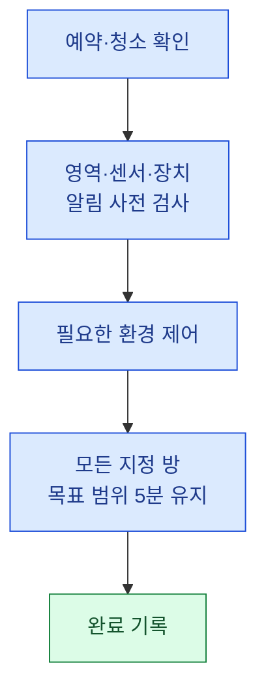

# 센서 기반 입실 준비 명세

버전: 1.0 · 2026-11-06 · 연결: [SC-03 / DEC-01](refactoring.md#dec-01)

**상태:** 사용자 업무 기준을 반영한 로컬 구현·검증 단계. 실제 장치 가동·운영 알림·배포 검증은 완료되지 않았다. 목표·지속 시간은 아래 근거를 참고한 운영 초기값이며 공식 쾌적도 표준의 인증값은 아니다.

## PREP-01 · 사용자가 기대하는 결과

| 요구사항 ID | 사용자 상황 | 시스템의 동작과 확인 방법 |
| --- | --- | --- |
| PREP-REQ-01 | 청소가 끝났고 손님 입실 전 준비할 시간이 있다 | 해당 숙소의 센서·장치·운영자 알림 경로를 먼저 검사한 뒤 필요한 환경 제어를 시작한다. 명령 접수는 완료 증거가 아니다. |
| PREP-REQ-02 | 거실과 침실의 환경이 준비됐다 | 지정한 모든 방의 실제 온도·습도가 목표 범위를 연속 5분 충족했을 때 완료 이벤트를 기록한다. 방 평균으로 나쁜 방을 상쇄하지 않는다. |
| PREP-REQ-03 | 청소 직후 입실해 준비를 시작하지 못했다 | 실제 입실 감지 시 `SKIPPED`를 기록한다. 성공·실패율의 분모에서 제외한다. 시작했다가 장치에 실패한 건은 생략으로 숨기지 않는다. |
| PREP-REQ-04 | 최적화 중 손님이 일찍 도착했다 | 입실 감지와 환경 제어를 독립적으로 처리한다. 입실 때문에 진행 중인 최적화를 중단하지 않는다. 이후 실제 목표 도달을 확인할 수 있다. |
| PREP-REQ-05 | 중요 센서·장치가 끊기거나 제어에 실패했다 | 준비용 환경 장치를 정지시키고 꺼짐 상태를 확인한다. 실패 원인과 정지 미확인 여부를 기록하고 운영자에게 즉시 알림을 시도한다. |
| PREP-REQ-06 | 이미 환경이 적정하다 | 불필요한 냉난방·가습·제습 시작 명령을 보내지 않는다. 동일한 지속 측정 기준으로 환경을 확인하고 `noControlNeeded`를 남긴다. |
| PREP-REQ-07 | 예약이 취소되거나 입실 예정 시각이 바뀐다 | 진행 중 제어를 종료하고 기존 회차를 제외한다. 변경된 예약을 새 시각 기준으로 재평가한다. 입실 전 완료 뒤 취소된 회차도 제외한다. |
| PREP-REQ-08 | 같은 HA에 여러 숙소가 있다 | 센서·환경 장치가 지정 숙소의 HA 영역에 속하는지 확인한다. 다른 숙소 장치에는 시작·정지 명령을 보내지 않는다. |
| PREP-REQ-09 | 프로그램 재시작·장시간 정체가 생긴다 | 진행 중 재시작은 실패로 종료하고 정지를 시도한다. 20분 동안 유의미한 개선이 없거나 최대 120분을 넘으면 실패·정지·알림 처리한다. |
| PREP-REQ-10 | 보고서에서 결과를 확인한다 | KPI·상세·월간 문제·패턴이 같은 회차 계산을 사용한다. 새 센서 회차의 진행·결과 미확인을 실제 장치 실패로 추정하지 않는다. |

다음은 정상 완료 흐름이다. 생략·오류·조기 입실·취소는 위 요구사항 표와 아래 상태 표를 따른다.



## PREP-02 · 날씨와 목표 범위

정본: [preStayOptimizationDomain.js](../src/domain/preStayOptimizationDomain.js)의 `PREPARATION_POLICY`와 `deriveOptimizationTargets`.

| 지역 실외 기온 | 온도 설정 목표 | 방별 완료 온도 범위 | 방별 완료 상대습도 범위 |
| --- | --- | --- | --- |
| 10°C 이하 | 21°C | 20~22°C | 35~50% |
| 10°C 초과·25°C 미만 | 23°C | 22~24°C | 40~55% |
| 25°C 이상 | 25°C | 24~26°C | 40~55% |

- 가습·제습기의 설정 목표는 기본 50%, 실외 습도 80% 이상이면 45%다. 완료 범위를 벗어나지 않게 실제 실내 센서로 확인한다. 높은 실외 습도를 실내 습도 측정값으로 대신 쓰지 않는다.
- 실외 정보는 해당 숙소에 명시적으로 지정된 HA `weather` 엔티티 → 기존 기상청/Open-Meteo 조회 순서다. 정확한 숙소 좌표가 있으면 지역명 지오코딩보다 우선한다. HA의 다른 지역 날씨를 이름만 보고 자동 선택하지 않는다.
- 기상 자료는 원본 관측 시각과 출처를 보존하고 90분을 넘으면 사용하지 않는다. API를 방금 읽었다고 오래된 관측을 새 관측으로 바꾸지 않는다. API 응답은 15분 동안 재사용한다.
- 실외 정보가 없으면 목표 23°C·범위 22~24°C·습도 40~55%를 사용한다. 실내 센서 검증은 생략하지 않는다. 목표는 회차 시작 때 고정해 날씨 변경으로 계속 흔들리지 않게 한다.
- 기본 시작 시점은 예약 입실 60분 전이다. 목표와의 차이가 크면 90분, 매우 크거나 실외가 0°C 이하/35°C 이상이면 120분 전부터 준비한다. 실제 설비 반응 속도를 학습한 예측은 아직 아니다. 청소가 늦게 끝나도 유효한 숙박 기간이고 실제 입실 전이면 준비할 수 있다.

**근거와 판단:** EPA는 실내 상대습도를 60% 미만, 가능하면 30~50%로 관리하도록 안내한다. 본 명세의 35~55% 계절별 허용 범위는 이 상한과 제어 오차를 고려한 프로젝트 운영값이다. DOE의 에너지 안내도 겨울에는 편안한 범위에서 낮게, 여름에는 높게 설정하도록 설명한다. 21/23/25°C와 각 분기점·5분 유지·시간 제한은 해당 문서가 정해 준 값이 아니라 이 프로젝트의 초기 정책이다.

- [EPA 실내 습도 관리](https://www.epa.gov/indoor-air-quality-iaq/biological-contaminants-and-indoor-air-quality)
- [DOE Energy Saver 안내](https://www.energy.gov/sites/default/files/2022-08/energy-saver-guide-2022.pdf)
- [HA Weather 속성과 단위](https://www.home-assistant.io/integrations/weather/)

## PREP-03 · 어떤 센서와 장치를 확인하는가

1. 사람이 주로 머무는 거실과 실제 사용하는 침실 각각에 온도·습도 센서를 연결한다. 욕실·창고·실외·냉장고·CPU 온도는 기본 완료 판정에 포함하지 않는다. 방 이름을 추정해 자동 배정하지 않는다.
2. 사용 중인 방 중 하나라도 센서가 빠지면 정상 숙소 전체를 확인한 것으로 볼 수 없다. 실제 방 구성과 매핑은 설치 정보로 확정한다.
3. 각 센서는 유한한 숫자, 올바른 단위, `unknown/unavailable`이 아닌 상태, 5분 이내 보고 시각을 요구한다. `last_reported`를 우선하고 구형 HA에서만 `last_updated`를 보수적으로 사용한다. 조회 시각으로 덮어쓰지 않는다.
4. 모든 방이 5분 연속 범위 안이어야 한다. 관측 간격이 90초를 넘으면 유지 시간을 다시 센다. 완료 시점의 센서 보고도 최근 90초 이내여야 한다. 같은 오래된 표본을 반복 조회해 완료시키지 않는다.
5. 필요한 냉방·난방 모드가 실제 장치의 `hvac_modes`에 있어야 한다. 장치의 온도 단위가 속성에 없으면 검증된 `climateTemperatureUnit`을 설정해야 한다. 난방 미지원 에어컨에 난방 명령을 보내거나, 겨울에 고정 냉방을 실행하지 않는다.
6. 습도 제어는 등록된 가습기·제습기 또는 지원이 확인된 AC `dry` 모드를 사용한다. 제습으로 온도 하한을 침범할 수 있으면 중단한다. 장치가 없어 목표 달성이 불가능한 건 성공·생략으로 처리하지 않는다.
7. 조명·TV·소음·참고용 전력 센서처럼 온습도 판정에 직접 쓰지 않는 항목이 누락돼도 온습도 성공을 부정하지 않는다. 추가 안전 센서가 필수인 설비를 연결하려면 별도 제어 계약이 필요하다.
8. 센서와 장치는 **등록한 숙소의 HA 영역**에서 조회·제어한다. 종료 요청이 실패하거나 꺼짐이 확인되지 않으면 실패 상태에 `pendingOff`를 남기고 다음 감시 주기에도 정지를 재시도한다. 다음 손님의 입실로 이 기록을 덮어쓰지 않는다.

HA의 `last_reported`는 HA에 상태가 다시 보고된 시각이다. 실제 무선 장치의 측정·통신 주기는 설치 환경에서 검증해야 한다. 보고 주기가 긴 센서의 값을 임의로 최신 상태로 만들어 제어하지 않는다. [HA 상태 시각 설명](https://www.home-assistant.io/docs/configuration/state_object/)

<a id="prep-04"></a>

## PREP-04 · 상태·저장·보고서 계약

| 실행 상태 | 이벤트 | 집계 |
| --- | --- | --- |
| `PREPARING` | `checkin_prep_time_reached` | 최종 결과 확인 전 성공·실패 분모에 넣지 않음 |
| `COMPLETED` | `optimization_finished` | 센서 확인 완료 1건 |
| `FAILED` | `optimization_failed` | 명시적 실패 1건·원인 보존 |
| `SKIPPED` | `optimization_skipped` | 준비 전 입실. 분모 제외·생략 건수 별도 보존 |
| `CANCELLED` | `optimization_cancelled` | 취소·시각 변경된 준비 회차 제외 |
| 결과 기록 미확인 | 완료·실패·취소가 연결되지 않음 | `preStayUnconfirmed`로 보존. 장치 실패로 추정하지 않음 |

- 기존 `events` 테이블과 JSONB `data`를 사용한다. 스키마 변경이 없다. `data.preparationPolicy = sensor-v1`, `optimizationRunId`, `reservationKey`, `propertyId`, 목표·센서값·원인을 기록한다.
- `optimizationRunId`는 제어 회차 ID다. `source_ref = optimization:<회차 ID>:<이벤트 종류>`는 출처 추적 참조다. `source_ref`를 예약/회차 연결 키로 해석하지 않는다.
- `events.status`는 수신 파이프라인 상태다. **준비의 성공/실패는 `data.status`와 업무 이벤트로 판단**한다. 두 상태를 혼용하지 않는다.
- 새 센서 회차는 같은 숙소·같은 `optimizationRunId`의 결과만 연결한다. 조기 입실 후 완료와 주·월 경계를 허용하며, 준비 시작 기간에 귀속한다. 취소는 분모에서 제외한다.
- 버전 정보가 없는 과거 이벤트는 승인 A안(다음 준비/입실 전 첫 완료)을 유지한다. 과거 시간 기반 완료 기록을 센서 검증 성공으로 소급 해석하지 않는다.
- 현재 표시 상태는 같은 REAL 숙소·예약의 워처 회차가 있을 때 실제 워처 결과를 사용한다. 예약 타임라인의 과거/미래 막대는 계속 예약 기반 재구성·예측이며 물리 환경의 측정 증거가 아니다. 브라우저의 캘린더 예측으로 워처 완료를 쓰거나 HA 영역 전체를 켜지 않는다.
- 진행 상태·안전 재시도는 기존 Pi `data/monitoring-state.json`에 저장한다. 확정 업무 이벤트는 기존 수신 API를 통해 Postgres에 저장한다. 로컬·운영 API/DB 구조를 분리하지 않는다. SIMULATED 입력은 실제 기기 제어를 실행하지 않는다.
- 신규 센서 이벤트는 같은 상태 파일의 `preparationOutbox`에 먼저 보관한다. 통신 실패·HTTP 오류 시 원래 발생 시각과 출처 참조를 유지해 재전송하며, 성공 응답 뒤에만 제거한다. 기존 DB 중복 키를 그대로 사용한다. 상태 파일은 임시 파일 작성 후 교체하며, 상태 저장 실패 시 환경 제어 시작을 막는다. 기존 Pi의 일반 이벤트 요청 형식은 유지한다.
- 목표 경계의 작은 변동으로 냉난방기가 빠르게 재가동되지 않도록 정지 후 최소 5분을 기다린다. 실제 설비의 제조사 제한이 더 길면 그 기준을 적용해야 한다. 이 초기값은 제조사별 안전 인증을 대신하지 않는다.

## PREP-05 · 설정 예시와 실제 적용 조건

아래는 **가상 엔티티 이름으로 작성한 설정 예시**다. 실제 파일·HA 설정에 적용한 값이 아니다.

```json
{
  "optimization": {
    "location": { "name": "숙소 위치", "latitude": 37.7, "longitude": 126.7 },
    "operatorNotifyService": "notify.mobile_app_operator",
    "rooms": [
      { "id": "living", "temperatureEntity": "sensor.living_temperature", "humidityEntity": "sensor.living_humidity", "climateEntity": "climate.living", "climateTemperatureUnit": "°C" },
      { "id": "bedroom", "temperatureEntity": "sensor.bedroom_temperature", "humidityEntity": "sensor.bedroom_humidity", "climateEntity": "climate.bedroom", "climateTemperatureUnit": "°C" }
    ]
  }
}
```

`weatherEntity`, `humidifierEntity`, `dehumidifierEntity`는 실제 해당 기능이 연결됐을 때 설정한다. 좌표와 날씨 엔티티가 모두 있으면 해당 날씨 엔티티를 먼저 사용하므로, 그 위치가 숙소와 같은지 먼저 확인한다. 알림 서비스는 HA 등록 여부를 검사하되, 휴대폰 실제 수신은 별도 확인해야 한다.

운영자 알림은 지정한 HA 알림 서비스 또는 기존 `PROPOS_SLACK_WEBHOOK` 중 하나 이상이 설정돼야 제어를 허용한다. 안전 중단 시 HA 알림과 설정된 Slack을 함께 시도한다. HA 자체 장애에서도 독립된 Slack 경로를 사용할 수 있으며, HA의 영구 알림만 만들어진 것을 휴대폰 전달 성공으로 세지 않는다. 두 실시간 경로가 모두 실패하면 다음 감시 주기에 재시도한다. 이번 작업에서 실제 알림이나 환경변수 교체를 실행하지 않았다.

**2026-11-05 읽기 전용 HA 확인 결과:** 파주201 영역에는 거실·안방창고·2번방 온습도 센서가 등록돼 있고, 확인 당시 안방창고·2번방은 `unavailable`이었다. 해당 영역에 `climate`/`humidifier` 장치는 없었다. HA 전체에서 발견한 에어컨은 다른 영역 소속이며 난방을 지원하지 않았다. 날씨에는 수지구 엔티티도 있어 파주 날씨로 사용할 근거가 없다. 기존 Pi 모니터링 설정에는 환경 제어 매핑이 없고 지역명도 비어 있었다. 모바일 전용 알림 서비스는 등록 목록에서 확인되지 않았다. 이 스냅샷은 현재 상태가 영구히 같다는 뜻이 아니다.

따라서 실제 가동 전에는 올바른 숙소의 장치 연결, 사용하는 방·센서 확정, 센서 보고 주기 개선/확인, 파주 좌표 또는 검증된 날씨 엔티티, 운영자 알림 수신 경로를 갖춰야 한다. 자동으로 다른 영역 장치를 가져와 설정하지 않았다.

전원 단절·프로세스 강제 종료·HA 자체 장애에서는 Pi 코드가 물리적 정지를 보장할 수 없다. 실제 무인 운영에는 HA/장치 측의 독립된 최대 가동 제한과 센서 단절 시 정지 장치를 함께 확인해야 한다. 이 문서와 로컬 테스트만으로 그 하드웨어 보호가 설치됐다고 판단하지 않는다.

로컬은 빠른 UI 확인을 위한 접속 경로이며 운영과 시스템·데이터를 나누지 않는다. ACT-01에서 Vite의 워처 자동 시작과 브라우저 대체 제어를 제거하고, 로컬 dev·preview의 모든 서비스 API를 운영 Vercel API로 중계하도록 변경했다. 양쪽 화면은 운영의 DB·인증·Google 토큰·숙소별 지정 Pi 설정을 사용한다. 명시적 DEMO fixture만 별도로 유지한다.

청소·정비 버튼은 `POST /api/monitoring/event?watcherId=...`에 작업 종류와 숙소 식별자를 보내며, Pi가 상태 전환·센서 준비와 같은 직렬 경로에서 처리한다. 브라우저가 달력 예측으로 준비 상태를 덮어쓰지 않는다. 다른 숙소·중복 전환·임의 완료 이벤트는 거절하며, 연결 실패 시 로컬/브라우저 제어로 대체하지 않는다. 기존 Pi `/state`·`/config` 형식은 호환성을 위해 유지한다.

이 코드는 작업 트리에서 검증했으며 미커밋·미배포다. 반영은 Pi와 신규 이벤트 처리기 → Vercel API·UI → 로컬 서버 재시작 순서로 진행해야 한다. 구형 Pi/API의 `/event` 미지원은 실패로 드러나며, 기존 상태 쓰기로 우회하지 않는다. 현장에서 두 Pi 프로세스가 동시에 실행되지 않는지는 별도 확인이 필요하다. 분산 제어권 임대·HA 자체 안전 자동화의 신규 배포는 포함하지 않았다. [ACT-01 적용 기록](refactoring.md#act-01)

<a id="prep-06"></a>

## PREP-06 · 검증과 구현 위치

| 검증 범위 | 실제 구현·테스트 |
| --- | --- |
| 목표·단위·방별 판정·안전 시간 | [도메인](../src/domain/preStayOptimizationDomain.js), [s96](../tests/unit/s96.sensor-preparation.test.js) |
| 제어·정지·복구·생략·취소·조기 입실 | [컨트롤러](../src/application/preStayOptimizationController.js), s96 |
| 실제 워처의 시간 기반 거짓 완료 방지 | [워처](../server/occupancyWatcher.js), [s97](../tests/unit/s97.preparation-watcher.test.js), [s20](../tests/unit/s20.occupancy-watcher.test.js) |
| KPI·상세·캘린더 일치·구형 A안 보존 | [회차 계산](../src/domain/metricDrilldownDomain.js), [s98](../tests/unit/s98.sensor-preparation-report.test.js), [s94](../tests/unit/s94.pre-stay-consistency.test.js) |
| 실제 PostgreSQL 조회 SQL·기간 밖 연결 | [저장소](../src/infrastructure/eventRepository.js), [s95](../tests/integration/s95.pre-stay-context.test.js) — `BEGIN READ ONLY`·JSON fixture |
| 날씨 시각·좌표·알림 서비스 | [어댑터](../server/preparationAdapters.js), [s99](../tests/unit/s99.preparation-adapters.test.js) |

```sh
node --test tests/unit/s96.sensor-preparation.test.js tests/unit/s97.preparation-watcher.test.js tests/unit/s98.sensor-preparation-report.test.js tests/unit/s99.preparation-adapters.test.js
RUN_LIVE_DB=1 node --test tests/integration/s95.pre-stay-context.test.js
```

테스트는 실제 구현을 호출하고 장치/날씨/알림만 가짜 응답으로 대체한다. 장치 명령과 실제 운영 알림은 전송하지 않는다. 통합 테스트는 운영 이벤트 테이블을 읽거나 수정하지 않고 JSON CTE로 저장소 SQL을 실행한다.

### 2026-11-06 검증 결과

| 검사 | 확인한 결과 |
| --- | --- |
| 수정 전 재현 | 실제 워처가 센서 없이 T−20분에 OPTIMIZED가 되는 회귀 테스트 실패 확인. 신규 보고서 사례는 수정 전 6개 중 5개 실패·구형 A안 보존 사례 1개 통과 |
| 신규 회귀 s96~s99 | 51개 통과. 실제 도메인·컨트롤러·워처·API 서비스·어댑터 호출 |
| 전체 `npm test` | 총 2,695개 중 통과 2,693·일반 실패 0·기존 TODO 2. TODO를 해결한 것으로 표시하지 않음 |
| 실제 PostgreSQL SQL | `BEGIN READ ONLY`·JSON CTE fixture로 20개 통과. 운영 테이블의 이벤트 행 조회·수정 없음 |
| 빌드 | 임시 출력 디렉터리에서 통과. 저장소 `dist/`를 변경하지 않음 |
| 문서 | 두 문서의 Mermaid 도식 총 8개 렌더링. 1440px/390px 미리보기, 링크·ID·표 구조 확인 |
| ACT-01 후속 전체 검사 | `s100`~`s102`의 중계·인증·청소/정비·중복/타 숙소·장애·종료 경합 검증 포함. 총 2,708개 중 통과 2,706·일반 실패 0·기존 TODO 2. 임시 출력 빌드 통과 |
| 투숙 중 배포 준비 | `s103`에서 실제 워처의 체류 상태 시작·종료 시 장치 제어·준비 시작·이벤트·알림 없음 확인. 최종 전체 2,710개 중 통과 2,708·일반 실패 0·TODO 2. 외부/API 차단 브라우저 smoke 1개와 시나리오·배포 검사 통과. 실제 Pi 읽기에서는 체류·연결 정상 확인. Pi 접속 권한 확인 중이며 운영 반영 완료를 뜻하지 않음 |

이전 A안 16개 회귀 사례와 기존 출처 보존 테스트를 함께 통과했다. 기존 시각 기반 완료·준비 중 입실 무시 테스트는 이번 사용자 요구에 맞춰 변경했고, 숙박 기간이 끝난 예약의 시작 방지와 아직 유효한 예약의 늦은 준비를 나눠 검증했다. 현재 상태의 숙소별 반복 조회 방지 검사는 문자열 검사 대신 실제 서비스의 질의 수를 1곳/20곳 입력으로 확인하도록 보강했다. 기대값을 낮춰 기존 오류를 숨긴 변경은 아니다.

실제 Pi 배포·현장 온습도 도달·운영자 실제 수신·하드웨어 정지 보호·동시 제어자 부재는 미검증이다. 단위·모의 테스트와 읽기 전용 HA 조회만으로 실제 운영 전체의 무결성을 단정하지 않는다.
