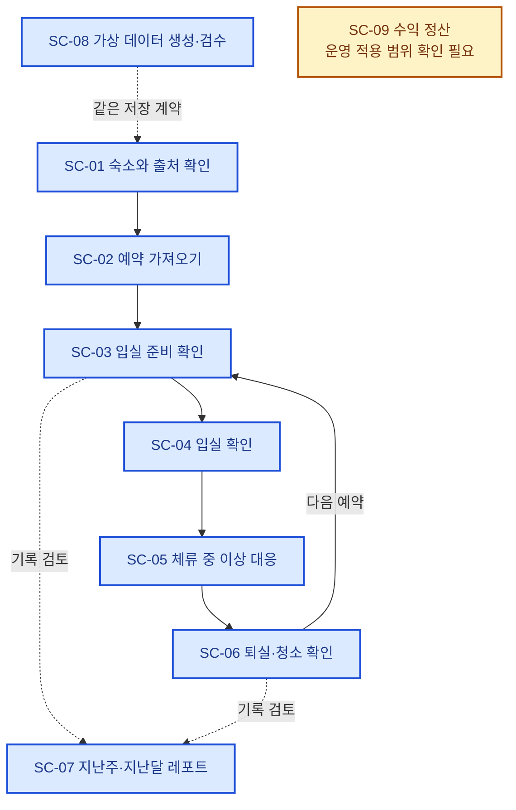
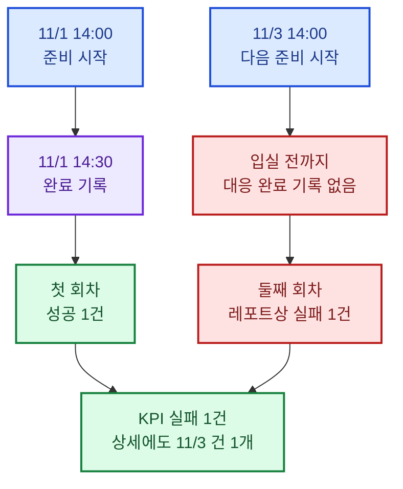
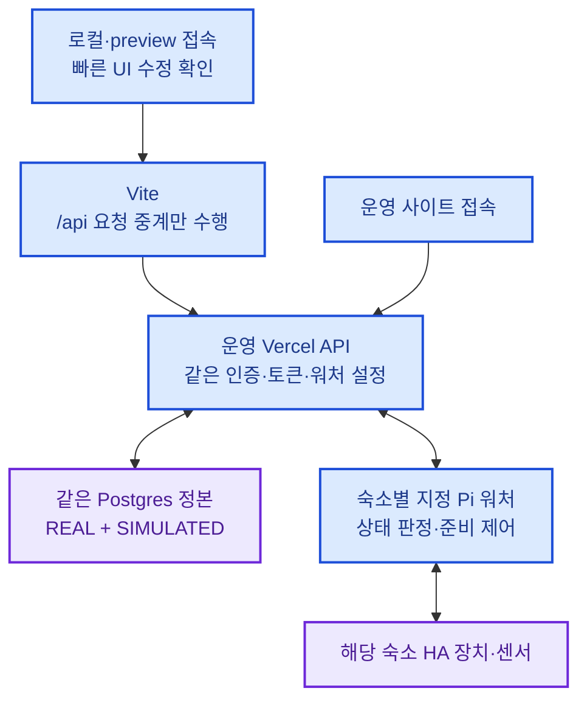
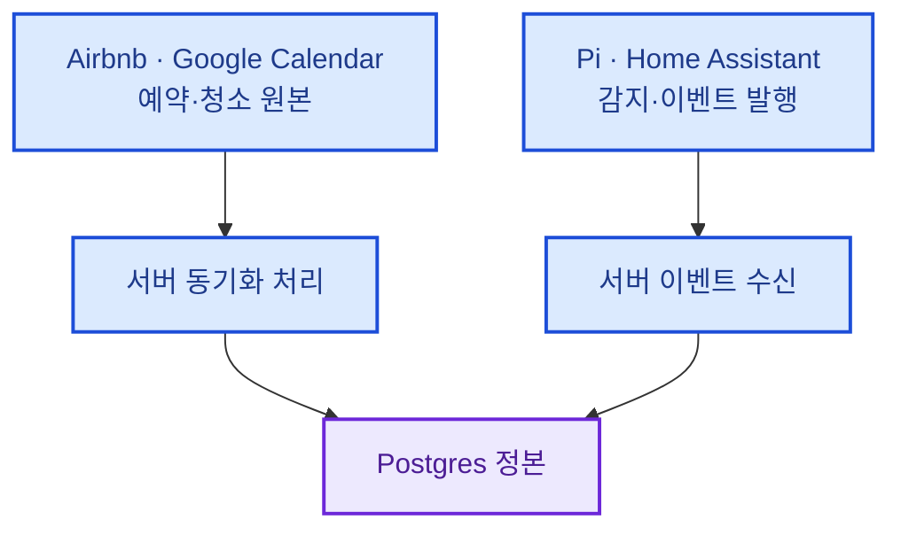
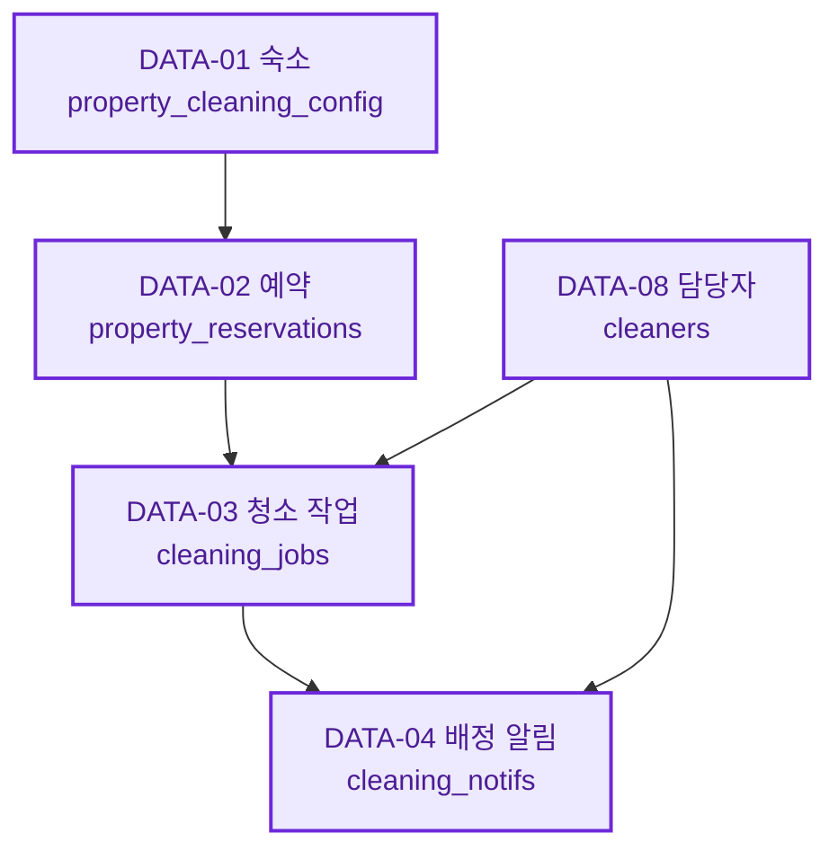
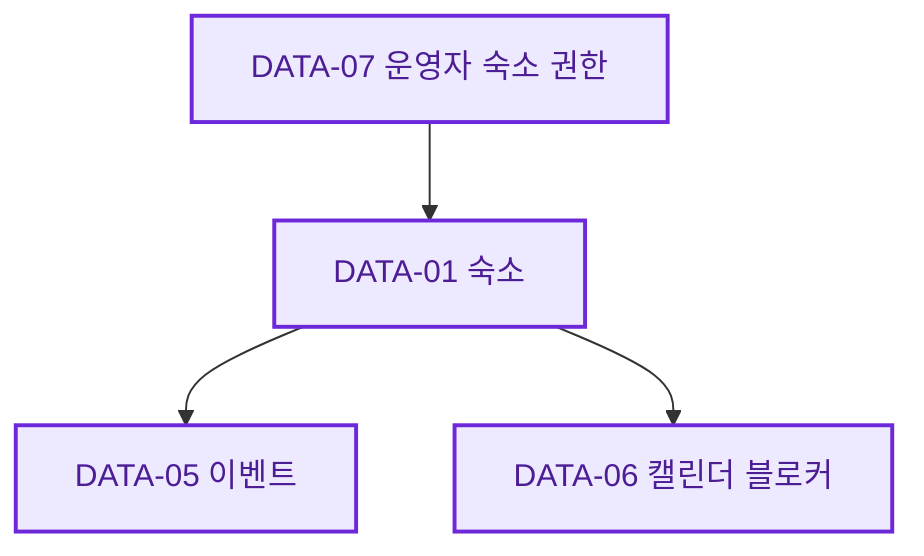
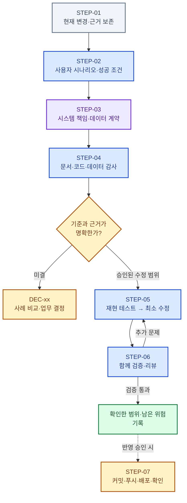
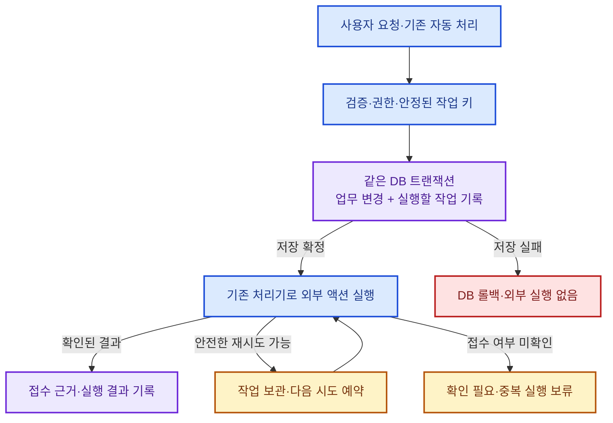

# 리팩토링

> 작성 기준 2026-11-14 · 기준 초안 v0.48 · **RF-14·RF-13·RF-05.1·RF-05.3 운영 반영 완료 / RF-05.2 관계 감사 완료** · 배포 단위·근거는 [운영 기록](#rollout-20261114), 다음 작업은 RF-05.4
>
> 목적: 요구사항·사용자 시나리오·시스템 책임·데이터 계약을 먼저 정리하고, 이를 근거로 코드를 점진적으로 개선한다.
>
> 이 문서는 감사 결과, 사용자 결정, 적용 상태를 연결하는 기준 문서다. 기존 분야별 정본을 전부 대체하지 않는다. 미결 사항을 현재 코드나 과거 설명에 맞춰 임의로 확정하지 않는다.

<a id="sec-01"></a>

## SEC-01 · 이 문서를 읽는 방법

**운영자가 어떤 일을 하려는지 먼저 읽고, 그 일을 뒷받침하는 시스템·데이터·코드를 따라간다.**

| 알고 싶은 것 | 바로 가기 |
| --- | --- |
| 완료한 일, 진행 중인 일, 다음 할 일은 무엇인가? | [SEC-02 작업 현황](#sec-02) |
| 사용자가 직접 확인하거나 결정할 일은 무엇인가? | [사용자 할 일](#user-actions) |
| 숙소 운영자가 실제로 어떤 일을 하는가? | [SEC-03 사용자 시나리오](#sec-03) |
| 데이터는 어디에 저장되고 어떻게 연결되는가? | [SEC-06 시스템·데이터](#sec-06) |
| 어떤 문제가 확인됐고 무엇이 남았는가? | [SEC-08 발견 사항](#sec-08) |
| 장애가 나도 데이터·실행 결과를 신뢰하려면 무엇을 공통화하는가? | [SEC-13 최소 신뢰성 구조](#sec-13) |
| 다음에 무엇을 결정하고 어떤 순서로 개선하는가? | [SEC-10 결정과 진행 순서](#sec-10) |
| 판단의 코드·문서·테스트 근거는 무엇인가? | [SEC-05 조사 범위](#sec-05), [SEC-07 기술 추적표](#sec-07) |

### 색상의 의미

색상은 다음 의미로만 사용한다. **REAL과 SIMULATED의 품질 차이를 색으로 표현하지 않는다.** 두 종류 모두 같은 데이터 계약을 따른다.

| 표시 | 의미 | 읽을 때 주의할 점 |
| --- | --- | --- |
| 🔵 파랑 | 사용자 행동·합의한 업무 기준 | 사용자가 하려는 일, 시스템이 따라야 할 규칙 |
| 🟣 보라 | 저장 정본·업무 객체 | 어떤 데이터가 어디에 저장되고 참조되는가 |
| 🟢 초록 | 성공 결과·검증 통과 | 설명용 예시인지 실제 검증 이력인지 확인. 로컬 완료와 운영 반영도 구분 |
| 🟡 노랑 | 결정·검증 대기 | 사실이 부족하거나 정책 승인이 필요한 부분 |
| 🔴 빨강 | 확인된 문제·레포트상 실패 | 실제 작업 실패와 완료 기록 누락은 구분 필요 |
| ⚪ 회색 | 과거 이력·캐시·참고 정보 | 현재 운영의 정본이나 완료 증거로 자동 해석하지 않음 |

Mermaid 도식에 같은 색상을 적용했다. 색을 표시하지 않는 Markdown 뷰어에서도 표의 기호와 문구로 상태를 확인할 수 있다.

### ID 사용 규칙

| ID 형식 | 가리키는 항목 | 대화 예시 |
| --- | --- | --- |
| `SEC-01` | 문서의 주요 장 | “SEC-06의 데이터 관계를 보자” |
| `SC-01` | 이 문서의 사용자 시나리오 | “SC-03의 준비 완료 기준을 정하자” |
| `DATA-01` | 저장 객체 | “DATA-03 청소 작업의 필수 관계를 확인하자” |
| `RF-01` | 발견 사항·추가 감사 대상 | “RF-05 검수 공백부터 개선하자” · 확정/미확정 상태를 함께 확인 |
| `DEC-01` | 결정이 필요한 요구사항 | “DEC-01을 먼저 확정하자” |
| `QA-01` | 감사 질문 | “QA-07 테스트가 실제 코드를 검증하는지 보자” |
| `STEP-01` | 개선 진행 단계 | “이 항목은 STEP-04 감사 단계다” |
| `ACT-01` | 구체적인 실행 작업. 완료 후에도 유지 | “ACT-02의 장치·센서 확인부터 진행하자” |

**한 번 부여한 ID는 제목이나 순서가 바뀌어도 유지한다.** 완료된 항목도 ID를 남긴다. 새 항목은 뒤 번호를 부여하고, 합치거나 대체할 때는 원래 ID와 대체 ID를 함께 기록한다.

기존 `scenarios.yaml`의 `S01~S05`, 테스트 파일의 `s93` 같은 번호는 그대로 유지한다. `SC-xx`는 사용자 관점에서 흐름을 읽기 위한 이 문서의 ID이며, 기존 시나리오 ID나 코드 식별자를 바꾼 것이 아니다.

<a id="sec-02"></a>

## SEC-02 · 작업 현황과 할 일

**과거 완료 기록(2026-11-10):** ACT-11/12 최초 요청 추적용 DB·서버 코드와 ACT-15는 `1aed54a`, DEMO 수치는 `f4903be`, 공통 노쇼 안내는 `2381a38`로 운영 반영했다. 당시 전체 2,811개·실제 PostgreSQL 47개 통과, 기존 알림 77건·작업 240건 보존과 지정폰 수신 확인. 이후 진행 상태와 다음 행동은 아래 현재 상태 및 작업표를 따른다. 로그인 후 HTTP·신규 실제 요청 전체 흐름은 별도 미검증 범위다.

**ACT-14 (2026-11-10, Claude):** 레포트 [예정]의 미배정에 "청소 계획 없음"(퇴실은 있는데 청소 작업이 없는 건)을 넣어 대시보드 캘린더 칸과 같은 규칙·같은 함수로 세고, 대시보드에서는 청소 작업 목록을 한 번만 받아 둘이 같이 쓴다. 수정 전 레포트·캘린더 차이를 실제 부품 렌더로 재현(4개 실패)→수정→리뷰 7건 반영. `dc6f7e0` 푸시·운영 반영(운영 JS에 새 코드 확인, 공개 HTTP 200/308/401 정상). **DEC-05 (2026-11-11, 사용자가 결정 위임):** 퇴실 하나에 청소 작업 하나를 맞춘다 — 퇴실과 맞지 않는 살아 있는 작업은 배정 숫자에서 빼고 "퇴실 없는 청소"로 따로 보이고, 같은 숙소·같은 날 예약 여러 건은 입실·퇴실 1건. 전체 2,840개 전부 통과·TODO 0. 이 과정에서 **예약 취소가 DB 예약표·청소 작업에 전혀 반영되지 않는 것**을 확인해 RF-16으로 넓혔다. [결과](#act14-result)

- **RF-06 반영 이력** — 인증·큐 개선은 기존 반영 완료 이력을 따른다. 11월 14일 현재 Pi 발행·운영 주소·격리 SQL을 다시 대조했고, RF-06.4는 구형 입구를 사용·재도입할 때 다룰 유지보수 항목으로 분류했다. 현재 사용 경로 감사는 완료다. [최신 대조](event-ingestion-audit.md#rf-06-current-path-review)
- **구조 기준:** [ACT-09](#act-09)의 최소 신뢰성 명세는 완료 상태를 유지한다. 범용 엔진을 새로 만들지 않고, 실사용 경로와 외부 접수/복구 근거를 조사한 뒤 한 경로씩 적용한다. [판단과 구조](#sec-13)
- **반영 완료:** 운영 API READY·운영 도메인 연결을 확인한 뒤 Pi 워처 파일 1개를 백업·교체·재시작했다. 워처 1개·체류/연결 정상·대기/거절 0·보호 설정 보존을 확인했다. [배포·복구 근거](event-ingestion-audit.md#rf-06-rollout)
- **실장치 기초 시험 완료:** 사용자 빈 숙소 확인·욕실 한 채널 제어 승인으로 18:36 KST `거실욕실 2구 switch` 1번의 켜기·동일 명령 재전송·끄기를 수행했다. HA REST/변경 보고 일치·원래 꺼짐 복구·다른 6채널과 기존 설정 보존·Pi 정상 확인. ACT-05의 자동 준비/센서·안전 정지 전체 검증은 별도다. [시험 기록](pre-stay-field-review.md#bathroom-switch-test-20261109)
- **최신 조사 결과:** 발송 실패 후 응답 대기 전환, 결과 저장 실패/동시 호출의 중복 발송, 동시 취소 덮어쓰기 등을 실제 함수로 재현했다. 연결된 DB 알림 77개 중 channel NULL 75개는 실패로 단정하거나 재발송하지 않는다. 기존 notifs를 활용한 최소 저장·선점·접수 결과·복구 계약을 정리했다. [ACT-10 결과](cleaning-notification-reliability-audit.md#act10-scope)
- **확인된 결함 수정:** [ACT-11 결과](cleaning-notification-reliability-audit.md#act11-implementation)에 F01~F07의 최초 VIP 요청 전후 비교·실제 구현 회귀·리뷰·남은 한계를 기록했다. 접수 후 상태 투영 실패는 재발송 없이 복구하고, 결과 미확인은 보관·보류한다. 기존 BULK/리마인드/완료·취소 알림 전체를 새 기록으로 이관한 것은 아니다.
- **현재 상태 / 다음 ID는 하나 · 2026-11-14** — RF-14·RF-13·RF-05.1·RF-05.3을 분리해 운영 READY·CI success까지 확인했다. RF-05.2는 실제 READ ONLY 집계·정본·저장 경로 대조를 완료했다. seed의 연결 고정 문제는 RF-05.3에서 최소 수정·장애 회귀를 마쳤다. **다음 개발자 작업은 RF-05.4의 가상 담당자 생성·저장·검수 계약 보완**이다. 현재 사용자가 골라야 할 선택지는 없다. [관계 감사·저장 결과](#rf05-assignment-relations), [단위별 배포](#rollout-20261114)
- **토큰 API·테스트폰 확인 완료 (2026-11-09~10):** 앱 1.0→1.0.1(계정·서명 유지)과 토큰 API 반영 이력에 이어 11월 10일 20:55 KST 별도 시험 1회에서 Firebase 접수·실수신·앱 열기를 확인했다. 1차 접수 미확인 발송을 자동 재시도한 것이 아니다. 이후 최초 요청용 DB·서버 코드는 ACT-12에서 별도로 반영했다. [실기 결과](cleaning-notification-reliability-audit.md#act11-phone-receipt)
- **이번 코드 보완·운영 반영 완료:** [ACT-15](#act-15)의 미래 청소 표시·cursor를 다음 입실에서 함께 끊어 다음 예약이 빠지지 않도록 했다. 실제 DB 일정·청소 담당자·입실 준비 제어는 바꾸지 않았다. 코드·회귀 후 `1aed54a`로 푸시·운영 반영했다. [검증](#act15-timeline)
- **현장 확인 대기:** 앱에서 적외선 장면의 대상 장치·설치 방·켜기/끄기 분리 여부, 기존 Slack 워크스페이스·채널 이름을 확인한다. 실제 실행·비밀값 전달은 필요 없다. 인증키 교체·기존 코드 운영 재배포·Git 제외는 승인·반영 완료다.
- **전체 리팩토링:** 미완료. 일부 코드 배포 성공을 전체 요구사항·데이터 무결성·모든 운영 시나리오의 검증 완료로 표시하지 않는다.

### 현장 작업 순서 · 실물·수신 대상 확인 대기

현장 항목은 아래 의존 순서를 유지한다. 실제 장치 연결은 선행 정보 대기다. 기존 반영 이력과 RF-16 운영 확인 2/2 완료를 유지한다. RF-14·RF-13은 작업 단위별 푸시·운영 READY·CI 확인을 완료했다. [배포 기록](#rollout-20261114) RF-11은 사용자 선택대로 감사만 기록했다. RF-05.2 감사와 RF-05.3 연결 수정 후 다음 독립 작업은 RF-05.4 담당자 생성·저장 계약 보완이다. SMS 기기·설정은 선행 조건이 아니며 아래 첫 행이 실행 중이라는 뜻은 아니다.

| 순서 | 작업 | 실행 시점 |
| --- | --- | --- |
| **1 · 실물 확인 대기** | **ACT-02 장치·센서·적외선 연결** | 11월 9일 HA 등록·진단 조사 완료. 장면은 물리 장치 상태를 제공하지 않고 후보 진단에도 IR 명령 정의 없음. 앱 설정의 실물 연결·명령 종류와 센서 보고 계약 확인 대기. [근거](pre-stay-field-review.md#ir-readonly-20261109) |
| 2 · 대상 확인 대기 | ACT-03 기존 Slack 경로 | 기존 Slack 우선 확인으로 사용자 선택 완료. 운영 Webhook 설정·공통 발송 함수까지 확인. 실제 워크스페이스·채널명 확인 대기 |
| 3 · 완료 | ACT-06 이벤트 인증 / RF-15 | Git 제외, 새 공유키 반영, 동일 코드 운영 재배포·Pi 재시작 완료. 운영 이전키 401·새키 저장 전 검사 400 확인 |
| 4 · 선행 대기 | ACT-07 실제 장치·센서·날씨·알림 매핑 적용 | [적용 전 비교](pre-stay-field-review.md)에 필요한 근거를 정리했다. 실물 연결·센서 신선도·수신 대상·인증·구체적인 변경 승인이 필요 |
| 5 · 기초 시험 일부 완료 / 본 검증 선행 대기 | ACT-05 실제 장치·안전 정지·기록 검증 | 11월 9일 사용자 빈 숙소 확인·욕실 1채널 제한 승인으로 제어/상태/복구 통과. 자동 준비·안전 정지·기록 연결은 매핑·알림 계약 및 별도 시험 범위 확인 후 진행 |

**‘대기·결정 대기·선행 대기’는 작업이 멈춰 있는 이유이며 실행 순위가 아니다.** 사용자가 이 상태 분류 중 하나를 고를 필요는 없다. DEC-02~04와 나머지 감사는 후순위 목록으로 유지한다. 외부 접속·현장 확인·승인 때문에 위 순서의 작업을 진행할 수 없으면 개발자가 사유를 기록하고, 독립적으로 가능한 작업 중 **다음 실행 ID 하나**를 지정해 이 절을 갱신한다. 대기 중인 변경을 임의로 적용하지 않는다.

### 상태 관리 규칙

**현재 작업 상태의 정본은 아래 ‘완료한 작업’과 ‘다음 할 일과 남은 감사’ 표다.** SEC-08은 발견 근거, SEC-10은 업무 기준과 검증 이력을 설명한다. 과거 기록이 현재 표와 다르면 기록 날짜와 검증 범위를 먼저 대조한다.

| 상태 | 사용 기준 |
| --- | --- |
| 🟢 완료 | 해당 행의 완료 조건을 충족했고 근거가 있다. 코드·배포 완료와 실제 장치 검증 완료는 별도 작업으로 기록한다. |
| 🔵 진행 중 | 담당자가 실제로 작업을 시작했다. 현재 단계·최근 결과·다음 행동을 함께 기록한다. |
| ⚪ 대기 | 아직 시작하지 않았다. 다음 행동이 정해져 있으며 미실행을 진행 중으로 표시하지 않는다. |
| 🟡 결정 대기 | 업무 정책이 미확정이다. 개발자가 사례·선택지·영향을 제시하고 사용자가 결정한다. |
| 🟡 선행 대기 | 앞 작업의 결과 또는 구체적인 변경·시험 범위에 대한 승인이 필요하다. 의존하는 ID를 적는다. |

작업을 시작·중단·완료할 때 담당 개발자가 **ID, 상태, 담당, 다음 행동, 완료 근거, 갱신일**을 함께 갱신한다. 테스트나 배포 시스템이 이 표를 자동으로 갱신하지는 않는다. 기존 표의 공통 기준일은 2026-11-08이며, 이후 갱신한 행에는 해당 날짜를 적는다. 완료 항목도 삭제하거나 ID를 재사용하지 않는다. 문제가 다시 재현되면 근거와 함께 다시 열거나 연결된 후속 ID를 만든다. 단순 작업 목록 등록은 코드·DB·환경변수·장치 제어·배포의 추가 승인이 아니다.

개발자가 아직 비교·검토하지 않은 사항은 개발자 작업으로 관리한다. 기존 기준으로 판정할 수 있는 오류는 회귀·수정·리뷰를 이어간다. 실제 업무 정의의 선택이 필요한 경우에는 구체적인 사용자 사례와 영향 비교를 준비해 질문한다. 선택 실행인 외부 시험·과거 참고 한계도 현재 사용자 승인 대기와 구분해 기록한다.

### 완료한 작업

| ID / 작업 | 상태·담당 | 완료한 범위와 근거 |
| --- | --- | --- |
| [RF-01](#rf-01) 이벤트 출처 보존 | 🟢 완료 · 개발자 | 검증·수신 API·INSERT의 출처 보존, 수정 전 재현·수정 후 회귀 통과, 운영 코드 반영. 과거 DB 행 복구는 범위 밖이다. `e638e65`, s93 |
| [RF-02](#rf-02) 준비 KPI·실패 목록 일치 | 🟢 완료 · 개발자 | 승인 A안·신규 센서 회차의 공통 계산을 KPI·상세·캘린더 문제·패턴에 연결하고 운영 코드 반영. 실제 장치→DB→보고서 확인은 ACT-05에서 수행한다. s94·s95·s98 |
| [RF-03](#rf-03) 준비 집계 명세 정정 | 🟢 완료 · 개발자 | 구형 A안과 신규 센서 회차의 연결·집계 기준을 정본 문서에 반영. 과거 데이터 소급 재분류 없음 |
| [DEC-01](#dec-01) / [RF-07](#rf-07) 센서 준비 기준·코드 | 🟢 완료 · 사용자 기준 확정 / 개발자 구현 | 센서 목표·연속 유지, 사전 검사, 중요 오류 정지, 생략, 조기 입실 후 계속 진행을 구현·모의 검증하고 Pi·운영 코드 반영. **실제 가동 완료는 ACT-05가 담당한다.** s96~s99 |
| <a id="act-01"></a>**ACT-01** 로컬·운영 제어 경로 통일 | 🟢 완료 · 개발자 | 공통 운영 API→지정 Pi로 통일. 로컬 자동 워처·브라우저 대체 제어 제거, 청소·정비 요청을 Pi에서 직렬 처리. s100~s102, 배포 시 대상 Pi 워처 1개 확인. 분산 잠금 구현은 범위 밖이다. |
| <a id="act-04"></a>**ACT-04** 배포·복구 준비 및 반영 | 🟢 완료 · 개발자 / 사용자 배포 승인 | 승인 코드 푸시, Pi 런타임 해시·기존 설정 보존·백업 확인, 운영 READY·읽기 전용 smoke, 최종 CI 통과. 구버전 종료 문제는 s104로 재현·수정 후 반영. [반영 기록](#rollout-record) |
| <a id="act-06"></a>**ACT-06** / [RF-15](#rf-15) 인증키 교체·보호 | 🟢 완료 · 개발자 / 사용자 승인 · 2026-11-08 | Pi Git 제외·0600 환경파일, 새 공유키 Production·Preview 설정과 동일 코드 `d96e9d4` 운영 재배포, Pi 워처 1개·투숙·연결 정상. 운영 도메인에서 이전키 401·새키 400 검증. 실제 업무 이벤트 저장·장치 준비는 ACT-05. [근거](pre-stay-field-review.md#credential-rotation-result) |
| <a id="act-09"></a>**ACT-09** 데이터·액션 최소 신뢰성 구조 명세 | 🟢 문서 완료 · 개발자 · 2026-11-09 | 사용자 요청에 따라 [SEC-13](#sec-13)에 사용자 사례·공통 책임·오류/복구 기준·첫 적용 범위·시기·완료 조건을 명세했다. 실제 공통 모듈·DB/외부 동작은 구현하지 않음 |
| RF-06 승인 코드·운영/Pi 반영 | 🟢 이번 범위 완료 · 개발자 / 사용자 반영 승인 · 2026-11-09 | `435f45f` 입력 검증·일반 이벤트 영속 전송·호환성·인증 보완, 전체 2,755개 통과·기존 TODO 2, CI 성공. 운영 READY와 Pi 파일 해시 19개·워처 1개·체류/연결·설정 보존·읽기 전용 smoke 확인. **RF-06.4 해결 및 실제 업무 이벤트→DB 검증은 제외한다.** [반영 기록](event-ingestion-audit.md#rf-06-rollout) |
| <a id="act-10"></a>**ACT-10** 청소 요청 알림의 저장·실행 경계 조사 | 🟢 조사·분석 완료 · 개발자 · 2026-11-09 | [조사 결과](cleaning-notification-reliability-audit.md): 실제 함수 15개·실제 SELECT 12개로 동시 실행/취소·부분 실패·접수 미확인·타이머를 검증, 기존 104개 통과. 연결된 DB의 키·관계·채널 집계와 기존 저장소 재사용·최소 변경/복구안을 정리. 공급자 운영 계약·DB 운영 대상 일치 확인은 한계로 명시. **코드 개선·실제 알림·운영 전체 검증 완료는 아님** |
| <a id="act-15"></a>**ACT-15** 미래 청소·다음 입실 경계 보완 | 🟢 코드·테스트·리뷰·운영 반영 완료 · 개발자 · 2026-11-10 | 8개 실패를 먼저 재현하고 해결. 신규 9개와 기존을 합쳐 s91 39개 통과. 저장 일정·퇴실 연결 키·충돌 없는 흐름 보존, `1aed54a` 운영 READY·실제 JS 렌더 확인. [근거](#act15-timeline) |

### 다음 할 일과 남은 감사

‘담당’의 개발자는 이 저장소 작업을 진행하는 Codex를 뜻한다. 사용자 판단이 필요한 항목도 개발자가 조사·비교안을 먼저 준비한다. RF 항목은 결함 확인 여부를 [SEC-08](#sec-08)과 함께 읽으며, 미확인 감사 대상을 확정 버그로 간주하지 않는다.

| ID / 할 일 | 상태 | 담당 | 다음 행동 | 완료 조건 / 선행 조건 |
| --- | --- | --- | --- | --- |
| [RF-06](#rf-06) 중 RF-06.4 사용 경로 대조 | 🟢 현재 경로 감사 완료 · 구형 입구 조건부 유지보수 · 2026-11-14 | 개발자 | 현재 Pi `/write`, 구형 주소 404, 실제 INSERT·중복·보고서 조회를 격리 SQL로 확인. [결과](event-ingestion-audit.md#rf-06-current-path-review) | 구형 최종 UPDATE 실패 재현은 보존하며 해당 입구 사용·재도입 시 단계·접수 기록과 함께 다룸. 현재 서비스 진행의 승인 대기로 두지 않음 |
| <a id="act-11"></a>**ACT-11** 최초 청소 요청 알림 한 경로 적용 | 🟢 코드·DB·서버 반영·지정폰 확인 완료 / 🟡 신규 실제 요청 종단 검증 대기 · 2026-11-10 | 개발자 / 사용자 서버 반영·기존 지정폰 시험 승인 | 토큰 API·앱 1.0.1 수신·알림 열기 확인, 최초 요청 DB·서버는 ACT-12에서 `1aed54a`로 반영. [실기](cleaning-notification-reliability-audit.md#act11-phone-receipt), [배포](cleaning-notification-reliability-audit.md#act12-production-rollout) | 신규 추적 요청은 0건으로 자연 발생 업무 전체 검증은 미완료. 강제 토큰 회전·실기 장애 주입·가짜 청소 요청 없음 |
| <a id="act-12"></a>**ACT-12** 신뢰성 적용 QA·복구·승인 반영 | 🟢 이번 운영 반영·검증 범위 완료 / 🟡 로그인 후 HTTP·자연 발생 종단 검증 대기 · 2026-11-10 | 개발자 / 사용자 서버 반영 승인 | `1aed54a` 푸시·Vercel READY·양 도메인·CI 성공. 3열·제약 추가 후 기존 77개 알림·240개 작업 값·키 보존. Chromium 로컬/운영 빌드 렌더·실제 DB 조회 구현/응답 투영 정상. [범위·한계](cleaning-notification-reliability-audit.md#act12-production-rollout) | 관리자 자격증명/로그인 브라우저가 없어 로그인 후 HTTP는 미검증. 새 최초 요청 저장→접수→후속 처리의 자연 발생 확인은 별도. 추가 실발송·업무 데이터 생성 없음 |
| <a id="act-13"></a>**ACT-13** 두 번째 흐름의 검증된 공통 처리만 확장 | 🟡 선행 대기 · ACT-12·실제 중복 근거 · 2026-11-09 | 개발자 / 사용자 적용 범위 승인 | 다음 후보는 예약 동기화. RF-14 감사 등에서 같은 실패·복구 계약이 필요한지 확인 후 재사용 범위만 제안 | 최소 두 실제 사용처의 공통점·차이와 회귀 근거 확보. 필요 없으면 확장하지 않고 사유 기록. IoT 안전 제어는 ACT-02~05의 별도 계약·현장 검증 없이 편입하지 않음 |
| <a id="act-02"></a>**ACT-02** 공간·센서·적외선 연결 확인 | 🟡 선행 대기 · 등록·진단 조사 완료 / 실물 계약 대기 · 2026-11-09 | 개발자 조사 / 사용자 실물 확인 | HA 장면용 객체·IR 후보 진단 5개·공식 버전 소스 확인. 장면의 명령·대상 정의는 미제공, 센서 6개 보고 5분 초과. Tuya/Smart Life의 장면 대상·분리 ON/OFF와 센서 보고 계약 확인. [근거](pre-stay-field-review.md#ir-readonly-20261109) | 실제 센서 보고·사용 공간·명령·정지 확인 계약 확정. 일부 조사 완료를 전체 연결 완료로 표시하지 않음 |
| <a id="act-03"></a>**ACT-03** 날씨·기존 Slack 경로 확인 | 🟡 선행 대기 · 대상 확인 · 2026-11-08 | 개발자 조사 / 사용자 채널 확인 | 파주 날씨 정상. 기존 Slack 우선 확인 선택 반영. Production에는 Webhook만 있고 채널/봇 변수·읽기 연결 없음. 워크스페이스·채널명 질문 발행 | 수신 대상·승인된 연결 방식 확정. Pi 안전 알림은 아직 연결되지 않았으며 실제 시험 발송도 미실행 |
| <a id="act-07"></a>**ACT-07** 실제 최적화 연결 적용 | 🟡 선행 대기 · 구현 차이 확인 · 2026-11-08 | 개발자 / 사용자 변경 승인 | 현재 코드는 직접 `climate` 제어만 지원. IR 씬을 매핑만 해서 사용할 수 없음을 실제 순수 함수 진단으로 확인. 공간·IR·알림 계약 이후 최소 변경안 제시 | ACT-02·03 근거 및 IR 지원·공간 판정·연결 변경의 구체적 승인 후 적용. 투숙 중 실제 제어 시험 없음 |
| <a id="act-05"></a>**ACT-05** 실제 준비·안전 정지·기록 검증 | 🟡 기초 시험 일부 완료·본 검증 선행 대기 · 2026-11-09 | 개발자 / 사용자 시험 범위 승인 | 욕실 1채널 명령·HA 상태 피드백·복구 통과. [근거](pre-stay-field-review.md#bathroom-switch-test-20261109). 자동 준비·안전 정지·기록 연결의 검증 사례·알림·복구 절차는 별도 제시 | ACT-02·03·06·07 완료와 해당 시험 승인 후 목표 도달·생략·조기 입실·취소·중요 센서/장치 오류 정지·알림, Pi→DB→화면·보고서 대조. 기초 스위치 시험으로 전체 완료 처리하지 않음 |
| [DEC-02](#dec-02) / [RF-04](#rf-04) 안심지수의 의미 대조 | ⚪ 개발자 비교안 준비 | 개발자 | 같은 운영 사례로 자동 해결률과 운영 지표 평균의 차이·분모를 비교 | 비교 결과에서 실제 업무 선택이 필요한 부분을 구체적으로 제시 |
| [DEC-03](#dec-03) 배정 완료의 필수 관계 대조 | 🟢 RF-05.2 대조 완료 / RF-05.4에서 코드 계약 보완 | 개발자 | Google 정상 배정은 담당자 FK·실제 이벤트 ID, 가상 배정은 담당자 FK·가상 원본 추적을 사용. 수동 PATCH의 nullable 허용은 후속 회귀 대상 | 외부 Google 키로 담당자 FK를 대체하지 않으며 REAL 레거시 행을 임의 수정하지 않음 |
| [DEC-04](#dec-04) 현재 운영 시나리오 범위 대조 | ⚪ 개발자 도달성 조사 | 개발자 | 기존 S01~S05의 운영 진입·외부 연동·저장·화면을 사례별로 추적 | 현재 제공·향후·레거시 기능을 근거와 함께 분류하고 필요한 후속 범위 제시 |
| [RF-05](#rf-05) 생성·검수기의 담당자 관계 공백 | 🟢 RF-05.1 운영 반영·RF-05.2 감사 완료·RF-05.3 운영 반영 / ⚪ 다음 RF-05.4 · 2026-11-14 | 개발자 | 생성·seed의 담당자 관계 공백과 실제 SIMULATED 99건을 확인. seed 연결 고정·장애 회귀 보완 후 다음은 가상 담당자/출처 계약 보완. [근거](#rf05-assignment-relations) | 같은 검수 기준·관계·반복 저장과 REAL 보존·외부 효과 차단을 실제 구현으로 검증. 운영 데이터 보정은 별도 작업 |
| [RF-08](#rf-08) 시나리오 등록·운영 연결 정합성 | 🟡 선행 대기 | 개발자 | DEC-04 조사 결과로 레지스트리·실제 앱·테스트 추적표 대조 | 운영 범위 합의 뒤 누락·레거시·의도된 구분의 근거와 수정 제안 확보 |
| [RF-09](#rf-09) 안심지수 중복 계산 개선 | 🟡 선행 대기 | 개발자 | DEC-02 기준과 현재 요약·표 계산을 비교해 추출안 제시 | DEC-02 및 수정 승인 후 실제 구현 회귀·요약/상세 일치 확인. 수식만 먼저 합치지 않음 |
| [RF-10](#rf-10) 기존 보고서 TODO 2개 검토 | 🟢 이번 기준·코드·회귀·운영 반영 완료 · 2026-11-10 | 사용자 지난 모든 기간 동일 안내 선택 / 개발자 | DEMO 수치 오류 4개·승인 노쇼 기준의 4개 실패를 각각 먼저 재현·해결. TODO 2개 일반 회귀 전환, 전체 2,811개 통과·TODO 0·UTC 관련 134개 통과. `f4903be`·`2381a38` READY·CI 성공. [근거](#rf10-review) | 집계·실패 건수·기본 HYBRID·선택 범위 유지. 요약·운영 화면·데이터 전체의 모든 잠재적 중복까지 해결한 것으로 확대하지 않음 |
| [RF-11](#rf-11) REAL/SIMULATED·권한 필터 감사 | 🟢 1차 읽기 전용 감사 / 사용자 감사만 선택 · 2026-11-13 | 개발자 / 사용자 “2번”, 가상 숙소는 Pi·IoT·실제 캘린더·실제 알림 없음 | 기본 HYBRID·운영자 숙소 교집합·REAL 외부 동작·기계 인증 경로를 표로 대조. 격리 SQL에서 가상 이벤트의 알림 함수 호출 가능성을 확인했으나 **이벤트 처리 코드 미수정**. [결과](#rf11-audit) | 실제 운영에 가상 Pi가 있거나 알림이 발송됐다는 판정이 아님. 실제 Vercel 설정·모든 권한/출처 조합·별도 공개 앱 등록의 신원 검증 전체는 이번 범위 밖 |
| [RF-12](#rf-12) 현재 DB 참조·무결성 검수 | 🟢 읽기 전용 검수 완료 · 2026-11-12 | 개발자(Claude) / 사용자 DB 읽기 허락 | 운영 DB `BEGIN READ ONLY`: 테이블 9·FK 10개 모두 검증(미검증 제약 0), 기존 검수기 오류 0·경고 15(D-032 레거시), 작업↔예약 날짜 불일치·같은 날 중복·취소된 예약에 묶인 작업 0. 결함 1건 → [RF-17](#rf-17) 수정, 결정 2건 → [RF-18](#rf-18)·[DEC-06](#dec-06). ERD `.uml` 재생성. [결과](#rf12-result) | 쿼리 범위·마스킹·한계 기록 완료. KV·Pi·Google 캘린더 쪽 대조와 이벤트 내용 정합성은 범위 밖 |
| [RF-13](#rf-13) 상태 계산·예측·캐시 책임 감사 | 🟢 정비·월간 상태·통합시험 보완 운영 반영 완료 · 2026-11-14 | 사용자 수정·테스트 승인 및 계속 진행 / 개발자 | 월초 이전 준비·이상 상태를 이어받고 SQL·재생의 동시각 순서를 일치시킴. 정비·시험 격리의 이전 보완도 함께 회귀. [최신 결과](#rf13-monthly-context) | 단위·기능 3,002개·통합 193개 통과, 실제 DB/Google 선택 시험 3개 skip. 코드 `4169698` 운영 READY·CI success, 실제 업무 종단 검증은 별도 |
| [RF-14](#rf-14) 동기화 경로 중복 감사 | 🟢 이번 감사·결함 보완·운영 반영 완료 · 2026-11-14 | 개발자 / 사용자 계속 진행 지시 | 배정/조회 공통화에 이어 월간 배치의 실제 예약 판정·접힌 UID·번호 없는 예약 키·출처 저장을 공통 기준으로 보완. 단위 5개·SQL 5개 수정 전 실패→통과. [월간 결과](#rf14-monthly-result) | 월간/일반 동기화의 별도 외부 조회는 목적·실행 시점·부수 동작이 달라 유지. 무조건 DB 스냅샷이나 같은 동기화 호출로 바꾸지 않음. `938cb27` 운영 READY·CI success 확인. 실제 캘린더/DB 보정/실발송은 없음 |
| <a id="act-14"></a>**ACT-14** 레포트·캘린더 미배정 기준 통일 | 🟢 코드·회귀·리뷰·DEMO 화면·운영 반영 완료 · 2026-11-11 | 개발자(Claude) / 사용자 11-05 승인 | 수정 전 차이 4개 재현→공통 함수 `summarizeFutureCleaning`·공용 요청 훅으로 해결, 리뷰 7건 반영, DEMO 화면에서 레포트=캘린더·요청 1회 확인. `dc6f7e0` 푸시, 운영 JS 반영·공개 HTTP 확인. [결과](#act14-result) | 배정완료+미배정=퇴실예정, 레포트=캘린더 칸 합계(실제 부품 렌더 회귀). 1:1 아닌 경우는 DEC-05로 해결. 운영 DB 읽기·로그인 화면 대조·CI 결과 조회는 미실행(gh 없음) |
| <a id="dec-05"></a>**DEC-05** 퇴실과 청소 작업이 1:1이 아닐 때 세는 법 | 🟢 결정·구현·리뷰 완료 · 2026-11-11 | 사용자 결정 위임 / 개발자(Claude) | ① 퇴실과 맞지 않는 살아 있는(배정완료·요청중·배정 실패) 작업은 배정 숫자에서 빼고 "퇴실 없는 청소 N건"(있을 때만, 주황)으로 따로 — 담당자 배정 건은 빨강 ② 같은 숙소·같은 날 예약 여러 건은 입실·퇴실 1건(다른 날은 따로). 근거·사례는 [결과](#act14-result) | s112 TODO 2개를 일반 회귀로 전환, 변형 8개 검출, 전체 2,840개 통과·TODO 0, DEMO 화면 확인 |
| <a id="rf-16"></a>**RF-16** 예약 취소·변경이 예약표·청소 작업에 반영되지 않음 | 🟢 운영 조사·코드·회귀·리뷰 4회·운영 반영 · 2026-11-11 | 개발자(Claude) / 사용자 위임("1건 이상이면 판단해서 진행") | 운영 DB 읽기 전용 확인: 파주201 옛 번호 2행(11/15·12/20 퇴실)은 Airbnb의 **번호 재발행**(같은 날 새 번호 예약 있음), 2027-06-14 작업은 D-032 레거시, 진짜 취소 0건. 구현: 판단할 수 있는 피드(온전한 달력 + 예약 1건 이상)에서 **직전 정상 동기화와 이번 동기화에 연속으로** 안 보이고 1시간도 넘은 미래 예약은 취소 표시(다시 보이면 자동 복구), 퇴실이 없어진 작업은 새 요청·단체 재안내·"배정 실패" 넘김(크론·화면 후속 처리·전원 거절) 없이 운영자에게 Slack, 담당자가 나중에 붙으면 다시 알림·캘린더 배정 Slack도 경고로. [결과](#rf16-result) | 첫 동기화는 기준 시각만 남기고, 두 번째 동기화(화면이 열려 있으면 15분 뒤)에 중복 2행이 취소로 바뀐다. 알림·발송 차단 0건 예상(읽기 전용 미리보기). **운영 확인 1/2(2026-11-12):** 11/11 23:48 KST 첫 동기화가 기준 시각만 남김(변경·알림·새 요청 0). **2/2(2026-11-13, 읽기 전용) 완료:** 11/12 22:19 KST 예약 가져오기에서 옛 번호 2행(11/15·12/20 퇴실)만 취소 표시, 같은 날 새 번호 예약 그대로, 퇴실 없어진 청소·알림·잘못된 요청 0 |
| <a id="rf-17"></a>**RF-17** 먼 퇴실 청소 요청이 바로 나가던 작업 생성 경로 | 🟢 코드·회귀·리뷰 2회·운영 반영 · 2026-11-12 | 개발자(Claude) / RF-12에서 발견, 사용자 "진행할 것 진행" | 첫 요청 시각 규칙 하나(`planJobDispatch`: 청소 시작 14일 안이면 지금, 아니면 시작 14일 전)를 iCal 동기화·관리자 일괄 등록·백필이 같이 쓴다. 크론은 청소 시작이 지난 "요청 전" 작업에 첫 요청을 보내지 않고, 일괄 등록·백필은 지난 퇴실에 새 작업을 만들지 않는다. [결과](#rf17-result) | 수정 전 9개 실패 재현 → s114 13개 통과, 변형 12개 검출, 전체 2,887개·격리 SQL 61개·관련 통합 92개·verify:all 통과. 이미 일찍 요청된 작업은 DEC-06 |
| <a id="rf-18"></a>**RF-18** 청소 관리 테스트 플로우를 실제 절차대로 | 🟢 코드·회귀·리뷰 2회·화면 확인 · 2026-11-13 | 사용자 지시("6단계 절차 자체가 잘못", "임시 기능 없이 원래 로직대로 타보자") / 개발자(Claude) | 옛 6단계(가짜 일정 만들기 — 예약 연결 규칙에 막혀 실패, 실제 일정 취소, 담당자 비활성화, 상태 초기화)를 걷어내고 **청소 관리 › 🧪 절차 점검**으로 다시 만들었다: ① 연결 확인(예약 피드·구글 캘린더·담당자 예약 링크·자동 배정 알림 구독) ② 날짜별 칸 상태(앞으로 6주, 원래 절차대로 막히고 열려 있는지 — 요청 나갔는데 막힘은 빨강, 퇴실 없는데 열림·요청 전인데 열림은 주황, 15일 칸 막기가 안 된 달·요청 예정일이 지났는데 아직 요청 전인 날(요청 작업 멈춤)은 빨강, 궁금한 날은 "구글에서 확인"으로 실제 캘린더를 읽음) ③ 청소 일정과 요청 예정일(청소 2주 전 규칙대로인지, 멈춘 요청) ④ 실제 일정으로 진행(요청 전 일정을 골라 확인 체크 뒤 "지금 요청 보내기" = 원래 수동 발송 → 칸 열림·요청 받은 사람·배정을 단계별로, 예약했는데 배정이 안 되면 원래 복구 절차 "캘린더 다시 확인"). 관리자 전용. [결과](#rf18-result) | 단위 s117 27개·변형 22개 검출, 브라우저 화면 확인(가짜 데이터) |
| <a id="dec-06"></a>**DEC-06** 일찍 요청돼 "배정 실패"가 된 앞으로의 작업 4건 | 🟢 B 실행 완료 · 2026-11-12 23:11 KST — 4건 "요청 전"(요청 시각 = 청소 2주 전), 10월 요청 기록 11개 삭제(원본은 로컬 백업 파일), 읽기 전용 재확인: 앞으로의 요청 전 일정 전부 2주 전 예정·지금 나갈 요청 0 | 사용자 결정(B) / 개발자(Claude) | 12/13·12/27·2027-09-20(10/12 백필 → 그날 밤 22:43부터 요청)·2027-08-06(8/27 생성 당일 요청)은 몇 달 전에 요청돼 아무도 받지 않았고 지금 "수동배정 필요"로 보인다. **B = "요청 전"으로 되돌려 자동 요청이 다시 나가게.** 연습용 저장소에서 실제 발송 코드로 재현: 10월 요청 기록(11개)을 남긴 채 되돌리면 "예전 요청 결과를 모른다"며 멈춰 아무에게도 안 간다 → 기록을 치워야 한다. 운영 읽기 전용 확인: 4건 모두 담당자·캘린더 배정 없음, 그날 실제 퇴실 있음, 응답한 담당자 없음. 2026-11-12 실행 완료. 2026-11-14 READ ONLY 재확인에서 대상 4건 모두 요청 전·담당자/배정 이벤트 없음·청소 2주 전 요청일 일치, 10월 요청 기록 0건 확인 | 실행 뒤: 각 청소 2주 전에 요청(12/13 → 11/29, 12/27 → 12/13, 2027-08-06 → 2027-07-23, 2027-09-20 → 2027-09-06). 11/15 월간 배치도 이 시각을 지킨다([RF-19](#rf-19)) |
| <a id="rf-19"></a>**RF-19** 월간 배치가 다음 달 청소 요청을 15일에 한꺼번에 보냄 | 🟢 코드·회귀·리뷰 · 2026-11-12 | 개발자(Claude) / 사용자 지적("요청 프로세스 md 기준으로 보면 12월은 청소요청이 가면 안될꺼야") | [시나리오 문서](cleaning-scenario-matrix.md) S01: 다음 달 예약 있는 날의 요청 시각 = 청소 2주 전(같은 날 여러 건은 10분 간격). 코드는 15일 배치의 마지막 단계가 다음 달 "요청 전" 일정 전부를 "지금"으로 덮어써 10/15에 11월 요청이 한 달 일찍 나갔고, 그대로면 11/15에 12월 5건이 한꺼번에 나갈 뻔했다. 수정: 배치가 일정을 만들 때부터, 그리고 마지막 단계에서 같은 규칙(`planJobDispatch`, 같은 날 10분 간격)으로 잡는다. 함께 고친 것: 마지막 예약 동기화 뒤 새로 생긴 예약 한 건 때문에 배치 전체가 멈추던 것("청소 일정은 실제 예약에 연결" 규칙에 거절) → 그 날짜만 건너뛰고 계속, 실패 건수는 Slack 요약에 표시 / 다음 달 범위를 한국 시간 자정 기준으로 / 요약의 "발송 스케줄링"은 실제로 잡은 건만 | s114 18개(월간 배치 함수를 실제로 실행), 변형 19개 검출, 전체 2,892개·격리 SQL 61개·관련 통합 92개·verify:all 통과. 리뷰 10건 중 반영 4. 고치지 않음: 같은 날 10분 간격은 하루 두 번 크론이라 실효는 없지만 시나리오 문서 규칙이라 유지 / 배치가 예약 목록 대신 피드를 직접 읽는 중복 구조는 RF-14에서 / 마지막 단계가 다른 경로의 "지금 보내기" 시각을 늦출 수 있다는 지적은 운영자 즉시 발송이 수동 발송 버튼(시각과 무관)이라 해당 없음 / 칸 여는 시점은 DEC-07 |
| <a id="dec-07"></a>**DEC-07** 칸(블로커)을 여는 시점 | 🟢 결정·구현 · 2026-11-12 | 사용자 결정("니가 추천한 방향으로") / 개발자(Claude) | **요청 보내는 날 연다.** 15일 작업은 퇴실 날을 포함해 다음 달 모든 날을 막고 일정만 만든다(이미 요청이 나갔거나 배정된 날은 막지 않음 — 수동 일괄 생성도 같은 판단). 칸은 첫 요청을 보내는 곳(매일 요청 작업·수동 발송·2주 안 신규 예약)이 연다. 구글에서 실제로 지워졌을 때만 기록을 지우고, 실패하면 매일 요청 작업이 "요청은 나갔는데 막힌 날"을 다시 연다(예전엔 기록을 먼저 지워 구글 실패 시 칸이 막힌 채 아무도 다시 열지 않았다). 예약 가져오기는 새로 생긴 2주 안 일정에만 칸을 연다(운영자가 취소하며 다시 막은 칸을 매번 다시 열지 않게). 15일 아침엔 월간 작업이 요청 작업보다 먼저 돈다. [시나리오 문서](cleaning-scenario-matrix.md) S01의 "월간 배치 때 예약 날짜 블로커 DELETE"는 이 결정으로 대체 | [RF-20 결과](#rf20-result) |
| <a id="rf-20"></a>**RF-20** 매일 Airbnb 예약 가져오기 | 🟢 코드·시나리오 검증·리뷰 2회 · 2026-11-12 | 사용자 결정("1번 좋다. 추가·삭제·수정을 다 대응 가능한지 심도있게 검토") / 개발자(Claude) | 아침 8시(다른 일보다 먼저)·밤 10시(요청 작업 직전)에 예약을 가져온다. 예전엔 대시보드가 열려 있을 때·"예약 확정" 메일·수동으로만 돌아 화면을 안 열면 취소·날짜 변경이 반영되지 않았다. 예약 가져오기를 화면 API에서 공용 모듈로 옮기고(내용 그대로), 숙소 하나의 오류가 다른 숙소를 멈추지 않게 했다. 추가·변경·취소 대응 검토는 [결과](#rf20-result) | 실제 코드로 추가·변경·취소 시나리오 8개(연습용 저장소), 전체 2,920개·격리 SQL·시나리오 161개·verify:all 통과, 변형 검출. `c4c6221` 운영 Ready(청소 API 정상 로드). **운영 확인(2026-11-13, 읽기 전용):** 아침 정기 작업 시간대 08:26 KST에 새 코드로 예약을 가져옴(마지막 확인 시각·기준 시각 일치), 이상 0 |
| <a id="act-08"></a>**ACT-08** 문서 기준·테스트 계약 교차 감사 | ⚪ 대기 | 개발자 | QA-01·06·07 기준으로 분야별 정본, DEMO/운영 API 계약, 실제 구현을 검증하는 테스트 대조 | 문서별 기준 관계·미결 정책·테스트 공백을 추적표에 기록하고 수정 제안. 전체 감사의 남은 범위를 명시 |

현장 작업은 위의 **1~5번 표**를 따른다. RF-14·RF-13은 단계별 운영 반영·CI 확인 완료, RF-11은 사용자 선택에 따라 감사만 기록했다. 다음 독립 작업은 **RF-05.4 가상 담당자 생성·저장·검수 계약 보완**이다. RF-16·DEC-06·RF-18 등 완료 항목을 대기로 되돌리지 않는다. 로그인 후 실제 HTTP·업무 종단 검증은 별도 한계이며 SMS 미설정은 선행 조건이 아니다.

<a id="act15-timeline"></a>

### ACT-15 · 미래 타임라인 보완·리뷰 · 2026-11-10

**사용자 상황:** 청소 예정이 12~17시이고 다음 손님 입실은 15시다. 오전에 상세·리스트를 보면 다음 숙박이 빠지고 16시도 청소중으로 표시됐다. 같은 시각을 현재 상태로 계산하면 체류중이었다. 이전 코드에서도 재현되는 잔존 오류이며 Claude가 추가한 토큰 서버 수정 두 건과 구분한다.

- **수정:** [공통 청소 구간](../src/domain/reservationHistoryDomain.js)은 다음 입실을 전달받으면 대기·진행 구간과 반환 cursor를 그 시각에서 함께 끊는다. [미래 예측](../src/data/roomStateMockData.js)의 공실·준비·체류·청소 및 두 번째 이후 예약에도 같은 경계를 전달한다. 표시 구간만 조정하며 원본 예약·청소 일정과 퇴실 연결 키는 보존한다. 센서 기반 실제 준비 판정·장치 제어는 변경하지 않는다.
- **재현→검증:** [s91](../tests/unit/s91.reservation-history-timeline.test.js)에 실제 함수를 호출하는 9개 사례를 추가했다. 수정 전 신규 8개 실패·경계 일치 대조 1개 통과 → 수정 후 기존 포함 39개 통과. 공실·준비·체류·청소, 연속 숙박, 청소 시작이 입실 뒤인 경우, 종료=입실, 퇴실=다음 입실, 자정 경계·기본 청소시간·조회 창 끝·입력 불변성을 확인했다. 기존 소스 문자열 검사 1개도 실제 예측/기록 결과 비교로 교체했다.
- **함께 적용한 회귀:** `TZ=Asia/Seoul npm test` 총 2,800개 중 통과 2,798·실패 0·기존 TODO 2. UTC의 s91·s92·s110 총 154개 중 통과 152·실패 0·TODO 2. TODO는 기존 노쇼 안내·DEMO 요약 계약이며 삭제하거나 기대값을 완화하지 않았다.
- **반영·한계:** ACT-15 코드 자체는 DB·장치 제어를 변경하지 않는다. 이후 ACT-12에서 `1aed54a`로 운영 반영·READY·CI·실제 운영 JS 렌더를 확인했다. 지정폰 실수신은 [별도 시험](cleaning-notification-reliability-audit.md#act11-phone-receipt)에서 확인했다. 로그인 후 실제 데이터 화면 대조·HTTP 성공 경로의 한계는 [배포 기록](cleaning-notification-reliability-audit.md#act12-production-rollout)에 남겼다.

<a id="rf10-review"></a>

### RF-10 · 보고서 계약 후속 · 2026-11-10

1. **명시적 DEMO 수치 오류 보완:** `getDemoStats('next_hour')`의 전체 통계는 입실 8건인데 요약은 1건이었다. 일부 숙소 선택에서도 통계 0건에 요약 1건 또는 3건이 나오는 경우를 실제 서비스로 재현했다. 요약만 별도 scale/hardcode를 사용한 것이 원인이다. [구현](../src/application/demoReportingService.js)은 이미 계산한 `stats.checkIns`를 다음 시간·내일·다음 주 요약에서도 그대로 쓴다. 통계·fixture 데이터·기존 문장 형식·기본 HYBRID 경로는 유지한다.
2. **회귀·리뷰:** [s92](../tests/unit/s92.report-contract.test.js)에 전체/부분/빈 선택 × 다음 시간/내일/다음 주 9개 사례를 먼저 추가했다. 수정 전 4개 실패 → 수정 후 9개 모두 통과. 업무 계산 복사 대신 실제 서비스의 같은 응답에서 요약 수치와 통계를 대조했다. 전체 2,811개 중 2,809개 통과·실패 0·기존 TODO 2, UTC s92 100개 통과·TODO 2다. 운영 DB·생성기·seed·REAL/SIMULATED 필터 변경 없음.
3. **표시 기준 확정·구현:** 사용자가 “지난 모든 기간에 같은 안내 표시”를 선택했다. [정본](report-architecture.md#summary-noshow-policy)에 반영하고 [순수 공통 함수](../src/domain/reportSummaryDomain.js)를 운영·DEMO가 함께 사용한다. 지난 1시간·일·주·월과 일반 과거 오프셋에서 노쇼가 있으면 기존 안내를 한 번 표시한다. 0건·지금·진행 중·미래는 기존대로 안내하지 않는다. 집계·실패 건수·SOFT 분류는 변경하지 않았다.
4. **정책 회귀·배포:** 새 기준을 먼저 테스트로 고정한 결과 지난 1시간·지난달 문장·공통 과거 안내·DEMO 계약의 4개가 실패했다. 수정 후 s92 102개 통과, 전체 2,811개 전부 통과·실패/TODO 0, UTC s21+s92 134개 통과. 기존 TODO는 삭제하지 않고 일반 회귀로 전환했고 중복 안내·노쇼 0건·현재/미래 미표시를 검증했다. 수치 보완 `f4903be`와 공통 안내 `2381a38`의 운영 READY·양 도메인·CI 성공을 확인했다. 최종 HTML/JS 200·보고서 모듈 로드/무인증 401 정상, 실제 운영 DB의 기간별 읽기 전용 조회·기존 값 보존도 확인했다. 다음은 ACT-14 읽기 전용 대조다.

<a id="act14-result"></a>

### ACT-14 · 레포트·캘린더 미배정 기준 통일 · 2026-11-10 (Claude)

**사용자 상황:** 대시보드 "다음달"에서 위 레포트의 "미배정"과 아래 캘린더 칸의 "청소 미배정" 합이 달랐다. 예: 퇴실 6건 중 청소 작업 4건(배정완료 1·요청중 1·실패 1·취소 1)이고 2건은 작업이 아직 없으면, 캘린더는 미배정 5(요청중 1 + 수동배정 필요 2 + 청소 계획 없음 2), 레포트는 미배정 3이었다. 레포트는 배정완료 1 + 미배정 3 = 4로 퇴실예정 6과도 안 맞았다.

1. **대조 결과(수정 전):** 두 화면은 같은 숙소 범위·같은 API(`/api/cleaning/stats?items=true`)를 쓴다. 차이는 한 곳 — 캘린더는 날짜마다 "그날 퇴실하는데 작업이 없는 숙소"(noJob)를 미배정에 넣고, 레포트는 서버의 작업 집계만 보여 이를 뺐다. 상태값 10종은 두 화면이 같은 분류(배정완료 ASSIGNED·COMPLETED / 요청중 6종 / 수동배정 필요 ESCALATED·CANCELLED)다. 같은 데이터를 대시보드에서 두 번 받고 있었다.
2. **수정:** [공통 함수](../src/domain/monthlyCalendarDomain.js) `summarizeFutureCleaning`이 퇴실 날짜(KST)마다 캘린더와 같은 `classifyDayCleaningItems`로 나눠 더한다. 숙소+퇴실 날짜로 맞추므로 같은 숙소의 다른 날 작업이 계획 없는 퇴실을 가리지 않고, 날짜 칸을 미리 만들지 않아 "다음 1시간"도 센다. [레포트](../src/components/v2/reporting/FutureMatrixPanel.jsx)의 미배정 팝업은 캘린더와 같은 세 줄(배정 요청중 / 수동배정 필요 / 청소 계획 없음)이고, 청소 계획 없음 목록은 캘린더와 같은 문구("청소 잡 미생성")에 퇴실 시각을 붙인다. [공용 훅](../src/hooks/useFutureCleaningStats.js)으로 요청을 옮기고, 대시보드는 `FutureCleaningProvider`로 한 번 받아 나눠 준다(응답 저장 없음 — 화면을 열 때마다 새로 받음, s81 원칙 유지). 리스트뷰 등은 각자 받는다.
3. **재현→검증:** [s112](../tests/unit/s112.cleaning-plan-unified.test.js)가 실제 레포트·캘린더 부품을 같은 고정 데이터로 렌더링해 화면 숫자를 비교한다(기대값은 사람이 센 고정값). 수정 전 4개 실패 → 수정 후 통과. 소스 글자 검사이던 기존 4개(s45 2·s57 2)는 같은 약속을 실제 부품 실행으로 확인하도록 바꿨다. 변형 시험 13개(미배정에서 noJob 제외, 숙소만으로 맞추기, 요청 공유 제거, 응답 영구 저장, 지난달 요청, 구간 무시, 공급자 연결 해제, 공급자 일치 조건 완화, 구간 밖 작업 포함 2곳, 이전 응답 사용, 집계가 입실 시각 요구, 실패 인원·취소 시각 붙이기 제거)를 모두 테스트가 잡았다.
4. **리뷰 반영(`/code-review high` 8건 중 7건):** ① 이미 지난 퇴실의 작업이 배정완료에 남음(캘린더 오늘 칸 포함) → 퇴실·작업 모두 같은 구간만 셈 ② 기간을 바꾼 첫 화면에 이전 달 응답 사용 → 요청 표식이 다르면 "받는 중" ③ 레포트 구간이 렌더마다 바뀌어 집계 memo 무효 → 캘린더와 같은 1분 시계 ④ 퇴실예정과 집계의 퇴실 조건 차이 → 세 곳 모두 "퇴실 시각이 구간 안" ⑤ 요청중 상태 목록 사본 → 개수와 같은 집계에서 목록 생성(실패 인원·취소 시각은 서버 목록에서 붙임) ⑥ ②와 같은 원인 ⑦ D-019 기록 미갱신 → decisions.md에 대체 표시. 미반영 1건: 청소 계획 없음 목록을 누르면 그 퇴실 날짜가 아니라 오늘로 열림 — 캘린더의 같은 목록과 레포트의 다른 두 목록도 같은 동작이라 별도 UX 변경으로 남김.
5. **화면 확인(명시적 DEMO, 로컬 5191, 운영 접속 없음):** 이번달 [예정] 레포트 84/69/14 = 캘린더 칸 합계 84/69/14, 다음달 120/99/21 = 120/99/21, 기간마다 청소 작업 요청 1회. 미배정 팝업 세 줄 표시. DEMO는 퇴실마다 작업을 만들어 계획 없음이 0이므로, 브라우저 안에서만 응답의 작업 3건을 빼 목록(숙소 이름·"청소 잡 미생성"·퇴실 시각, 가까운 순)과 120 = 97 + 23 일치를 확인했다.
6. **바뀌지 않는 것:** 서버 API·SQL·DB·청소 요청 발송, 퇴실예정·체크인 예정·공실률 숫자, 캘린더의 미배정 규칙(구간 밖 작업 제외만 추가), 지난 기간 레포트.
7. **DEC-05 — 퇴실과 청소 작업이 1:1이 아닌 두 경우 (2026-11-11 결정·구현, 사용자가 결정 위임):**
   - **퇴실과 맞지 않는 청소 작업:** 손님이 날짜를 바꾸면 동기화는 새 퇴실의 작업을 만들지만 옛 작업은 그대로 두고(RF-16), 발송은 예약이 남아 있는지 확인하지 않는다 — 그 작업으로 요청 알림이 나가거나 배정된 담당자가 퇴실 없는 날(연장 투숙이면 아직 손님이 있는 방) 올 수 있다. 결정: 배정 숫자에 섞으면 "준비됐다"로 잘못 보이고 숨기면 위험이 사라지므로 **배정완료·미배정에서 빼고 "퇴실 없는 청소 N건"으로 따로** 보인다(0건이면 안 보임). 살아 있는 작업(배정완료·요청중·배정 실패)만 — 취소·완료된 남은 작업은 더 일어날 일이 없어 뺀다. 담당자가 배정된 건은 빨강("그날 퇴실 예약이 없는데 ○○님이 배정돼 있어요"), 나머지는 주황. 레포트는 청소배정 아래 한 줄, 캘린더는 그 날짜 칸에 주황 테두리 표시 — 누르면 같은 목록. 같은 숙소·같은 날 작업이 여럿이면 배정완료 > 요청중 > 배정 실패 > 취소 순으로 하나를 퇴실과 맞추고 남는 살아 있는 작업은 "같은 날 다른 청소가 이미 잡혀 있는데…"로 보인다. 알 수 없는 상태의 작업만 있는 퇴실은 청소 계획 없음으로 센다(퇴실이 어느 칸에서도 사라지지 않게).
   - **같은 날 중복 예약:** 방 하나에 같은 날 두 손님이 퇴실할 수 없고 청소 작업도 숙소·퇴실 날짜마다 하나다(DB UNIQUE). Airbnb 재전송 중복(2026-10-30 실사용)도 이 모양이다. 결정: **같은 숙소·같은 날의 입실·퇴실은 1건** — 레포트 퇴실예정·체크인 예정·요약 문장·캘린더 칸이 같은 기준. 다른 날 예약은 숙소가 같아도 따로 센다(숙소 id 만으로 합치지 않음). 기존 바쁨 등급 테스트(s44) 4개가 한 숙소에 같은 시각 입실 n건을 넣는 데이터를 쓰고 있어, 기대 문장은 그대로 두고 입실을 서로 다른 날로 펼쳤다.
   - **검증:** s112 TODO 2개를 일반 회귀로 전환(실제 레포트·캘린더 렌더: 퇴실 6·배정완료 1·미배정 5·퇴실 없는 청소 1, 중복 예약은 퇴실 6), 하루 분류·목록 문장 단위 테스트, s44 규칙 테스트 3개. 변형 8개(남은 작업을 배정완료로, 취소된 남은 작업 표시, 레포트·캘린더 중복 집계, 레포트·캘린더 표시 숨김, 하루 안 중복 퇴실 id, 알 수 없는 상태)를 모두 잡음. 전체 2,840개 통과·TODO 0, UTC 관련 381개 통과. DEMO 화면: 이번달 84 = 69 + 15(오늘 날짜의 DEMO 데이터에는 같은 날 중복이 없음 — DEMO 예약은 오늘 기준으로 만들어진다), 브라우저 안에서만 작업 1건을 퇴실 없는 날로 복사해 레포트 "퇴실 없는 청소 1건"·캘린더 12/5 칸 주황 표시·목록 문장 확인.
   - **리뷰 반영(`/code-review high` 10건):** 알 수 없는 상태로 퇴실이 사라지는 문제·쓰이지 않는 분기·중복 문서 줄·캘린더 목록 매 렌더 계산을 고쳤다. "숙소 예약이 아직 안 불러와지면 모든 작업이 퇴실 없는 청소로 보인다"는 지적은 확인 결과 성립하지 않는다(숙소와 예약이 같은 응답으로 오고 동기화 실패 시 마지막 DB 예약을 유지). 중복 제거를 예약 원본 한 곳에서 하자는 제안은 모든 타임라인에 영향이 커 후속으로 남겼다. 근본 원인(동기화)을 고치자는 제안은 RF-16.
<a id="rf16-check"></a>

   **RF-16 첫 단계 — 운영 DB 읽기 전용 확인 쿼리(아직 실행하지 않음).** 동기화는 피드에 있는 예약의 `last_seen_at`만 갱신하므로, 미래 퇴실인데 그 숙소의 마지막 동기화보다 오래된 행은 Airbnb 피드에서 사라진(취소 또는 다른 uid로 재발행) 예약이다. 과거 예약은 피드에서 자연히 빠지므로 미래 퇴실만 본다.

   ```sql
   -- ① 피드에서 사라진 미래 예약 (숙소별)
   WITH last_sync AS (
     SELECT property_id, MAX(last_seen_at) AS synced_at
       FROM property_reservations WHERE data_origin = 'REAL' GROUP BY property_id)
   SELECT r.property_id, r.reservation_uid, r.check_in, r.check_out, r.last_seen_at, l.synced_at
     FROM property_reservations r JOIN last_sync l USING (property_id)
    WHERE r.data_origin = 'REAL' AND r.status = 'ACTIVE' AND r.check_out > NOW()
      AND r.last_seen_at < l.synced_at - INTERVAL '10 minutes'
    ORDER BY r.check_out;

   -- ② 지금 피드의 예약과 맞지 않는 살아 있는 미래 청소 작업 (요청이 나가거나 담당자가 올 수 있는 것)
   WITH last_sync AS (
     SELECT property_id, MAX(last_seen_at) AS synced_at
       FROM property_reservations WHERE data_origin = 'REAL' GROUP BY property_id)
   SELECT j.property_id, j.checkout_at, j.status, j.assigned_cleaner_id IS NOT NULL AS has_cleaner
     FROM cleaning_jobs j
    WHERE j.data_origin = 'REAL' AND j.checkout_at > NOW()
      AND j.status IN ('PENDING','NOTIFYING_VIP_1','NOTIFYING_VIP_2','NOTIFYING_VIP_3','NOTIFYING_BULK','BULK_REMINDED','ESCALATED','ASSIGNED')
      AND NOT EXISTS (
        SELECT 1 FROM property_reservations r JOIN last_sync l USING (property_id)
         WHERE r.property_id = j.property_id AND r.status = 'ACTIVE'
           AND r.last_seen_at >= l.synced_at - INTERVAL '10 minutes'
           AND (r.check_out AT TIME ZONE 'Asia/Seoul')::date = (j.checkout_at AT TIME ZONE 'Asia/Seoul')::date)
    ORDER BY j.checkout_at;
   ```

   결과가 0건이면 지금 당장 위험은 없고 재발 방지만 설계한다. 1건 이상이면 해당 건을 사용자에게 먼저 보여 준다(담당자 연락 여부는 사용자 판단). 변경안 후보: 동기화가 성공한 숙소에서 피드에 없는 미래 예약을 `CANCELLED`로 표시하고, 그 날의 살아 있는 작업은 자동 취소·담당자 알림 대신 운영자에게 Slack으로 알린다 — DB 쓰기·외부 동작이라 승인 후 적용.
8. **한계:** 운영 DB 읽기 전용 대조는 하지 않았다(실제 운영 데이터에 계획 없음·퇴실 없는 작업·중복 예약이 몇 건인지 미확인 — RF-16에서 확인). 로그인 후 실제 데이터 화면, CI 결과 조회(gh 없음)도 미확인. **예약 취소는 화면이 알아챌 수 없다** — 취소된 예약이 DB에 그대로 남아 숙박으로 보이므로 RF-16에서 동기화 쪽을 고쳐야 한다.

<a id="rf16-result"></a>

### RF-16 · 사라진 예약·퇴실이 없어진 청소 작업 · 2026-11-11 (Claude)

**사용자 상황:** 손님이 Airbnb에서 취소하거나 날짜를 바꾸면, 우리 화면엔 그 숙박이 그대로 남고 그날 청소 요청이 담당자에게 나가거나 배정된 담당자가 퇴실 없는 날(연장 투숙이면 손님이 있는 방) 올 수 있었다. 동기화는 피드에 있는 예약을 추가·갱신만 했고, 발송은 예약이 남아 있는지 확인하지 않았다.

1. **운영 DB 읽기 전용 확인(사용자 허락, `BEGIN READ ONLY`):** REAL 숙소는 파주201 하나, 미래 예약 14행. 피드에서 사라진 미래 예약 2행(11/14→11/15, 12/19→12/20)은 같은 날짜에 새 번호 예약이 있는 **번호 재발행**이었고, 그 날의 청소 작업은 옛 번호에 묶여 있었다. 지금 예약과 맞지 않는 살아 있는 작업은 2027-06-14 하나 — 8월 레거시(예약 연결 없음, 8/28 요청 2회 후 배정 실패)라 자동 발송은 없다. 진짜 취소·청소 계획 없는 퇴실은 0건.
2. **구현:** [`server/cleaning/_reservationSync.js`](../server/cleaning/_reservationSync.js) — ① 동기화가 성공한 숙소에서 피드에 없는 미래 예약을 취소로 표시(이번 동기화 시작보다 1시간 넘게 안 보인 것만, 피드에 예약이 없으면 안 함, 한꺼번에 3건 이상·절반 넘게 사라지면 안 함, 다시 보이면 기존 저장이 "예약됨"으로 복구) ② "퇴실이 없어진 작업" 규칙 하나(그날 살아 있는 예약이 없고, 그날 예약이 취소됐거나 작업의 예약이 취소·다른 날로 옮겨짐 — 예약 기록이 없는 날은 판단하지 않음)를 발송 확인과 알림 목록이 같이 씀 ③ 새 요청·단체 요청·단체 재안내·"배정 실패" 넘김을 하지 않음(작업·요청 기록은 그대로 — 예약이 돌아오면 이어서 진행, 이미 접수된 요청의 상태 반영은 그대로) ④ 운영자 Slack은 작업마다 한 번(보내졌을 때만 기록, 정상으로 돌아오면 목록에서 빼 다시 사라지면 다시 알림) ⑤ 운영자가 직접 보내면 "그날 퇴실 예약이 없어 청소 요청을 보내지 않았어요" 문장. 확인 자체가 실패하면 예전처럼 진행(정상 요청·크론이 멈추지 않게). 새 청소 작업도 예약과 같은 번호 규칙으로 저장(번호 없는 피드 예약 대비). `postSlack`은 성공 여부를 돌려준다(기존 호출부 영향 없음).
3. **검증:** 단위 [s113](../tests/unit/s113.vanished-reservations.test.js) 18개, 격리 PGlite SQL [s113](../tests/integration/s113.vanished-reservations-sql.test.js) 11개(번호 재발행·진짜 취소·같은 번호 날짜 변경·겹친 동기화·1시간 안 흔들림·잘린 피드·빈 피드·지난/다른 숙소·알림 대상·기록 없는 날·진행 중 요청 보류 후 재개). ACT-11 SQL 47개 그대로 통과. 변형 21개(첫 구현 6·리뷰 1차 반영 8·2차 반영 7)를 모두 잡음. 전체 2,858개 통과·TODO 0, 빌드·verify 통과.
4. **리뷰 2회 반영:** 1차 — 겹친 동기화가 새 예약을 취소, "예약 불가" 표시만 있는 피드, 같은 번호 날짜 변경 미검출, 접수된 요청 반영 차단·복구 대기열 막힘, Slack 실패 시 재전송 없음, 단체 재안내 미차단, 운영자 화면 내부 코드. 2차 — 흔들린 피드 한 번에 진행 중 요청이 영구 정지, 단체 "배정 실패" 넘김 미차단, 작은 숙소의 흔들림, 다시 사라진 작업 미알림, 확인 실패로 크론 정지, "요청 전" 작업에 "진행 중" 문구, 상태 목록 두 벌. 남긴 것: 막힌 작업은 상태가 그대로라 30분마다 가볍게 다시 확인됨(건수 적음), `jobs/sync` 경로는 호출자가 준 예약 번호를 그대로 씀.
5. **반영하면 운영에서 바뀌는 것(읽기 전용 미리보기, 반영 직전 재확인):** 반영 뒤 첫 동기화는 기준 시각만 남기고, 두 번째 동기화에 파주201 옛 번호 2행이 "취소"로 바뀐다(같은 날 새 번호 예약이 그대로 있어 화면의 숙박·청소는 그대로, 겹쳐 있던 중복만 정리). 퇴실이 없어진 작업 0건 → Slack 알림·발송 차단 없음. 2027-06-14 레거시 작업은 예약 기록이 없어 판단하지 않는다(화면에선 "퇴실 없는 청소"로 보이므로 운영자가 취소하면 된다).
6. **리뷰 3·4회 반영(사용자 지시 "진행한 내용 리뷰, 새 문제 해결, 1건 이상이면 판단해서 진행", 2026-11-11):**
   - **직접 리뷰 2건:** 손님 취소 알림(요청 중) 뒤 담당자가 이미 받은 요청을 캘린더로 수락하면 "✅ 배정 완료"만 가던 것(담당자가 퇴실 없는 날 온다) → 알림 기록을 "작업 + 담당자 붙음"으로 남겨 다시 알리고, 캘린더 배정 Slack은 그날 퇴실이 없어졌으면 경고로 바꿈(동기화와 같은 함수·기록이라 중복 없음, 다른 작업만 알렸으면 이 작업을 따로). 단체 요청 전원 거절의 "배정 실패" 넘김도 차단.
   - **`/code-review high` 9건:** **화면이 열릴 때 도는 후속 처리(runFollowupChecks)의 "배정 실패" 넘김 미차단**(하루 한 번 크론보다 이쪽이 주 경로) 반영. **동기화가 정해진 주기 없이 돌아**(운영 마지막 동기화가 약 23시간 전) 밤새 쉬다 흔들린 피드 한 번에 진짜 예약이 취소될 수 있던 것 → 직전 정상 동기화에도 안 보였어야 정리(숙소마다 시작 시각 하나를 KV에, 못 읽으면 정리 안 함), 피드가 오류 페이지·잘린 응답이면 정리 안 함. "배정 실패" 넘김 전부에 퇴실 확인이 있는지 계약 테스트.
   - **`/code-review medium` 10건:** **예약 0건 피드는 정리하지 않는 쪽으로 확정** — Airbnb 피드엔 앞으로의 숙박만 와서(운영 확인: 지난 숙박 0건) "남은 예약 모두 취소"와 "형식이 바뀌어 못 읽음"을 구별할 수 없고, 잘못 판단하면 진짜 퇴실의 청소 요청이 막히며(다음 손님이 청소 안 된 방) 놓치면 빈 방 헛걸음 한 번이다. 다른 예약이 생기면 그때 정리된다. 알림 기록은 상태가 아니라 담당자가 실제로 붙었는지로, 캘린더 경고는 그 작업이 실제로 알려졌는지로 판단.
   - **고치지 않은 것(근거):** 문자 "접수됨" 경로 지적은 문자 회사의 접수 상태라 담당자 수락이 아님(수락은 캘린더 경로 — 반영함). 관리자 수동 배정은 운영자 본인 판단. 키 형식 변경의 기존 기록은 미반영이라 없음. 겹친 동기화의 KV 경쟁(알림 중복·기준 시각이 뒤로 감)은 안전한 쪽(중복 알림 또는 한 주기 늦은 정리). 막힌 작업이 화면 후속 처리마다 다시 확인되는 비용(건수 적음). 모든 "보내지 않음" 판단을 쿼리 한 곳으로 모으는 구조 변경은 범위가 커서 계약 테스트로 대신. 월간 배치·`jobs/sync`의 예약 번호(Airbnb 피드엔 항상 번호가 있음). 퇴실이 없어진 작업의 담당자에게 자동 취소 안내는 운영자 판단(기존 "일정 취소"가 안내를 보냄).
   - **검증:** 단위 s113 33개·s88 2개 추가, 격리 SQL s113 14개(두 번 연속 미확인·0건 피드·직전 기록 없음 추가). 변형 18개 모두 검출. 전체 2,874개·격리 SQL 61개 통과, 빌드·verify 통과. 반영 직전 운영 DB 읽기 전용 미리보기 재확인(위 5와 같음).
   - **알릴 일:** 전체 통합 테스트를 실행하는 중 감시 프로그램 테스트(s30, 이번 변경과 무관한 기존 실패 3개)가 집 HA의 시험용 가상 스위치(`input_boolean.propos_test_door`)를 켰다 끄고 정리했다. 실제 기기는 아니다. 이후엔 격리 SQL 파일만 실행했다.
7. **운영 동작 확인 1/2 (2026-11-12 21:53 KST, 읽기 전용 — DB `BEGIN READ ONLY`, KV 읽기 전용 토큰):** 반영 뒤 동기화는 11/11 23:48 KST 한 번이었고 설계대로 **기준 시각만 남겼다**(KV 기록 = 그 동기화 시작 시각). 옛 번호 2행(11/15·12/20 퇴실)은 아직 "예약됨", 반영 뒤 상태가 바뀐 예약 0, 퇴실이 없어진 작업 0, 알림 기록 없음, 반영 뒤 새 요청·작업 변경 0. 그 뒤 약 22시간 동안 동기화가 없었다 — 예약 동기화는 화면이 열려 있을 때(15분마다)·Gmail 알림·수동으로만 돌고 아침·저녁 크론은 예약을 동기화하지 않는다. 동기화를 직접 일으키는 것은 로그인이 필요한 운영 쓰기라 하지 않았다. **2/2는 화면이 15분 넘게 열린 뒤** 같은 읽기 전용 확인으로 본다.

<a id="rf12-result"></a>

### RF-12 · 운영 DB 관계·무결성 읽기 전용 검수 · 2026-11-12 (Claude)

**사용자 상황:** 화면·레포트·청소 요청을 믿으려면 숙소→예약→청소 작업→요청 기록의 연결이 실제 DB에서 끊기지 않았는지, 문서의 "제약이 있다"가 실제 DB와 같은지 봐야 한다. 사용자가 운영 DB 읽기를 허락해(2026-11-11 "운영 db조회는 니가 얼마든지 해도 되는거야. 읽기니까 괜찮아") 처음으로 전체를 검수했다.

1. **방법:** `BEGIN READ ONLY` 트랜잭션에서 SELECT만 실행하고 ROLLBACK(값 변경 0). 기존 데이터 계약 검수기(`validateDataset` — `npm run data:check:db`와 같은 규칙)를 그대로 돌리고, 검수기가 보지 않는 실제 제약 상태(FK·검증 여부)와 관계 일치(작업↔예약 날짜, 같은 날 중복, 취소된 예약에 묶인 작업, 블로커와 작업, 담당자 상태, 작업이 만들어진 경로)를 추가 조회했다. 이름·연락처·토큰은 출력하지 않았고 예약 번호는 해시로만 봤다. 조회 스크립트는 저장소에 넣지 않았다.
2. **구조:** 테이블 9개, FK 10개 **모두 검증 완료(NOT VALID 0)**, CHECK·UNIQUE 미검증 0. 숙소를 가리키는 FK는 이름 변경을 따라가고(ON UPDATE CASCADE), 작업→예약 복합 FK는 트랜잭션 끝에 검사한다(D-032 그대로). ERD 문서(`myPlantUML/*.uml`)에 ACT-12의 요청 기록 칸 3개·제약 1개가 빠져 있어 `npm run erd`로 다시 만들었다(손으로 배치한 `.drawio`와 PNG는 그대로 둠, `erd:check` 일치).
3. **데이터(2026-11-12 21:56 KST):** 숙소 22(REAL 1·SIMULATED 21), 예약 228(REAL 24), 청소 작업 240(REAL 36), 이벤트 509(REAL 2), 요청 기록 77(전부 REAL), 블로커 98(REAL), 담당자 5(활성 3), 운영자 1(숙소 배정 2). 검수기 **오류 0**, 경고 15 = D-032 레거시 작업(예약 번호 없음, 의도된 상태). 작업↔예약 날짜 불일치 0, 같은 숙소·같은 날 살아 있는 작업 중복 0, 취소된 예약에 묶인 살아 있는 작업 0, 앞으로의 REAL 퇴실 중 작업 없음 0, SIMULATED 요청 기록 0(외부 발송 없음), 비활성 담당자에게 배정된 앞으로의 작업 0.
4. **확인해 보니 설계대로였던 것:** ① 11/29 퇴실 작업과 같은 날 블로커가 남아 있다 — 월간 배치 작업의 블로커는 첫 요청 때 지우는 설계라 11/15 저녁 크론에서 지워진다. 지난 2건(9/27·10/1)은 8월 초기 설정 때 블로커가 작업보다 나중에 만들어진 흔적(지금 영향 없음). ② 예약끼리 기간 겹침: 앞으로의 2쌍은 RF-16 중복(두 번째 동기화에 정리), 지난 1쌍(11/3~11/6)은 퇴실 전에 피드에서 사라진 옛 기록이라 지난 레포트에서 입실이 하루 차이로 2건 셀 수 있다(정리는 쓰기라 보류, RF-16은 앞으로의 예약만 정리), SIMULATED 8쌍은 D-032 결정대로 처리하지 않음. ③ 앞으로의 SIMULATED 퇴실 3건은 작업이 취소 상태 = 화면의 "배정 요청 필요". ④ SIMULATED 숙소 21개의 id(P001 등)≠이름 — D-016의 목업 id 유지. ⑤ 요청 기록 77개 중 채널 미기록 75개 — ACT-10에서 확인한 것(실패로 단정 안 함). ⑥ "요청 전" REAL 작업 5건은 모두 발송 예정 시각 전(11/15·11/22·11/30·12/06·2027-02-28). ~~⑦ 월간 배치(매월 15일)는 설계 문서대로 다음 달 요청을 그날 한꺼번에 보낸다~~ → **틀린 판단(사용자 지적으로 정정, [RF-19](#rf-19)):** [시나리오 문서](cleaning-scenario-matrix.md) S01은 "다음 달 예약 있는 날 → 요청 시각 = 청소 2주 전(같은 날 여러 건은 10분 간격)"인데, 코드가 "지금"으로 덮어써 15일에 한꺼번에 보내고 있었다(10/15 배치가 11/15·11/23 퇴실 요청을 한 달 일찍 보냄).
5. **발견한 결함 → [RF-17](#rf-17)로 수정:** 앞으로의 작업 중 "배정 실패" 3건(12/13·12/27·2027-09-20)은 10/12 밤 백필 스크립트가 작업을 만들면서 **첫 요청 시각을 비워 DB 기본값(지금)**이 들어갔고, 그날 밤(10/12 22:43)부터 몇 달 뒤 청소 요청이 담당자들에게 차례로 나갔다 — 아무도 받지 않아 10/14 아침 "배정 실패". 2027-08-06 1건도 8/27 생성 당일 요청돼 같은 결과. 관리자 일괄 등록 API(`jobs/sync`, 청소 관리 테스트 플로우가 씀)도 같은 빈틈이 있었다.
6. **결정으로 넘긴 것:** [RF-18](#rf-18) 테스트 플로우 2단계 실패, [DEC-06](#dec-06) 일찍 요청돼 배정 실패가 된 앞으로의 작업 4건.
7. **한계:** KV·Pi·HA·Google 캘린더 쪽(블로커 이벤트가 캘린더에 실제로 있는지 등)은 대조하지 않았다. 이벤트 509건의 내용 정합성(RF-01·02 범위)은 보지 않았다. 스냅샷이므로 이후 변경은 다시 조회해야 한다.

<a id="rf17-result"></a>

### RF-17 · 먼 퇴실 청소 요청이 바로 나가던 경로 · 2026-11-12 (Claude)

**사용자 상황:** 12월·내년 9월 퇴실의 청소 작업이 10/12에 만들어졌는데, 그날 밤 담당자들에게 바로 청소 요청이 나갔다. 아무도 몇 달 뒤 일을 받지 않아 "배정 실패 — 수동 처리 필요"가 됐고, 화면엔 한 달 넘게 남은 퇴실이 수동 배정 대상으로 보인다.

1. **원인:** 청소 작업을 만드는 곳 5곳 중 백필 스크립트(10/12 실행)와 관리자 일괄 등록 API(`jobs/sync`)가 첫 요청 시각(`dispatch_after`)을 저장하지 않아 DB 기본값(지금)이 들어갔다. 크론은 "요청 시각이 지난 요청 전 작업"을 보내므로 다음 실행에서 바로 요청했다. iCal 동기화는 8월부터 맞게 저장하고 있었고(14일 안이면 지금, 아니면 시작 14일 전), 시뮬레이션 시드는 외부 발송이 없다. 월간 배치도 같은 문제(15일에 한꺼번에 요청)가 있었는데 처음엔 설계대로라고 잘못 판단했다 — [RF-19](#rf-19)에서 고침.
2. **수정:** 규칙 하나 [`planJobDispatch`](../server/cleaning/_dispatch.js)를 iCal 동기화·일괄 등록·백필이 같이 쓴다. 리뷰 반영으로 ① 크론은 청소 시작이 지난 "요청 전" 작업에 첫 요청을 보내지 않는다(어떤 경로로 남았든 지난 청소 요청이 담당자에게 나가지 않게, 운영자 수동 발송은 그대로) ② 일괄 등록·백필은 지난 퇴실에 새 작업을 만들지 않는다(백필은 이미 있는 작업의 예약 연결 보강만 원래대로 — 건너뛰면 아래 레거시 표시가 예약 있는 작업까지 레거시로 찍는다) ③ 백필 날짜를 한국 시간으로.
3. **검증:** [s114](../tests/unit/s114.job-dispatch-time.test.js) — 수정 전 10개 중 9개 실패 재현(통과한 1개는 원래 맞던 동기화의 기준선) → 13개 통과. 일괄 등록·동기화 핸들러를 실제로 실행해 저장 값을 확인하고, 작업을 만드는 5곳 전부가 발송 시각을 정하거나 예외 이유를 코드에 남겼는지 계약으로 묶었다. 변형 12개 모두 검출. 전체 2,887개·격리 SQL 61개·관련 통합 92개·`verify:all`(스모크 포함) 통과.
4. **리뷰 2회:** `/code-review high` 8건 — 반영 3(지난 청소 첫 요청 차단·백필 지난 퇴실·백필 한국 시간), ~~설계대로 1(월간 배치의 15일 일괄 요청)~~ → 리뷰 지적이 맞았다([RF-19](#rf-19)에서 반영), 의도·영향 없음 4(배치의 일정 단계가 실패해도 결과가 설계와 같음, 일괄 등록의 즉시 블로커 삭제·즉시 발송 없음은 테스트 플로우 의도, 동기화 한 번의 시작 시각 공유는 분 단위 오차). `/code-review medium` 8건 — 반영 3(백필이 지난 작업 보강을 건너뛰던 것, 크론 주석이 범위를 과장, 일괄 등록 지난 날짜), 결정으로 넘김 1(RF-18), 고치지 않음 4(DB 기본값 제거는 스키마 변경이라 대신 계약 테스트가 새 생성 경로를 잡는다 / 이미 진행 중인 요청을 청소 시작 시각에 멈출지는 업무 판단 / 백필 퇴실 시각은 한국 날짜로 바꾼 뒤 동기화와 같은 값 / 월간 배치의 날짜 묶음은 퇴실 11시라 영향 없음).
5. **운영에서 바뀌는 것:** 지금 데이터에는 영향 없다(요청 전 작업 5건 모두 앞으로의 정상 일정, 시작이 지난 요청 전 작업 0건). 이미 일찍 요청된 4건은 그대로 — [DEC-06](#dec-06).
6. **운영 반영:** `764dac1` 푸시 → Vercel `dpl_GBjGtZf576gi3A2GWF5qmuo2kVgZ` Production Ready, `www.proposonline.com`이 이 배포를 가리킴(`vercel inspect`). 공개 홈 200·루트 도메인 308·청소 API 무로그인 401. 바뀐 곳이 서버뿐이라 화면 번들은 그대로다. 크론·일괄 등록의 실제 실행 확인은 다음 크론(11/13 08:00 KST) 뒤 읽기 전용으로 — 지금 "요청 전" 작업 중 발송 시각이 된 것이 없어 바뀌는 동작이 없다. CI 결과는 이 컴퓨터에 `gh`가 없어 미확인.

<a id="rf20-result"></a>

### RF-20 · 매일 예약 가져오기 + DEC-07 칸은 요청 날 열기 · 2026-11-12 (Claude)

**사용자 상황:** 운영자는 "매달 요청 일정을 잡고, 매일 예약을 맞춘다"고 알고 있었지만, 실제로는 매일 정해진 시간에 Airbnb 예약을 가져오는 작업이 없었다. 대시보드를 안 열면 손님의 취소·날짜 변경이 반영되지 않았다("예약 확정" 메일은 새 예약에만 온다). 또 15일 작업이 다음 달 퇴실 날 칸을 미리 열어, 요청이 2주 전으로 바뀐 뒤엔 몇 주 동안 칸이 열려 있었다.

**흐름(바뀐 뒤):** Airbnb 예약 → (아침 8시·밤 10시·화면 15분마다) 우리 예약 목록 → 퇴실마다 청소 일정(요청 = 청소 2주 전) → 요청 날: 칸 열기 + 1순위 담당자에게 요청 → 1시간마다 다음 순서 → 담당자가 칸 예약 → 자동 배정.

**추가·변경·취소 대응 검토(실제 코드로 돌린 결과, [시나리오 테스트](../tests/integration/s115.reservation-changes-sql.test.js)):**

| 상황 | 자동으로 되는 것 | 운영자 몫·한계 |
| --- | --- | --- |
| 추가 — 2주보다 먼 퇴실 | 다음 가져오기에서 예약·청소 일정 생성, 요청은 청소 2주 전, 칸은 그때까지 막힘 | 없음 |
| 추가 — 2주 안 퇴실 | 바로 칸을 열고 1순위 담당자에게 요청, 운영자 Slack | 없음 |
| 변경 — 같은 예약의 날짜 변경 | 새 날짜에 청소 일정 바로 생성(요청 규칙 그대로). 옛 날짜 일정은 요청을 멈추고 운영자에게 한 번 알림 | 옛 날짜 일정 취소는 운영자(취소하면 요청 받은 담당자에게 취소 안내 + 칸 다시 막힘) |
| 변경 — Airbnb가 새 번호로 다시 내보냄 | 새 날짜 일정은 바로. 옛 예약은 두 번 연속 안 보이면 취소 표시 → 옛 날짜 요청 멈춤·알림 | 위와 같음 |
| 취소 | 두 번 연속(1시간 이상 간격) 안 보이면 취소 표시 → 다음 담당자 요청 멈춤·알림. 피드가 한 번 흔들린 것으로는 취소하지 않음 | 일정 취소는 운영자. 반영까지 반나절~하루(정기 작업 두 번) — 그 사이 요청 날이 겹치면 요청이 한 번 나갈 수 있고, 확정되면 알림이 간다 |
| 같은 피드를 여러 번 가져옴 | 일정·요청·알림이 늘지 않음 | 없음 |
| 운영자가 2주 안 청소를 취소하며 칸을 다시 막음 | 다음 가져오기가 칸을 다시 열지 않음(리뷰 2차에서 발견·수정) | 없음 |

**리뷰 2회에서 고친 것:** ① 화면 API가 새 칸 열기 함수를 가져오지 않아 운영자 "발송"이 요청만 보내고 칸은 못 여는 결함(테스트가 함수를 직접 끼워 넣어 놓쳤다) → 수정 + 운영 API·청소 모듈 전체에서 "정의·가져오기 없이 호출"을 잡는 검사 추가([s116](../tests/unit/s116.server-unbound-calls.test.js), 일부러 되살려 잡히는지 확인) ② 구글 실패 시 칸이 막힌 채 다시 열리지 않음 → 구글에서 지운 뒤 기록 삭제 + 매일 다시 열기 ③ 관리자 일괄 등록이 먼 일정의 칸도 바로 엶 → 2주 안만 ④ 숙소 하나 오류로 전체 가져오기가 멈춤 → 숙소마다 따로 ⑤ 가져올 때마다 2주 안 칸을 다시 엶 → 새 일정만 ⑥ 15일 아침 순서·수동 일괄 생성·배정된 날 다시 열기 맞춤.

**고치지 않은 것(근거):** 아침 작업 한 번에 일이 많아져 시간 제한에 걸릴 수 있다는 지적 — 지금 실제 숙소 1곳은 1~2초, 숙소가 늘면 다시 본다(실행 시간 설정 변경은 요금제 기본값 확인이 필요해 보류) / 15일 월간 작업이 피드를 한 번 더 읽어 일정을 만드는 중복 — 예약 가져오기가 먼저 돌아 대부분 이미 있고(같은 날 중복 생성 없음), 구조 정리는 [RF-14](#rf-14)에서 / 구글 연결이 끊긴 동안 막힌 날마다 토큰을 다시 시도 — 막힌 날은 몇 개뿐이고 실패 알림은 일정 시간에 한 번만 / 숙소의 구글 캘린더 설정을 지운 상태에서는 기록만 지워진다(기존과 같음, 정리 도구 있음) / 이미 진행 중인 요청을 청소 시작 시각에 멈출지는 업무 판단.

**검증:** 단위 s114 20개·s115 13개·s116 13개(신규), 시나리오 s115 8개(실제 예약 가져오기·요청 코드, 연습용 저장소, 담당자 문자·Slack은 가로챔). 변형 30여 개 검출(대조군 1개는 의도대로 통과). 전체 2,920개·격리 SQL·시나리오 161개·verify:all 통과.

<a id="rf18-result"></a>

### RF-18 · 청소 관리 › 절차 점검 — 실제 절차대로 · 2026-11-13 (Claude)

**사용자 상황:** 옛 "테스트 플로우"는 실제 절차를 따르지 않았다. 2단계는 예약 없이 가짜 청소 일정을 만들려다 "청소 일정은 실제 예약에 연결" 규칙에 막혀 실패했고, 4단계 "알림 발송"은 1단계에서 고른 담당자가 아니라 1순위 실제 담당자에게 요청을 보냈으며, 6단계는 실제 일정을 취소하고 담당자를 비활성화할 수 있었다. 무엇보다 이 절차의 핵심 — 호스트가 만든 반복 청소 칸, 블로커로 막고 요청 날 여는 칸, 담당자의 칸 예약, 자동 배정 — 을 보는 단계가 없었다.

**흐름(화면이 따라가는 실제 절차):** 호스트가 만든 구글 예약 캘린더의 매일 반복 청소 칸 → 매월 15일 다음 달 모든 날 막기 → 매일 아침·밤 Airbnb 예약 가져오기 → 퇴실마다 청소 일정(요청 = 청소 2주 전) → 요청 날 그날 칸 열기 + 1순위 담당자부터 요청 → 담당자가 열린 칸 예약 → 캘린더 알림으로 자동 배정.

1. **화면:** [`CleaningProcessCheck.jsx`](../src/components/v2/CleaningProcessCheck.jsx) — 4단계(한 번에 한 단계만 펼침). 판단 규칙은 [`cleaningProcessCheckDomain.js`](../src/domain/cleaningProcessCheckDomain.js)(화면은 표시만). "요청은 청소 2주 전" 규칙은 화면과 서버가 함께 쓰도록 [`cleaningDispatchRule.js`](../src/domain/cleaningDispatchRule.js)로 옮겼다(서버는 그대로 다시 내보냄).
2. **서버(읽기 전용 추가):** 막힌 칸 목록(`GET /api/cleaning/blockers`, 관리자 전용), 구글 캘린더 읽기(수동 스캔 GET)에 PROPOS 블로커 수 추가, 청소 일정 목록에 숙소·날짜 거르기(200건 제한에 가까운 일정이 잘리지 않게). 자동 배정 알림 구독 만료 시각을 6일마다 아침 자동 갱신도 남기고(예전엔 수동 등록만), 만료 뒤 2주 보관(예전엔 1시간 뒤 사라져 끊긴 구독이 안 보였다).
3. **안전장치:** 1~3단계는 새로 보내는 것이 없다(일정 목록을 불러오면 청소 관리 화면이 늘 그렇듯 시간이 된 요청의 다음 순서가 진행될 수는 있다). 4단계의 "지금 요청 보내기"는 요청 전 일정에서 "실제 담당자에게 요청이 가는 것을 확인했어요"를 체크해야 켜진다(브라우저에서 체크 전 누름 → 요청 0건, 체크 후 1건 확인). 담당자 연락처는 화면에 싣지 않는다. 운영자 계정은 "관리자 전용" 안내만(가려진 정보로 거짓 경고를 띄우지 않게).
4. **리뷰 2회 반영:** (1차 high 10건) 일정 목록 200건 제한에 가까운 일정이 잘림 → 서버에서 숙소·날짜로 거르기 / 15일 칸 막기가 실패한 달이 "아직 막기 전"으로 숨음 → 날짜 기준(전달 15일이 지났는데 막힌 칸이 없으면 빨강) / 구독 만료 기록이 1시간 만에 사라짐 → 2주 보관·같은 함수 / 4단계 그날 칸을 화면이 따로 판단하고 6주 밖 일정은 틀림 → 같은 규칙 함수 + 그날만 조회 / 운영자 거짓 경고 → 관리자 전용 / 숙소를 빠르게 바꿀 때 옛 응답 덮어쓰기 → 최신 요청만 / 같은 날 일정 2개 가림 → 더 심한 쪽 + 경고 / 요청 예정일 없음·같은 날 여러 건 간격 / 단계 버튼 테두리 / "1~3단계는 확인만" 문구를 사실대로. (2차 medium 9건) **요청 예정일이 지났는데 아직 요청 전인 일정을 정상으로 보던 것 → 빨강(매일 요청 작업이 멈추면 여기서 보인다, 하루 두 번 작업 간격 14시간까지는 정상)** / 날짜부터 볼 때 가까운 순서 / 달 끝에 보이는 날이 모두 요청 나간 날이면 "칸 막기 실패" 거짓 경고 → 막혀 있어야 하는 날이 있을 때만 / 일정을 빠르게 바꿀 때 옛 응답 → 최신만 / 캘린더를 여러 숙소가 같이 쓸 때 "구글에서 확인"이 다른 숙소 칸까지 셈 → 숙소별 / 같은 날 간격 허용 하루로(모든 숙소 합쳐 10분씩 늦추므로) / 만료 시각 형식 검사 / 한국 날짜는 기존 함수 재사용 / 운영자에겐 탭 자체를 숨김. 고치지 않음: 없음.
5. **확인:** 단위 s117 27개(규칙·화면 계약·서버 — 청소 일정 목록·막힌 칸 조회는 실제 함수 실행), 정의 없는 호출 검사 s116에 새 화면 포함, 변형 22개 검출, 전체 2,951개·격리 SQL·시나리오 161개 통과. 브라우저(데모 서버, 청소 관련 응답은 가짜)에서 4단계 모두 화면 확인 — 확인 체크 전 "지금 요청 보내기"는 꺼져 있고 눌러도 요청 0건, 체크 뒤 1건, 연락처 비노출, "요청 예정일이 지났는데 아직 요청 전" 표시. 실제 운영 데이터로 화면을 연 확인은 사용자 몫(로그인 필요). 화면 스모크 테스트는 이 컴퓨터 부하(평균 150)로 한 번 시간 초과, 단독 재실행은 통과(이번 화면을 열지 않는 테스트).

<a id="rf14-result"></a>

### RF-14 · 캘린더 배정 경로 보완 — 중단 작업 인계·회귀·리뷰 · 2026-11-13 (Codex)

**사용자 상황:** 담당자가 구글 예약 캘린더의 청소 칸을 예약했다. 같은 시간에 월간 작업의 블로커가 많이 바뀌면 자동 배정 알림 경로가 오래된 변경 10개만 읽어 담당자의 예약을 놓칠 수 있었다. 운영자가 수동으로 다시 확인하면 배정되지만 다른 요청 대상에게 보내는 완료 안내는 빠졌다. 한국 새벽의 완료 안내 날짜도 UTC 날짜로 전날을 표시할 수 있었다.

**인계 당시와 이번 변경을 구분한다.** `0239ae8`까지 원격 main과 일치함을 직접 확인했다. 그 뒤의 API·배정 모듈·알림 날짜·s86/s88/s113/s117 수정은 Claude의 기존 미커밋 작업이다. 새 `_calendarAssign.js`도 로컬에 존재하지만 미추적 상태이므로 나중에 반영할 때 포함해야 한다. 이번에는 그 변경을 보존하면서 s87·s89의 실제 함수 연결, 실패 회귀와 최소 오류 처리, 이 상태 기록을 보완했다. `.DS_Store`와 개인 문서·설정은 건드리지 않았다.

| 경로·행위자 | 유지하거나 통일한 책임 | 의도적으로 다른 계약 |
| --- | --- | --- |
| 담당자 예약 → Calendar Webhook | 여러 페이지 조회 후 [`assignFromCalendarEvents`](../server/cleaning/_calendarAssign.js)로 판단·저장, 새 배정의 나머지 요청 대상 완료 안내 + 운영자 Slack | 최근 30분 변경분, 기존 Webhook 응답 유지 |
| 운영자 → 수동 calendar-scan | 같은 배정 함수·중복/경쟁 보호. S22에 명시된 완료 안내 누락 보완 | GET은 조회만, POST만 배정, 지정 한국 날짜 또는 최근 변경 시간 범위 |
| 운영자 → iCal 동기화 뒤 배정 복구 | 같은 [`listCalendarEvents`](../api/cleaning/[...slug].js)로 전부 읽은 뒤 기존 연결 정정 | **기존 ASSIGNED만**, 등록 담당자와 유일한 후보·기존 연결 확인. 시각 정정은 새 배정 안내를 보내지 않음. 신규 배정 함수와 무조건 합치지 않음 |
| 운영자 → 블로커 정리 | 같은 완전 조회 뒤 DB에 없는 고아 블로커만 기존 절차로 삭제 | 관리자 POST. 조회 실패·페이지 한도 초과이면 삭제 0건 |
| 아침·밤 / 대시보드 / Gmail / 수동 → Airbnb 예약 동기화 | 기존 [`_icalSync.js`](../server/cleaning/_icalSync.js)의 예약 저장·취소 판정·청소 생성 경로 유지 | Calendar의 담당자 예약을 읽는 일과 다른 업무다. 이 함수 자체는 이번에 수정하지 않음 |
| 15일 월간 배치 → 다음 달 칸·일정 | 기존 요청 시각·칸 열기 기준 유지 | [`handleMonthlyClean`](../api/cron/[...slug].js)은 Airbnb 피드를 별도로 읽고 `parseCheckoutsFromIcal`을 사용함. 후속 대조와 보완은 [월간 결과](#rf14-monthly-result)에 기록. 별도 외부 조회 자체는 유지 |

이번에 재검증·보완한 사항:

1. **기존 실패 2개:** s87이 새 `listCalendarEvents`를 실제 복구 함수에 주입하지 않아 실패했다. 마지막 커밋의 API·s87로 임시 대조 실행하면 10개가 통과해 기존 실패와 구분했다. 실제 조회 함수를 가짜 I/O에 연결해 기대값을 유지한 채 해결했다. s89도 새 공유 함수를 연결했다.
2. **일부 조회의 거짓 성공:** 페이지 한도를 넘었는데 다음 쪽이 남으면 일부 배열을 성공으로 반환하던 문제를 수정 전 회귀로 재현했다. 이제 `null`로 실패를 전달해 배정·기존 연결 정정·블로커 삭제 전에 차단한다. Webhook은 기존 200, 관리자 스캔/정리는 502, 복구는 오류로 구분한다. 정확히 마지막 허용 페이지에서 끝나는 정상 조회·빈 달력·뒤쪽 페이지 오류도 확인했다.
3. **실패한 경고를 하루 동안 억제:** 기존 코드는 성공 여부를 알기 전에 24시간짜리 표식을 남겼다. 이제 전송 중 선점은 **60초**, Slack 접수가 확인된 뒤의 성공 기록은 **24시간**으로 구분한다. 실패·프로세스 중단 뒤의 임시 표식은 만료되고 **이후 재수신/수동 확인에서** 재시도할 수 있다. 별도 타이머나 무한 재전송을 만들지 않았다. KV 장애 때 경고 전송을 시도하는 기존 정책은 유지한다.
4. **한국 날짜 완료 안내:** [`sendCompletionSmsToRest`](../server/cleaning/_dispatch.js)의 `toKstDateKey` 사용을 실제 알림 함수·FCM 가짜 전송으로 검증했다. UTC 전날·월 경계·연도 경계/DB Date 타입 3개를 마지막 커밋의 UTC 구현에서 먼저 실패시킨 뒤 현재 구현에서 통과시켰다. 실제 청소 시각·타임라인은 변경하지 않았다.
5. **SQL·호환성 리뷰:** 공통 모듈의 SELECT/UPDATE는 기존 Webhook의 배정 대상·저장 조건과 동일하며 인증·권한·API 라우팅 함수는 변경되지 않았음을 대조했다. REAL만 배정, 같은 연결의 시간 변경은 안내 없이, 동시 완료/CANCELLED/COMPLETED 보호를 확인했다. 수동 스캔의 안내 횟수 기대값 1→2는 실패를 숨긴 것이 아니라 S20/S22의 ‘다른 요청 대상 완료 안내 + Slack’ 계약으로 누락을 고친 결과다. 마지막 리뷰에서는 미커밋 변경에 섞인 불필요한 API 오류 안내 추가를 기존 문구로 복원했다(응답 문구 회귀 2개도 먼저 실패 확인 후 해결). Google의 상세 조회 오류는 서버 기록으로 확인한다.

| 확인 | 결과·범위 |
| --- | --- |
| 수정 전/후 재현 | 중단 작업의 조회·경고 회귀 **5개 실패 → 통과**. 한국 날짜는 마지막 커밋 구현에서 **3개 실패 → 현재 구현 통과**. s87 기존 2개 실패도 해결 |
| 전체 단위·functional | **2,973개 통과 / 실패 0 / TODO 0**. 소켓 제한 때문에 실패했던 s100은 허용된 loopback 시험으로 별도 구분한 뒤 전체 재실행 통과 |
| 실제 PostgreSQL 18.6 | s89·s109·s111·s113·s115 **76개 통과**, 운영과 다른 `127.0.0.1`의 전용 DB·매 시험 별도 스키마. 임시 서버 종료 완료 |
| 새 s89 SQL 계약 | **7개 통과**. 두 경로가 같은 PENDING 행을 읽도록 순서를 고정한 저장 경쟁에서 갱신 1회·안내 1세트. 반복 실행·시간 변경·조회 직후 완료·취소/완료/SIMULATED 차단·불완전 조회 보호 |
| PGlite / UTC | s89 메모리 SQL **7개**, UTC 관련 단위 **140개** 통과. PGlite 결과를 다중 연결 PostgreSQL 검증과 동일시하지 않음 |
| 오류 재삽입 | 임시 복사본에서 부분 조회 성공·실패 경고 성공 기록·동시 선점 제거·완료 안내 제거·UTC 날짜 복귀 **5종 모두 테스트가 검출**. 실제 작업 트리에는 변형을 넣지 않음 |
| 빌드·정적 검사 | `/private/tmp` 별도 출력 빌드·시나리오/배포 구성 검사·구문·diff 공백 검사 통과. 저장소 `dist/`는 변경하지 않음 |

**테스트 실행:** s89는 더 이상 운영 `.env.local`이나 `RUN_LIVE_DB`로 접속하지 않는다. 기존 `createCleaningSqlFixture`의 격리 계약을 사용한다.

```sh
node --test tests/unit/s87.ical-sync-assignment-repair.test.js tests/unit/s88.calendar-cleaning-times.test.js
PGLITE_TEST_ROOT=/private/tmp/propos-act11-sql node --test tests/integration/s89.calendar-cleaning-times.test.js
# 또는 별도로 준비한 loopback 전용 테스트 DB만 사용
CLEANING_TEST_DATABASE_URL=postgresql://postgres@127.0.0.1:PORT/propos_delivery_test node --test tests/integration/s89.calendar-cleaning-times.test.js
```

**미반영·한계:** 이번 변경은 코드·테스트·문서의 로컬 완료이며 커밋·푸시·Vercel/Pi 배포·운영 DB/스키마/환경변수 변경·Calendar 쓰기·실제 알림을 하지 않았다. 운영 Google 이벤트→로그인 화면의 전체 흐름은 재검증하지 않았다. Slack 접수 뒤 성공 기록 저장이 실패하거나 외부 호출이 오래 걸리는 경우까지 정확히 한 번 전송을 보장하는 구조는 아니다. 완료 안내 자체의 기존 실패/재개 문제를 범용 전송 큐로 확장하지 않았다. 이후 월간 배치의 별도 원본 읽기·키·출처 대조와 보완 결과는 [다음 절](#rf14-monthly-result)에 기록했다.

<a id="rf14-monthly-result"></a>

### RF-14 · 월간 배치의 예약 판정·키·출처 보완 · 2026-11-13 (Codex)

**사용자 상황:** 매월 다음 달 청소 칸을 준비할 때, 월간 배치만 Airbnb의 ‘예약 불가’ 기간을 실제 숙박처럼 읽었다. 예약 번호가 없는 기간은 예약 FK가 NULL이라 청소 작업이 저장될 수 있었다. 정상 예약도 출처가 빠지고, 긴 예약 번호가 다음 줄로 접히면 기존 예약과 맞지 않아 생성에 실패했다.

| 같은 입력 | 수정 전 실제 구현·격리 SQL | 수정 후 |
| --- | --- | --- |
| 예약 불가, UID 없음 | 공통 동기화의 숙박 0건인데 월간 작업 1건 저장. 예약 키·출처 NULL | 숙박으로 판정하지 않아 청소 0건 |
| 정상 숙박, UID 없음 | 예약 원장에는 합성키가 있지만 작업은 NULL 키·NULL 출처 | 공통 `reservationUidOf`의 숙소:입실시각 키로 기존 예약에 연결 |
| 정상 숙박, UID 있음 | 예약 FK는 연결되나 `source_ref` NULL | 같은 예약 UID를 작업 출처로 보존 |
| 접힌 UID | 정규식이 첫 줄만 읽어 기존 예약 FK에 거절됨 | 공통 파서가 줄 접기를 풀어 동일 UID로 연결 |
| 두 번째 피드에만 보이는 미저장 예약 | UID가 없으면 FK를 우회해 저장 가능 | UID 유무와 관계없이 기존 예약이 없으면 FK에 거절. 다음 정상 동기화가 예약·작업을 생성 |

**최소 수정:** [`api/cron`](../api/cron/[...slug].js)의 월간 예약 파싱을 기존 [`icalParser`](../src/domain/room-state/icalParser.js)의 `parseVEvents`·`airbnbEventsToReservations`로 전환했다. 일반 동기화와 같은 체크인/체크아웃 설정·KST 월 경계·합성키를 사용하고, 새 작업에 `source_ref`와 `data_origin='REAL'`을 명시한다. 기존 행을 고치거나 FK를 완화하지 않았다. 요청 14일 전·같은 날 10분 간격·칸은 요청 날 열기·실패한 날짜만 건너뛰기·관리자/크론 인증은 유지했다.

**의도적으로 합치지 않은 부분:** 일반 동기화는 예약 저장·취소 판정·2주 안 첫 요청까지 수행하고, 월간 작업은 다음 달 블로커 준비·기존 예약에 연결된 청소 작업 보강·요청 시각 분산을 한다. 월간 작업이 무조건 전체 동기화를 다시 부르면 다른 숙소/시점의 즉시 요청·취소 판정까지 넓어진다. 반대로 DB만 조회하도록 바꾸면 직전 동기화 실패·누락 시의 신선도 정책이 필요하다. 따라서 별도 외부 조회는 유지하고 **같은 예약 판정·키·관계·출처만 통일**했다. 두 조회 사이 새 예약은 FK로 막히며 이후 정상 동기화로 복구하는 기존 계약을 유지한다. DB 조회만으로 바꾸는 제안은 향후 필요성과 신선도 계약이 확인된 경우에만 진행한다.

기존 `parseCheckoutsFromIcal`·`parseAllFutureCheckouts`는 날짜만 추출하는 구형 도구이며 월간 운영 경로는 더 이상 사용하지 않는다. 기존 s28·s29는 이 유틸리티의 이전 계약을 확인하므로 기대값을 바꾸지 않았다. **현재 운영 월간 계약은 새 [단위 s118](../tests/unit/s118.monthly-reservation-contract.test.js)·[SQL s118](../tests/integration/s118.monthly-reservation-sql.test.js)이 실제 핸들러·공통 파서·SQL을 호출해 검증한다.** s114도 파서 대역 대신 실제 iCal 텍스트·실제 파서를 사용하게 했으며 요청 시각의 기대값은 유지했다. 새 s118의 시계는 2026-11-13으로 고정해 나중에 실행해도 2주 전/당장 요청 경계가 달라지지 않는다.

| 검사 | 결과 |
| --- | --- |
| 수정 전 재현 | 새 s118 단위 7개 중 **5개 실패**, 격리 SQL 6개 중 **5개 실패**. 실제 핸들러·기존 파서·실제 SQL로 확인 |
| 수정 후 | s114+s118 단위 **27개**, PGlite s118 **6개** 통과. 실제 PostgreSQL에서도 신규 6개 확인 |
| 합친 회귀 | **전체 2,980개 / 실패 0 / TODO 0**, 실제 PostgreSQL **82개**, UTC 관련 **167개** 통과 |
| 오류 재삽입 | 임시 복사본에서 합성키 누락·출처 NULL·UTC 월 필터·중복 방지 제거 **4종 모두 검출** |
| 리뷰 | 월간 인증 라우터·블로커 단계·발송 일정 단계·`_icalSync`·기존 공통 파서는 보존. API 2개 메모리 번들·구문·시나리오/배포 구성·diff 검사 |

**범위:** 이번 추가 제품 변경은 `api/cron/[...slug].js`의 해당 파싱/키/출처뿐이다. 이전 RF-14의 미커밋 변경은 보존했다. 기존 s114 보완과 신규 단위/격리 SQL s118, 이 문서를 수정했다. 실제 운영에 잘못된 작업이 이미 존재하는지는 조회하지 않았으며, 운영 DB 보정·seed·환경변수·외부 Calendar 쓰기·실제 알림·커밋·푸시·배포는 하지 않았다. 임시 PostgreSQL 서버는 종료했다.

<a id="rf11-audit"></a>

### RF-11 · 출처·권한 필터 1차 감사 — 사용자 선택으로 코드 수정 없음 · 2026-11-13

**사용자 확인:** “가상 숙소는 애초에 pi도 없고, iot센서도 없고, 캘린더 일정도 없어. 때문에 알림은 받을 필요 없어.” 같은 DB 저장 구조·관계·기본 HYBRID 조회 계약은 유지한다. 아래의 기술적 호출 가능성을 정상 운영에서 가상 Pi가 동작하거나 실제 알림이 발송된 사실로 해석하지 않는다.

| 경로 | 출처·사용자 범위의 현재 계약 | 확인 근거 |
| --- | --- | --- |
| 로컬·운영 / 명시적 DEMO | 기본 HYBRID는 같은 운영 API. DEMO는 별도 fixture·외부 쓰기 차단 | `dataProfile.js`, `vite.config.mjs:119`, s70·s100 |
| 숙소·예약·청소 목록 / 보고서·실패 상세 | 기본은 REAL/SIMULATED 혼합. 운영자는 허용 숙소와 요청 숙소의 교집합, 빈 범위는 `__no_access__`로 0건. 단건·발송·취소는 대상 숙소 확인 | `operatorAccounts.js:111`, `api/stats.js:86`, `api/cleaning` 목록/상세/dispatch/cancel, s77·s78 |
| 설정·운영자 계정·변경 | 설정·숙소 쓰기는 관리자. 계정 관리는 인증 off/log와 별도로 실제 관리자 세션 요구 | `api/config.js`, `api/properties.js:57`, `operatorAuth.js`·`api/cleaning` 라우터 |
| 청소 외부 동작 | REAL 작업·숙소를 확인하는 최초 요청, SIMULATED 발송·배정·취소 차단. 일반 동기화/월간/Calendar 배정은 REAL 대상으로 제한 | `_initialDelivery.js:73`, `_dispatch.js:84`, `api/cleaning` 및 이번 s118. 조회가 혼합인데 발송이 REAL 전용인 것은 의도된 차이 |
| HA·Pi·카메라 | 세션+숙소/장치·워처 범위. 운영자는 제한된 읽기/장치만, 관리자는 별도 제어 권한. 실제 숙소·가상 숙소의 자동 제어 책임을 혼동하지 않음 | `api/ha`, `api/monitoring`, `api/camera`, `haScope`·`watcherScope`, s79·s101 |
| 이벤트 POST / GET | 두 POST는 Pi 공유 인증, GET은 세션·숙소 범위. 이벤트 `data_origin`은 요청이 아니라 부모 숙소에서 결정 | `api/events:68`, `eventRepository.js:28`, s93·s107 |
| 작업자 앱 | 운영자 계정이 아니라 등록/기존 FCM 토큰 소유 경로. 관리자 API와 같은 세션 요구로 일괄 바꾸면 기존 앱을 깨뜨림 | `api/workers`, s110·s111. 최초 등록의 신원 보증 전체는 별도 검토 대상 |
| 크론 / 날씨 | 크론은 CRON_SECRET·DEMO 차단이 별도 책임. 날씨는 지역 공개 정보로 숙소 원장을 반환하지 않음 | `api/cron` 라우터, `api/weather`. 현재 Vercel 인증 환경값은 이번에 조회하지 않음 |

**확인한 한계와 사용자 결정:** 정상 경로에서 쓰지 않는 `POST /api/events`에 가상 숙소 이벤트를 강제로 넣으면, 실제 SQL은 `SIMULATED`로 저장하지만 [`processEvent`](../src/application/eventService.js#L20)는 출처 구분 없이 알림 함수를 호출한다. 격리 PGlite에서 저장 출처 SIMULATED·완료 처리·알림 함수 1회 호출을 확인했으며 알림 함수는 가짜라 실제 발송은 0회다. `/write`는 저장 전용으로 원래 이 알림 경로를 타지 않는다.

수정안은 ‘DB가 확정한 출처로 실제 알림만 제한하고 저장·캐시·집계·중복/Pi 응답 유지’였다. **사용자가 2번(이번에는 감사 결과만 기록)을 선택했으므로 `eventService`·`eventRepository`·알림 코드는 변경하지 않았다.** 향후 가상 이벤트를 이 API로 입력하는 시험을 만들 때는 실제 알림 함수를 가짜로 대체하고, 차단 코드가 이미 구현됐다고 가정하지 않는다. 관련 기존 실행 테스트 s70·s71·s77·s78·s79·s107 **125개 통과**는 이 새 방어까지 보장하는 것이 아니다.

`real`이라는 프로필 이름과 숙소 속성 `data_origin='REAL'`은 같은 필터가 아니다. 현재 비-DEMO 프로필은 공통 DB 경로를 사용하며 실제 조회 범위는 숙소 ID·권한으로 정한다. 모든 조회에 자동 REAL 필터가 있다고 설명하지 않는다. 실제 Vercel 설정·계정·최신 DB의 모든 출처/권한 조합이나 외부 앱 등록의 신원 검증까지 마친 전체 보안 감사로 확대하지 않는다. `data-architecture-and-simulator.md`의 로컬 동적 핸들러 설명은 현재 Vite 공통 운영 API 프록시와 다른 과거 설명이므로 ACT-08 문서 대조 대상이다.

<a id="rf13-audit"></a>

### RF-13 · 감지·상태 전이·관측 재구성·예측·캐시 대조 · 2026-11-13~14

**사용자 상황:** 청소 예약은 12~15시이고 지금은 12:30이다. 센서가 청소 시작을 확인하지 않았다면 예약 타임라인은 ‘예정된 청소 진행’, 이벤트 기반 보고서는 ‘마지막 확인 상태인 청소 대기’일 수 있다. 실제 함수 두 개로 이 차이를 확인했다. 이 둘을 같은 상태 계산으로 합치면 예측을 관측 성공으로 바꾸므로 통합하지 않는다.

| 책임 | 입력·정본 | 구현·사용처 | 이번 판정 |
| --- | --- | --- | --- |
| 감지 | 센서 스냅샷·지속 시간·예약 맥락 | `occupancyMonitor` → SensorEventGenerator/SuspicionTracker → Pi | 이벤트 후보를 만드는 계층. 상태 전이를 다시 구현한 것이 아님 |
| 운영 상태 전이 | 현재 Pi 상태 + 검증된 이벤트 | `roomStateDomain` → `occupancyWatcher.applyTransition`·직렬 수동 요청 | 실제 실행 책임. 공통 전이 함수가 이미 존재 |
| 관측 재구성 | DB의 마지막 주요 이벤트 + 뒤의 세부 이벤트 | `roomStateFromEventsDomain`·`eventRepository.getLastKnownStatesFromDB` → 현재 보고서 | 같은 `getNextRoomState`를 재사용. 전이 수식 중복보다 **조회할 이벤트 목록**이 감사 대상 |
| 예약 기반 지난/미래 구간 | 예약·퇴실 키·확정 청소 시각 | `reservationHistoryDomain`·`calendarSyncService`·`roomStateMockData` | 과거/미래가 `appendStayCycle`·`appendCleaningSegments`를 공유. `isFuture` 구간은 센서 완료 증거가 아님 |
| 구형 KV 상태 | 일부 이벤트 → 5분 캐시 | `eventService._updateRoomStateCache`·`kvStore` | 현재 보고서는 이 캐시를 읽지 않음. 저장소 검색에서 `getRoomState`의 활성 읽기 호출은 확인되지 않으나 외부 소비까지 부재를 증명한 것은 아니므로 삭제하지 않음 |

11월 13일 1차 대조에서는 청소 완료 뒤 정비 시작을 기록해도 보고서가 `VACANT/CLEANING_FINISHED`를 유지하는 차이를 확인했다. 이 사례의 주 상태는 계속 VACANT이므로 전체·공실 합계는 같았다. 당시 관련 s11·s20·s48·s90·s91 204개 통과는 해당 날짜의 검증 이력이다.

<a id="rf13-maintenance-contract"></a>

#### RF-13.1 · 운영자가 정비를 시작·완료할 때 · 2026-11-14

| 사용자 시나리오·계층 | 확인한 현재 계약 | 근거 |
| --- | --- | --- |
| 빈 숙소에서 ‘정비 시작’, 이후 ‘정비 완료’ 선택 | 화면은 공통 운영 API로 요청하고 지정 Pi가 직렬 처리한다. Pi가 상태 전이·이벤트 전송을 담당한다 | [VacantCard](../src/components/v2/PropertyDetailView.jsx#L247) → [RoomStateApp](../src/components/v2/RoomStateApp.jsx#L626) → [중계 API](../api/monitoring/[...slug].js#L39) → [수동 Pi 처리](../server/occupancyWatcher.js#L341), [s101](../tests/unit/s101.manual-watcher-events.test.js) |
| Pi가 실제 정비 시작·완료를 반영 | 공통 전이 함수로 각각 `VACANT/MAINTENANCE`, `VACANT/CLEANING_FINISHED`가 된다. 기존 영속 전송 큐를 거쳐 `/api/events/write`에 발생 시각·출처를 저장한다 | [공통 전이](../src/domain/room-state/roomStateDomain.js#L22), [전송 큐](../server/occupancyWatcher.js#L416), [수신 API](../api/events/[...slug].js#L91), [INSERT](../src/infrastructure/eventRepository.js#L21) |
| 캘린더·모션으로 정비 필요·시작·완료를 자동 감지 | 문서의 자동 감지·운영자 확인 시나리오는 설계 단계다. 조사한 감지기·워처에서 이 자동 발행 경로는 확인되지 않았다 | [상태 정본 3A](room-state-machine.md#L76), `occupancyMonitor`·`sensorEventGenerator`·`suspicionTracker`·`occupancyWatcher` 검색 |
| 구형 `POST /api/events`로 정비 이벤트 수신 | 저장 후 상태를 종결하고 `skipped`로 응답한다. `UNIMPLEMENTED_EVENT_TYPES`는 이 입구의 후처리 분기에서 사용한다 | [등록표](../src/config/eventTypes.js#L43), [구형 처리기](../src/application/eventService.js#L20) |
| 지금·오늘 보고서 조회 | 현재 조회 목록은 정비 시작·완료를 포함하지 않는다. 두 이벤트의 Pi·DB 반영을 확인한 뒤 조회해도 상태 복원에서 누락된다 | [조회 목록](../src/domain/roomStateFromEventsDomain.js#L12), [실제 SQL](../src/infrastructure/eventRepository.js#L78), [보고서 진입점](../src/application/reportingService.js#L180) |
| 지난 기간의 정비 건수 조회 | 현재 `countPeriodEvents`에 정비 전용 카운터가 없다. 문서의 GLOBAL 집계도 예약 항목이다. 정비 집계의 신규 요구사항은 별도 기준 수립 대상이다 | [기간 집계](../src/domain/reportingDomain.js#L86), [집계 분류표](report-architecture.md#L140) |

정본의 3A 자동 감지 ‘미구현’, 5A의 GLOBAL 전이 ‘미구현’, 보고서 문서의 정비 ‘미구현’, 상수의 설명을 같은 범위로 읽으면 현재 수동 기능을 잘못 해석하게 된다. 코드에서는 순수 전이·수동 Pi 처리·DB 저장이 구현돼 있다. 자동 감지, 구형 입구의 후처리, 보고서의 복원·집계는 각각 적용 범위를 기록해야 한다. 이 대조는 DEC-04/ACT-08의 운영 기능 분류 근거로 사용한다.

#### RF-13.2 · 실제 구현을 연결한 격리 재현

새 격리 DB에 REAL fixture 숙소를 만들고 실제 `dispatchMonitoringEvent` → 영속 전송 큐 → 실제 `/api/events/write` 핸들러 → `insertEvent` SQL → `getLastKnownStatesFromDB`·`getStatsForPeriod('now')`를 호출했다. HA·알림·네트워크는 테스트 I/O로 대체했다. API 응답 후 DB 저장 완료를 확인하고 상태를 비교했다. 테스트에서 상태 전이·집계 계산을 복사하지 않았다.

| 입력·순서 | Pi 결과 | DB 이벤트 | 수정 전 보고서 결과 | 영향 |
| --- | --- | --- | --- | --- |
| 청소 완료 → 정비 시작 | `VACANT/MAINTENANCE` | 정비 시작·REAL·출처 참조 저장 확인 | `VACANT/CLEANING_FINISHED`, 전체 1·공실 1 | 정비 하위 상태 누락 |
| 위 상태에서 정비 완료 | `VACANT/CLEANING_FINISHED` | 정비 완료 저장 확인 | `VACANT/CLEANING_FINISHED`, 전체 1·공실 1 | 결과가 우연히 일치해 누락이 가려짐 |
| 이전 입실·퇴실·청소 기록 없이 정비 시작 | `VACANT/MAINTENANCE` | 정비 시작·REAL·출처 참조 저장 확인 | 상태 없음, 전체 0·공실 0 | 현재 보고서에서 숙소 누락 |

수정 전 관련 테스트 s11·s24·s48·s101·s105·s107 **171개 통과**를 확인했다. 이 테스트들의 통과와 위 격리 재현을 함께 기록한다. 특히 s48의 가짜 DB도 제품의 ANCHOR/FOLLOW 목록을 사용해 정비 누락을 자체적으로 드러내지 못했다. SQL 검증은 임시 설치한 **PGlite 0.3.14**로 수행했다. 기존 임시 네이티브 PostgreSQL 클러스터는 재사용할 수 없어 이번 SQL 실행 환경을 대체했다. 11월 13일의 네이티브 PostgreSQL 검증 이력과 실행 환경을 구분한다.

연결 설정의 DB에서도 `BEGIN READ ONLY`·읽기 전용 상태 확인 후 REAL 숙소에 연결된 정비 이벤트만 집계했다. 조회 시점 결과는 0건이었다. 파주201에서 위 누락이 이미 발생했다는 근거는 확보되지 않았다. 이번에 해당 연결과 최신 Vercel DB 설정의 동일성을 다시 비교하지 않았으며, 실제 화면·Pi의 정비 요청은 실행하지 않았다.

#### RF-13.3 · 승인한 최소 변경 범위

1. `roomStateFromEventsDomain`의 주요 이벤트에 정비 시작·완료를 포함해, 이전 청소 기록이 없어도 현재 상태를 복원한다. 현재 집계 계약에서 `VACANT/MAINTENANCE`는 공실 1건이다.
2. 같은 발생 시각의 주요 이벤트는 기존 후속 이벤트처럼 서버 기록 시각도 사용해 정렬하는 안을 검증한다. 발생·서버 기록 시각까지 모두 같은 데이터는 추가 순서 근거가 필요하다.
3. 실제 함수와 격리 SQL을 호출하는 회귀 테스트를 추가하고 현재 코드에서 누락을 먼저 재현한다. 청소→정비→완료, 첫 정비 기록, 여러 숙소·조회 필터, 중복 수신, 늦게 도착한 이벤트, 같은 발생 시각을 포함한다.
4. 승인 범위의 코드 보완 후 기존 상태·보고서·Pi 수신 테스트와 함께 리뷰한다. 문서의 구현 상태도 자동 감지·수동 처리·구형 입구·보고서 범위별로 명확히 한다.

임시 저장소에 만든 수정 후보로 위 세 연결 사례를 다시 실행해, 정비 시작·첫 정비 기록 모두 `VACANT/MAINTENANCE`, 전체 1·공실 1이고 정비 완료는 `VACANT/CLEANING_FINISHED`임을 확인했다. 후보의 제품 코드 변경은 도메인 조회 목록과 저장소 SELECT 두 파일이다. 이 결과는 승인 전 비교 근거이며 저장소에 적용한 회귀 테스트·코드 수정 완료를 뜻하지 않는다.

2026-11-14 사용자가 **“보고서 상태 복원 수정·테스트 진행”**을 승인했다. 아래 적용 결과가 현재 상태다. RF-11의 가상 이벤트 알림은 사용자의 감사만 진행 결정을 따른다.

<a id="rf13-implementation"></a>

#### RF-13.4 · 승인 코드 적용·회귀·리뷰 완료

| 수정 파일 | 적용 내용·근거 |
| --- | --- |
| [roomStateFromEventsDomain](../src/domain/roomStateFromEventsDomain.js#L12) | 정비 시작·완료를 이전 상태와 독립적으로 복원할 수 있는 주요 이벤트에 포함 |
| [eventRepository](../src/infrastructure/eventRepository.js#L79) | 최신 주요 이벤트의 발생 시각·서버 기록 시각으로 기준을 정하고, 후속 이벤트도 두 시각을 비교해 조회. 같은 발생 시각의 뒤쪽 준비 이벤트가 누락되는 사례까지 검증 |
| [단위 s48](../tests/unit/s48.current-state-from-events.test.js#L47) | 첫 정비 시작·완료·준비 후속 전이 3개 추가. 목록 검사는 기존 4종의 존재와 승인한 정비 2종을 명시하고 세부 이벤트와의 중복을 검증 |
| [SQL s119](../tests/integration/s119.maintenance-state-sql.test.js) | 실제 스키마·`insertEvent`·현재 보고서·월간 보고서를 호출하는 10개 시나리오와 상위 테스트. 정비·첫 기록·완료·월 경계·준비 실패·지연 도착·같은 발생 시각·중복·HYBRID·숙소 선택 검증 |
| [상태 정본](room-state-machine.md#L76)·[보고서 구조](report-architecture.md#L121)·[보고서 설계](reporting-feature-design.md#L325) | 수동 Pi·전이 함수·현재 상태 복원·자동 감지·구형 입구 후처리의 구현 범위를 구체화 |

단위 테스트 4개와 SQL 시나리오 9개의 실패를 제품 코드 수정 전에 확인했다. 수정 후 같은 기대값이 통과했고 월간 공유 경로의 정상 사례 1개를 추가했다. s48의 ‘4종·총 14종’ 구조 검사는 승인한 주요 이벤트 확장을 반영해 구체적인 이벤트 목록·중복 검사로 바꿨다. 기존 상태별 기대값은 유지했다.

| 검증 | 결과 |
| --- | --- |
| `npm test` | 단위·기능 **2,983개 통과**, 실패·skip·TODO 0. 첫 실행의 로컬 포트 `listen EPERM` 1건은 권한이 허용된 재실행에서 통과 |
| 격리 SQL s89·s109·s111·s113·s115·s118·s119 | **93개 통과**, 실패·skip 0. PGlite 실행이며 실제 DB·외부 공급자 호출은 테스트 I/O로 대체 |
| `TZ=UTC`의 s48·s51·SQL s119 | **80개 통과**, 실패·skip 0 |
| 실제 Pi 함수→실제 수신 API→격리 SQL→현재 보고서 | 정비 시작·완료·첫 정비 기록 3사례에서 Pi·DB 복원 상태 일치, 전체 1·공실 1. 실제 외부 I/O는 대체 |
| 임시 소스 변형 4종 | 정비 시작 누락·완료 누락·주요 이벤트 동시각 정렬 제거·동시각 후속 이벤트 제외를 각각 회귀 테스트가 검출 |
| `verify:scenarios` | 레지스트리·서비스·컴포넌트·도식·테스트 연결 통과 |

리뷰에서 주요 이벤트 목록을 월간 상태 구간도 공유함을 확인했다. 기존 월간 보고서 진입점을 실제 SQL과 함께 호출해 월 시작 전 정비→월 안 완료가 각각 정비 중·청소 완료 구간으로 복원됨을 검증했다. 현재 상태 조회의 인자·응답 구조와 저장 INSERT·중복 처리·기본 HYBRID 조회 계약을 대조했다.

이전 RF-14 등의 미커밋 소스·테스트와 RF-11 처리 코드는 해시로 보존을 확인했다. 이번 승인 범위의 제품 코드 변경은 두 파일이며 단위·SQL 테스트와 관련 문서가 추가됐다. 당시에는 **로컬 미커밋·미배포**였으며 이후 `4169698`로 운영 반영했다. [배포 기록](#rollout-20261114)

<a id="rf13-integration-followup"></a>

#### RF-13.5 · 구형 통합시험의 최초 실패·로컬 파일 영향 이력

전체 `tests/integration/*.test.js` 실행에는 구형 [s30](../tests/integration/s30.watcher-ha.test.js)이 포함됐다. 이 파일은 private 설정의 HA 정보가 있으면 연결 시험을 자동 활성화하고, 로컬 워처 저장 경로도 사용한다. 실행에서는 HA 연결 실패 1건·연결 선행 조건 실패에 따른 취소 1건, 과거 예약·준비 상태 기대값 실패 2건이 발생했다. s30의 의존 그래프에는 이번 두 제품 수정 파일이 없으며, 외부 호출을 차단하고 임시 저장 경로로 재실행해도 뒤의 기대값 실패 2건이 재현됐다. 이 기존 시험의 전제·기대값을 함께 정리해야 한다.

해당 실행은 Git 제외 파일 `data/monitoring-config.json`과 `data/monitoring-state.json`을 테스트 설정·상태로 덮어썼다. 최신 내용이 테스트 영역 `none`과 테스트 준비 이벤트·대기 큐임을 확인하고 `/private/tmp/propos-rf13-fix-20261114-pubekxa9/s30-generated-local-state/`에 0600 권한으로 옮겼다. 실행 전 두 파일의 원본 백업은 확보되지 않아 원래 내용의 복원은 확인할 수 없다. 로컬 UI의 공통 운영 API 경로는 s100에서 통과했다. API 전송용 Pi 인증 환경변수가 없는 프로세스여서 시험 이벤트는 전송 대기 큐에 남았으며, 장치 토글 시험은 연결 선행 단계에서 취소됐다.

이때 확인한 s30의 실장치 시험 조건·임시 파일 격리·현재 센서 준비 계약은 아래 RF-13.6에서 조사·보완했다. 과거 원본 복원 미확인 기록을 유지한다. 추가 검증 범위로 네이티브 PostgreSQL 재실행, 운영 로그인 후 보고서 확인, 실제 정비 요청→Pi→운영 DB 반영, 발생·서버 기록 시각이 모두 같은 데이터의 순서 근거, 월간 상태 구간의 동시각 정렬 전체가 남아 있다.

<a id="rf13-test-isolation"></a>

#### RF-13.6 · HA 통합시험 격리·센서 준비 계약 보완 완료

사용자의 계속 진행 지시로 RF-13.5의 시험 문제를 보완했다. 반영 범위는 통합시험·helper·회귀 테스트·본 문서다. 로컬·운영 서비스의 공통 API·DB·Pi 책임은 기존 계약을 따른다.

| 수정 파일 | 변경과 확인 근거 |
| --- | --- |
| [시험 연결 설정](../tests/integration/helpers/setup.js#L9) | 실제 연결 시험은 `RUN_LIVE_HA=1`과 HA 설정으로 선택한다. 기본 시험에는 fixture 연결값을 주고 Pi 전송·Slack 인증 환경을 비운다. 외부 요청은 선택한 HA 호스트에 한정한다 |
| [워처 시험 helper](../tests/integration/helpers/watcherHelper.js#L10) | 실제 워처를 import하기 전에 기존 `isolateDataDir`를 적용한다. 실행 중 준비의 취소·장치 꺼짐 확인 후 설정·방 상태를 정리한다. 누적된 재가동 보호 기록은 실제 구현을 따른다 |
| [s30](../tests/integration/s30.watcher-ha.test.js) | 종료된 예약, 입실 지연 중인 유효 예약, 정상 사전 검사, 중요 센서 장애의 4개 사례에서 실제 워처·준비 제어기를 호출한다. HA 응답·서비스 접수만 fixture로 제공한다. 실장치 토글 시험은 원래 상태를 읽고 `finally`에서 복원·확인하도록 보완 |
| [단위 s120](../tests/unit/s120.integration-isolation.test.js) | 실제 helper·워처를 호출해 상속 저장 경로의 canary 파일 보존, Pi 이벤트 외부 전송 0, 명시적 연결 선택·호스트 제한을 검증한다. 실제 s30 토글 시험 본문과 HA helper를 호출해 원래 on/off × 정상/실패 4조합의 복원을 검증한다 |

기존 기대값의 문제는 입력 시나리오와 사전 조건에서 확인했다. 입실 시각이 지나도 퇴실 전·도착 미확인인 예약은 늦은 준비가 가능하다. 종료된 예약 검사는 퇴실까지 지난 입력으로 구체화하고, 이전 입력에 해당하는 입실 지연 사례도 별도로 검증했다. 정상 준비 검사는 필수 센서·장치·숙소 영역·알림 경로를 모두 제공한다. 중요 센서가 없는 별도 사례에서는 안전 실패·냉방 시작 차단·운영자 알림을 확인한다. 정상 준비와 장애 준비를 서로 독립된 기대값으로 검증했다.

연속 시험에서 동일 fixture 장치를 재사용하자 실제 5분 재가동 보호가 다음 시험에도 적용됐다. 각 사례에 독립적인 센서·장치 ID를 부여해 시험 간 간섭을 제거했다. 정상 준비의 실제 제어 요청 1회와 목표 미달 중 완료 이벤트 0건을 함께 검증했다. 상태 판정·준비·안전 정지는 제품의 실제 구현으로 검증했다.

| 실행·검증 | 결과 |
| --- | --- |
| 수정 전 신규 격리 회귀 | 상속 경로 보존·명시적 실행 선택·외부 호스트 제한 3개 실패를 격리된 canary·대역 네트워크로 재현 |
| s120 + s30 기본 실행 | **11개 통과**, 실패·취소 0. 실장치 HA 2개 suite는 별도 선택 실행 |
| `npm test` | **2,990개 통과**, 실패·skip·TODO 0 |
| 전체 `tests/integration/*.test.js` + 격리 PGlite | **192개 중 189개 통과·3개 skip**, 실패·취소 0. 선택 실행 대상은 s85의 실제 DB·Google 2개와 s95의 실제 PostgreSQL 1개 |
| `TZ=UTC`의 s120 + s30 기본 실행 | **11개 통과**, 실패·취소 0 |
| `verify:scenarios`·문서 링크·변경 보존 대조 | 레지스트리·서비스·컴포넌트·도식·테스트 연결, 문서 링크·ID 중복 없음, 승인 범위 외 기존 소스·테스트의 해시 일치 |

실장치용 명령은 `RUN_LIVE_HA=1 node --test tests/integration/s30.watcher-ha.test.js`이며 IT-002가 시험용 `input_boolean.propos_test_door`를 토글하고 원래 상태로 복원한다. 이번 확인은 대역 I/O의 실제 시험 본문 실행까지다. 실제 HA 연결·토글 재시험은 미검증 범위다.

이번 실행 전후의 로컬 워처 파일 경로 상태를 확인했고, 이전 격리 파일 두 개도 보관 상태를 유지했다. 과거 실행 전 원본의 복구는 미확인이다. 기존 미커밋 소스·테스트의 해시를 대조하고, 당시 변경은 로컬 미커밋·미배포로 관리했으며 이후 `4169698`로 운영 반영했다. 이후 RF-06.4의 현재 사용 경로 재검토를 마쳤다. [결과](event-ingestion-audit.md#rf-06-current-path-review)

<a id="rf13-monthly-context"></a>

#### RF-13.7 · 월초 상태·동시각 이벤트 복원 보완

사용자가 개발자 판단으로 리뷰·재확인·수정을 이어가도록 지시한 뒤 실제 보고서 진입점으로 남은 경계를 대조했다. 월초 직전 준비가 완료된 숙소가 월간 보고서에서는 공실로 돌아가고, 동일 발생 시각의 이벤트가 입력 순서에 따라 다른 상태가 되는 사례를 재현했다.

| 변경 | 근거·수정 결과 |
| --- | --- |
| [월간 SQL](../src/infrastructure/eventRepository.js#L194) | 월 시작 전 마지막 주요 이벤트와 그 이후의 세부 이벤트부터 함께 조회한다. 이전 주요 이벤트 선택·전체 조회 모두 발생 시각과 서버 기록 시각으로 정렬한다 |
| [월간 상태 재생](../src/domain/monthlyCalendarDomain.js#L410) | SQL 외 호출자가 역순 입력을 전달해도 같은 두 시각으로 복원한다. 서버 시각을 모두 생략한 기존 입력은 동시각의 주어진 순서를 보존한다 |
| [단위 s51](../tests/unit/s51.monthly-calendar.test.js)·[SQL s119](../tests/integration/s119.maintenance-state-sql.test.js) | 수정 전 단위 2개·SQL 시나리오 3개 실패를 확인했다. 수정 후 월초 준비 완료·이전 주요 이벤트 동시각·월 안 동시각·다른 숙소 제외·주요 이벤트 없는 이력·기존 입력 호환성을 함께 검증 |

월간 상태 복원의 기준을 현재 보고서와 맞췄다. 관측 이벤트를 재생하는 부분의 수정이며, 예약을 예측하는 청소 시간·상태 전이 함수의 계약은 기존 정본을 따른다. 준비 완료는 실제 기록된 완료 이벤트로 판정한다.

<a id="rf05-reference-validation"></a>

### RF-05.1 · 담당자 참조 검수와 DEMO 예약 검증 보완

기존 DB 외래키·데이터 정본의 ‘참조한 담당자가 존재해야 한다’는 규칙으로 판정 가능한 공백을 먼저 수정했다. 담당자 목록이 비거나 생략돼도 작업·알림에 기록된 담당자 참조를 검사한다. REAL·SIMULATED를 같은 기준으로 검사하며 과거 기록의 비활성 담당자 관계도 보존한다. [검수 구현](../src/data/dataSimulator.js#L217), [데이터 기준](data-architecture-and-simulator.md)

기존 검수 명령 실행에서 DEMO 예약의 요일 의존 오류도 확인했다. P010은 입실의 ‘2일 뒤’와 퇴실의 ‘다가오는 일요일’을 혼합해 금·토요일에 날짜가 역전됐다. 기존 토요일 2박 시나리오를 기준으로 다음 토요일 입실·월요일 퇴실로 맞췄다. P011·P020은 가까운 예약과 주간 예약이 같은 퇴실 키를 만들 수 있어 후속 주간 예약을 그 다음 주부터 시작하게 했다. 현재 예약과 전체 후속 순서를 함께 보존하도록 fixture 날짜를 정리했다. [DEMO fixture](../src/data/roomStateMockData.js#L350)

[s72](../tests/unit/s72.data-simulator.test.js)는 원래 검수 함수로 참조 누락 5개 회귀의 실패를 재현하고 해결을 확인한다. 별도의 요일 회귀는 월요일부터 일요일까지 fixture 전체를 생성·검수해 날짜 역전·중복 퇴실 키를 검사하고 P010의 토요일 2박도 확인한다. 현재 s72 19개가 통과한다.

| 함께 적용한 검증 | 결과 |
| --- | --- |
| 전체 단위·기능 | **3,002개 통과**, 실패·skip·TODO 0 |
| 전체 통합 + 격리 PGlite | **196개 중 193개 통과·선택 시험 3개 skip**, 실패·취소 0 |
| UTC 관련 회귀 | **117개 통과**, 실패·skip 0 |
| 기존 CLI | `npm run data:check`·`npm run data:generate` 모두 PASS. 같은 명령으로 검수·메모리 생성 결과 확인 |
| 시나리오·격리 계약 | `verify:scenarios` 통과. s120에도 격리 helper를 첫 import로 적용해 기존 s50 가드를 통과 |
| 완료 상태 재검토 | DEC-06은 실제 DB READ ONLY에서 대상 4건 모두 요청 전·2주 전 요청일 일치·기존 10월 요청 0건을 확인. 현재 표의 과거 대기 문구와 RF-16 사용자 체크 상태를 정정 |

검증 범위는 로컬 작업 트리와 격리 데이터다. 운영 HTTP는 인증정보 없는 조회 상태만 확인했다. 이전 미커밋 변경을 보존하며 이번 변경은 작업 트리에 정리했다.

이후 **RF-05.2**에서 실제 DB·입력·정본·저장 관계 대조를 완료했고, 아래 결과와 RF-05.3·RF-05.4로 이어진다.

<a id="rf05-assignment-relations"></a>

### RF-05.2 · 배정 상태·담당자·생성 관계 감사 · 2026-11-14

**사용자 상황:** 가상 숙소도 청소가 배정됐다고 표시되면 누구에게 배정됐는지 같은 담당자 테이블에서 찾을 수 있어야 한다. 가상 숙소에 실제 Google Calendar가 있는 것처럼 키만 만들어 담당자 관계를 대신해서는 안 된다.

**확인 범위:** 생성기·검수기·seed·FK·Google 및 수동 배정 경로와 연결 DB를 대조했다. DB는 `REPEATABLE READ READ ONLY`를 확인하고 집계·제약 상태만 조회했다. 개인정보·원본 토큰은 출력하지 않았고 데이터·스키마는 변경하지 않았다.

| 확인한 근거 | 결과·의미 |
| --- | --- |
| 실제 DB의 REAL 배정 | `ASSIGNED` 21건 모두 담당자 FK와 Google 이벤트 ID가 있고, 존재하지 않는 담당자 참조 0건 |
| 실제 DB의 SIMULATED 배정 | `ASSIGNED` 99건 전부 담당자 NULL, `sim:` Google ID 99건. FK 검증 완료 상태와 별개로 **필수 담당자 관계가 빠진 상태**다. NULL은 FK 위반으로 잡히지 않는다 |
| 담당자·FK | 담당자 총 5명(활성 3·비활성 2), 청소 작업의 숙소·예약·담당자 FK 3개 모두 검증 완료. 사용자 연락처·이름은 기록하지 않음 |
| [검수기](../src/data/dataSimulator.js#L217) | 입력에 있는 담당자 참조의 존재는 검사하지만, `ASSIGNED/COMPLETED`에서 담당자·Google ID가 **둘 다 없을 때만** 경고한다. 가상 Google ID가 담당자 누락을 가린다 |
| [생성기](../src/data/dataSimulator.js#L334) | 담당자 목록은 빈 배열, 배정에는 가상 Google ID만 생성. 고정 입력 2숙소/8예약으로 배정 5건·담당자 0건인데 `strictOk=true` 재현 |
| [seed](../scripts/seed-simulated-data.mjs#L107) | 담당자 테이블을 저장하지 않고 작업의 `assigned_cleaner_id`도 INSERT/UPDATE하지 않는다. 생성기만 바꿔서는 DB 관계가 복구되지 않는다 |
| [Google 공통 배정](../server/cleaning/_calendarAssign.js#L34) | 실제 담당자 매칭 실패는 배정하지 않고 경고한다. 매칭되면 담당자 FK와 실제 이벤트 ID를 함께 저장한다 |
| [수동 배정 PATCH](../api/cleaning/%5B...slug%5D.js#L1315) | REAL 대상에서 담당자·Google ID 둘 다 NULL도 허용한다. 현재 DB 21건은 정상이나 이 입구의 필수값 검증은 후속 회귀 대상이다. 이번 감사에서 동작을 바꾸지 않음 |
| [DB 정의](../data/schema-cleaning.sql#L48) | `cleaners`는 전역 공용 테이블이며 별도 `data_origin`이 없다. 같은 담당자가 여러 숙소를 담당할 수 있으므로 숙소별 origin 컬럼을 무조건 추가하지 않는다 |

**후속 RF-05.4 최소 보완안:** 가상 배정도 기존 `cleaners`의 담당자 FK를 가지게 생성·저장을 함께 고친다. 가상 담당자가 실제 요청 수신자에 섞이지 않도록 비활성·연락 불가 fixture 연락값·출처를 명시하고, 기존 담당자와 ID/연락값 충돌이면 덮어쓰지 않고 전체 저장을 중단한다. 실제 Google 이벤트가 없는 가상 배정에는 `google_event_id`를 꾸며 넣지 않고 가상 원본 추적을 사용한다. 새 기본값을 강제하기 전에 생성→검수→격리 SQL 저장→재조회 회귀를 먼저 추가한다. `ASSIGNED`의 필수 담당자 누락은 Google ID 존재 여부와 독립적으로 검출하며 REAL 레거시 정리와 구분한다. 운영의 기존 가상 99건 보정·seed 실행은 코드 배포와 별도다.

### RF-05.3 · seed 단일 연결·실패 롤백 보완

**원인:** seed는 `BEGIN`·숙소/예약/작업/이벤트 저장·`COMMIT/ROLLBACK`을 `Pool.query()`에 각각 요청했다. 이 메서드는 호출마다 연결을 빌리고 반환하므로 같은 연결의 트랜잭션임을 보장하지 않는다. 초기 충돌 검사 `FOR UPDATE`도 전체 저장과 같은 연결에 있어야 한다.

**최소 수정:** [실제 CLI](../scripts/seed-simulated-data.mjs#L47)에서 `pool.connect()`로 한 연결을 획득해 모든 쿼리를 실행하고, 실패 시 그 연결에서 롤백한 뒤 반환한다. 연결 획득 실패에도 pool을 닫고, 롤백까지 실패하면 해당 연결을 폐기한다. 기존 인자·dry-run·저장 대상·REAL 충돌 정책은 유지한다. 새 큐·DB 테이블·프레임워크는 추가하지 않는다.

- [단위 s121](../tests/unit/s121.simulated-seed-transaction.test.js): 실제 스크립트를 자식 프로세스로 실행하고 DB·환경파일·입력 fixture만 격리한다. **수정 전 6개 실패/1개 통과 → 수정 후 7개 통과**. 정상 저장, 중간 실패, REAL 충돌, 연결 실패, COMMIT 실패, 롤백 실패, dry-run을 검증한다. 테스트에 seed의 SQL·업무 로직을 복사하지 않는다.
- [격리 SQL s121](../tests/integration/s121.simulated-seed-transaction.test.js): 실제 스키마·실제 CLI로 숙소/예약 저장 뒤 장애 시 행 수 원상 복구, 정상 저장·반복 실행 키 보존·기존 REAL 작업 불변을 확인했다. 3개 통과. 외부 연결·비밀파일 접근은 차단했다.
- 전체 단위·기능 **3,009개 통과**, 통합 **199개 중 196개 통과·선택형 실제 DB/Google 3개 skip**, 실패·취소 0. 배포 SHA는 아래 운영 기록에 반영한다. 이 검증은 운영 seed 실행이 아니다.

<a id="user-actions"></a>

### 사용자가 확인·결정할 일

- [x] **ACT-02 공간 정보:** 방 3개의 숙소, 손님 사용 공간, 안방 창고는 베란다 성격·침구 보관 공간임을 설명했다. 직접 HVAC 대신 적외선으로 에어컨을 제어하고 같은 공간 온도 변화로 효과를 관찰할 수 있음을 확인했다.
- [ ] **ACT-02 현장 정보:** Tuya/Smart Life 앱에서 `에어컨on/off` 장면의 대상 장치와 설치 방, 켜기/끄기 분리 여부를 확인한다. HA 진단으로는 내부 동작을 읽을 수 없었다. 장면을 실제로 눌러 시험할 필요는 없다.
- [x] **ACT-03 경로 선택:** 기존 Slack 수신 경로부터 확인하는 것으로 선택했다.
- [ ] **ACT-03 대상 확인:** 기존 Slack 워크스페이스·채널 이름을 알려준다. 프로젝트에는 Webhook 설정만 있고 읽기용 Slack 연결이 없어 목적지를 직접 확인할 수 없다. URL·토큰은 전달하지 않는다.
- [x] **ACT-06 접근·런타임 설정:** SSH 접속, 환경파일·기동 인자 적용 승인과 반영 완료.
- [x] **ACT-06 Git 보호:** Pi 로컬 제외 규칙 추가 승인·반영·미추적/제외 검사 완료.
- [x] **RF-15 인증키 교체:** 새 공유키·운영 동일 코드 재배포·Pi 전환, 빈 본문 이전키/새키 확인 각 1회 승인·완료. 값은 출력하지 않았다.
- [x] **RF-06 우선 세 항목:** 먼저 문제를 해결하라는 지시를 반영해 입력 검증·일반 이벤트 영속 재전송·경로별 호환성의 코드/테스트 수정·리뷰를 완료했다. [결과](event-ingestion-audit.md#rf-06-implementation)
- [x] **ACT-09 최소 구조·순서:** 공통 신뢰성 구조와 적용 시점을 검토해 작업 항목으로 등록했다. 이번 요청은 문서 설계 범위이며 공통 모듈 구현·DB 변경·배포 승인이 아님.
- [x] **RF-06 인증 후속:** 다음 작업 진행 지시에 따라 기본 분기도 기존 Pi 인증을 요구하도록 최소 보완·재현·회귀 검증했고 `435f45f`로 운영에 반영했다.
- [x] **RF-06 새 코드 반영:** “테스트 및 리뷰 완료 되었으면 새 코드 반영해” 지시에 따라 운영 API·Pi 코드 반영과 읽기 전용 smoke를 완료했다. [완료 증거](event-ingestion-audit.md#rf-06-rollout)
- [ ] **RF-06.4 복구:** 기본 분기의 실제 사용·후처리 재개 범위를 검토한다. 이번 코드 반영으로 미해결 복구 기능을 구현하거나 과거 데이터를 재처리하지 않는다.
- [ ] **ACT-07 적용 전:** 공간별 환경 판정·IR 명령/피드백·안전 정지·알림 연결의 구체적인 전후 차이를 검토한다. 현재 코드를 임의로 IR 제어로 바꾸거나 미완성 매핑을 적용하지 않는다.
- [x] **ACT-05 기초 스위치 시험:** 11월 9일 빈 숙소 확인·욕실 1채널만 실제 제어 승인, 켜기/끄기·상태 보고·원상 복구 완료.
- [x] **ACT-10 조사:** 최초 요청의 실제 구현·읽기 전용 DB·공급자 공식 안내·기존/진단 테스트 확인과 최소 변경안 작성 완료.
- [x] **ACT-11 코드 수정:** 확인된 문제를 먼저 해결하라는 사용자 지시로 실제 회귀부터 추가하고 저장·선점·결과·취소 보호·타이머를 수정·검증했다. 스키마 파일도 작성했다.
- [x] **ACT-11 운영 사전 점검:** 로컬·Vercel DB 일치, 현재 운영 배포·기존 11열/알림 77개·요청 상태·알림 설정을 읽기 전용으로 확인했다.
- [x] **ACT-11 알림 기준:** 앱 노티를 우선 구현했고 문자는 실제로 사용하지 않음을 확인했다. SMS 기기 유무 질문과 설정 복구 선행 조건은 철회했다.
- [x] **ACT-11 추가 모바일 수정 승인·완료:** “앱 토큰 갱신 복구 수정·테스트 승인”을 받아 API/FCM 서비스·기존 서버 토큰 확인 분기·회귀를 수정·검증·리뷰했다. UI·30일 정책·승인 상태·운영 데이터·배포·실발송은 변경하지 않았다. [전후 동작·결과](cleaning-notification-reliability-audit.md#act11-fcm-recovery)
- [x] **ACT-11 토큰 API·테스트 앱:** 기존 승인으로 API 반영·테스트폰 앱 1.0.1 설치·기존 계정 유지까지 진행했다. [기록](cleaning-notification-reliability-audit.md#act11-phone-rollout). 이 완료 이력을 최초 요청 DB·서버 반영과 혼동하지 않는다.
- [x] **ACT-11 최초 요청 운영 적용:** 사용자 서버 반영 지시 후 ACT-12에서 3열·제약·서버 코드·타임라인을 `1aed54a`로 반영했다. 기존 알림·작업 값·키 보존·운영 READY·CI·현재 범위 QA 확인. [결과와 한계](cleaning-notification-reliability-audit.md#act12-production-rollout)
- [ ] **ACT-12 남은 운영 확인:** 로그인된 운영 브라우저에서 실제 데이터 화면·인증 후 HTTP를 확인하고, 새 최초 요청의 자연 발생 시 저장·접수·후속 처리 근거를 대조한다. 운영 인증 설정을 바꾸거나 과거 알림을 재발송하지 않는다.
- [x] **RF-10 표시 기준:** 사용자가 지난 모든 기간에 같은 안내를 선택했고 운영·DEMO 공통 함수·명세·회귀에 반영했다. 집계값·실패 건수 유지, 기존 TODO 2개 일반 회귀 통과.
- [x] **ACT-11 시험 알림:** 기존 승인 범위의 지정 테스트폰 1대에서 시험 1회, Firebase 접수·실제 OS 알림·동일 메시지 앱 열기·대기 복귀·오류 0을 확인했다. 실제 청소 수락·거절이나 과거 UNKNOWN 자동 재시도 없음. [결과](cleaning-notification-reliability-audit.md#act11-phone-receipt)
- [ ] **ACT-11 앱 복구 한계:** 다른 담당자에게 앱을 배포하기 전, 서버가 모르는 옛 토큰이 기기에 남거나 대기 기록이 손상된 경우의 처리를 결정한다. [내용](cleaning-notification-reliability-audit.md#act11-phone-rollout)
- [ ] **ACT-05 자동 준비 전체 시험:** 실제 최적화 연결·알림 계약 이후 빈 숙소의 일정과 시험 범위를 별도로 확인한다. 욕실 스위치 시험 승인으로 범위를 확대하지 않는다.
- **DEC-02·03·04 개발자 준비 업무** — 기존 요구사항·입력 사례·현재 구현을 먼저 대조한다. 실제 업무 선택이 필요한 경우 구체적인 차이를 정리해 질문한다.
- [x] **RF-16 운영 확인 2/2** — 2026-11-13 읽기 전용 확인 완료. 옛 번호 2행만 취소되고 같은 날 새 번호 예약과 청소·알림 상태가 보존됐다. [결과](#rf16-result)
- [x] **DEC-06 선택:** 2026-11-12 B(자동 요청을 다시 살림) 선택.
- [x] **DEC-06 실행 지시:** 2026-11-12 "너무 일찍 요청된것들은 되돌려" — 결과는 DEC-06 행.
- [x] **DEC-07:** 2026-11-12 "요청 보내는 날 열기"(추천안) 선택 — 구현 완료.
- [x] **RF-20:** 2026-11-12 매일 예약 가져오기 승인 — 추가·변경·취소 검토 후 구현.
- [x] **RF-18:** 2026-11-13 청소 관리 › 테스트 플로우를 실제 절차대로 다시 만들었다(청소 관리 › 🧪 절차 점검). 처음 쓸 때 1~3단계를 한 번 훑어 연결·칸·일정이 맞는지 봐 주세요. 4단계는 실제 담당자에게 요청이 갑니다.
- [x] **RF-13 수정 승인·로컬 완료 · 2026-11-14** — 사용자가 “보고서 상태 복원 수정·테스트 진행”을 승인했다. 정비 시작·완료·첫 기록 누락을 보완하고 로컬 회귀·리뷰를 완료했다. [적용·남은 범위](#rf13-implementation)

이 체크리스트는 위 작업 표를 사용자 역할로 다시 읽는 안내다. 현재 상태는 위 표에서만 갱신하며, 체크 표시는 해당 사용자 확인·결정이 완료됐을 때 갱신한다.

### 배포 기준과 최신 검증

| 구분 | 확인 결과 |
| --- | --- |
| 현재 코드·운영 배포 기준 | `435f45f` 푸시·Production READY. [배포](https://propos-project-v2-nw56m5n6u-adcfirmproj-5252s-projects.vercel.app)와 `www.proposonline.com`·`proposonline.com`·`propos-project-v2.vercel.app` 연결 확인. 배포 결과 문서 커밋은 같은 제품 코드의 후속 기록으로 구분 |
| Pi 실제 런타임 | `435f45f`의 정적 import 런타임 19개 모듈 해시 확인, 그중 `server/occupancyWatcher.js` 1개만 변경. PID 1325→1399·워처 1개·기존 설정 7개 보존. 실제 소스는 `.propos-release.json`과 파일 해시로 확인하며 Pi Git HEAD와 구분. [복구본·기록](event-ingestion-audit.md#rf-06-rollout) |
| 최종 회귀·CI | 테스트 2,757개 중 통과 2,755·일반 실패 0·기존 TODO 2. 빌드·격리 화면 smoke 1개·시나리오·배포 준비·dist 검사 통과. [435f45f CI 성공](https://github.com/adckang/propos/actions/runs/42587630518) |
| 최신 RF-06 반영 확인 | 2026-11-09 운영 홈페이지·엔트리 JS·인증·정책 GET 200, 이벤트 write/history 무인증 401·root 404. Pi 재시작 후 재조회도 체류/연결 정상·오류 없음·준비 실행 없음·전체 대기/거절 0. 장치 명령·가짜 이벤트·시험 알림·인증값 교체·DB 수동 정정 없음 |
| 최신 ACT-10 조사 검증 | 2026-11-09 기존 s11·s25·s26 104개 통과, 실제 함수의 가짜 I/O 진단 15개와 READ ONLY의 실제 SELECT/JSON CTE 12개 확인. 연결 DB의 키/FK·알림 집계 SELECT·ROLLBACK. 운영 Vercel DB 대상 동일성·공급자 계정 계약·실수신은 미확인. 제품 수정 후 통과·전체 회귀 결과로 해석하지 않음 |
| ACT-11 배포 전 통합 검증 | 2026-11-09 기존 최초 요청 회귀 36개+앱 토큰 복구 SQL 11개, 실제 PostgreSQL 18.6 총 47개 통과. 앱 신규 단위 19개 통과, 전체 2,788개 중 통과 2,786·일반 실패 0·기존 TODO 2. 시나리오·배포 준비·임시 출력 웹 빌드 통과. 당시 미검증이던 설치 앱·실수신은 아래 후속 실기 행에서 구분 |
| ACT-11 후속 실기 검증 | 2026-11-10 지정폰 앱 1.0.1·알림 권한·현재 FCM active·동일 수신자 1명 확인. 실제 sendPush 1회로 Firebase 접수·OS 알림 1건·알림 탭 후 동일 내용·대기 화면 복귀·오류 0. 앱 재빌드·재설치·수동 DB 보정 없음. 최초 요청 dispatcher·DB·서버 미반영과 강제 토큰 회전은 검증 범위 밖. [기록](cleaning-notification-reliability-audit.md#act11-phone-receipt) |
| ACT-12 운영 반영·후속 검증 | `1aed54a` 운영 READY·양 도메인·CI, 3열·제약 적용 전후 77개 알림·240개 작업 보존, 실제 운영 JS 렌더와 READ ONLY의 실제 보고서/상세 조회 구현 통과. 로그인 후 HTTP·신규 실제 요청 종단 검증은 미확인. 이후 RF-10 수치 보완의 전체 회귀 2,809개 통과·기존 TODO 2 |
| RF-10 확정 기준 회귀 | 수치 오류 4개·노쇼 기준 4개를 각각 수정 전에 재현·해결. 기존 TODO 2개를 일반 회귀로 전환, 전체 2,811개 통과·실패/TODO 0, UTC s21+s92 134개 통과. 실제 운영 DB의 READ ONLY 기간별 조회와 기존 알림·작업 보존 확인 |
| RF-10 운영 반영 확인 | `2381a38`·Vercel `dpl_G9TmL3dYfSN97VoSSPLPZwLnXWtV` READY·운영 두 도메인·[CI 성공](https://github.com/adckang/propos/actions/runs/42821757018). 공개 HTML/JS·정규 도메인 이동·보고서/토큰 인증 보호 정상. 운영 DB·집계·필터 추가 변경 없음 |
| 최신 ACT-11 운영 사전 점검 | 2026-11-09 로컬·Production DB 동일, 운영 `eda08ee` READY. 기존 11열·알림 77개·NOTIFYING 0개. SMS는 사용자 확인으로 미사용·필수 조건 제외. 활성 담당자 2명 앱 미등록, 1명 30일 초과 inactive. DB READ ONLY·조회만 수행. [근거](cleaning-notification-reliability-audit.md#act11-production-preflight) |
| 최신 앱 FCM 수정·검증 | 2026-11-09 승인 후 실제 앱 TypeScript·서버 핸들러/SQL을 호출해 단위 12개·SQL 5개 수정 전 실패→수정 후 통과. 서버 확인 전 로컬 토큰 덮어쓰기 방지, 응답 유실/재시작 복구·담당자 확인·동시 실행·롤백/비밀값 보호 검증. 운영 inactive 원인을 확정하거나 과거 상태를 정정하지 않음. [수정 결과](cleaning-notification-reliability-audit.md#act11-fcm-recovery) |
| 최신 현장·인증 확인 | 2026-11-08 Pi PID 1325 한 개·체류·연결 정상. 이전키 401·새키 400, 운영 홈페이지/인증/정책 GET 200. 공개 HTML·엔트리 JS에서 새 키 미포함. 실제 장치·업무 이벤트 저장 시험은 제외 |
| 최신 읽기 전용 조사 | 2026-11-09 HA 등록·진단 5개·센서 6개 조회 성공, 설치 버전 2025.12.4 공식 소스 대조. Pi GET은 체류·연결 정상, 준비 회차 없음·전송 대기 0. 숙소 메타데이터에는 최적화 설정 없음. 실행 중 워처 상세 설정은 응답에서 생략되므로 이번에는 미확인. 추가 인증 POST·실제 제어·알림·재시작 없음. 앱 회귀 테스트를 새로 실행한 결과가 아님 |
| 최신 RF-06 감사 검증 | 2026-11-09 관련 기존 테스트 34개 통과·실패 0, 실제 함수의 가짜 I/O 진단 16개로 차이 재현. 운영 GET은 root 404·write/history 401. 운영 POST·실제 SQL·알림 미실행. 문제 수정 후 통과나 전체 회귀 결과로 해석하지 않음 |
| 최신 RF-06 코드 검증 | 2026-11-09 신규 31개: 수정 전 API 11개·전송 9개 실패 재현 후 모두 통과. 관련 106개 통과, 전체 2,747개 중 통과 2,745·일반 실패 0·기존 TODO 2. 시나리오·배포 준비·임시 경로 빌드 통과. 운영/Pi 반영 전 작업 트리 결과 |
| 최신 인증 후속·전체 검증 | 2026-11-09 s107 신규 10개(수정 전 4개 실패→통과), 관련 72개 통과. 전체 2,757개 중 통과 2,755·일반 실패 0·기존 TODO 2. 시나리오·배포 준비·임시 빌드 통과. RF-06.4 재현 1건·청소 알림 사전 진단 4건은 가짜 I/O이며 문제 해결 검증이 아님 |
| 리팩토링 전 복구 기준 | `43339da`. 현재 운영 버전이 아니다. Pi 코드·설정 복구본은 [반영 기록](#rollout-record) 참조 |
| 기존 태그 | `v-before-refactor-20261105` → `eda0f13`. `43339da` 및 이후 개선을 포함하지 않음. 태그 이동·신규 태그는 이번 문서 정리에 포함하지 않음 |

기간 계산·레포트 API 계약은 기존 `43339da`에 반영돼 있다. [기간 계산](../src/domain/periodDomain.js#L110), [API 검증](../api/stats.js#L43), [현재 Vite DEMO 연결](../vite.config.mjs#L34). 2026-11-08에는 공유 인증키 교체·동일 코드 재배포를 수행했고, 11월 9일에는 RF-06 승인 소스를 `435f45f`로 새로 반영했다. 과거 날짜의 검증·미실행 기록과 최신 반영 결과를 구분한다. 이번에는 기존 인증값·기동 인자·장치 연결 설정을 보존했으며 DB 수동 정정·실제 장치 제어는 하지 않았다.

### 직전 검증 이력

아래는 1차 코드 개선 완료 시 실행한 결과다. 이번 문서 작성에서 전체 테스트를 재실행한 결과는 아니다.

| 검증 | 결과 |
| --- | --- |
| 개선 전 `npm test` | 통과 2,612 · 일반 실패 0 · 기존 TODO 2 |
| 두 개선 후 `npm test` | 통과 2,641 · 일반 실패 0 · 기존 TODO 2 |
| 출처 회귀 테스트 | 최초 11개 중 8개 실패로 누락 재현. 보강 후 신규 13개 모두 통과 |
| 준비 회귀 테스트 | A안 사례 16개 중 수정 전 11개 실패 → 수정 후 모두 통과 |
| PostgreSQL 검증 | `BEGIN READ ONLY`에서 실제 SELECT와 JSON CTE 입력을 사용, 16개 통과. 실제 이벤트 행·임시 테이블·스키마를 쓰지 않음 |
| 프로덕션 빌드 | 임시 출력 경로에서 성공 |

테스트 근거: [s93 출처](../tests/unit/s93.event-provenance.test.js#L78), [s94 준비 집계](../tests/unit/s94.pre-stay-consistency.test.js#L28), [s95 실제 SQL](../tests/integration/s95.pre-stay-context.test.js#L20). 월간·주간 기존 테스트는 시각 없는 입력을 조회 기간에 맞는 이벤트 순서로 보강했고, 기존 기대값은 유지했다: [s63](../tests/unit/s63.monthly-insights.test.js#L310), [s65](../tests/unit/s65.weekly-insights.test.js#L191).

**DEC-01 후속 검증 · 2026-11-06:** 전체 테스트 통과 2,693·일반 실패 0·기존 TODO 2. 신규 회귀 51개, 읽기 전용 SQL 20개, 임시 경로 빌드가 통과했다. 실제 워처의 시간 기반 거짓 완료를 먼저 재현했다. [상세 결과와 미검증 범위](pre-stay-optimization.md#prep-06).

### 문서 자체의 검수 · 2026-11-05

- **내용:** 준비 회차와 예약의 1:1 연결을 구분하고, 수신 UUID의 추적 한계를 명시했다. 로컬·운영의 서버 실행 위치와 공통 API 코드를 구분했다. 잘못 연결된 근거 줄 번호를 정정했다.
- **구조:** 고정 ID의 중복·누락, 내부 이동, 근거 파일·줄 번호, 표의 열 구조를 검사했다. 기존 RF ID와 업무 결정 상태를 유지했다.
- **표시:** Mermaid 10.9.1을 사용한 임시 미리보기에서 도식 7개를 실제 렌더링했다. 1440px·390px 화면을 확인하고 큰 도식을 분리했다. 색상별 글자 대비는 모두 4.5:1 이상이다. 모든 Markdown 뷰어의 표시까지 보장하는 검사는 아니다.
- **판정 범위:** 위 항목은 v0.3 당시의 문서 검수 이력이다. 이후 DEC-01은 사용자 기준으로 구체화했다. DEC-02~04와 실제 가동 확인은 남아 있다.

**v0.9 문서 검수 · 2026-11-07:** 기존 고정 ID를 모두 보존하고 중복·내부 링크·참조 파일·표 열 구조·코드 블록을 검사했다. 기존 Mermaid 도식 7개는 변경하지 않았다. RF-01~14·DEC-01~04·ACT-01~08을 작업 표에 연결하고, 배포 완료와 현장 가동 대기의 혼재 문구를 정정했다. 앱 테스트나 현장 검증을 새로 실행한 결과는 아니다.

**v0.13 문서 검수 · 2026-11-09:** 기존 명시 앵커 75개·작업 ID 27개와 Mermaid 7개를 보존했다. 두 문서의 내부 링크·참조 파일/줄·표 열·코드 블록, 조사 요약과 조회 결과의 일치를 검사했다. 상태 API가 상세 설정을 생략하는 구현도 대조해 실제 설정 미확인과 메타데이터 설정 없음을 구분했다. 앱 소스·기존 미커밋 파일은 보존했으며 앱 회귀 테스트를 새로 실행한 것은 아니다.

<a id="sec-03"></a>

## SEC-03 · 사용자 시나리오로 보는 전체 흐름

운영자는 숙소를 등록하고, 예약을 가져오고, 입실 준비·체류·퇴실·청소를 확인한 뒤 결과를 레포트로 검토한다. 가상 데이터 검수와 수익 정산은 각각 별도 목적을 가진 흐름이다.



이 도식은 **사용자의 업무 흐름**이다. 상태 기계의 허용 전이표나 모든 운영 연결이 검증됐다는 뜻은 아니다.

| ID | 운영자가 하려는 일 | 연결된 발견 사항·결정 |
| --- | --- | --- |
| [SC-01](#sc-01) | 로컬과 운영에서 같은 숙소·데이터를 본다 | [RF-11](#rf-11), [RF-12](#rf-12) |
| [SC-02](#sc-02) | 실제 예약을 가져와 다음 예약을 준비한다 | [RF-08](#rf-08), [RF-14](#rf-14), [DEC-04](#dec-04) |
| [SC-03](#sc-03) | 입실 전에 준비가 완료됐는지 확인한다 | [RF-02](#rf-02), [RF-03](#rf-03), [RF-07](#rf-07), [DEC-01](#dec-01) |
| [SC-04](#sc-04) | 실제 입실을 확인하고 기록을 추적한다 | [RF-01](#rf-01), [RF-06](#rf-06) |
| [SC-05](#sc-05) | 체류 중 이상을 확인하고 대응한다 | [RF-04](#rf-04), [DEC-02](#dec-02) |
| [SC-06](#sc-06) | 청소 담당자·시간·완료 상태를 확인한다 | [RF-05](#rf-05), [DEC-03](#dec-03) |
| [SC-07](#sc-07) | 레포트 숫자와 상세 실패 목록을 대조한다 | [RF-02](#rf-02), [RF-04](#rf-04), [RF-09](#rf-09), [RF-10](#rf-10) |
| [SC-08](#sc-08) | 실제 수준의 가상 데이터를 만들고 검수한다 | [RF-05](#rf-05), [DEC-03](#dec-03) |
| [SC-09](#sc-09) | 플랫폼 수익을 정산한다 | [RF-08](#rf-08), [DEC-04](#dec-04) |

<a id="sc-01"></a>

### SC-01 · 로컬과 운영에서 같은 숙소·데이터를 본다

- **누가·언제:** 운영자가 로컬 또는 운영 사이트에서 숙소 목록을 연다.
- **기대 결과:** 두 접속 경로가 같은 혼합 데이터 서비스를 사용한다. 파주201은 REAL, 가상 숙소는 SIMULATED이며 필요한 경우 출처로 필터한다.
- **시스템의 역할:** 같은 Postgres 테이블을 조회하고 로그인한 사람의 숙소 권한을 적용한다. DEMO는 명시적으로 선택했을 때만 fixture를 사용한다.
- **확인 근거·남은 범위:** 저장·프로필 기준과 로컬→운영 API 중계는 확인했다. 모든 출처/권한 필터 조합과 최신 DB 관계는 [RF-11](#rf-11)·[RF-12](#rf-12)에서 확인한다. [작업 현황](#sec-02)
- **연결 데이터·근거:** [DATA-01 숙소](#data-01), [DATA-07 운영자 범위](#data-07), [프로필 설정](../src/config/dataProfile.js#L19).

<a id="sc-02"></a>

### SC-02 · 실제 예약을 가져와 다음 예약을 준비한다

- **누가·언제:** 운영자가 예약 동기화를 실행하거나 예약 갱신 트리거가 발생한다.
- **기대 결과:** 원본 예약이 DB에 반영되고 해당 퇴실의 청소 작업과 연결된다. 반복 동기화가 중복 예약·작업을 만들지 않고, 가져오기 실패가 기존 배정을 지우지 않는다.
- **시스템의 역할:** 서버가 숙소 설정의 iCal 원본을 읽어 예약·청소 작업에 반영한다. 전날 PIN·웰컴 메시지·씬 준비라는 기존 `S01`의 운영 연결은 따로 추적한다.
- **확인 상태:** ⚪ 원본 동기화 통합·복구의 기존 이력이 있다. 🟡 `S01`의 등록된 기능 전체가 현재 운영에서 실행되는지는 미확인이다.
- **연결 데이터·근거:** [DATA-02 예약](#data-02), [DATA-03 청소 작업](#data-03), [iCal 동기화](../api/cleaning/%5B...slug%5D.js#L733), [RF-08](#rf-08), [DEC-04](#dec-04).

<a id="sc-03"></a>

### SC-03 · 입실 전에 숙소 준비가 끝났는지 확인한다

- **누가·언제:** 운영자가 오늘 준비 상태를 보거나 지난 예약의 준비 결과를 확인한다.
- **기대 결과:** 실제 온습도 목표 도달·연속 유지를 확인해 완료를 기록한다. 준비 전 입실은 생략, 준비 중 입실은 제어를 계속한다. 중요 센서·장치 오류는 안전 정지와 운영자 알림으로 처리한다.
- **연결 기준:** 버전 없는 과거 이벤트는 승인 A안(다음 준비 또는 입실 전 첫 완료)을 유지한다. 신규 `sensor-v1`은 같은 숙소·제어 회차 ID로 연결하며 조기 입실 뒤 완료도 인정한다. 예약 UID는 추적 문맥이며 `source_ref`는 연결 키가 아니다. [구형 규칙](#prep-policy), [신규 명세](pre-stay-optimization.md)
- **확인 근거·남은 범위:** 센서 기준 구현·모의 검증·Pi/운영 코드 반영은 확인했다. 실제 센서 보고 주기·장치 매핑·운영자 알림 수신·환경 도달은 [ACT-02](#act-02)~[ACT-07](#act-07)의 해당 작업에서 확인한다. [DEC-01](#dec-01)
- **연결 데이터·근거:** [DATA-05 이벤트](#data-05), [RF-02](#rf-02), [RF-03](#rf-03), [RF-07](#rf-07), [공통 계산](../src/domain/metricDrilldownDomain.js#L89).

아래는 **버전 없는 과거 A안의 설명용 기록 예시이며 실제 운영 이력은 아니다.** 같은 숙소의 서로 다른 두 준비 회차다. 신규 센서 회차의 생략·미확인은 [센서 명세](pre-stay-optimization.md#prep-04)를 따른다.



여기서 ‘실패’는 **대응 완료 기록을 확인하지 못했다는 뜻**이다. 실제로 준비하지 않은 것과 기록만 누락된 것을 이 계산만으로 확정할 수는 없다.

<a id="sc-04"></a>

### SC-04 · 실제 입실을 확인하고 기록의 출처를 추적한다

- **누가·언제:** 게스트 입실 신호를 감지하고 운영자가 상태·기록을 확인한다. 기존 등록 시나리오는 `S02`다.
- **기대 결과:** 해당 숙소의 이벤트가 중복 없이 저장되고 발생 시각·출처를 확인할 수 있다. 출처 참조를 예약 번호로 임의 해석하지 않는다.
- **시스템의 역할:** Pi/수신 API가 이벤트를 저장한다. 출처가 전달되면 보존하고, 기존 Pi 요청에 출처가 없으면 실제 수신 UUID를 참조로 남긴다.
- **추적 범위:** 수신 UUID는 수신한 이벤트 행을 찾는 참조다. 센서 원본 ID나 예약 ID까지 확보·검증했다는 뜻은 아니다.
- **확인 근거·남은 범위:** 출처 저장의 회귀 검증·운영 코드 반영은 확인했다. 두 API의 상태 종결·캐시·알림 차이는 [RF-06](#rf-06), 실제 장치부터 운영 화면까지의 연결은 [ACT-05](#act-05)에서 확인한다.
- **연결 데이터·근거:** [DATA-05 이벤트](#data-05), [RF-01](#rf-01), [RF-06](#rf-06), [수신 API](../api/events/%5B...slug%5D.js#L66).

<a id="sc-05"></a>

### SC-05 · 체류 중 이상을 확인하고 대응한다

- **누가·언제:** 운영자가 소음·에너지 등 이상 신호나 게스트 메시지를 확인한다. 기존 등록 시나리오는 `S03`다.
- **기대 결과:** 감지한 문제, 자동 대응한 내용, 해소 여부가 해당 숙소 기록으로 이어진다. 예약 시각에 따른 예측과 센서로 확인한 사실을 구분한다.
- **시스템의 역할:** 감지·의심/확인·상태 전이·기록·레포트의 책임을 각각 추적한다.
- **확인 상태:** 🟡 현재 WebSocket 워처와 문서의 폴링/시나리오 서비스 관계를 더 확인해야 한다. ‘안심지수’가 이상 자동 해결률인지 운영 성공률 평균인지도 미결이다.
- **연결 데이터·근거:** [DATA-05 이벤트](#data-05), [이벤트 감지 설계](event-detection-design.md#L21), [RF-04](#rf-04), [DEC-02](#dec-02).

<a id="sc-06"></a>

### SC-06 · 퇴실 후 청소 담당자·시간·완료 상태를 확인한다

- **누가·언제:** 운영자가 퇴실 후 청소 배정과 다음 입실 전 준비 상황을 본다. 기존 등록 시나리오는 `S04`다.
- **기대 결과:** 담당자가 배정됐으면 실제 담당자 관계가 이어지고 이름이 나온다. 퇴실 11시·확정 청소 12~15시라면 대기 11~12시, 진행 12~15시로 구분한다.
- **시스템의 역할:** 예약·청소 작업·담당자·알림·Google 원본을 연결한다. 동기화 오류를 실제 미배정으로 바꿔 저장하지 않는다.
- **확인 상태:** ⚪ 담당자·시각·타임라인 복구는 기존 검증 이력이 있다. 🟡 현재 운영 재확인과 ‘배정 완료’의 필수 정보 확정은 별도다. 이 문서 작업에서 데이터를 다시 정정하지 않는다.
- **연결 데이터·근거:** [DATA-03 작업](#data-03), [DATA-04 알림](#data-04), [DATA-08 담당자](#data-08), [기존 복구 이력](current-task.md#L3), [RF-05](#rf-05), [DEC-03](#dec-03).

<a id="sc-07"></a>

### SC-07 · 지난주·지난달 레포트에서 실패 이유를 확인한다

- **누가·언제:** 운영자가 기간·숙소를 선택해 KPI를 보고 실패 건수를 눌러 상세 목록을 연다.
- **기대 결과:** 같은 기간·같은 숙소 범위에서 KPI의 실패 건수와 상세 목록이 일치한다. 패턴 분석도 같은 의미의 건수를 사용한다.
- **확인 근거·남은 범위:** 구형 A안·신규 `sensor-v1` 준비 지표의 일치를 검증하고 운영 코드에 반영했다. 실제 Pi 이벤트 발행부터 보고서까지의 대조, 안심지수 정의, 평균 계산 중복, 기존 TODO 2개는 [작업 현황](#sec-02)을 따른다. Pi 중계 조회 성공을 모든 지표의 검증 완료로 표시하지 않는다.
- **연결 데이터·근거:** [SC-03 준비 사례](#sc-03), [RF-02](#rf-02), [RF-04](#rf-04), [RF-09](#rf-09), [RF-10](#rf-10), [레포트 서비스](../src/application/reportingService.js#L131).

<a id="sc-08"></a>

### SC-08 · 실제 수준의 가상 데이터를 만들고 검수한다

- **누가·언제:** 개발·QA 담당자가 반복 가능한 시나리오를 만들거나 현재 저장 데이터를 검사한다.
- **기대 결과:** SIMULATED도 REAL과 같은 테이블·키·필수 관계·추적성을 가진다. 배정 완료 데이터라면 화면에서 담당자를 찾을 수 있어야 한다. 실제 알림·외부 배정을 실행하지 않는다.
- **시스템의 역할:** 생성·검수·저장 계약을 대조하고, 검수 통과가 보장하는 범위를 명확히 한다. DEMO fixture와 DB에 저장하는 SIMULATED를 구분한다.
- **확인 상태:** 🔴 현재 검수기는 담당자 관계가 불충분한 배정 데이터를 놓칠 수 있다. 🟡 필수 조건을 [DEC-03](#dec-03)에서 정한 뒤 검수기·생성기를 개선한다.
- **연결 데이터·근거:** [RF-05](#rf-05), [검수 조건](../src/data/dataSimulator.js#L217), [생성 구조](../src/data/dataSimulator.js#L334).

<a id="sc-09"></a>

### SC-09 · 플랫폼 수익을 정산한다

- **누가·언제:** 운영자가 월 정산과 가격 추천·세금 결과를 검토한다. 기존 등록 시나리오는 `S05`다.
- **기대 결과:** 수익 수집·집계·결과 보관의 원본과 책임이 이어진다. 숙소 운영 상태 레포트와 재무 정산의 목적을 구분한다.
- **확인 상태:** 🟡 서비스·기능 테스트는 있으나 현재 운영 진입과 정본 DB 연결은 미확인이다. 등록돼 있다는 이유만으로 운영 완료로 보지 않는다.
- **연결 근거:** [정산 서비스](../src/application/settlementService.js#L41), [RF-08](#rf-08), [DEC-04](#dec-04).

<a id="sec-04"></a>

## SEC-04 · 리팩토링 목적과 감사 원칙

목표 연결은 다음과 같다.

`사용자 요구 → 시나리오·성공 조건 → 업무 객체 → 저장소·키·관계 → API·서비스 → 화면 → 테스트·자동 검수`

다음 아홉 항목을 감사한다.

- <a id="qa-01"></a>**QA-01 · 문서 일치:** 같은 규칙을 문서마다 다르게 설명하는가?
- <a id="qa-02"></a>**QA-02 · 계산 중복:** 같은 업무 규칙을 여러 위치에서 독립 계산하는가?
- <a id="qa-03"></a>**QA-03 · 데이터 동등성:** REAL/SIMULATED가 같은 저장 구조·필수 관계·추적성을 따르는가?
- <a id="qa-04"></a>**QA-04 · 조회·수정 범위:** 출처별 조회·집계·수정·외부 발송 정책이 일관적인가?
- <a id="qa-05"></a>**QA-05 · 참조 관계:** 예약·청소·이벤트·블로커·알림·담당자가 이어지는가?
- <a id="qa-06"></a>**QA-06 · 응답 계약:** DEMO·레포트·API의 기간·선택 범위·응답 계약이 맞는가?
- <a id="qa-07"></a>**QA-07 · 테스트 근거:** 테스트가 실제 구현을 호출하는가? 복사한 계산만 검증하지 않는가?
- <a id="qa-08"></a>**QA-08 · 중복의 의도:** fixture·캐시·파생 데이터와 위험한 중복을 구분했는가?
- <a id="qa-09"></a>**QA-09 · 사용자 영향:** 불일치가 잘못된 화면·배정·알림·데이터 손상으로 이어지는가?

감사는 읽기 전용으로 진행한다. 수정은 승인된 항목의 최소 범위로 분리한다. 기존 미커밋 변경을 보존하고 새 발견 사항과 구분한다. DB·환경변수·외부 API·실제 알림·배포는 일반 코드 정리의 일부로 실행하지 않는다. 개인정보·비밀값은 문서와 결과에 남기지 않는다.

증거의 상태를 `사용자 확정`, `현재 코드 확인`, `테스트 재현`, `과거 조회 스냅샷`, `미확인`으로 구분한다. 문서에 적혀 있다는 이유만으로 운영 구현 완료를 인정하지 않고, 코드가 존재한다는 이유만으로 업무 규칙을 확정하지 않는다.

<a id="sec-05"></a>

## SEC-05 · 무엇을 확인했고 무엇이 미확인인가

### 1단계: 문서·시나리오·객체 기준

확인한 주요 근거:

- [scenarios.yaml:54](scenarios.yaml#L54): S01~S05, 트리거·서비스·화면·기능 테스트 등록.
- [room-state-machine.md:1](room-state-machine.md#L1), [106](room-state-machine.md#L106), [164](room-state-machine.md#L164): 상태 정본, 준비 시작·완료 의미.
- [data-architecture-and-simulator.md:3](data-architecture-and-simulator.md#L3), [관계 모델](data-architecture-and-simulator.md#L52): 출처·정본 저장소·관계·레거시 보존.
- [data-storage-design.md:36](data-storage-design.md#L36), [130](data-storage-design.md#L130): 이벤트 스키마와 저장 파이프라인.
- [report-architecture.md:7](report-architecture.md#L7), [637](report-architecture.md#L637), [701](report-architecture.md#L701): 집계·범위·실패 목록 계약.
- [reporting-feature-design.md:8](reporting-feature-design.md#L8), [374](reporting-feature-design.md#L374): 화면/집계 문서의 역할 및 테스트 전략.
- 참조 문서: [이벤트 감지](event-detection-design.md#L21), [청소 자동화](cleaning-automation-design.md), [문구 기준](content-guide.md), [현재 작업 이력](current-task.md#L3), [이전 인수인계](handoff-to-codex.md#L1).

아직 확정되지 않은 범위: S01~S05의 현재 운영 적용 범위, 자동화 성공의 관측 근거, 안심지수의 최종 정의. 과거 작업·인수인계는 이력 근거이며 현재 동작의 정본으로 자동 승격하지 않는다.

### 2단계: 소스·스키마·테스트 대조

이번 정리에서 이벤트 저장·준비 계산·프로필·청소 API 진입·생성/검수 코드·시나리오 서비스 연결을 확인했다. 근거는 [SEC-07](#sec-07)·[SEC-08](#sec-08)에 명시했다. 모든 라우트·함수·쓰기 경로를 빠짐없이 검토한 상태는 아니다.

읽기 전용 DB 조회 스냅샷(2026-11-12, [RF-12](#rf12-result)):

- 숙소: REAL 1개, SIMULATED 21개. 예약 228(REAL 24)·청소 작업 240(REAL 36)·요청 기록 77·블로커 98.
- FK 10개 모두 검증 완료, 미검증 제약 0. 데이터 계약 검수기 오류 0·경고 15(D-032 레거시).
- 이벤트: 509건(REAL 2). 준비 시작·최적화 완료 이벤트 0건은 이전 조회 결과다(이번엔 이벤트 종류별로 다시 세지 않음).
- `events`의 출처 컬럼과 `UNIQUE(property_id, type, device_time)` 존재 확인.
- 출처 저장 INSERT는 `EXPLAIN`으로 검증했으며 실제로 삽입하지 않았다.

이 수치는 조회 당시 연결 DB의 스냅샷이다. 최신 배포 SHA와 공통 API 중계의 확인 기록은 [SEC-02](#sec-02)에 반영했다. Pi의 이벤트 전송 인증은 [ACT-06](#act-06), 기존 행의 관계·FK 검증 상태는 [RF-12](#rf12-result)에서 2026-11-12에 확인했다. 파주201을 조회했다는 사실만으로 모든 운영 경로를 검증했다고 보지 않는다.

<a id="sec-06"></a>

## SEC-06 · 시나리오를 뒷받침하는 시스템과 데이터

### 시스템별 책임과 저장 위치

**예약·청소·이벤트는 Postgres가 정본이다. 로컬과 운영은 같은 혼합 데이터 계약을 사용한다.** 아래 공통 API→지정 Pi 구조는 코드 반영과 읽기 전용 조회로 확인했다. 실제 장치 최적화 가동과 전체 DB 관계 검증은 [SEC-02](#sec-02)의 별도 작업이다.



로컬은 별도 개발 데이터·토큰·워처를 운영하지 않는 UI 접속 경로다. 명시적 DEMO를 제외하면 `/api/*`는 `https://www.proposonline.com`으로 중계하므로, DB·Google 토큰·Pi 주소는 운영 서버의 설정을 사용한다. 로컬 `.env.local`의 같은 값으로 따로 백엔드를 실행하는 방식은 사용하지 않는다. 이 도식에 맞춘 코드는 Pi·Vercel 운영에 반영했다. 임시 로컬 Vite의 실제 운영 API 중계, Vercel→동일 Pi 조회, 운영 HYBRID UI 포함 여부를 읽기 전용으로 확인했다.

**원본 데이터를 DB에 반영하는 흐름은 다음과 같다.** 아래 ‘서버 처리’는 공통 구현의 책임을 나타내며, 별도 서버를 새로 둔다는 뜻이 아니다.



⚪ Pi 메타데이터·상태 파일·브라우저 캐시·KV는 정본과 역할·수명이 다른 보조 저장소다. DEMO도 위 Postgres 정본을 대신하는 운영 데이터가 아니다. [SC-08](#sc-08)의 SIMULATED는 DB에 저장하는 데이터이고, DEMO는 명시적으로 선택한 fixture 프로필이다.

### 분야별 기준 관계

| 분야 | 담당 문서/근거 | 적용 원칙 |
| --- | --- | --- |
| 제품 시나리오·행위자·성공 조건 | `scenarios.yaml` | 등록된 기능과 현재 운영에 연결된 기능을 구분한다. 누락된 DB 연결을 추측해 채우지 않는다. |
| 상태·허용 전이 | `room-state-machine.md` | 감지·명령 실행·이벤트 기록·화면 예측과 책임을 구분한다. |
| 감지 근거·의심/확인 | `event-detection-design.md` | 관측 신호가 무엇을 입증하는지 정의한다. |
| 데이터 출처·관계·저장 정본 | `data-architecture-and-simulator.md` | REAL/SIMULATED 동일 구조, HYBRID 기본값, 외부 원본과 DB 책임을 정한다. |
| 물리 저장·수신·중복 방지 | `data-storage-design.md` + `data/*.sql` | 문서의 의도, 스키마 파일, 실제 DB 적용 상태를 각각 확인한다. |
| 레포트 집계·기간·선택 범위 | `report-architecture.md` | 분자·분모·실패 목록·관측 시점·기간 귀속을 먼저 확정한다. |
| 화면·알림 표현 | `reporting-feature-design.md`, `content-guide.md` | 표현 변경으로 집계 의미를 바꾸지 않는다. |
| 적용 이력·감사·미결 결정 | 이 문서 | 분야별 문서를 연결하고 충돌·적용 상태를 관리한다. 업무 규칙을 여러 문서에 독립 재정의하지 않는다. |

충돌 시 최신 사용자 승인과 확인된 근거를 먼저 기록한다. 원본 문서의 수정안을 제안하고 기준을 합의한 뒤 코드를 개선한다. 현재 코드에 맞추기 위해 요구사항을 조용히 바꾸지 않는다.

### 이미 확정된 운영 기준

- 로컬과 운영은 같은 혼합 데이터 서비스를 사용한다. `HYBRID`가 기본이며 파주201만 REAL이다. SIMULATED도 같은 테이블·키·관계·추적 계약을 따른다. DEMO는 명시적 fixture 프로필이다. [설정 근거](../src/config/dataProfile.js#L19)
- 저장소는 Postgres의 숙소·예약·작업·이벤트가 정본이다. Pi의 숙소 메타데이터와 브라우저 캐시는 예약·청소 정본을 대체하지 않는다.
- 현재 `property_id`는 이름 기반 식별 계약이다. 이름을 정리하거나 UUID로 바꾸는 작업은 단순 중복 제거로 실행하지 않는다. [기존 식별 계약](report-architecture.md#L722)
- 예약은 Airbnb iCal 원본, 배정 담당자·확정 청소 시각은 Google 예약 원본을 근거로 DB에 반영한다. 퇴실 11시와 청소 12~15시를 구분한다. 기존 담당자·시간 복구는 과거 완료 이력이며 재적용하지 않는다. [기존 복구 이력](current-task.md#L3)
- 조회의 숙소 선택 범위와 출처 필터는 서로 다른 조건이다. `null` 전체·`[]` 선택 없음·목록 지정이라는 계약에 인증된 숙소 범위를 함께 적용한다.
- HYBRID 조회와 REAL만 외부 발송하는 정책은 양립할 수 있다. SIMULATED의 저장 구조를 다르게 만들거나 외부 실제 알림을 보내야 한다는 뜻이 아니다. [발송 차단](../api/cleaning/%5B...slug%5D.js#L422), [Cron REAL 범위](../api/cron/%5B...slug%5D.js#L143)

### 저장소와 관계



숙소에 연결하는 이벤트·블로커·권한은 별도로 읽는다.



선은 업무상 참조 관계를 나타낸다. 모든 관계가 현재 DB에서 검증된 FK라는 뜻은 아니다.

| ID · 객체 | 기본 키·업무 키 | 관계·추적 기준 |
| --- | --- | --- |
| <a id="data-01"></a>**DATA-01 · 숙소** | `property_id`; `name` UNIQUE | `data_origin`, `source_system`, `source_ref`. [스키마](../data/schema-cleaning.sql#L5) |
| <a id="data-02"></a>**DATA-02 · 예약** | `id`; `(property_id, reservation_uid)` UNIQUE | 숙소 FK, 유효한 입·퇴실 순서, 출처·원본. [스키마](../data/schema-cleaning.sql#L24) |
| <a id="data-03"></a>**DATA-03 · 청소 작업** | `id`; `(property_id, checkout_at)` UNIQUE | 예약 복합 FK, 담당자 FK, Google 참조·확정 시각. UID 없는 REAL 레거시는 별도 검수. [스키마](../data/schema-cleaning.sql#L61) |
| <a id="data-04"></a>**DATA-04 · 알림** | `id`; `(job_id, cleaner_id)` UNIQUE; token UNIQUE | 작업·담당자 FK. 출처는 연결 작업과 발송 기록으로 추적. [스키마](../data/schema-cleaning.sql#L95) |
| <a id="data-05"></a>**DATA-05 · 이벤트** | `id`; `(property_id, type, device_time)` UNIQUE | 발생 시각이 업무 기준. 출처 참조는 예약 FK로 해석하지 않음. [스키마](../data/schema.sql#L6) |
| <a id="data-06"></a>**DATA-06 · 블로커** | `(property_id, block_date)` | Google 이벤트 참조·숙소 출처. 숙소 FK 검증 완료(2026-11-12, [RF-12](#rf12-result)). [스키마](../data/schema-cleaning.sql#L112) |
| <a id="data-07"></a>**DATA-07 · 운영자 숙소 범위** | `(operator_id, property_id)` | 조회 권한을 데이터 출처 필터와 별도로 제한. [스키마](../data/schema-cleaning.sql#L139) |
| <a id="data-08"></a>**DATA-08 · 담당자** | `cleaners.id`; 연락처 필드 UNIQUE | 청소 작업·배정 알림에서 참조하는 작업자 마스터. 실제 연락처는 문서에 기록하지 않음. [스키마](../data/schema-cleaning.sql#L48) |

`NOT VALID`로 추가된 FK가 존재한다는 사실은 과거 모든 행이 검증됐다는 뜻이 아니다. 2026-11-12 운영 DB 확인: FK 10개 모두 검증 완료, 미검증 제약 0([RF-12](#rf12-result)). [마이그레이션 근거](../data/migrate-source-aware-data.sql#L104). 스키마 파일을 읽은 결과와 실제 DB의 제약·기존 행 검수 결과를 구분한다.

<a id="sec-07"></a>

## SEC-07 · 시나리오의 코드·DB·테스트 근거

S01~S05는 기존 레지스트리 ID다. 아래 연결은 확인된 부분까지만 기록하며, 비어 있는 운영 연결은 구현 완료로 표시하지 않는다.

| 시나리오·트리거/행위자 | 객체·저장 관계 | API·서비스 | 화면 | 테스트·현재 확인 범위 |
| --- | --- | --- | --- | --- |
| [SC-02](#sc-02) · [S01](scenarios.yaml#L55) 전날 18시/관리자 실행 | 예약·PIN·메시지·씬 실행 결과. 해당 서비스 자체의 DB 영속 연결 미확인 | [runD1Automation:45](../src/application/checkinPreparationService.js#L45), 외부 동작은 주입된 deps 호출 | 등록은 `D1AutomationPanel`; 루트는 v1 패널 선택 | [s01:20](../tests/functional/s01.functional.test.js#L20)은 실제 서비스+가짜 I/O. 운영 스케줄부터 DB·장치까지 검증한 것은 아님 |
| [SC-04](#sc-04) · [S02](scenarios.yaml#L79) 도어락 열림/입실 | 예약·입실 이벤트·상태 | [handleDoorUnlocked:40](../src/application/checkinService.js#L40); 현재 워처의 이벤트 경로는 별도 확인 | `S02CheckinPanel` / 현재 `PropertyDetailView`의 상태·기록 | `tests/functional/s02.functional.test.js`, `s11`, `s14`, `s20.occupancy-watcher`. 두 실행 경로의 동등성 미확인 |
| [SC-05](#sc-05) · [S03](scenarios.yaml#L102) 센서/게스트 메시지 | 감지·해소 이벤트 → `events` → 상태/레포트 | [pollAll:79](../src/application/monitoringService.js#L79), `occupancyMonitor`, `occupancyWatcher` | S03 패널 / 현재 상세·대시보드 | `s03.functional`, `s14`, `s15`, `s30` 등. 문서의 폴링과 현재 WebSocket 운용을 구분해야 함 |
| [SC-06](#sc-06) · [S04](scenarios.yaml#L125) 퇴실/청소 | 예약 → `cleaning_jobs` → 담당자·알림; 청소 이벤트 → `events` | [handleCheckout:38](../src/application/checkoutService.js#L38)와 현행 `/api/cleaning/*`의 책임·중복 여부를 대조 | S04 패널 / 현재 리스트·상세·청소 관리 | `s04.functional`, `s85`~`s91`. 레거시 시나리오의 체크리스트와 현행 DB 작업을 같은 객체로 추측하지 않음 |
| [SC-09](#sc-09) · [S05](scenarios.yaml#L149) 월 정산/관리자 | 플랫폼 수익·가격 추천·세금 결과. 정본 테이블 연결 미확인 | [runMonthlySettlement:41](../src/application/settlementService.js#L41), deps로 수집·결과 저장 | S05 패널 | `s05.functional`. 운영 상태 레포트와 금융 정산은 목적이 달라 같은 모듈로 통합하지 않음 |
| [SC-02](#sc-02) · 실제 예약 입력·갱신 | `property_cleaning_config` → `property_reservations` → `cleaning_jobs` | [iCal 동기화:733](../api/cleaning/%5B...slug%5D.js#L733), [수동 진입:922](../api/cleaning/%5B...slug%5D.js#L922) | `RoomStateApp` 동기화 → 리스트·상세 | `s84`, `s87`, `s88`. 반복 실행·오류 시 기존 관계 보존을 확인할 대상 |
| [SC-06](#sc-06) · 배정·청소 시각 반영 | Google 이벤트 → 작업의 담당자 FK·시작·종료; 퇴실 키 유지 | [Webhook:610](../api/cleaning/%5B...slug%5D.js#L610), [Scan:1240](../api/cleaning/%5B...slug%5D.js#L1240), 공통 Calendar 도메인 | 리스트·상세 타임라인 | `s85`, `s88`, `s89`, `s90`. 과거 복구 결과와 현재 운영 상태는 구분 |
| [SC-04](#sc-04) · 이벤트 수집 | Pi → `events`; 출처·중복 키 | [두 수신 경로:66](../api/events/%5B...slug%5D.js#L66), [저장소:21](../src/infrastructure/eventRepository.js#L21) | 현재 상태·이벤트 기록·레포트 | `s18`, `s24`, [s93](../tests/unit/s93.event-provenance.test.js#L78). 출처 보존 회귀·운영 코드 반영 확인. 실제 장치 이벤트 전송은 ACT-05·06 |
| [SC-03](#sc-03) · 준비 성공·실패 레포트 | 구형 A안: 기간 내 준비 ↔ 완료/다음 준비/입실. 신규 `sensor-v1`: 같은 숙소·제어 회차 ↔ 센서 완료/실패/취소 | [공통 회차:89](../src/domain/metricDrilldownDomain.js#L89), [집계:131](../src/application/reportingService.js#L131), [구형 기간 밖 조회:154](../src/infrastructure/eventRepository.js#L154), [센서 회차 조회:174](../src/infrastructure/eventRepository.js#L174) | KPI·실패 상세·월간 문제·패턴 | [s94](../tests/unit/s94.pre-stay-consistency.test.js#L28), [s95](../tests/integration/s95.pre-stay-context.test.js#L20), [s98](../tests/unit/s98.sensor-preparation-report.test.js). 두 버전의 로컬 일치 검증 완료, 실제 Pi 경로는 미검증 |
| [SC-08](#sc-08) · SIMULATED 데이터 검수·생성 | 같은 숙소·예약·작업·이벤트 구조 | [검수기:97](../src/data/dataSimulator.js#L97), [생성기:331](../src/data/dataSimulator.js#L331), CLI·seed 어댑터 | 일반 HYBRID 화면; DEMO는 별도 fixture | `s71`, `s72`. 배정 담당자·추적의 검수 공백은 [RF-05](#rf-05) 참조 |

추적표 보완이 필요한 이유: 레지스트리는 최상위 `src/components/S0X`를 가리키지만 루트는 S01~S05에 v1 패널을 선택하고 기본 진입은 `RoomStateApp`이다. [App:79](../src/components/App.jsx#L79), [115](../src/components/App.jsx#L115), [169](../src/components/App.jsx#L169). 파일 이름이 비슷하다고 현재 운영과 같은 실행 경로라고 인정하지 않는다. `verify:scenarios`의 등록/연결 검증과 실제 운영 도달성 검증을 분리한다. [검증 스크립트:72](../scripts/verify-scenarios-sync.mjs#L72)

<a id="sec-08"></a>

## SEC-08 · 발견 사항과 현재 판정

아래 RF 번호는 이 문서의 관리 ID다. 과거 테스트의 R 번호·설계 결정 D 번호와 혼동하지 않는다.

| ID / 심각도 | 확인된 내용·영향 | 근거 | 확인 근거·남은 범위 ([현재 상태](#sec-02)) |
| --- | --- | --- | --- |
| <a id="rf-01"></a>**RF-01** / 높음<br/>[SC-04](#sc-04) | 입력된 출처가 검증/전달/INSERT에서 빠져 추적이 끊겼음 | [검증기:27](../src/domain/eventValidation.js#L27), [API:88](../api/events/%5B...slug%5D.js#L88), [저장소:21](../src/infrastructure/eventRepository.js#L21), s93 | 수정 전 재현→수정 후 회귀 통과·운영 코드 반영을 [ACT-04](#act-04)에 기록. 과거 DB 행 복구는 미실행 |
| <a id="rf-02"></a>**RF-02** / 높음<br/>[SC-03](#sc-03) · [SC-07](#sc-07) | 준비 2회·완료 1회인 같은 숙소에서 KPI 실패 1건/상세 0건. 다른 숙소의 완료가 전체 KPI 실패를 상쇄하기도 했음 | [공통 회차:89](../src/domain/metricDrilldownDomain.js#L89), [레포트 연결:131](../src/application/reportingService.js#L131), s94·s95 | A안 승인·수정·회귀·운영 코드 반영 근거 확보. 주·월 경계의 패턴 보정은 준비 지표에 한정. 실제 장치→보고서 대조는 [ACT-05](#act-05) |
| <a id="rf-03"></a>**RF-03** / 중간<br/>[SC-03](#sc-03) | 문서의 이전 ‘시간 순서 무관’ 설명이 승인 A안과 달랐음 | [report-architecture:707](report-architecture.md#L707), [센서 회차 명세](pre-stay-optimization.md#prep-04) | 🟢 **정본 갱신** · 구형 A안과 신규 센서 회차의 연결·집계 차이를 명시. 과거 데이터를 소급 재분류하지 않음 |
| <a id="rf-04"></a>**RF-04** / 중간<br/>[SC-05](#sc-05) · [SC-07](#sc-07) | ‘안심지수’ 문서는 자동 해결 비율, 현재 결과 요약·표는 운영 지표 평균을 사용. 지표의 목적·분모가 확정되지 않은 상태에서 계산만 합치면 의미가 달라짐 | [보고서 설계:40](reporting-feature-design.md#L40), [아키텍처:432](report-architecture.md#L432), [요약:83](../src/domain/operationalMetricsDomain.js#L83), [표:40](../src/components/v2/reporting/EventMatrixPanel.jsx#L40) | 🟡 **정의 결정 대기** · 정의 차이는 확인. 어떤 정의를 채택할지는 미결이며 코드를 정답으로 단정하지 않음 |
| <a id="rf-05"></a>**RF-05** / 높음<br/>[SC-06](#sc-06) · [SC-08](#sc-08) | 초기 감사의 빈 담당자 목록 참조 검사 공백은 RF-05.1에서 수정했다. RF-05.2에서 생성기의 빈 담당자 목록·가상 Google ID와 seed 관계 공백을 실제 DB 집계까지 확인했다. RF-05.3은 연결 고정 수정, RF-05.4는 담당자 생성·저장·검수 보완이다 | [검수](../src/data/dataSimulator.js#L217), [생성](../src/data/dataSimulator.js#L334), [담당자 FK](../data/schema-cleaning.sql#L74), [이번 검증](#rf05-reference-validation) | 🟢 참조 존재 검사 보완·회귀 완료 / RF-05.2 감사 완료·SIMULATED 배정 99건 담당자 NULL 확인. RF-05.4로 후속 관리 |
| <a id="rf-06"></a>**RF-06** / 승인 코드 반영·현재 경로 감사 완료<br/>[SC-04](#sc-04) | 입력 검증·전송·호환성·인증은 기존 반영 완료. 최신 대조에서 현재 Pi는 `/write`, 구형 일반 주소는 404다. RF-06.4의 최종 UPDATE 실패는 구형 입구의 조건부 유지보수 기록으로 보존 | [최신 경로·격리 SQL 대조](event-ingestion-audit.md#rf-06-current-path-review), [반영 기록](event-ingestion-audit.md#rf-06-rollout), [API](../api/events/%5B...slug%5D.js#L65) | 🟢 현재 서비스 경로 감사 완료. 구형 입구 사용·재도입 시 별도 처리 단계·접수 기록과 함께 검토 |
| <a id="rf-07"></a>**RF-07** / 높음<br/>[SC-03](#sc-03) | 워처와 브라우저 예측이 시간만으로 완료 상태를 만들던 문제. 실제 HA에서는 다른 숙소 장치·지역 날씨와 끊긴 센서도 확인됨 | [센서 명세](pre-stay-optimization.md), [컨트롤러](../src/application/preStayOptimizationController.js), [워처](../server/occupancyWatcher.js#L594), s96~s99 | 센서 목표 유지·영역 검증·정지·알림·생략의 구현·모의 검증·Pi/운영 코드 반영 근거 확보. 실제 연결·가동은 [ACT-02](#act-02)·[ACT-03](#act-03)·[ACT-05](#act-05)·[ACT-06](#act-06)·[ACT-07](#act-07) |
| <a id="rf-08"></a>**RF-08** / 중간<br/>[SC-02](#sc-02) · [SC-09](#sc-09) | 시나리오 등록·화면 버전·현재 기본 앱 경로가 다름. 등록 검증 통과만으로 S01~S05의 운영 완결성을 인정할 수 없음 | [SEC-07](#sec-07)의 App/registry 연결 및 [실제 서비스 테스트:20](../tests/functional/s01.functional.test.js#L20) | 🟡 **운영 연결 확인 필요** · 연결 차이 확인, 전 시나리오 운영 도달성은 추가 감사 필요. 레거시 파일 삭제 승인 근거가 아님 |
| <a id="rf-09"></a>**RF-09** / 낮음<br/>[SC-07](#sc-07) | 운영 지표 평균 계산이 요약과 표에 각각 존재. 현재 공식은 같지만 나중에 한쪽만 바뀔 위험 | [요약:90](../src/domain/operationalMetricsDomain.js#L90), [표:40](../src/components/v2/reporting/EventMatrixPanel.jsx#L40) | 🟡 **개선 검토** · 중복 확인. RF-04에서 지표 정의·반올림·빈 분모 정책을 확정한 뒤 공통 계산 추출 제안 |
| <a id="rf-10"></a>**RF-10** / 중간<br/>[SC-07](#sc-07) | 지난달 노쇼 안내와 DEMO/운영 요약 일치가 아직 TODO. 전체 명령이 성공해도 두 기대 검증은 해결되지 않은 상태 | [계약 테스트:261](../tests/unit/s92.report-contract.test.js#L261), [274](../tests/unit/s92.report-contract.test.js#L274) | 🔴 **기존 TODO 미해결** · 직전 테스트에서도 확인된 기존 잔여 사항. 새 실패와 구분, 1차 개선에서 수정하지 않음 |
| <a id="rf-15"></a>**RF-15** / 높음<br/>[SC-04](#sc-04) | 현재 운영과 일치하던 Pi 인증값이 공개 저장소의 과거 main 이력에 있었음. 유효성만으로 재사용을 권한 초기 안내 정정 | [이력 근거와 교체 결과](pre-stay-field-review.md#credential-rotation-result) | 🟢 현재 운영키 교체·Git 보호 완료. 운영 도메인 이전키 거절·새키 저장 전 검사 통과 확인. 과거 Git 이력 삭제와 전체 API 보안 감사는 수행한 것으로 표시하지 않음 |

### 이전 분석을 다시 해석한 사항

- ‘이벤트 출처 누락’과 ‘준비 목록 불일치’는 발견 상태로만 남겨두면 부정확하다. 회귀 검증·운영 코드 반영 근거를 확보했으며, 과거 DB 행 복구와 실제 장치→보고서 검증은 이와 별개다. 현재 상태는 [SEC-02](#sec-02)를 따른다.
- 과거 ‘더미 데이터 5개 테스트 실패’는 [과거 작업 기록](current-task.md#L36)이다. 직전 전체 결과의 현재 일반 실패는 0이며 기존 TODO 2개가 남았다. 과거 실패 개수를 현재 상태로 복사하지 않는다.
- ‘청소 API 전체 무인증’이라는 [인수인계의 과거 주장](handoff-to-codex.md#L44)은 현재 코드의 결함으로 그대로 이월할 수 없다. 현재는 [requireScope 진입:1411](../api/cleaning/%5B...slug%5D.js#L1411)이 있다. 이것만으로 모든 공개 경로·운영 인증 설정이 안전하다고 단정하지도 않는다.
- Google 청소 시각·담당자 복구와 11~12시 대기/12~15시 진행은 과거 적용·검증 이력이 있다. 이 작업을 ‘남은 리팩토링’으로 다시 실행하지 않는다. 현재 배포·실데이터 상태를 확인해야 한다면 읽기부터 시작한다.
- `source_ref` 값이 일부 생성 데이터에서 예약 UID와 같아도 전역 예약 키 계약이 되는 것은 아니다. 수신 UUID·원본 참조·레거시 참조를 구분한다.

### 🟡 아직 결함으로 확정하지 않은 감사 항목

RF-11~14는 기존 문서의 미확인 항목에 관리 ID를 부여한 것이다. **이 번호가 있다는 이유로 결함이 확인됐다고 해석하지 않는다.**

- <a id="rf-11"></a>**RF-11 · 출처·권한 필터 대조** — [SC-01](#sc-01). 주요 조회·집계·수정·외부 동작·기계 인증 경로의 1차 표를 작성했다. 기본 HYBRID와 REAL 전용 외부 동작은 의도된 차이다. 가상 이벤트의 알림 함수 호출을 격리 재현했으나 사용자 선택으로 코드 수정 없이 기록했다. 가상 숙소의 실제 Pi·IoT·캘린더 연결·알림 수신은 없다는 사용자 확인을 기준으로 한다. [결과·한계](#rf11-audit), [QA-04](#qa-04)
- <a id="rf-12"></a>**RF-12 · 현재 DB 관계 검수** — [SC-01](#sc-01)·[SC-06](#sc-06)·[SC-08](#sc-08). 예약·작업·알림·담당자·블로커 관계와 FK 검증 상태를 확인한다. 스키마 파일과 과거 스냅샷만으로 현재 무결성을 확정하지 않는다. [QA-05](#qa-05) → 2026-11-12 읽기 전용 검수 완료, 결함 1건은 RF-17로 수정. [결과](#rf12-result)
- <a id="rf-13"></a>**RF-13 · 상태 계산의 책임 구분** — [SC-03](#sc-03)·[SC-05](#sc-05). 정비 복원 누락을 승인 범위에서 수정·검증했고, 구형 HA 통합시험의 파일·연결 격리와 센서 준비 사례도 보완했다. 첫 정비 기록도 전체·공실에 포함한다. `4169698` 운영 READY·CI success 확인. 실제 HA 시험·과거 로컬 파일 원본 복원은 별도 미확인 범위다. [적용·시험 보완·한계](#rf13-test-isolation), [QA-02](#qa-02)·[QA-08](#qa-08)
- <a id="rf-14"></a>**RF-14 · 동기화 경로의 중복 판정** — [SC-02](#sc-02)·[SC-06](#sc-06). 배정/완전 조회 보완과 월간 배치의 공통 예약 판정·키·출처 적용을 로컬 회귀·리뷰까지 확인했다. 기존 ASSIGNED 복구, 월간 블로커 준비, 일반 예약 동기화는 목적·부수 동작이 달라 전체를 한 번에 합치지 않았다. [배정 결과](#rf14-result), [월간 결과](#rf14-monthly-result), [QA-02](#qa-02)·[QA-08](#qa-08)

<a id="sec-09"></a>

## SEC-09 · 어떤 중복을 유지하고 어떤 중복을 개선하는가

| 형태 | 현재 분류 | 통합/삭제 판단 기준 |
| --- | --- | --- |
| DB 정본 → API 응답 → 화면 모델 | 의도된 파생 형태 | 같은 필드 의미·참조 키를 보존해야 한다. 모양이 다르다는 이유만으로 합치지 않음 |
| REAL/SIMULATED 행 | 같은 구조를 쓰는 서로 다른 데이터 | 숙소 출처로 분리하며 별도 저장 아키텍처로 나누지 않음 |
| DEMO fixture·테스트 fixture | 의도된 입력 데이터 | 실제 DB 원장과 구분. 계산 계약을 복사하는 테스트 전용 구현은 금지 |
| Postgres 상태·Pi 상태 파일·KV·브라우저 캐시 | 목적과 수명에 따른 복제 | 소유자·갱신·무효화·오류 처리 계약을 확인한 뒤 정리. 캐시를 원장으로 승격하지 않음 |
| 상태 전이/감지/예측 | 판정 보류 | 관측 이벤트를 적용하는 일과 예약으로 미래를 예상하는 일을 같은 계산으로 간주하지 않음 |
| Webhook·Scan·수동 동기화 | 일부 공유, 나머지 판정 보류 | 시간/담당자 검증과 외부 부수 동작을 구분해 비교 |
| 요약·표의 운영 평균 계산 | 드리프트 위험이 있는 중복 | RF-04 결정 후 RF-09의 최소 추출 검토 |
| v1·최상위·v2 UI 유사 파일 | 도달성 확인 전 삭제 금지 | 등록표·실제 import·라우팅·기능 사용 여부를 먼저 증명 |
| SQL 문자열/파일 존재만 확인하는 테스트 | 계약 검사의 한 종류 | 실제 실행 검증의 대체물이 아님. [s71](../tests/unit/s71.source-aware-data-contract.test.js#L10)은 구조 확인, s93/s95는 실제 함수·SQL 실행 근거로 구분 |

<a id="sec-10"></a>

## SEC-10 · 무엇을 결정하고 어떤 순서로 개선하는가

<a id="prep-policy"></a>

### 버전 없는 과거 이벤트에 적용하는 승인 A안

적용 시나리오: [SC-03 입실 준비](#sc-03), [SC-07 기간 레포트](#sc-07).

1. 같은 숙소의 준비 시작 한 건이 한 회차다.
2. 준비 시작부터 다음 준비 또는 입실 감지 직전까지의 첫 완료를 연결한다.
3. 날짜·주·월 경계를 넘어도 연결한다. 건수는 준비 시작이 속한 기간에 귀속한다. 기간 밖의 다음 준비는 연결 경계로만 사용한다.
4. 준비 없는 완료·준비 이전 완료·다른 숙소의 완료는 성공을 늘리지 않는다. 추가 완료가 다음 회차의 성공을 대신하지 않는다.
5. 동일 중복 키는 한 번만 센다. 도착 순서보다 발생 시각을 사용한다. 같은 시각의 준비→완료는 연결할 수 있지만 입실과 같은 시각의 완료는 입실 전 완료로 보지 않는다.
6. KPI·상세·캘린더 문제·패턴은 같은 회차 계산을 사용한다. `source_ref`를 회차/예약 키로 사용하지 않는다.
7. 구형 A안의 ‘실패’는 대응 완료 기록이 없다는 의미다. 실제 장치 작업 실패와 이벤트 기록 누락을 과거 데이터만으로 완전히 구분하지 못한다.

1~4는 승인 A안의 업무 의미이며 5~6은 기존 회귀 테스트로 명확히 한 경계 처리다. 이후 사용자 결정 DEC-01에 따라 새 `sensor-v1`에는 실제 센서 확인·생략·취소·조기 입실 후 계속 진행을 적용한다. 두 버전의 계약은 [센서 명세](pre-stay-optimization.md#prep-04)에서 구분한다.

### 업무 결정과 남은 확인

DEC-01은 사용자가 기준 구체화와 구현을 승인했다. DEC-02~04는 개발자가 먼저 기존 요구사항·실제 사례·구현을 대조한다. 기존 정본으로 판정되는 오류의 보완은 이어가고, 실제 업무 정의가 갈리는 경우 구체적인 차이를 질문한다.

| ID · 우선순위 | 사용자 시나리오로 결정할 내용 | 최소 후속 작업 |
| --- | --- | --- |
| <a id="dec-01"></a>**DEC-01** · 기준 확정·실제 연결 대기 | [SC-03](#sc-03): 입실 전 사전 검사 후 필요한 IoT 제어 → 모든 지정 방의 실제 온습도 목표·5분 유지 확인. 준비 전 입실은 생략, 진행 중 입실은 계속. 중요 오류는 환경 장치 정지·운영자 실시간 알림. 예약 취소는 제외 | [명세·현재 구현·검증](pre-stay-optimization.md). 로컬 구현 뒤 실제 HA를 읽기 전용 확인했으며, 파주201 영역의 제어 장치 연결·센서 복구·날씨 위치·알림 수신 확인이 남아 있음 |
| <a id="dec-02"></a>**DEC-02** · 우선 2 | [SC-05](#sc-05)·[SC-07](#sc-07): ‘안심지수’로 이상 자동 해결률과 운영 성공률 평균 중 무엇을 보고 싶은가? 둘 다 필요하다면 명칭·위치·분모를 어떻게 구분하는가? | [RF-04](#rf-04)의 같은 입력에 대한 두 결과를 비교하고 정의를 확정. 그 뒤 [RF-09](#rf-09)의 공통 함수 추출 검토 |
| <a id="dec-03"></a>**DEC-03** · RF-05.2 대조 완료 / RF-05.4 보완 | [SC-06](#sc-06)·[SC-08](#sc-08)의 배정 상태·담당자 FK·Google/수동 배정 원본 근거를 기존 사용자 요구·코드와 대조 | RF-05.2의 실제 DB·검수기·생성·seed 대조 완료. 담당자 FK와 원본 추적의 구분은 [감사 결과](#rf05-assignment-relations), 다음 코드 보완은 RF-05.4 |
| <a id="dec-04"></a>**DEC-04** · 우선 4 | 기존 S01~S05 중 현재 운영에 포함된 기능과 향후 기능은 무엇인가? [SC-02](#sc-02)부터 [SC-09](#sc-09)까지 해당 기능의 역할을 대조한다. | [SEC-07](#sec-07)의 시나리오마다 실제 진입·외부 어댑터·저장 결과·화면을 한 건씩 추적. 레지스트리 보완안부터 제시 |

### 반복 사이클

**한 사용자 시나리오를 선택해 기준을 확정하고, 그 기준의 테스트와 코드를 순서대로 개선한다.** 다음 도식은 진행 절차이며 현재 완료 상태는 [SEC-02](#sec-02)에서 확인한다.



업무 결정이 필요한 항목은 합의 후 STEP-02부터 기준을 다시 대조한다. 한 시나리오의 검증이 끝나면 다음 시나리오를 선택해 같은 순서를 반복한다.

| 단계 | 산출물 | 다음 단계로 넘어가는 조건 |
| --- | --- | --- |
| <a id="step-01"></a>**STEP-01** · 현황 보존 | HEAD·태그·미커밋 목록·검증 이력 | 기존 변경과 새 작업을 식별 가능. 원격/운영 반영을 추측하지 않음 |
| <a id="step-02"></a>**STEP-02** · 요구·시나리오 정리 | 행위자, 시작 조건, 성공/실패 의미, 예외·누락 사례 | 사실과 미결 정책을 구분하고 업무 의미가 합의됨 |
| <a id="step-03"></a>**STEP-03** · 시스템·데이터 계약 | 책임 경계, 정본, 키·필수 관계·시간·출처 계약 | 기존 데이터/소비 경로와 충돌을 비교하고 필요한 승인을 받음 |
| <a id="step-04"></a>**STEP-04** · 읽기 전용 감사 | [SEC-07 추적표](#sec-07), [SEC-08 발견 목록](#sec-08), 재현 근거·확실성 | 같은 의미의 중복과 의도된 차이를 구분. 수정 범위·위험·복구 방안 제시 |
| <a id="step-05"></a>**STEP-05** · 승인된 한 항목 수정 | 실제 구현 회귀 테스트 → 최소 코드 수정 → 리뷰 | 수정 전 재현/수정 후 해결, 기존 실패와 새 실패 구분. 기대값 변경으로 숨기지 않음 |
| <a id="step-06"></a>**STEP-06** · 합쳐서 검증·기록 | 관련/전체 회귀 결과, 적용 파일·줄, 잔여 위험 | 승인된 변경끼리 함께 검증. 문서·코드·DB·배포 상태를 각각 기록 |
| <a id="step-07"></a>**STEP-07** · 반영 | 승인된 커밋·푸시·배포와 확인 결과 | 반영 승인이 있을 때만 실행. 로컬 완료를 운영 완료로 표기하지 않음 |

현재 위치는 **1차 개선과 DEC-01 센서 기반 준비 코드의 검증·Pi/운영 반영 후, 실제 연결·가동 검증 준비 단계**다. DEC-02~04는 미결이다. 작업별 상태·담당·다음 행동은 [SEC-02](#sec-02)에서만 관리한다. 전체 요구/아키텍처 기준이 확정됐거나 전체 리팩토링이 끝난 상태로 보지 않는다.

### 후속 작업 실행 순서 · DEC-01 실제 적용 준비

ACT-01·ACT-04의 코드 반영을 다시 대기 작업으로 열지 않는다. [SEC-02의 실행 순서](#sec-02)에서 지정한 다음 실행 ID를 따르며, 각 작업 안에서는 다음 절차로 진행한다.

1. **읽기 전용 조사:** ACT-02 장치·센서, ACT-03 날씨·알림, ACT-06 이벤트 인증 계약을 확인한다. 조사만으로 장치 제어나 환경변수 변경을 실행하지 않는다.
2. **구체적인 적용안:** 사용할 방·장치와 알림 수신 대상을 확인하고, ACT-06·07의 설정 전후 차이·안전 조건·복구안을 제시한다.
3. **승인 범위의 설정 적용:** 투숙 상태를 고려해 승인받은 내용만 적용한다. 설정 저장이 자동 가동을 유발하는지도 먼저 검토한다.
4. **ACT-05 현장 검증:** 빈 숙소에서 승인된 실제 장치·센서·알림·DB·화면 사례를 대조한다. 이 결과가 있어야 실제 최적화 가동 검증을 완료로 바꾼다.

현장 작업의 선행 조건을 기다릴 때는 SEC-02에 대기 사유와 다음 실행 ID를 기록한 뒤 DEC-02~04의 사용자 시나리오·데이터 계약 등을 정리할 수 있다. 미결 업무 의미를 현재 코드에 맞춰 임의로 확정하거나 구현하지 않는다.

**ACT-01 재현·변경·검증 기록 (2026-11-06)**

- 수정 전: 로컬 요청에 `watcherId`가 있으면 미처리되고, 로컬 워처·Pi 컨트롤러가 같은 장치에 각각 명령을 보낼 수 있었다. 청소 완료 버튼은 시간표로 `PRE_STAY_READY`를 먼저 저장해 신규 센서 준비를 막을 수 있었다. 외부 연결을 차단한 실제 함수 재현으로 확인했으며, 운영에서 실제 중복 명령이 발생했다는 판정은 아니다.
- 수정 후: 로컬 dev·preview의 모든 `/api`를 운영으로 중계한다. 인증 쿠키·워처 ID·요청 본문·오류 상태를 전달하며, 운영 API가 끊겨도 로컬 워처나 브라우저 제어로 전환하지 않는다. 명시적 DEMO의 fixture·쓰기 차단은 유지한다.
- 청소·정비: `POST /api/monitoring/event?watcherId=...`에 `{type, propertyId}`를 보낸다. 관리자 권한을 유지하고, Pi가 숙소·전환을 검증한 뒤 센서 처리와 같은 직렬 실행 경로에서 적용한다. 중복·다른 숙소·임의 완료 이벤트는 거절한다. UI는 응답 성공 후 Pi 상태만 반영하며 달력 예측을 저장하지 않는다.
- 회귀: `s100`~`s102`는 실제 Vite 프록시·Pi 워처·HTTP 이벤트 처리기·브라우저 요청/버튼 함수를 호출한다. 외부 서비스는 임시 localhost 서버·가짜 HA로 대체한다. 기존 `s70`·`s73`·`s79`의 로컬 워처 실행·직접 장치 제어 기대를 이번 승인된 공통 운영 경로 계약으로 갱신했다. 수정 전 신규 3개 실패를 확인했고 전체 최종 검사는 2,708개 중 2,706개 통과·일반 실패 0·기존 TODO 2다. 임시 출력 빌드도 통과했다.
- 반영 순서: **Pi 코드와 신규 처리기 → Vercel API·UI → 로컬 서버 재시작**. 새 UI만 먼저 반영하면 이전 Pi/API에는 `/event`가 없어 실패한다. 이를 성공으로 숨기는 `/state` 쓰기 fallback은 넣지 않았다. Pi의 기존 `/state`·`/config` 요청 형식은 유지한다. 이 구현 단계에서는 커밋·배포·실장치 동작·운영 데이터 수정을 실행하지 않았으며, 후속 배포 준비 결과는 아래에 기록한다.
- 남은 경계: 이 변경은 로컬과 브라우저의 독립 자동 제어를 제거한다. 별도 기기에서 임의 실행한 두 Pi 프로세스 사이의 분산 잠금·제어권 임대는 구현하지 않았으며, 기존 관리자용 수동 HA API도 제거하지 않는다. 현장 프로세스와 장치·알림 확인은 ACT-02~05에서 수행한다.

**배포 전 점검 (2026-11-06, 투숙 중)**

- 사용자가 테스트·리뷰 후 배포를 승인했으며 파주201이 투숙 중임을 알렸다. Pi에서 확인한 상태는 `OCCUPIED/GOOD_CONDITION`, WebSocket 연결 정상·오류 없음이다. 현재 Pi 응답에는 신규 센서 준비 계약이 없어 Pi 선반영이 필요하다. 실제 장치 명령·청소/정비 이벤트·동기화·운영 알림을 검증 목적으로 보내지 않았다.
- `s103`은 저장된 체류 상태로 실제 워처 시작·종료 함수를 실행하며 장치/날씨/네트워크만 가짜로 대체한다. 체크인 시각이 과거이거나 임박해도 투숙 상태를 유지하고 준비 실행·장치 서비스·이벤트 발행·알림이 없는 것을 확인했다. 실제 투숙 환경의 무영향을 보장하는 현장 제어 테스트로 해석하지 않는다.
- 전체 회귀 2,710개 중 통과 2,708·일반 실패 0·기존 TODO 2. 시나리오·배포 준비 검사와 빌드 통과. 주요 화면 브라우저 smoke 1개 통과. smoke는 모든 API와 외부 통신을 fixture로 차단해 로컬→운영 중계가 실서비스 쓰기로 이어지지 않게 보완했다.
- 기존 SSH 키는 Pi에서 거절돼 배포용 접속 방법을 사용자에게 확인 중이다. Pi가 새 요청을 지원하기 전에 운영 웹을 먼저 바꾸지 않는다. 운영 도메인은 Vercel 프로젝트 `propos-project-v2`에 연결된 것을 API로 재확인했다. 이전 운영 복구 기준은 `43339da`다. 아래 이력이나 테스트 통과만으로 운영 배포 완료라고 표시하지 않는다.
- 승인된 기능·테스트·문서·빌드 산출물을 `e638e65`로 로컬 커밋했다. 개인 메모·관련 없는 미추적 파일·`.DS_Store`는 제외했다. 웹 배포 포장에는 `.vercelignore`를 추가해 기존 Pi 기동 스크립트의 비밀값과 테스트·문서·개인 파일을 전송 대상에서 제외한다. 기존 Pi 기동 파일 자체는 수정하지 않는다. 웹 배포 후보는 정리된 커밋 아카이브로만 준비하며, Pi 선반영 전 Production push는 하지 않는다.
- 정리된 `75727e1` 아카이브로 [보호된 Preview](https://propos-project-v2-ea7vvqflv-adcfirmproj-5252s-projects.vercel.app)를 배포해 Vercel `READY`와 releaseCommit 일치를 확인했다. 정적 개인정보처리방침 GET 200·인증 API GET 200·신규 이벤트 경로 GET 405로 서버 import와 메서드 제한을 확인했다. 이벤트 POST·동기화·장치 제어는 호출하지 않았다. 운영 별칭과 원격 main은 `43339da`를 유지한다. Preview의 Vercel 인증 보호는 운영 도메인 반영과 별개다.
- 기존 SSH 키는 Pi에서 인증이 거절되며 저장된 관리자 로그인 정보도 확보되지 않았다. 사용자에게 SSH 계정 또는 평소 사용하는 터미널 접근 경로를 요청했다. Pi에 접속해 기존 코드·프로세스·설정·현재 체류 상태와 복구 방법을 확인하기 전에는 재시작하거나 운영 웹을 먼저 반영하지 않는다.
- 이후 사용자가 직접 로그인한 SSH 공유 연결로 Pi를 점검했다. 기존 워처는 1개, Node 24, 체류·연결 정상이다. 실제 구동 설정·데이터·Pi의 별도 부트 수정은 보존하고, 외부 npm 의존성이 없는 런타임 20개만 후보 폴더에서 해시·문법·네트워크 차단 import 검사했다.
- 첫 교체 시 기존 워처가 SIGTERM 뒤 HTTP를 닫고도 남아 복구 자동 재기동을 막았다. 원래 코드 해시를 확인해 잔류 프로세스만 종료하고 기존 워처 1개를 복구했으며 체류·연결 정상으로 재확인했다. 장치 제어·상태 보정은 하지 않았다. 조회 중단은 발생했으므로 무중단 배포로 기록하지 않는다.
- 종료 뒤 늦은 소켓 close가 재연결을 만들던 원인을 `s104` 실제 워처 회귀로 재현했다. 늦은 close·이전 소켓의 새 연결 훼손·초기 REST 로딩 중 종료·이전 재연결의 새 시작 개입 4개를 수정 전 실패/수정 후 통과로 확인한다. 종료 표시·실행 세대·소켓 소유권을 검사해 오래된 비동기 작업을 차단한다.
- `.vercelignore`는 [Vercel 공식 문서](https://vercel.com/docs/builds/build-features)의 CLI 제외 규칙이다. Git 자동배포에도 비밀값이 넘어가지 않도록 `scripts/start-watcher.sh`의 실제 파일은 그대로 보존하고 Git 추적만 제외했다. Pi의 별도 부트 파일도 바꾸지 않는다.

<a id="rollout-record"></a>

**Pi·운영 반영 결과 (2026-11-07)**

- Pi 런타임 `25a1d28`: 워처 1개, `OCCUPIED/GOOD_CONDITION`, WebSocket 정상, 오류·준비 실행·미확인 종료·재시작 후 상태 전환 이벤트 없음. 런타임 20개 파일 해시와 기존 설정 해시를 검증했다. 구버전 종료 버그로 첫 시도에서 조회 중단과 원복이 있었으며, 수정·재검사 후 반영했다.
- Pi는 기존 별도 수정과 데이터 보존을 위해 런타임 파일만 교체했다. Pi Git HEAD는 기존 값을 유지하며 실제 배포 코드는 `/config/propos/.propos-release.json`과 파일 해시로 확인한다. 코드·설정 복구본은 `/config/propos/.rollout/rollout-20261106T145217Z-25a1d28/`에 보관한다. 데이터 파일을 복구본으로 덮어쓰는 방식의 원복은 하지 않는다.
- Vercel `propos-project-v2`의 `25a1d28` Production READY와 `proposonline.com`·`www.proposonline.com` 별칭을 확인했다. 보호 Preview에서 같은 운영 대상 Pi로 GET 중계 200·새 준비 상태 계약 수신을 확인했다. 운영 로그인 화면 1440px/390px의 런타임 오류 0, 실제 운영 JS의 신규 요청 클라이언트·HYBRID 프로필 포함을 확인했다. 실제 사용자 로그인 이후 업무 화면·청소/정비 버튼·최적화 제어를 수행한 검증은 아니다.
- 실제 임시 로컬 Vite와 운영의 인증 조회가 모두 200·동일 인증 계약이며, 인증 없는 `watcherId` 포함 모니터링 요청은 운영과 같이 401이다. 로컬은 별도 DB·토큰·워처를 시작하지 않는다.
- 종료 경합 수정 후 전체 회귀 2,715개 중 2,713개 통과·일반 실패 0·기존 TODO 2. 시나리오·배포 준비 검사·빌드 통과. GitHub CI는 이전 기준 커밋의 Chromium 설치 실패와 새 커밋의 테스트 실패를 구분했다. 프로젝트·Pi·Vercel의 Node 24와 CI Node 20이 달라 CI를 24로 정렬했다. 공개 로그는 접근 제한으로 읽지 못했으므로 개별 테스트 오류를 추측해 확정하지 않았다. 이후 CI 최종 결과는 [GitHub Actions](https://github.com/adckang/propos/actions)에서 해당 커밋으로 확인한다.
- 남은 실제 가동 조건: 기존 Pi 설정에는 `optimization` 매핑이 없고 구동 환경의 `PROPOS_PI_SECRET`도 없다. 이번에는 장치·센서·지역 날씨·알림 매핑이나 인증값을 임의로 추가하지 않았다. ACT-02~03과 이벤트 전달 인증 설정 후 실제 환경 도달·중요 센서 장애 정지·DB 이벤트 도착을 검증해야 한다. 코드 배포 완료를 이 현장 검증 완료로 해석하지 않는다.
- CI 재현성을 위해 Node는 프로젝트 기준 24, OS는 현재 잠긴 Playwright 1.59.1이 공식 지원하는 Ubuntu 24.04로 고정했다. GitHub 공개 주석에서 `ubuntu-latest`의 Ubuntu 26 전환을 확인했고 설치된 Playwright의 hostPlatform 지원 표에는 26이 없다. 이를 Chromium 실패의 유일한 원인으로 단정하지 않고 후속 CI 실행으로 검증한다. 앱 런타임·데이터·인증 설정은 이 CI 변경으로 달라지지 않는다.
- 추가 재현에서 s83의 기존 미래 예약 테스트 2개가 2026-11-07이 되면 실패함을 한국 시간대·UTC 모두 확인했다. 선언만 하고 사용하지 않던 기준 시각(2026-10-30)을 실제 Date mock에 적용해 예약을 원래 시나리오대로 미래로 유지했다. 운영 청소 계산·입력 예약 시각·기대값은 바꾸지 않았다. 해당 14개는 두 시간대 모두 통과했고 UTC 전체도 2,715개 중 2,713개 통과·일반 실패 0·기존 TODO 2다. 이 날짜 의존 오류와 CI 런타임/OS 정렬은 구분한다.
- 최종 확인: `d96e9d4`의 [CI 실행 42243351628](https://github.com/adckang/propos/actions/runs/42243351628)은 전체 성공이다. 단위/기능 테스트·시나리오·배포 준비·dist·Chromium 설치·smoke가 모두 통과했고 같은 커밋의 Vercel Production READY와 실제 운영 도메인 연결을 확인했다. 이 확인으로 위 중간 CI 대기 상태를 마감한다. Pi 런타임은 `25a1d28` 이후 동일하며, 실제 최적화 가동 조건은 별도다.

### 발견 사항 관리 기록 양식

`ID / 사용자 시나리오 / 상태 / 담당 / 갱신일 / 다음 행동 / 선행 ID / 원하는 결과·완료 조건 / 현재 단계 / 원본·코드·테스트 근거 / 확실성 / 영향 / 최소 변경안 / 승인 범위 / 로컬 검증 / DB 반영 / 커밋·배포 / 현장 검증 / 남은 위험`

현재 상태는 [SEC-02](#sec-02)의 다섯 상태로 관리한다. 조사·정책 확정·코드 수정·검증·배포·현장 검증은 별도 단계와 근거로 기록한다. 테스트 통과만으로 배포나 현장 검증 완료를 채우지 않는다. 완료된 코드 작업의 후속 현장 검증은 연결된 별도 ID로 남긴다.

<a id="sec-11"></a>

## SEC-11 · 보존할 부분과 필요한 추가 증거

- 현재 미커밋 코드·테스트와 사용자 문서/설정을 임의로 되돌리거나 묶어서 커밋하지 않는다.
- 숙소 식별자 변경, REAL/SIMULATED 전환, 기본 HYBRID 변경, 실제 DB 정리·마이그레이션·seed·외부 Calendar 쓰기·알림 재발송은 이 문서 작성이나 단순 리팩토링의 권한에 포함되지 않는다.
- 이벤트 원본/예약 관계가 불명확하면 UID를 만들거나 `source_ref`만 보고 연결하지 않는다. REAL 레거시 작업과 기존 복구 이력을 보존한다.
- 상태 전이·청소 일정·타임라인·UI 문구는 근거와 별도 승인 없이 함께 바꾸지 않는다.
- DB 검수는 필요한 컬럼/집계만 읽고 개인정보·비밀값을 마스킹한다. `check-db`의 상세 출력이나 JSON 원본을 그대로 문서에 붙이지 않는다.
- 준비 회차가 실제로 발행된 예시, 장치 실행 결과/이벤트 발생 근거, 실제 운영자의 실패 상세 확인이 필요하다. 앞선 DB에 해당 이벤트가 없었으므로 이 검증은 남아 있다.
- 전체 참조 관계·origin 일치·담당자 누락·레거시 예외·FK 검증 상태는 새 읽기 전용 DB 검수로 확인해야 한다. 과거 스냅샷을 현황으로 재사용하지 않는다.
- 이번에는 준비 관련 정본의 A안·신규 센서 기준을 갱신했다. 출처 필드·수신 경로·기타 상태 데이터 소스에 관한 문서 전체 정합성 검토는 별도로 남아 있다.

<a id="sec-12"></a>

## SEC-12 · 변경 이력

| 날짜 | 작업 | 적용 범위 |
| --- | --- | --- |
| 2026-11-05 | 기준 초안 작성. 감사 목적·기준 관계·시나리오/객체 추적·발견/미확인 구분·1차 개선 상태·반복 절차 정리 | `docs/refactoring.md`만 추가. 기존 코드·테스트·문서·DB·환경변수·배포는 변경하지 않음 |
| 2026-11-05 | v0.2: 사용자 시나리오 SC-01~09 중심으로 재구성. 의미별 색상·도식·고정 ID·내부 링크 추가 | 이 문서만 수정. 업무 정책·구현·적용 상태는 변경하지 않음 |
| 2026-11-05 | v0.3: 문서 검수. 준비 회차와 예약 관계·수신 UUID의 추적 한계를 명시하고, 서버 실행 위치와 공통 코드의 차이를 도식에 반영. 좁은 화면을 위해 도식을 분리·간결화 | 이 문서만 수정. 기존 ID·업무 정책·코드·DB·배포 상태 보존 |
| 2026-11-06 | v0.4: 사용자 승인 DEC-01 반영. 센서 기반 완료·실패 정지·생략·조기 입실 후 계속 진행, 버전별 보고서 계약과 실제 HA 연결 한계 기록 | 관련 코드·회귀 테스트·입실 준비/상태/보고서 명세 갱신. 기존 미커밋 개선 보존. 실제 장치 명령·운영 알림·DB 변경·배포 미실행 |
| 2026-11-06 | v0.5: 적용 현황 재확인. DEC-01을 미결로 포함하던 예전 다음 단계 설명을 정정하고 ACT-01~05의 담당·순서·완료 조건을 추가. SC-07과 추적표에 신규 센서 회차 반영 | `docs/refactoring.md`만 보완. 코드·테스트·DB·환경변수·커밋·배포 변경 없음 |
| 2026-11-06 | v0.6: 사용자 승인 후 ACT-01 공통 운영 API·Pi 제어 경로 구현 및 검증. 시스템 도식·재현 결과·호환성·반영 순서 기록 | 작업 트리 코드·테스트·관련 문서만 수정. 운영 데이터·환경변수·커밋·배포 변경 없음 |
| 2026-11-06 | v0.7: 투숙 중 배포 승인 후 s103·화면 통신 격리·전체 회귀·보호 Preview READY 확인. 웹 포장에서 기존 Pi 기동 비밀값 제외. 기능/포장 커밋과 운영 대기 사유 기록 | Pi 접속 방법 확인 중. 운영 도메인·원격 main은 43339da 유지, 장치 명령·Pi/HA 재시작·동기화·실제 알림 미실행 |
| 2026-11-07 | v0.8: Pi·운영 반영과 읽기 전용 smoke, 구버전 종료 실패·복구 및 s104 개선, 비밀 부트 파일 Git 제외, CI Node 정렬을 기록 | 코드 반영 완료. 실제 장치 제어 테스트·운영 데이터 정정·토큰 변경 미실행; 현장 최적화 설정·이벤트 인증은 후속 |
| 2026-11-07 | v0.9: SEC-02를 작업 상태 정본으로 지정. 완료·대기·결정/선행 대기, 담당·다음 행동·완료 조건·사용자 체크리스트와 의존 순서를 정리. ACT-06 인증·ACT-07 매핑·ACT-08 문서/테스트 감사 추가. 오래된 운영 반영 대기 문구와 최종 CI 상태 정정 | `docs/refactoring.md`만 갱신. 기존 ID·업무 기준·코드·DB·환경변수·장치·커밋·배포는 변경하지 않음. 후속 항목 등록은 실행 승인과 구분 |
| 2026-11-07 | v0.10: 상태 분류와 실행 순위를 분리. 다음 실행 ID를 ACT-02 하나로 지정하고 이후 1~5번 순서·대기 발생 시 갱신 책임을 명시 | 이 문서만 수정. 현장 조사·설정 변경은 시작하지 않았으며 기존 상태·완료 근거 보존 |
| 2026-11-07 | v0.11: 사용자 순차 진행 지시에 따라 ACT-02·03을 읽기 전용 조회하고 ACT-06 계약·실행 환경·기존 인증값 확인과 승인된 런타임 설정 반영, ACT-07 적용 전 비교 작성. 관련 회귀 64개·투숙/종료 5개·인증 진단 3개 확인. 첫 검증 오탐 원복·수정 재반영과 Git 제외 승인 대기 기록 | `docs/pre-stay-field-review.md` 추가와 이 문서 상태 갱신. 앱 소스·DB·실제 장치·알림 시험·Vercel 배포 변경 없음. 승인된 Pi 비공개 환경파일·기동 인자만 반영. 기존 미커밋 변경 보존 |
| 2026-11-07 | v0.11 추가: RF-15 현재 유효 Pi 인증값의 공개 Git 과거 이력 확인. 유효성만으로 재사용을 권한 안내를 정정하고 교체·재배포 승인 요청 | 비밀값 출력·교체·추가 인증 요청·Vercel 재배포는 아직 미실행 |
| 2026-11-08 | v0.12: 사용자 공간·IR·기존 Slack 선택 반영. Git 보호 및 RF-15 새 키 교체·동일 코드 운영 재배포·Pi 전환 완료. 실제 IR 호환성 차이와 현장 질문을 ACT-02·03 후속으로 관리 | 앱 소스 변경·미커밋 문서 업로드·DB 수동 정정·실제 장치/알림 시험 없음. 관련 회귀 69개와 운영 인증·조회 smoke 통과 |
| 2026-11-09 | v0.13: ACT-02 등록·IR 후보 5개 진단·센서 6개 신선도와 설치 HA 공식 소스 대조 완료. 장면용 객체와 실제 제어 대상을 구분하고, 실물·명령·센서 보고 확인 대기 및 ACT-07 미적용 계약·회귀 조건 기록 | 현장 조사 문서와 이 문서만 갱신. 앱 코드·테스트·DB·환경변수·장치 제어·알림·커밋·배포 변경 없음. 기존 미커밋 변경 보존 |
| 2026-11-09 | v0.14: ACT-02·03 실물/수신 대상 대기 중 RF-06 독립 감사 완료. 실제 Pi 경로와 두 API의 인증·검증·응답·중복·종결·캐시·알림 차이, 일반 전송·부분 실패 위험과 최소 수정안 정리. 다음 실행 RF-10 지정 | `docs/event-ingestion-audit.md` 추가와 이 문서만 갱신. 기존 테스트 34개·임시 진단 16개, 운영 GET 3회 확인. 앱 코드·테스트 파일·DB·환경변수·실제 제어/알림·커밋·배포 변경 없음 |
| 2026-11-09 | v0.15: 사용자 우선 해결 지시로 RF-06 입력 검증·일반 이벤트 영속 재전송·경로별 호환성 수정·검증 완료. RF-10 후순위 복귀, RF-06의 미반영·잔여 인증/후처리 공백 유지 | 앱 소스 3개·관련 테스트/fixture·준비 전송 명세·감사/현황 문서 갱신. 기존 미커밋 변경 보존. DB·환경변수·실제 장치/알림·푸시·Vercel/Pi 반영 없음 |
| 2026-11-09 | v0.16: ACT-09 최소 신뢰성 구조 명세 완료. 지금 할 설계와 후속 구현을 분리하고 RF-06→ACT-10 조사→ACT-11 단일 경로 적용→ACT-12 QA/승인 반영→조건부 ACT-13 확장 순서 지정 | `docs/refactoring.md`만 갱신. 기존 코드·테스트·미커밋 문서·DB·환경변수·외부 시스템은 그대로 보존. 작업 등록은 구현/반영 승인이 아님 |
| 2026-11-09 | v0.17: RF-06.1 기본 분기에 기존 Pi 인증 적용·신규 회귀 10개 검증. RF-06.4의 미해결/실사용 미확인 범위를 분리하고, 사전 알림 진단·공급자 근거를 ACT-10 조사 입력으로 연결. 다음 실행 ACT-10 지정 | 이번 제품 변경은 이벤트 API 인증 조건. 테스트 fixture·s107·감사/현황 문서 갱신. 기존 미커밋 개선 보존. 실제 DB·환경변수·장치·알림·운영 POST·푸시/배포 변경 없음 |
| 2026-11-09 | v0.18: 사용자 새 코드 반영 승인. 전체 회귀·빌드·격리 화면 smoke·배포 준비 재확인, Pi 공유 SSH·투숙/빈 큐·실제 런타임 19개 모듈·보호 설정 확인 후 반영 진행 | 운영 API→Pi 순서로 승인된 소스만 반영 예정. 기존 DB·인증값·장치 매핑·개인 파일 보존. 완료 전 진행 중으로 기록 |
| 2026-11-09 | v0.19: RF-06 승인 코드 `435f45f` 푸시·Vercel READY·운영 도메인 연결·CI 성공, Pi 워처 1개 파일 교체·재시작·해시/설정 검증과 GET smoke 완료. 다음 실행 ACT-10 복귀 | 실제 장치 명령·가짜 이벤트·시험 알림·인증값 변경·DB 수동 정정 없음. RF-06.4·기존 TODO 2·실제 업무/현장 검증은 남김. 배포 결과 문서만 별도 후속 커밋 |
| 2026-11-09 | v0.20: 사용자 빈 숙소 확인·대상 제한 승인에 따라 거실욕실 1번 한 채널의 ON·동일 ON·OFF와 HA 상태 보고·복구 시험 통과. 다른 6채널과 보호 설정 보존 확인 | 현장 기록과 상태 문서 갱신. 앱 코드·DB·환경변수·Pi 설정/프로세스 변경·가짜 이벤트·시험 알림·추가 푸시/배포 없음. ACT-05 전체와 ACT-07은 미완료 유지 |
| 2026-11-09 | v0.21: ACT-10 최초 청소 요청의 실제 경로·키/관계·부분 실패·동시 실행/취소·접수 미확인·발송/응답 시각 조사 완료. 최소 저장·선점·결과 보존·복구·legacy 보호안과 ACT-11 범위 제시 | `docs/cleaning-notification-reliability-audit.md` 추가와 이 문서만 갱신. 기존 욕실 시험 문서·개인 파일 보존. 제품 코드·테스트·DB·환경파일·실제 발송·장치·푸시/배포 변경 없음 |
| 2026-11-09 | v0.22: 확인된 결함을 해결하고 진행하라는 지시로 ACT-11 코드·테스트·리뷰 수행. 16개 수정 전 실패→통과, fallback 복구 추가 재현/개선, 전체 2,767개·실제 PostgreSQL SQL 34개 통과. 조사 완료와 결함 해결·운영 적용을 분리 | 기존 미커밋 문서·개인 파일 보존. 최초 VIP 요청 저장·선점·결과/복구·타이머·기존 응답 보호와 nullable 3열 migration 파일 작성. 운영 DB·환경파일·기존 TODO·UI·Pi·실제 발송·푸시/배포 변경 없음 |
| 2026-11-09 | v0.23: 다음 단계 지시로 ACT-11 운영 사전 점검. 로컬·Production DB 일치·현재 운영 배포/스키마/집계 확인. 문자 인증 설정 없음·활성 푸시 대상 0명 발견, 현재 우선 작업을 기존 발송 기기·설정 확인과 복구로 명확화 | 운영 조건의 SQL 회귀 1개 추가·실제 PostgreSQL 35개 통과. 시나리오·배포 준비 검사 통과. 비밀값·연락처 미출력, 기존 미커밋 문서/개인 파일 보존. 운영 DB·환경변수·실제 발송·장치·푸시/배포 변경 없음 |
| 2026-11-09 | v0.24: 사용자 확인에 따라 앱 FCM이 운영 기준·SMS는 미사용으로 정정. v0.23의 SMS 기기 질문·설정 복구 필수 조건 철회. SMS 없는 FCM 회귀 추가·실제 PostgreSQL 36개 통과, 앱 갱신 실패 복구 누락 2건 재현·추가 최소 수정안 기록 | 정본·감사 문서·현재 할 일 갱신. 서버 최초 요청 회귀 1개 추가. 모바일/서버 제품 코드·운영 DB·환경변수·실발송·기기·배포 변경 없음. 기존 미커밋 코드·욕실 시험 기록·개인 파일 보존 |
| 2026-11-09 | v0.25: 모바일 토큰 갱신 복구 승인 후 코드·회귀·리뷰 완료. 단위 12개·SQL 5개 수정 전 실패→통과, 리뷰 UUID 재현·보완. 신규 단위 19개·전체 2,786개·실제 PostgreSQL 통합 47개 통과 | 앱 서비스 2개·기존 서버 token 분기·테스트/문서만 변경. DB 스키마/운영 데이터·환경변수·30일 정책·UI·승인 상태·실발송·푸시/배포 변경 없음. 기존 미커밋 최초 요청 코드·개인 파일 보존. 현재는 운영·설치 앱 반영 대기 |
| 2026-11-10 | v0.26: 토큰 API 운영 반영·테스트폰 앱 1.0.1 설치·시험 알림 1차 미수신 기록. 리뷰에서 재현한 서버 결함 2건 수정, 토큰 묶음만 커밋해 Git과 운영 일치. 승인됐으나 미등록이던 미배정 기준 통일을 ACT-14로 등록 | 최초 요청 코드·DB·앱 재빌드·2차 시험 알림은 미실행. 토큰 커밋 묶음 격리 실행 2,777개 통과·실패 0·기존 TODO 2, 실제 PostgreSQL 47개 통과 |
| 2026-11-10 | v0.27: Claude 변경 검수 후 ACT-15의 미래 청소·다음 입실 누락을 회귀로 재현·최소 수정·리뷰. 현재 완료/대기 상태와 과거 배포 전 기록을 구분하고 ACT-11 테스트폰 실수신을 다음 실행으로 지정 | s91 신규 8개 실패→해결, 대조 1개 포함 신규 9개·전체 s91 39개 통과. 전체 2,798개 통과·기존 TODO 2, UTC 관련 152개 통과·TODO 2. 코드·테스트·문서만 변경, 푸시·배포·운영 DB·환경변수·실제 알림 변경 없음. 테스트폰 연결 0대로 연결 요청 |
| 2026-11-10 | v0.28: 기존 지정 테스트폰 연결 후 알림 실수신·탭 동작 확인 완료, 다음 실행을 ACT-12 최초 요청 운영 반영 비교안 준비로 이동 | 앱 1.0.1 유지·재설치 없음. Firebase 인증/사전 검증·실발송 1회 접수·OS 알림 1건·동일 메시지 앱 열기·대기 복귀·실행 오류 0. 실제 청소 요청·스키마·환경변수·소스·배포 변경 없음. 기존 앱 정상 heartbeat 외 수동 DB 보정 없음 |
| 2026-11-10 | v0.29: 사용자 서버 반영 지시로 ACT-12 최종 리뷰·QA·운영 사전 점검. 최초 요청 롤백 실패 연결 재사용을 먼저 재현·폐기하도록 수정 | 신규 단위 2개 중 수정 전 1개 실패→통과, 전체 2,800개 통과·기존 TODO 2, 실제 PostgreSQL 47개·격리 빌드·시나리오/배포 검사 통과. 운영 DB 값 일치·알림 77·작업 240·현재 REAL 발송 도래/진행 0 확인. 운영 반영 완료 전 기록 |
| 2026-11-10 | v0.30: ACT-12의 3열·제약·서버·타임라인 운영 반영과 현재 범위 QA 완료. RF-10 검토로 명시적 DEMO 요약 수치 4개 실패 재현·수정·9개 회귀 통과, 노쇼 표시 정책 질문 발행 | 운영 코드 `1aed54a` READY·CI·기존 77개 알림/240개 작업 보존. 실제 HTTP 인증·신규 업무 종단 검증의 한계 기록. 후속 수치 보완 전체 2,809개 통과·기존 TODO 2 유지. 정책 답변 전 안내 문구·집계 변경 없음 |
| 2026-11-10 | v0.31: 사용자 지난 모든 기간 동일 노쇼 안내 결정 반영. 기간 공통 순수 함수를 운영/DEMO에서 공유하고 기존 TODO 2개를 일반 회귀로 전환 | 수정 전 4개 실패→통과, 전체 2,811개 통과·실패/TODO 0, UTC 관련 134개 통과. 수치 보완 `f4903be` READY·CI 확인. 집계·실패 건수·DB·필터·기본 프로필 변경 없음. 마지막 보완 반영 확인 후 다음 ACT-14 |
| 2026-11-10 | v0.32: 공통 노쇼 안내 `2381a38`의 운영 READY·양 도메인·CI 성공·최종 공개 smoke 확인. ACT-12·RF-10 이번 범위 완료와 남은 접근/실제 업무 검증 한계를 정리 | 전체 2,811개 통과·실패/TODO 0·실제 SQL 47개 통과. 기존 데이터 보존, 개인 파일 보존. 다음 실행 ID를 아직 미착수인 ACT-14 읽기 전용 대조로 명확화 |
| 2026-11-10 | v0.33 (Claude): ACT-14 레포트 미배정에 청소 계획 없는 퇴실 포함(캘린더와 같은 함수), 대시보드 청소 작업 1회 조회. DEC-05(1:1 아닌 두 경우)·RF-16(예약 변경 뒤 남는 작업) 등록, D-019/D-020에 대체 표시 | 수정 전 4개 실패→통과, 리뷰 7건 반영, 변형 13개 검출, 전체 2,835개 중 2,833 통과·실패 0·TODO 2(DEC-05), UTC 관련 356개 통과, 빌드·verify 통과, DEMO 화면 확인. 서버·DB·발송 변경 없음. 로컬 커밋, 운영 미반영 |
| 2026-11-11 | v0.34 (Claude): ACT-14 `dc6f7e0` 푸시·운영 반영 확인. 사용자가 결정을 위임한 DEC-05 구현 — 퇴실과 맞지 않는 살아 있는 청소 작업은 "퇴실 없는 청소"로 따로, 같은 숙소·같은 날 입실·퇴실은 1건. RF-16을 "예약 취소·변경이 예약표·청소 작업에 반영되지 않음"으로 넓히고 다음 실행으로 지정 | TODO 2개 일반 회귀 전환, 변형 8개 검출, 리뷰 10건 중 4건 반영·나머지 근거 기록, 전체 2,840개 통과·TODO 0, DEMO 화면 확인. 서버·DB·발송 변경 없음 |
| 2026-11-11 | v0.35 (Claude): RF-16 운영 DB 읽기 전용 확인(옛 번호 2행은 번호 재발행, 진짜 취소 0건) 후 사라진 예약 정리·퇴실이 없어진 청소 작업 발송 중지·운영자 알림 구현, 리뷰 2회 반영 | 단위 18·격리 SQL 11 신규, ACT-11 SQL 47 유지, 변형 21개 검출, 전체 2,858개 통과. 로컬 커밋 — 반영 시 중복 2행만 취소 표시(미리보기), 승인 대기 |
| 2026-11-11 | v0.36 (Claude): RF-16 리뷰 3·4회 반영(담당자가 나중에 붙으면 다시 알림·캘린더 배정 경고, 화면 후속 처리·전원 거절의 "배정 실패" 넘김 차단, 직전 정상 동기화에도 안 보였어야 정리, 오류·0건 피드는 정리 안 함) 후 사용자 위임으로 운영 반영 | 변형 18개 검출, 전체 2,874개·격리 SQL 61개 통과, 운영 DB 읽기 전용 미리보기 재확인(중복 2행만 정리, 알림 0건) |
| 2026-11-12 | v0.37 (Claude): RF-16 운영 동작 확인 1/2(반영 뒤 첫 동기화가 기준 시각만 남김, 변경 0). 사용자 DB 읽기 허락으로 RF-12 운영 DB 관계·무결성 읽기 전용 검수 완료(FK 10개 검증, 검수기 오류 0) — 먼 퇴실 청소 요청이 바로 나가던 생성 경로를 RF-17로 수정(리뷰 2회), 테스트 플로우 실패 RF-18·일찍 요청된 작업 처리 DEC-06을 결정 대기로 등록. ERD `.uml` 재생성. 이력의 v0.35/v0.36 순서 바로잡음 | 운영 DB·KV 읽기만(쓰기 0). 코드 `server/cleaning/_dispatch.js`·`api/cleaning`·`api/cron`·백필 스크립트, s114 신규 13개. 전체 2,887개·격리 SQL 61개·verify:all 통과 |
| 2026-11-12 | v0.38 (Claude): 사용자 지적으로 시나리오 문서 S01 재확인 — 월간 배치가 다음 달 요청을 15일에 한꺼번에 보내던 것을 RF-19로 수정(청소 2주 전·같은 날 10분 간격, 새 예약 한 건으로 배치가 멈추던 것도), RF-12·RF-17의 "15일 일괄 요청은 설계대로" 판단 정정. DEC-06 B 실행 지시. 문서가 갈리는 칸 여는 시점을 DEC-07로 등록, RF-18을 장면 중심으로 | 코드 `api/cron`·`server/cleaning/_dispatch.js` 주석, s114 18개. 전체 2,892개·격리 SQL 61개·verify:all 통과 |
| 2026-11-12 | v0.39 (Claude): 사용자 승인으로 RF-20 매일 예약 가져오기(아침 8시·밤 10시) — 추가·변경·취소를 실제 코드 시나리오로 검토 — 와 DEC-07 칸은 요청 날 열기 구현. 리뷰 2회(화면 API의 빠진 가져오기 결함 포함) 반영, 정의 없는 호출 검사 추가 | 코드 `server/cleaning/_icalSync.js`(신규, 이동)·`_calendar.js`·`api/cron`·`api/cleaning`, 테스트 s114·s115(단위·시나리오)·s116. 전체 2,920개·격리 SQL·시나리오 161개·verify:all 통과 |
| 2026-11-13 | v0.40 (Claude): RF-16 2/2·RF-20 운영 확인(읽기 전용). RF-18 청소 관리 테스트 플로우를 실제 절차대로 "절차 점검"으로 다시 만듦(연결·날짜별 칸·일정·실제 진행 4단계, 확인 체크 뒤에만 요청), 리뷰 2회 반영 | 코드 `src/components/v2/CleaningProcessCheck.jsx`·`src/domain/cleaningProcessCheckDomain.js`·`cleaningDispatchRule.js`(신규), `api/cleaning`·`api/cron`·`server/cleaning/_calendar.js`, s117 신규 |
| 2026-11-13 | v0.41 (Codex): 중단된 RF-14 배정 공통화·완전 조회·미등록 경고·한국 날짜의 실제 구현 회귀와 리뷰 완료. 상태표의 오래된 RF-16 대기 문구 정정, 월간 배치 원본 대조를 다음 행동으로 명시 | 기존 미커밋 보존, s87 연결 보완·s89 격리 SQL 전환·s88 회귀 추가. 수정 전 조회/경고 5개·마지막 커밋 날짜 3개 실패 재현, 전체 2,973개·실제 PostgreSQL 76개·UTC 140개·변형 5종 통과. **로컬 미커밋·미배포**, 운영 DB·실제 알림 변경 없음 |
| 2026-11-13 | v0.42 (Codex): RF-14 월간 배치의 실제 예약 판정·예약 키·출처 보완 로컬 완료. RF-11은 사용자 2번 선택으로 감사만 기록, RF-13 관측/예측/캐시 책임과 정비 분류 차이 1차 대조 | 월간 수정 전 단위 5개·SQL 5개 실패→통과. 전체 2,980개·격리 PostgreSQL 82개·UTC 167개·변형 4종 통과. 이벤트/상태 처리 코드 미수정. 운영 DB·실발송·푸시·배포 없음. 다음 RF-13 정비 이벤트 계약 대조 |
| 2026-11-14 | v0.43 (Codex) · RF-13 정비의 자동 감지·수동 Pi 처리·구형 입구·보고서 계약 대조 완료, 현재 상태 복원 누락의 최소 수정안 승인 대기 | 실제 Pi 함수→수신 API→PGlite SQL→보고서로 정비 하위 상태 누락·첫 정비 기록의 전체 숙소 수 0 재현. 기존 관련 171개 통과. 임시 후보에서 세 사례 해결 확인. 연결 DB의 REAL 정비 이벤트는 READ ONLY 집계 0건이며 최신 Vercel DB와 동일성 재확인은 생략. 이번 저장소 변경은 본 문서 |
| 2026-11-14 | v0.44 (Codex) · 사용자 승인 후 정비 상태 복원 수정·회귀·리뷰 로컬 완료 | 제품 코드 2파일, 단위 s48·SQL s119·관련 명세 보완. 수정 전 단위 4개·SQL 시나리오 9개 실패를 재현, 단위·기능 2,983개·격리 SQL 93개·UTC 관련 80개·임시 소스 변형 4종 검출. 전체 통합의 구형 s30 실패와 로컬 상태 파일 2개 덮어쓰기·생성분 격리·원본 복원 미확인을 RF-13.5에 기록. 미커밋·미배포, 다음 구형 통합시험 계약 조사 |
| 2026-11-14 | v0.45 (Codex) · RF-13.5의 HA 통합시험 격리·센서 준비 계약 보완 로컬 완료 | 시험 파일·helper 3개와 s120 신규, 수정 전 격리 회귀 3개 실패→해결. s30·s120 11개 통과, 단위·기능 2,990개 통과·통합 189개 통과/실제 DB·Google 선택 3개 skip. 실장치 HA 2개 suite는 명시적 선택. 이전 로컬 파일 원본 복원은 미확인으로 유지. 다음 RF-06.4 읽기 전용 조사, 미커밋·미배포 |
| 2026-11-14 | v0.46 (Codex) · 개발자 판단으로 월간 상태 복원·참조 검수·DEMO 요일 오류 보완, 작업 상태 정리 | 월간 수정 전 단위 2개·SQL 시나리오 3개, 참조 검사 5개, DEMO 요일 회귀 1개 실패를 확인하고 보완. 단위·기능 3,002개·통합 193개·UTC 117개 통과, 검수·생성 CLI PASS. RF-06.4는 현재 경로 감사 완료·구형 조건부 유지보수로 분류. 다음 개발자 RF-05.2, 현재 사용자 질문 대기 없음. 작업 트리·격리 데이터 검증 |
| 2026-11-14 | v0.47 (Codex) · RF-14/RF-13/RF-05.1 단위별 운영 반영, RF-05.2 실제 DB 관계 감사, RF-05.3 seed 연결 고정 | 세 단위 READY·CI success 확인. 관계 감사는 READ ONLY. seed 수정 전 6개 실패→7개 통과, 전체 단위 3,009개·통합 196개 통과/선택 3 skip. 다음 RF-05.4 담당자 생성·저장·검수 보완, 운영 seed·DB 보정·외부 액션 없음 |
| 2026-11-14 | v0.48 (Claude) · Codex 중단 인계 — RF-05.3 배포 확인 기록, 사용자 폴더를 원격과 정렬 | Codex가 끊긴 지점(RF-05.3 배포 확인 직전)을 세션 기록으로 확인하고 같은 읽기 전용 확인으로 READY·SHA 일치·CI success 기록. 사용자 폴더의 미커밋 사본을 파일별로 대조(원격과 같거나 Codex 중간 초안)한 뒤 백업 브랜치를 남기고 fast-forward, 단위·기능 3,009개 통과. 다음 RF-05.4는 시작하지 않음 |

<a id="sec-13"></a>

## SEC-13 · 데이터·액션 처리의 최소 신뢰성 구조

**판단: 기준을 먼저 정하고 한 경로씩 수정·검증한다. ACT-11의 서버 최초 VIP 요청과 앱 토큰 복구의 코드·격리 QA, 토큰 API·앱 1.0.1·지정폰 수신 확인은 완료했다. ACT-12에서 최초 요청 DB·서버도 운영 반영했고 실제 신규 요청 전체 흐름·로그인 후 HTTP는 미검증으로 구분한다. 운영은 앱 FCM을 기준으로 검증하며 미사용 SMS 설정을 선행시키지 않는다.** Pi 큐·기존 DB·알림 함수를 활용하며 새 메시지 서버·범용 워크플로 엔진·분산 트랜잭션은 추가하지 않았다. 적용 대상은 **청소자 1명에게 보내는 최초 VIP 요청 경로**다. VIP 단계가 바뀌어도 동일 요청 함수를 재사용한다. BULK 발송·리마인드·예약 동기화·IoT 전체를 한 번에 이관하지 않는다.

ACT-09는 이 절의 명세 완료이며 구현 완료가 아니다. 현재 코드의 이벤트 보관·재시도는 [RF-06 1차 결과](event-ingestion-audit.md#rf-06-implementation)이고, 아래 구조의 서버 전체 적용과 구분한다. 공통 처리의 범위는 흐름의 길이보다 **함께 확정돼야 하는 데이터와 다시 실행해도 되는 액션**으로 결정한다.

### 13.1 · 사용자 시나리오와 책임

| 사용자 상황 | 확보할 결과 | 처리 책임 |
| --- | --- | --- |
| 청소 요청 대상과 알림 작업을 저장하다 DB 오류 발생 | 업무 변경과 ‘발송할 작업’이 함께 저장되거나 함께 취소. 취소됐으면 발송하지 않음 | 같은 Postgres 연결의 짧은 DB 트랜잭션 |
| DB 저장 후 서버가 재시작돼 아직 발송하지 못함 | 남은 작업을 찾아 이어서 처리. 새 청소 요청을 중복 생성하지 않음 | 기존 DB의 작업/진행 기록과 기존 처리기 |
| 문자 서비스가 접수했지만 응답이 끊김 | 성공/실패를 추정하지 않고 접수 여부 확인. 중복 방지·결과 조회 수단이 없으면 확인 대기 | 채널별 실행 어댑터와 업무별 복구 정책 |
| 발송은 확인했지만 결과 기록이 실패 | 동일 작업의 접수 근거로 기록 복구. 문자부터 다시 보내지 않음 | 작업별 추적 키·공급자 결과 참조·재개 기준 |
| 두 요청/크론이 같은 작업을 동시에 처리 | 같은 작업의 중복 실행을 차단. 다른 목적의 정당한 리마인드는 구분 | 기존 DB의 고유 키·조건부 갱신/선점 검토 |
| 발송 대기 중 청소 일정 취소·대상 변경 | 재시도 직전에 대상·상태·권한·숙소 유형을 재확인해 오래된 요청 실행 방지 | 청소 업무 서비스 |
| 파주201 Pi에서 청소 완료 이벤트 전송이 끊김 | 최초 발생 시각·출처·중복 키를 유지해 전달 재개 | 기존 Pi 파일 큐. 서버 DB 트랜잭션으로 대체하지 않음 |

서버 적용 목표는 다음과 같다. **계획 도식이며 현재 구현 완료를 뜻하지 않는다.**



### 13.2 · 공통화는 세 책임으로 제한

| 책임 | 최소 제공 기능 | 업무 쪽에 남길 판단 |
| --- | --- | --- |
| DB 작업 묶기 | 필요할 때 작은 `withTransaction` 함수로 같은 client의 BEGIN/COMMIT/ROLLBACK/release와 원인 보존 | 어떤 행이 함께 저장돼야 하는지. 기존 트랜잭션을 전부 바꾸지 않고 중첩 트랜잭션·자동 전체 재실행은 기본 제공하지 않음 |
| 작업 보관·재개 | 기존 Pi 큐/서버 DB를 사용해 작업 키·대상·현재 단계·확인 결과·시도/다음 시각을 보존. 여러 실행자가 있으면 DB 선점 근거 확인 | 대상 취소·권한·REAL 여부, 액션별 중복 방지 키와 재실행 가능성. 저장/실행/확인 완료를 분리 |
| 오류 분류·추적 | 오류 코드·원인·작업/숙소/업무 참조·실패 단계·확인된 결과를 작은 공통 형식으로 전달. API/처리기 경계에서 기록·응답·보류/재시도 결정 | 안전 정지·업무 취소·채널 폴백의 의미. 전부 throw하거나 모든 오류를 자동 재시도하지 않음 |

`throw`는 예외를 경계로 전달하는 수단이다. 중복 접수·검증 거절 같은 예상 결과는 명시적 결과값도 허용한다. 전원/프로세스 중단에는 예외 처리 코드가 실행되지 않을 수 있으므로 복구는 영속 기록에서 시작한다. 전체 플로우를 하나의 긴 DB 트랜잭션으로 감싸 외부 API 응답을 기다리지 않는다. DB 변경과 알림 의도 기록을 함께 확정하는 방식은 [PostgreSQL 트랜잭션](https://www.postgresql.org/docs/current/tutorial-transactions.html)과 [Transactional Outbox](https://docs.aws.amazon.com/prescriptive-guidance/latest/cloud-design-patterns/transactional-outbox.html)의 책임을 따른다.

필요한 작은 공통 함수는 첫 경로를 구현하면서 추가한다. 큐 종류·단계 등록·플러그인·범용 보상 엔진을 먼저 만들지 않는다. 같은 계약이 실제로 두 곳에서 필요하다는 근거가 있을 때 ACT-13에서 추출·확장한다. DB 연결·외부 호출·시계는 주입 가능하게 해 실제 구현을 가짜 I/O로 검증한다.

### 13.3 · 오류·성공·재시도의 공통 기준

| 분류 | 기본 처리 | 통과 조건 |
| --- | --- | --- |
| 잘못된 입력·형식·참조 | 원인 보존·실행 차단·수정 대상 분리 | 잘못된 데이터가 외부 실행으로 이어지거나 성공으로 집계되지 않음 |
| 인증/설정 오류 | 작업을 보관하고 설정 복구 대기. 짧은 반복 재시도 금지 | 자격 확인·설정 복구 후 같은 작업으로 재개 |
| 일시 오류·timeout·서버 오류 | 중복 방지/접수 조회로 안전한 경우에만 간격·횟수 제한을 둔 재시도 | 최초 작업 키·발생 시각 유지. 한 액션의 재시도 주체는 한 곳이며 기존 내부 재시도와 곱해지지 않음 |
| 이미 처리된 동일 작업 | 경로별 기존 성공/중복 응답을 보존하고 액션 재실행 억제 | Pi `/write` 중복 200 등 RF-06 계약 유지. 모든 409를 동일 의미로 취급하지 않음 |
| 외부 접수 여부 미확인 | 공급자 결과 조회·중복 방지 수단으로 확인, 불가능하면 확인 대기 | 응답 누락을 ‘미발송’으로 간주해 문자·IR 명령을 맹목 재실행하지 않음 |
| 중요 센서/장치 장애 | 기존 IoT 안전 정지·운영자 알림 계약 우선 | 공통 오류 기록/재시도가 로컬 안전 조치를 지연시키거나 안전 확인을 대신하지 않음 |

**기록 원칙:** 정본 업무 ID·행위·대상으로 작업을 구분하고 재시도 횟수를 작업 키에 넣지 않는다. 정당한 리마인드/새 요청은 별도 업무 목적·회차로 구분한다. `source_ref`를 예약 키로 임의 해석하지 않는다. 내부 오류 기록은 원인·작업 단계·참조만으로 추적 가능하게 하고 토큰·인증 헤더·원문 개인정보를 출력하지 않는다.

Pi→이벤트 DB는 기존 중복 키·중복 ACK가 있어 통신 오류 재전송을 사용할 수 있다. 문자 발송이 같은 조건을 충족하는지는 별도 확인이 필요하다. 한 경로의 ‘안전한 재시도’를 다른 액션에도 자동 적용하지 않는다.

대기/실행 중/확인 완료/확인 필요를 구분하되 기존 `events.status`·청소 상태 enum은 바꾸지 않는다. ACT-11에서 작성한 기존 notifs의 nullable 3열·상태/시각 제약은 ACT-12에서 운영 적용했고 기존 값·키·legacy NULL을 보존했다. 문자 서비스 접수와 휴대폰 도착, HA 명령 접수와 목표 온습도 도달도 각각 구분한다. 외부 액션까지 무조건 한 번 실행됨을 보장한다고 표현하지 않는다.

로컬·운영은 같은 정본과 처리 책임을 공유한다. 파주201은 REAL, SIMULATED는 같은 저장 구조·관계를 따르되 실제 발송·캘린더 쓰기·장치 제어는 차단한다. DEMO는 명시적 fixture·쓰기 차단을 유지한다. 재처리도 이 조건과 예약/청소 취소를 확인해야 한다.

### 13.4 · 재사용 근거와 미확인 범위

| 현재 구현에서 확인한 것 | 설계에 반영할 점 |
| --- | --- |
| [숙소 식별자 변경](../src/infrastructure/propertyRenameRepository.js#L72)·[운영자 관리](../server/auth/operatorAdmin.js#L52)에 이미 동일 client DB 트랜잭션이 있음 | 책임 구분의 근거로 재사용. 범위 밖의 정상 경로를 먼저 전면 개편하지 않음 |
| [Pi 이벤트 큐](../server/occupancyWatcher.js#L416)는 영속 재시도·중복 ACK 확인을 구현/모의 검증하고 `435f45f`로 운영·Pi 반영 | 동일 큐를 재사용하고 로컬용 큐/워처를 새로 만들지 않음. 실제 투숙 중에는 빈 큐·정상 연결만 읽기 전용 확인. 이를 전원 장애 내구성·실제 이벤트 저장 검증으로 확대하지 않음 |
| [청소 알림 행](../data/schema-cleaning.sql#L95)은 업무/청소자 관계와 고유 키가 있으며 [발행](../server/cleaning/_dispatch.js#L149)에서 발송 전에 생성됨. `sent_at`은 기본 NOW | 기존 테이블 활용 가능성을 먼저 조사. 행 존재·sent_at만으로 실제 발송 성공을 판단하지 않음. 필요한 상태·동시 실행·수신 참조를 저장할 수 있는지는 미확정 |
| [최초 요청 모드](../server/cleaning/_notify.js#L58)와 [기존 문자 인터페이스](../server/cleaning/_sms.js#L42)를 구분 | ACT-11 작업 트리의 최초 VIP 요청은 단일 전송·typed 결과·저장소의 안전 재시도/보류를 사용. 정상 우선순위·폐기 토큰 SMS 폴백 유지. 다른 legacy 알림의 boolean/기존 재시도 동작은 유지하므로 전체 경로 해결로 확대하지 않음 |

ACT-09 명세 작성 당시에는 공급자 API·운영 DB·실제 수신자를 조회하거나 시험하지 않았다. 이후 [ACT-10](cleaning-notification-reliability-audit.md#act10-db)에서 기존 연결 DB의 키·관계·집계를 READ ONLY로 확인했다. Vercel 운영 대상과의 동일성·공급자 계정의 실제 계약·실수신은 미확인이다. 기존 notifs 재사용과 최소 실행 기록 보완을 우선 제안하며, DB 변경·실제 발송은 별도 승인 범위다.

### 13.5 · 시기·의존 순서·완료 기준

| 순서 | 작업 ID | 판단·범위 |
| --- | --- | --- |
| 0 · 이번 완료 | [ACT-09](#act-09) | 최소 구조·실패 의미·업무 경계·작업 순서를 지금 문서화. 코드 추가 없음 |
| 1 · 승인 범위 반영 완료 / 복구 후속 별도 | [RF-06](#rf-06) | 인증 포함 코드 검증·운영/Pi 반영 완료. RF-06.4는 기본 분기의 실제 사용·접수/결과 구분 근거 확인 후 후속 범위 제시 |
| 2 · 조사·분석 완료 | [ACT-10](#act-10) | [실제 경로·DB/진단·최소 계약과 미확인 범위](cleaning-notification-reliability-audit.md)를 정리. 문제를 수정한 상태는 아님 |
| 3 · 코드·격리 QA·운영 반영 완료 / 실제 새 요청 종단 검증 대기 | [ACT-11](#act-11) | 최초 VIP 요청 결함 수정, 토큰 API·앱·지정폰 수신 확인. 최초 요청 DB·서버는 ACT-12에서 반영했으며 새 실제 요청 전체 검증과 구분 |
| 4 · 운영 반영·현재 범위 QA 완료 / 추가 종단 검증 대기 | [ACT-12](#act-12) | 3열·제약·코드 반영, 기존 값 보존·READY·CI·운영 렌더·실제 READ ONLY 조회 확인. 로그인 후 HTTP·신규 업무 전체는 미확인 |
| 5 · 수치·확정 노쇼 기준·회귀·운영 반영 완료 | [RF-10](#rf-10) | 운영/DEMO 공통 안내·수치 일치, 기존 TODO 2 일반 회귀 통과. 전체 2,811개 통과·TODO 0, `2381a38` READY·CI·최종 공개 smoke, 집계·필터 보존 |
| 6 · 필요 확인 시에만 | [ACT-13](#act-13) | 두 번째 실제 사용처가 확인되면 검증된 부분만 재사용. 모든 긴 흐름의 일괄 이관은 하지 않음 |

RF-06이 접근/승인 때문에 대기하면 ACT-10의 독립적인 읽기 전용 조사를 앞당길 수 있다. 그때 SEC-02의 다음 실행 ID를 먼저 갱신한다. 실제 IR·알림 목적지 확인이 필요한 ACT-02·03과 빈 숙소 시험 ACT-05는 기존 선행 조건을 유지하며, 문서 설계나 모의 QA로 완료 처리하지 않는다.

RF-06의 선행 조건은 현재 수정분의 안전성과 실사용 경로의 남은 위험·반영 범위를 정하는 것이다. 사용 근거가 없는 레거시 경로까지 전면 재설계해야만 ACT-10 조사를 시작할 수 있는 것으로 해석하지 않는다. 이번 우선순위는 데이터 누락·중복 액션 방지를 요약 문구 정합성보다 먼저 검증하되, 선택적인 확장은 기존 문제 검토 뒤에 두는 판단이다.

첫 적용의 장애 검수는 DB 저장 전/중간/확정 직후, 외부 호출 전/응답 미수신/응답 후 결과 저장 실패, 프로세스 중단·재시작, 동시 처리, 이미 끝난 작업 재수신, 대기 중 취소·유형 변경을 포함한다. 저장 불변조건과 실제 외부 접수 근거를 대조해 판정하고 테스트 안에 업무 로직을 복사하지 않는다. 승인 전에는 코드·테스트·DB·환경변수·실제 액션·배포를 바꾸지 않는다.


<a id="rollout-20261114"></a>

### 작업 단위별 운영 배포 · 2026-11-14

사용자 지시에 따라 RF 단위별로 커밋·테스트·운영 배포를 나눈다. DB seed·마이그레이션·실제 장치 제어·시험 알림은 실행하지 않는다.

| 단위 | 코드·QA | 운영 상태 |
| --- | --- | --- |
| RF-14 | `938cb27` · 단위/기능 2,980개·격리 SQL 82개·build·smoke 통과 | Vercel READY·Production SHA 일치·CI success·읽기 전용 HTTP 정상 |
| RF-13 | `4169698` · 단위/기능 2,994개·격리 통합 193개/선택 3 skip·build·smoke 통과 | Vercel READY·Production SHA 일치·CI success |
| RF-05.1 | `041a230` · 단위·기능 3,002개·CLI 검수/생성·build·smoke·시나리오/배포 검증 통과 | Vercel READY·Production SHA 일치·CI success |
| RF-05.3 | `181c10c` · seed 연결 고정·장애 회귀 7개·격리 SQL 3개·전체 단위 3,009개·통합 196개 통과/선택 3 skip | Vercel READY·Production SHA 일치·CI success |

<a id="handover-20261114"></a>

**Codex 중단 인계 (2026-11-14, Claude):** Codex는 `181c10c`를 푸시한 직후, 위 표의 배포 확인 스크립트를 실행하려던 순간 토큰 한도로 멈췄다(Codex 세션 기록의 마지막 요청이 이 확인이다). Claude가 같은 읽기 전용 확인을 실행해 RF-05.3 행을 채웠다 — Production이 `181c10c`, READY, CI `validate` success.
Codex는 별도 작업 폴더에서 커밋했고 사용자 폴더는 의도적으로 건드리지 않아, 사용자 폴더는 `0239ae8`에 멈춘 채 Codex의 중간 미커밋 사본이 남아 있었다. 파일마다 원격·Codex 커밋과 바이트 단위로 대조해 수정된 추적 파일 27개 중 코드·테스트 21개와 문서 4개는 원격과 같고, 문서 2개는 Codex 중간 초안(더 새 버전이 커밋에 있음)이며, 새 파일 5개는 원격과 같음을 확인했다(`.DS_Store`는 원격이 바꾸지 않아 그대로 둠). 정렬 전 상태를 로컬 브랜치 `backup/main-folder-before-align-20261114`(`531fae1`, 33개 파일)에 남긴 뒤 reset·clean 없이 `181c10c`로 fast-forward했다. Codex가 정렬 전에 해시를 기록한 추적 안 된 파일 23개(사용자 개인 파일 18개 + 새 파일 5개)는 정렬 전후 모두 내용이 그대로이고, 정렬한 폴더에서 단위·기능 3,009개가 통과했다. Codex 작업 폴더(`codex/refactoring-release-04ri2pcs`)는 `181c10c`와 같고 남은 미커밋 작업이 없다. 워처 파일 두 개의 원본 미복구는 위 RF-13 기록 그대로다.
