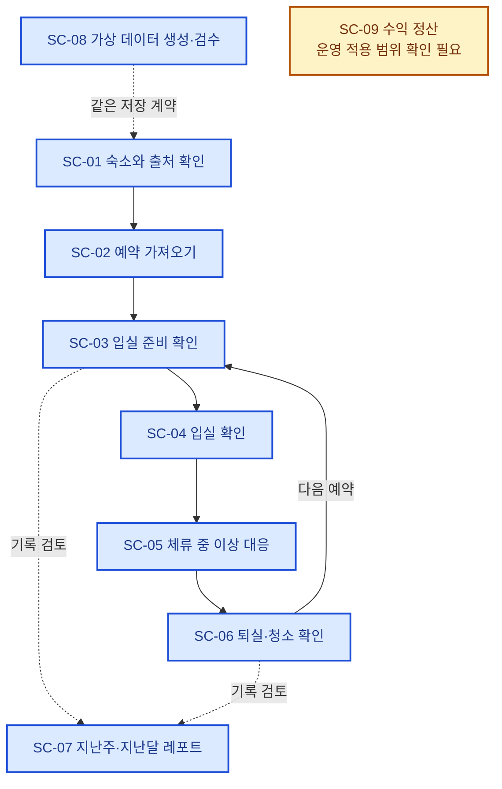
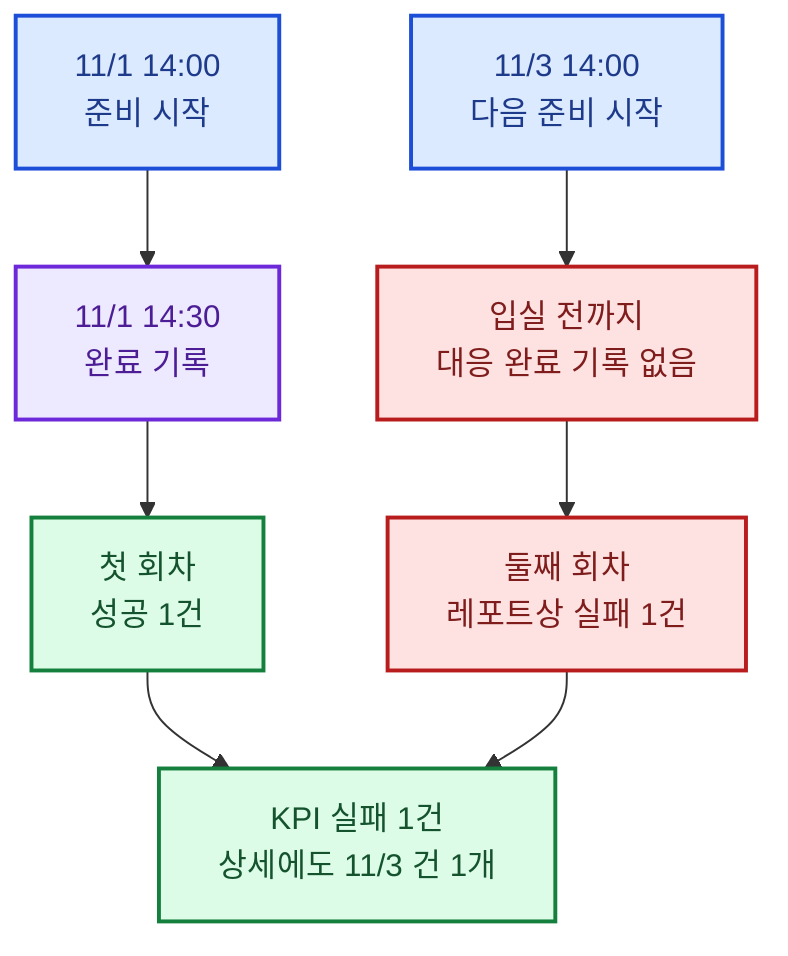
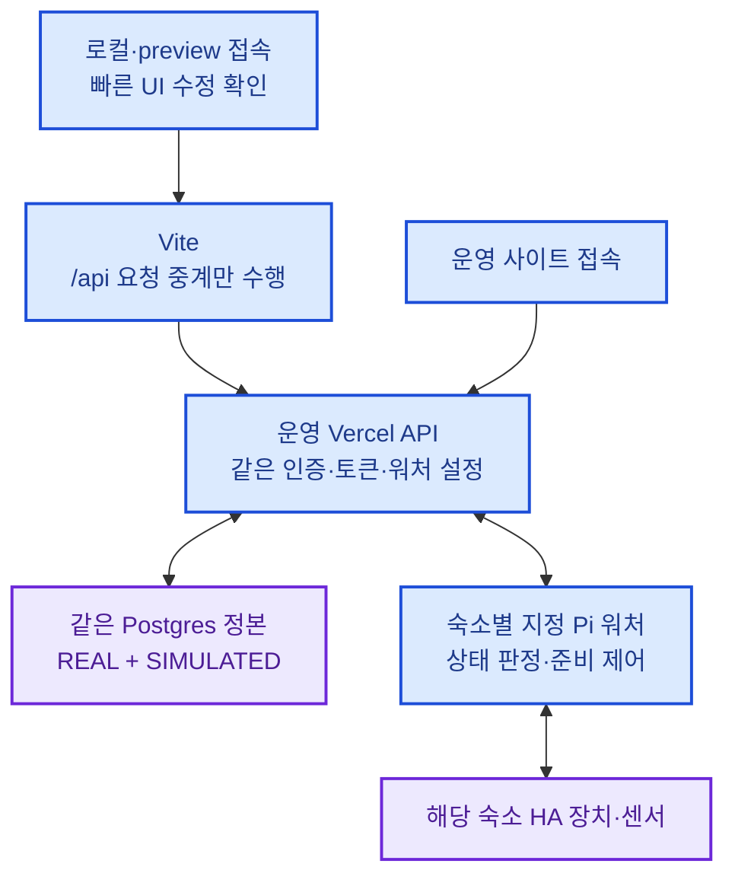
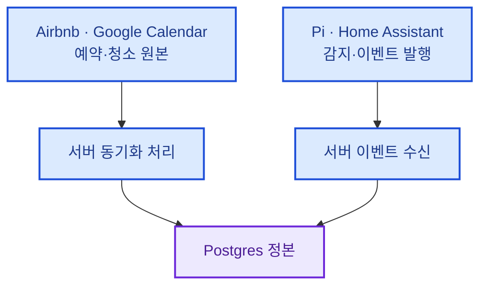
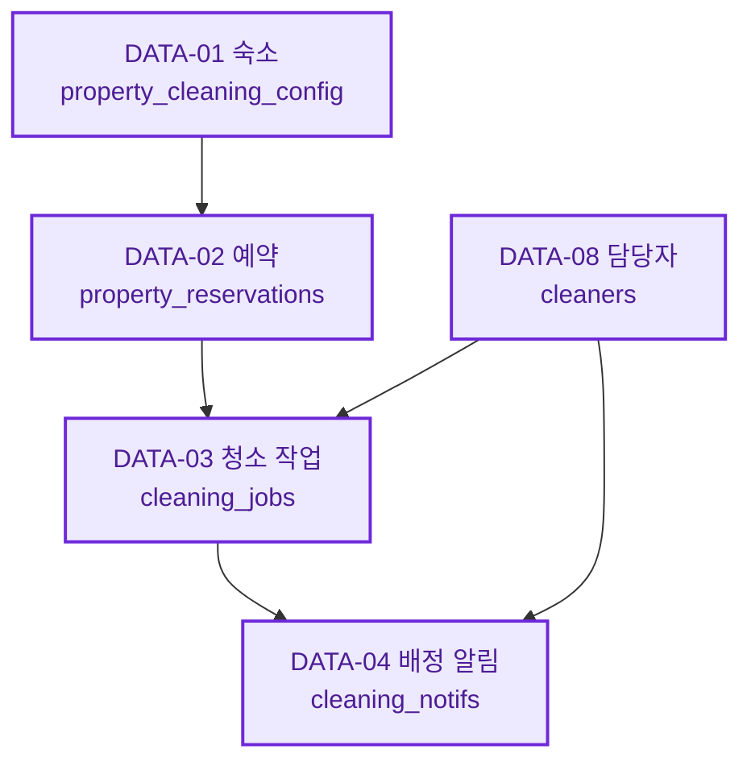
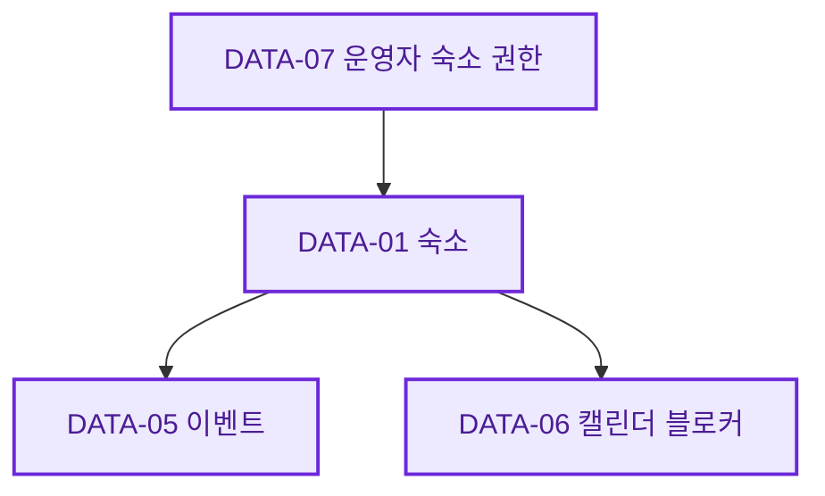
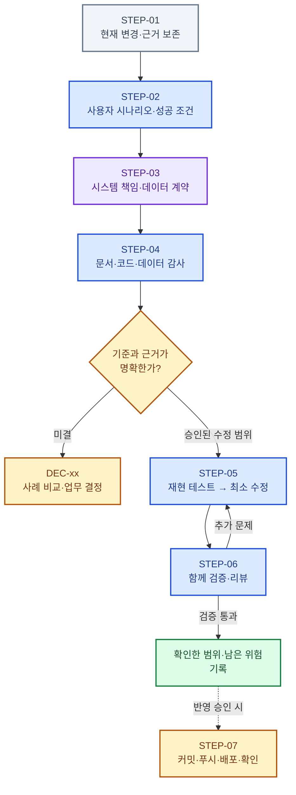

# 리팩토링

> 작성 기준: 2026-11-07 · 기준 초안 v0.8 · Pi·운영 코드 반영과 읽기 전용 검증
>
> 목적: 요구사항·사용자 시나리오·시스템 책임·데이터 계약을 먼저 정리하고, 이를 근거로 코드를 점진적으로 개선한다.
>
> 이 문서는 감사 결과, 사용자 결정, 적용 상태를 연결하는 기준 문서다. 기존 분야별 정본을 전부 대체하지 않는다. 미결 사항을 현재 코드나 과거 설명에 맞춰 임의로 확정하지 않는다.

## SEC-01 · 이 문서를 읽는 방법

**운영자가 어떤 일을 하려는지 먼저 읽고, 그 일을 뒷받침하는 시스템·데이터·코드를 따라간다.**

| 알고 싶은 것 | 바로 가기 |
| --- | --- |
| 지금 어디까지 고쳤고 운영에도 반영됐는가? | [SEC-02 현재 상태](#sec-02) |
| 숙소 운영자가 실제로 어떤 일을 하는가? | [SEC-03 사용자 시나리오](#sec-03) |
| 데이터는 어디에 저장되고 어떻게 연결되는가? | [SEC-06 시스템·데이터](#sec-06) |
| 어떤 문제가 확인됐고 무엇이 남았는가? | [SEC-08 발견 사항](#sec-08) |
| 다음에 무엇을 결정하고 어떤 순서로 개선하는가? | [SEC-10 결정과 진행 순서](#sec-10) |
| 판단의 코드·문서·테스트 근거는 무엇인가? | [SEC-05 조사 범위](#sec-05), [SEC-07 기술 추적표](#sec-07) |

### 색상의 의미

색상은 다음 의미로만 사용한다. **REAL과 SIMULATED의 품질 차이를 색으로 표현하지 않는다.** 두 종류 모두 같은 데이터 계약을 따른다.

| 표시 | 의미 | 읽을 때 주의할 점 |
| --- | --- | --- |
| 🔵 파랑 | 사용자 행동·합의한 업무 기준 | 사용자가 하려는 일, 시스템이 따라야 할 규칙 |
| 🟣 보라 | 저장 정본·업무 객체 | 어떤 데이터가 어디에 저장되고 참조되는가 |
| 🟢 초록 | 성공 결과·검증 통과 | 설명용 예시인지 실제 검증 이력인지 확인. 로컬 완료와 운영 반영도 구분 |
| 🟡 노랑 | 결정·검증 대기 | 사실이 부족하거나 정책 승인이 필요한 부분 |
| 🔴 빨강 | 확인된 문제·레포트상 실패 | 실제 작업 실패와 완료 기록 누락은 구분 필요 |
| ⚪ 회색 | 과거 이력·캐시·참고 정보 | 현재 운영의 정본이나 완료 증거로 자동 해석하지 않음 |

Mermaid 도식에 같은 색상을 적용했다. 색을 표시하지 않는 Markdown 뷰어에서도 표의 기호와 문구로 상태를 확인할 수 있다.

### ID 사용 규칙

| ID 형식 | 가리키는 항목 | 대화 예시 |
| --- | --- | --- |
| `SEC-01` | 문서의 주요 장 | “SEC-06의 데이터 관계를 보자” |
| `SC-01` | 이 문서의 사용자 시나리오 | “SC-03의 준비 완료 기준을 정하자” |
| `DATA-01` | 저장 객체 | “DATA-03 청소 작업의 필수 관계를 확인하자” |
| `RF-01` | 발견 사항·추가 감사 대상 | “RF-05 검수 공백부터 개선하자” · 확정/미확정 상태를 함께 확인 |
| `DEC-01` | 결정이 필요한 요구사항 | “DEC-01을 먼저 확정하자” |
| `QA-01` | 감사 질문 | “QA-07 테스트가 실제 코드를 검증하는지 보자” |
| `STEP-01` | 개선 진행 단계 | “이 항목은 STEP-04 감사 단계다” |
| `ACT-01` | 다음에 진행할 구체적인 후속 작업 | “ACT-01의 중복 제어 경로부터 확인하자” |

**한 번 부여한 ID는 제목이나 순서가 바뀌어도 유지한다.** 완료된 항목도 ID를 남긴다. 새 항목은 뒤 번호를 부여하고, 합치거나 대체할 때는 원래 ID와 대체 ID를 함께 기록한다.

기존 `scenarios.yaml`의 `S01~S05`, 테스트 파일의 `s93` 같은 번호는 그대로 유지한다. `SC-xx`는 사용자 관점에서 흐름을 읽기 위한 이 문서의 ID이며, 기존 시나리오 ID나 코드 식별자를 바꾼 것이 아니다.

## SEC-02 · 현재 어디까지 진행됐는가

**출처 저장·준비 집계·센서 준비와 ACT-01 코드를 Pi·운영에 반영했다. 실제 장치 최적화 설정·가동 검증은 🟡 대기 상태다.**

| 항목 | 현재 상태 | 근거와 한계 |
| --- | --- | --- |
| 리팩토링 전 기존 코드 | 기준 `43339da` (현재 운영 버전) | 이전 대화에서 이 커밋의 푸시 성공을 확인했다. 이번 문서 작성에서는 원격·배포 상태를 다시 조회하지 않았다. |
| 기존 기준 태그 | `v-before-refactor-20261105` → `eda0f13` | HEAD보다 이전이다. `43339da`와 아래 미커밋 개선을 포함한 복구 지점으로 간주하면 안 된다. 태그 이동·새 커밋·푸시는 별도 작업이다. |
| 기간 계산·레포트 API 계약 정리 | HEAD에 커밋됨 | `43339da`: 기간 범위·지원 기능을 공유하고 로컬 DEMO도 공통 stats handler를 사용한다. [기간 계산](../src/domain/periodDomain.js#L110), [API 검증](../api/stats.js#L43), [현재 Vite DEMO 연결](../vite.config.mjs#L34). |
| [RF-01](#rf-01) 이벤트 출처 누락 | 🟢 기능 커밋 `e638e65`·검증 및 운영 코드 반영 완료 | 검증기·두 수신 API·공통 INSERT에서 출처를 보존한다. 과거 DB 행을 소급 수정하지 않았다. |
| [RF-02](#rf-02) 준비 KPI·실패 목록 불일치 | 🟢 사용자 승인 A안·기능 커밋 `e638e65`·검증 및 운영 코드 반영 완료 | 준비 회차의 공통 계산을 KPI·상세·캘린더 문제 목록·주간/월간 패턴에 연결했다. 실제 Pi 발행부터 운영 화면까지의 검증은 미완료다. |
| [DEC-01](#dec-01) 센서 기반 입실 준비 | 🟢 로컬 구현·모의 검증 / 🟡 실제 가동 조건 대기 | 시간만으로 완료하는 경로를 제거하고 사전 검사·센서 유지·실패 정지·생략·조기 입실 후 계속 진행을 구현했다. [상세 명세·테스트](pre-stay-optimization.md). 파주201 영역에 환경 제어 장치가 없고 일부 센서가 끊겨 있어 실제 가동 완료로 보지 않는다. |
| [ACT-01](#act-01) 로컬·운영 제어 경로 통일 | 🟢 Pi `25a1d28`·운영 READY / 🟡 실장치 최적화 설정 대기 | 로컬·preview의 모든 서비스 API를 운영으로 중계한다. Vite 워처 자동 시작·브라우저 대체 제어·예측 상태 쓰기를 제거하고, 청소·정비 요청은 지정 Pi가 직렬 처리한다. 현장 프로세스 중복 부재까지 확인한 것은 아니다. |
| 1차 개선의 운영 반영 | 🟢 코드 반영 완료 | Pi 선반영 후 main을 푸시했고 운영 도메인에 연결된 `25a1d28` READY를 확인했다. 이후 CI·문서 커밋은 같은 런타임 코드다. 실제 장치 제어·업무 쓰기 검증은 별도다. |
| 전체 시나리오·아키텍처 감사 | 🟡 일부 확인, 추가 감사 필요 | 아래 추적표의 운영 연결·미결 정책·DB 현황을 추가로 확인해야 한다. |
| 이번 DEC-01 정리 | 관련 명세·상태·집계 문서 갱신 | 앞선 미커밋 개선과 사용자 파일을 보존했다. 코드·회귀 테스트·관련 정본에 이번 사용자가 승인한 센서 기준을 반영했다. DB·환경변수·실제 장치·배포는 변경하지 않았다. |

### 직전 검증 이력

아래는 1차 코드 개선 완료 시 실행한 결과다. 이번 문서 작성에서 전체 테스트를 재실행한 결과는 아니다.

| 검증 | 결과 |
| --- | --- |
| 개선 전 `npm test` | 통과 2,612 · 일반 실패 0 · 기존 TODO 2 |
| 두 개선 후 `npm test` | 통과 2,641 · 일반 실패 0 · 기존 TODO 2 |
| 출처 회귀 테스트 | 최초 11개 중 8개 실패로 누락 재현. 보강 후 신규 13개 모두 통과 |
| 준비 회귀 테스트 | A안 사례 16개 중 수정 전 11개 실패 → 수정 후 모두 통과 |
| PostgreSQL 검증 | `BEGIN READ ONLY`에서 실제 SELECT와 JSON CTE 입력을 사용, 16개 통과. 실제 이벤트 행·임시 테이블·스키마를 쓰지 않음 |
| 프로덕션 빌드 | 임시 출력 경로에서 성공 |

테스트 근거: [s93 출처](../tests/unit/s93.event-provenance.test.js#L78), [s94 준비 집계](../tests/unit/s94.pre-stay-consistency.test.js#L28), [s95 실제 SQL](../tests/integration/s95.pre-stay-context.test.js#L20). 월간·주간 기존 테스트는 시각 없는 입력을 조회 기간에 맞는 이벤트 순서로 보강했고, 기존 기대값은 유지했다: [s63](../tests/unit/s63.monthly-insights.test.js#L310), [s65](../tests/unit/s65.weekly-insights.test.js#L191).

**DEC-01 후속 검증 · 2026-11-06:** 전체 테스트 통과 2,693·일반 실패 0·기존 TODO 2. 신규 회귀 51개, 읽기 전용 SQL 20개, 임시 경로 빌드가 통과했다. 실제 워처의 시간 기반 거짓 완료를 먼저 재현했다. [상세 결과와 미검증 범위](pre-stay-optimization.md#prep-06).

### 문서 자체의 검수 · 2026-11-05

- **내용:** 준비 회차와 예약의 1:1 연결을 구분하고, 수신 UUID의 추적 한계를 명시했다. 로컬·운영의 서버 실행 위치와 공통 API 코드를 구분했다. 잘못 연결된 근거 줄 번호를 정정했다.
- **구조:** 고정 ID의 중복·누락, 내부 이동, 근거 파일·줄 번호, 표의 열 구조를 검사했다. 기존 RF ID와 업무 결정 상태를 유지했다.
- **표시:** Mermaid 10.9.1을 사용한 임시 미리보기에서 도식 7개를 실제 렌더링했다. 1440px·390px 화면을 확인하고 큰 도식을 분리했다. 색상별 글자 대비는 모두 4.5:1 이상이다. 모든 Markdown 뷰어의 표시까지 보장하는 검사는 아니다.
- **판정 범위:** 위 항목은 v0.3 당시의 문서 검수 이력이다. 이후 DEC-01은 사용자 기준으로 구체화했다. DEC-02~04와 실제 가동 확인은 남아 있다.

## SEC-03 · 사용자 시나리오로 보는 전체 흐름

운영자는 숙소를 등록하고, 예약을 가져오고, 입실 준비·체류·퇴실·청소를 확인한 뒤 결과를 레포트로 검토한다. 가상 데이터 검수와 수익 정산은 각각 별도 목적을 가진 흐름이다.

이 도식은 **사용자의 업무 흐름**이다. 상태 기계의 허용 전이표나 모든 운영 연결이 검증됐다는 뜻은 아니다.

| ID | 운영자가 하려는 일 | 연결된 발견 사항·결정 |
| --- | --- | --- |
| [SC-01](#sc-01) | 로컬과 운영에서 같은 숙소·데이터를 본다 | [RF-11](#rf-11), [RF-12](#rf-12) |
| [SC-02](#sc-02) | 실제 예약을 가져와 다음 예약을 준비한다 | [RF-08](#rf-08), [RF-14](#rf-14), [DEC-04](#dec-04) |
| [SC-03](#sc-03) | 입실 전에 준비가 완료됐는지 확인한다 | [RF-02](#rf-02), [RF-03](#rf-03), [RF-07](#rf-07), [DEC-01](#dec-01) |
| [SC-04](#sc-04) | 실제 입실을 확인하고 기록을 추적한다 | [RF-01](#rf-01), [RF-06](#rf-06) |
| [SC-05](#sc-05) | 체류 중 이상을 확인하고 대응한다 | [RF-04](#rf-04), [DEC-02](#dec-02) |
| [SC-06](#sc-06) | 청소 담당자·시간·완료 상태를 확인한다 | [RF-05](#rf-05), [DEC-03](#dec-03) |
| [SC-07](#sc-07) | 레포트 숫자와 상세 실패 목록을 대조한다 | [RF-02](#rf-02), [RF-04](#rf-04), [RF-09](#rf-09), [RF-10](#rf-10) |
| [SC-08](#sc-08) | 실제 수준의 가상 데이터를 만들고 검수한다 | [RF-05](#rf-05), [DEC-03](#dec-03) |
| [SC-09](#sc-09) | 플랫폼 수익을 정산한다 | [RF-08](#rf-08), [DEC-04](#dec-04) |

### SC-01 · 로컬과 운영에서 같은 숙소·데이터를 본다

- **누가·언제:** 운영자가 로컬 또는 운영 사이트에서 숙소 목록을 연다.
- **기대 결과:** 두 접속 경로가 같은 혼합 데이터 서비스를 사용한다. 파주201은 REAL, 가상 숙소는 SIMULATED이며 필요한 경우 출처로 필터한다.
- **시스템의 역할:** 같은 Postgres 테이블을 조회하고 로그인한 사람의 숙소 권한을 적용한다. DEMO는 명시적으로 선택했을 때만 fixture를 사용한다.
- **확인 상태:** 🔵 저장·프로필 기준은 확정. 🟡 실제 배포의 DB 연결값과 모든 출처/권한 필터 조합은 별도 확인이 필요하다.
- **연결 데이터·근거:** [DATA-01 숙소](#data-01), [DATA-07 운영자 범위](#data-07), [프로필 설정](../src/config/dataProfile.js#L19).

### SC-02 · 실제 예약을 가져와 다음 예약을 준비한다

- **누가·언제:** 운영자가 예약 동기화를 실행하거나 예약 갱신 트리거가 발생한다.
- **기대 결과:** 원본 예약이 DB에 반영되고 해당 퇴실의 청소 작업과 연결된다. 반복 동기화가 중복 예약·작업을 만들지 않고, 가져오기 실패가 기존 배정을 지우지 않는다.
- **시스템의 역할:** 서버가 숙소 설정의 iCal 원본을 읽어 예약·청소 작업에 반영한다. 전날 PIN·웰컴 메시지·씬 준비라는 기존 `S01`의 운영 연결은 따로 추적한다.
- **확인 상태:** ⚪ 원본 동기화 통합·복구의 기존 이력이 있다. 🟡 `S01`의 등록된 기능 전체가 현재 운영에서 실행되는지는 미확인이다.
- **연결 데이터·근거:** [DATA-02 예약](#data-02), [DATA-03 청소 작업](#data-03), [iCal 동기화](../api/cleaning/%5B...slug%5D.js#L733), [RF-08](#rf-08), [DEC-04](#dec-04).

### SC-03 · 입실 전에 숙소 준비가 끝났는지 확인한다

- **누가·언제:** 운영자가 오늘 준비 상태를 보거나 지난 예약의 준비 결과를 확인한다.
- **기대 결과:** 실제 온습도 목표 도달·연속 유지를 확인해 완료를 기록한다. 준비 전 입실은 생략, 준비 중 입실은 제어를 계속한다. 중요 센서·장치 오류는 안전 정지와 운영자 알림으로 처리한다.
- **연결 기준:** 버전 없는 과거 이벤트는 승인 A안(다음 준비 또는 입실 전 첫 완료)을 유지한다. 신규 `sensor-v1`은 같은 숙소·제어 회차 ID로 연결하며 조기 입실 뒤 완료도 인정한다. 예약 UID는 추적 문맥이며 `source_ref`는 연결 키가 아니다. [구형 규칙](#prep-policy), [신규 명세](pre-stay-optimization.md)
- **확인 상태:** 🟢 로컬 구현·모의 검증. 🟡 실제 센서 보고 주기·장치 매핑·운영자 알림 수신·Pi 반영 확인이 남아 있다. [DEC-01](#dec-01)
- **연결 데이터·근거:** [DATA-05 이벤트](#data-05), [RF-02](#rf-02), [RF-03](#rf-03), [RF-07](#rf-07), [공통 계산](../src/domain/metricDrilldownDomain.js#L89).

아래는 **버전 없는 과거 A안의 설명용 기록 예시이며 실제 운영 이력은 아니다.** 같은 숙소의 서로 다른 두 준비 회차다. 신규 센서 회차의 생략·미확인은 [센서 명세](pre-stay-optimization.md#prep-04)를 따른다.

여기서 ‘실패’는 **대응 완료 기록을 확인하지 못했다는 뜻**이다. 실제로 준비하지 않은 것과 기록만 누락된 것을 이 계산만으로 확정할 수는 없다.

### SC-04 · 실제 입실을 확인하고 기록의 출처를 추적한다

- **누가·언제:** 게스트 입실 신호를 감지하고 운영자가 상태·기록을 확인한다. 기존 등록 시나리오는 `S02`다.
- **기대 결과:** 해당 숙소의 이벤트가 중복 없이 저장되고 발생 시각·출처를 확인할 수 있다. 출처 참조를 예약 번호로 임의 해석하지 않는다.
- **시스템의 역할:** Pi/수신 API가 이벤트를 저장한다. 출처가 전달되면 보존하고, 기존 Pi 요청에 출처가 없으면 실제 수신 UUID를 참조로 남긴다.
- **추적 범위:** 수신 UUID는 수신한 이벤트 행을 찾는 참조다. 센서 원본 ID나 예약 ID까지 확보·검증했다는 뜻은 아니다.
- **확인 상태:** 🟢 출처 저장은 로컬 검증 완료. 🟡 두 API의 상태 종결·캐시·알림 차이와 실제 장치부터 운영 화면까지의 연결은 추가 확인 대상이다.
- **연결 데이터·근거:** [DATA-05 이벤트](#data-05), [RF-01](#rf-01), [RF-06](#rf-06), [수신 API](../api/events/%5B...slug%5D.js#L66).

### SC-05 · 체류 중 이상을 확인하고 대응한다

- **누가·언제:** 운영자가 소음·에너지 등 이상 신호나 게스트 메시지를 확인한다. 기존 등록 시나리오는 `S03`다.
- **기대 결과:** 감지한 문제, 자동 대응한 내용, 해소 여부가 해당 숙소 기록으로 이어진다. 예약 시각에 따른 예측과 센서로 확인한 사실을 구분한다.
- **시스템의 역할:** 감지·의심/확인·상태 전이·기록·레포트의 책임을 각각 추적한다.
- **확인 상태:** 🟡 현재 WebSocket 워처와 문서의 폴링/시나리오 서비스 관계를 더 확인해야 한다. ‘안심지수’가 이상 자동 해결률인지 운영 성공률 평균인지도 미결이다.
- **연결 데이터·근거:** [DATA-05 이벤트](#data-05), [이벤트 감지 설계](event-detection-design.md#L21), [RF-04](#rf-04), [DEC-02](#dec-02).

### SC-06 · 퇴실 후 청소 담당자·시간·완료 상태를 확인한다

- **누가·언제:** 운영자가 퇴실 후 청소 배정과 다음 입실 전 준비 상황을 본다. 기존 등록 시나리오는 `S04`다.
- **기대 결과:** 담당자가 배정됐으면 실제 담당자 관계가 이어지고 이름이 나온다. 퇴실 11시·확정 청소 12~15시라면 대기 11~12시, 진행 12~15시로 구분한다.
- **시스템의 역할:** 예약·청소 작업·담당자·알림·Google 원본을 연결한다. 동기화 오류를 실제 미배정으로 바꿔 저장하지 않는다.
- **확인 상태:** ⚪ 담당자·시각·타임라인 복구는 기존 검증 이력이 있다. 🟡 현재 운영 재확인과 ‘배정 완료’의 필수 정보 확정은 별도다. 이 문서 작업에서 데이터를 다시 정정하지 않는다.
- **연결 데이터·근거:** [DATA-03 작업](#data-03), [DATA-04 알림](#data-04), [DATA-08 담당자](#data-08), [기존 복구 이력](current-task.md#L3), [RF-05](#rf-05), [DEC-03](#dec-03).

### SC-07 · 지난주·지난달 레포트에서 실패 이유를 확인한다

- **누가·언제:** 운영자가 기간·숙소를 선택해 KPI를 보고 실패 건수를 눌러 상세 목록을 연다.
- **기대 결과:** 같은 기간·같은 숙소 범위에서 KPI의 실패 건수와 상세 목록이 일치한다. 패턴 분석도 같은 의미의 건수를 사용한다.
- **확인 상태:** 🟢 구형 A안과 신규 `sensor-v1` 준비 지표의 일치를 로컬에서 검증했다. 🟡 실제 Pi 연동, 안심지수 정의, 평균 계산 중복, 기존 TODO 2개는 남아 있다. 모든 지표를 검증 완료로 표시하지 않는다.
- **연결 데이터·근거:** [SC-03 준비 사례](#sc-03), [RF-02](#rf-02), [RF-04](#rf-04), [RF-09](#rf-09), [RF-10](#rf-10), [레포트 서비스](../src/application/reportingService.js#L131).

### SC-08 · 실제 수준의 가상 데이터를 만들고 검수한다

- **누가·언제:** 개발·QA 담당자가 반복 가능한 시나리오를 만들거나 현재 저장 데이터를 검사한다.
- **기대 결과:** SIMULATED도 REAL과 같은 테이블·키·필수 관계·추적성을 가진다. 배정 완료 데이터라면 화면에서 담당자를 찾을 수 있어야 한다. 실제 알림·외부 배정을 실행하지 않는다.
- **시스템의 역할:** 생성·검수·저장 계약을 대조하고, 검수 통과가 보장하는 범위를 명확히 한다. DEMO fixture와 DB에 저장하는 SIMULATED를 구분한다.
- **확인 상태:** 🔴 현재 검수기는 담당자 관계가 불충분한 배정 데이터를 놓칠 수 있다. 🟡 필수 조건을 [DEC-03](#dec-03)에서 정한 뒤 검수기·생성기를 개선한다.
- **연결 데이터·근거:** [RF-05](#rf-05), [검수 조건](../src/data/dataSimulator.js#L217), [생성 구조](../src/data/dataSimulator.js#L334).

### SC-09 · 플랫폼 수익을 정산한다

- **누가·언제:** 운영자가 월 정산과 가격 추천·세금 결과를 검토한다. 기존 등록 시나리오는 `S05`다.
- **기대 결과:** 수익 수집·집계·결과 보관의 원본과 책임이 이어진다. 숙소 운영 상태 레포트와 재무 정산의 목적을 구분한다.
- **확인 상태:** 🟡 서비스·기능 테스트는 있으나 현재 운영 진입과 정본 DB 연결은 미확인이다. 등록돼 있다는 이유만으로 운영 완료로 보지 않는다.
- **연결 근거:** [정산 서비스](../src/application/settlementService.js#L41), [RF-08](#rf-08), [DEC-04](#dec-04).

## SEC-04 · 리팩토링 목적과 감사 원칙

목표 연결은 다음과 같다.

`사용자 요구 → 시나리오·성공 조건 → 업무 객체 → 저장소·키·관계 → API·서비스 → 화면 → 테스트·자동 검수`

다음 아홉 항목을 감사한다.

- **QA-01 · 문서 일치:** 같은 규칙을 문서마다 다르게 설명하는가?
- **QA-02 · 계산 중복:** 같은 업무 규칙을 여러 위치에서 독립 계산하는가?
- **QA-03 · 데이터 동등성:** REAL/SIMULATED가 같은 저장 구조·필수 관계·추적성을 따르는가?
- **QA-04 · 조회·수정 범위:** 출처별 조회·집계·수정·외부 발송 정책이 일관적인가?
- **QA-05 · 참조 관계:** 예약·청소·이벤트·블로커·알림·담당자가 이어지는가?
- **QA-06 · 응답 계약:** DEMO·레포트·API의 기간·선택 범위·응답 계약이 맞는가?
- **QA-07 · 테스트 근거:** 테스트가 실제 구현을 호출하는가? 복사한 계산만 검증하지 않는가?
- **QA-08 · 중복의 의도:** fixture·캐시·파생 데이터와 위험한 중복을 구분했는가?
- **QA-09 · 사용자 영향:** 불일치가 잘못된 화면·배정·알림·데이터 손상으로 이어지는가?

감사는 읽기 전용으로 진행한다. 수정은 승인된 항목의 최소 범위로 분리한다. 기존 미커밋 변경을 보존하고 새 발견 사항과 구분한다. DB·환경변수·외부 API·실제 알림·배포는 일반 코드 정리의 일부로 실행하지 않는다. 개인정보·비밀값은 문서와 결과에 남기지 않는다.

증거의 상태를 `사용자 확정`, `현재 코드 확인`, `테스트 재현`, `과거 조회 스냅샷`, `미확인`으로 구분한다. 문서에 적혀 있다는 이유만으로 운영 구현 완료를 인정하지 않고, 코드가 존재한다는 이유만으로 업무 규칙을 확정하지 않는다.

## SEC-05 · 무엇을 확인했고 무엇이 미확인인가

### 1단계: 문서·시나리오·객체 기준

확인한 주요 근거:

- [scenarios.yaml:54](scenarios.yaml#L54): S01~S05, 트리거·서비스·화면·기능 테스트 등록.
- [room-state-machine.md:1](room-state-machine.md#L1), [106](room-state-machine.md#L106), [164](room-state-machine.md#L164): 상태 정본, 준비 시작·완료 의미.
- [data-architecture-and-simulator.md:3](data-architecture-and-simulator.md#L3), [관계 모델](data-architecture-and-simulator.md#L52): 출처·정본 저장소·관계·레거시 보존.
- [data-storage-design.md:36](data-storage-design.md#L36), [130](data-storage-design.md#L130): 이벤트 스키마와 저장 파이프라인.
- [report-architecture.md:7](report-architecture.md#L7), [637](report-architecture.md#L637), [701](report-architecture.md#L701): 집계·범위·실패 목록 계약.
- [reporting-feature-design.md:8](reporting-feature-design.md#L8), [374](reporting-feature-design.md#L374): 화면/집계 문서의 역할 및 테스트 전략.
- 참조 문서: [이벤트 감지](event-detection-design.md#L21), [청소 자동화](cleaning-automation-design.md), [문구 기준](content-guide.md), [현재 작업 이력](current-task.md#L3), [이전 인수인계](handoff-to-codex.md#L1).

아직 확정되지 않은 범위: S01~S05의 현재 운영 적용 범위, 자동화 성공의 관측 근거, 안심지수의 최종 정의. 과거 작업·인수인계는 이력 근거이며 현재 동작의 정본으로 자동 승격하지 않는다.

### 2단계: 소스·스키마·테스트 대조

이번 정리에서 이벤트 저장·준비 계산·프로필·청소 API 진입·생성/검수 코드·시나리오 서비스 연결을 확인했다. 근거는 [SEC-07](#sec-07)·[SEC-08](#sec-08)에 명시했다. 모든 라우트·함수·쓰기 경로를 빠짐없이 검토한 상태는 아니다.

직전 읽기 전용 DB 조회에서 확인한 스냅샷:

- 숙소: REAL 1개, SIMULATED 21개.
- 이벤트: 509건. 준비 시작·최적화 완료 이벤트는 각각 0건.
- `events`의 출처 컬럼과 `UNIQUE(property_id, type, device_time)` 존재 확인.
- 출처 저장 INSERT는 `EXPLAIN`으로 검증했으며 실제로 삽입하지 않았다.

이 수치는 조회 당시 연결 DB의 스냅샷이다. 이번 문서 작성에서는 DB를 재조회하지 않았다. Vercel·Pi가 동일한 DB/자격증명을 바라보는지, 최신 배포 SHA, 모든 기존 행의 무결성·FK 검증 상태는 별도 확인이 필요하다. 파주201을 조회했다는 사실만으로 모든 운영 경로를 검증했다고 보지 않는다.

## SEC-06 · 시나리오를 뒷받침하는 시스템과 데이터

### 시스템별 책임과 저장 위치

**예약·청소·이벤트는 Postgres가 정본이다. 로컬과 운영은 같은 혼합 데이터 계약을 사용한다.** 아래 도식은 따라야 할 구조를 보여주며, 현재 배포의 연결값까지 재확인한 결과는 아니다.

로컬은 별도 개발 데이터·토큰·워처를 운영하지 않는 UI 접속 경로다. 명시적 DEMO를 제외하면 `/api/*`는 `https://www.proposonline.com`으로 중계하므로, DB·Google 토큰·Pi 주소는 운영 서버의 설정을 사용한다. 로컬 `.env.local`의 같은 값으로 따로 백엔드를 실행하는 방식은 사용하지 않는다. 이 도식에 맞춘 코드는 Pi·Vercel 운영에 반영했다. 임시 로컬 Vite의 실제 운영 API 중계, Vercel→동일 Pi 조회, 운영 HYBRID UI 포함 여부를 읽기 전용으로 확인했다.

**원본 데이터를 DB에 반영하는 흐름은 다음과 같다.** 아래 ‘서버 처리’는 공통 구현의 책임을 나타내며, 별도 서버를 새로 둔다는 뜻이 아니다.

⚪ Pi 메타데이터·상태 파일·브라우저 캐시·KV는 정본과 역할·수명이 다른 보조 저장소다. DEMO도 위 Postgres 정본을 대신하는 운영 데이터가 아니다. [SC-08](#sc-08)의 SIMULATED는 DB에 저장하는 데이터이고, DEMO는 명시적으로 선택한 fixture 프로필이다.

### 분야별 기준 관계

| 분야 | 담당 문서/근거 | 적용 원칙 |
| --- | --- | --- |
| 제품 시나리오·행위자·성공 조건 | `scenarios.yaml` | 등록된 기능과 현재 운영에 연결된 기능을 구분한다. 누락된 DB 연결을 추측해 채우지 않는다. |
| 상태·허용 전이 | `room-state-machine.md` | 감지·명령 실행·이벤트 기록·화면 예측과 책임을 구분한다. |
| 감지 근거·의심/확인 | `event-detection-design.md` | 관측 신호가 무엇을 입증하는지 정의한다. |
| 데이터 출처·관계·저장 정본 | `data-architecture-and-simulator.md` | REAL/SIMULATED 동일 구조, HYBRID 기본값, 외부 원본과 DB 책임을 정한다. |
| 물리 저장·수신·중복 방지 | `data-storage-design.md` + `data/*.sql` | 문서의 의도, 스키마 파일, 실제 DB 적용 상태를 각각 확인한다. |
| 레포트 집계·기간·선택 범위 | `report-architecture.md` | 분자·분모·실패 목록·관측 시점·기간 귀속을 먼저 확정한다. |
| 화면·알림 표현 | `reporting-feature-design.md`, `content-guide.md` | 표현 변경으로 집계 의미를 바꾸지 않는다. |
| 적용 이력·감사·미결 결정 | 이 문서 | 분야별 문서를 연결하고 충돌·적용 상태를 관리한다. 업무 규칙을 여러 문서에 독립 재정의하지 않는다. |

충돌 시 최신 사용자 승인과 확인된 근거를 먼저 기록한다. 원본 문서의 수정안을 제안하고 기준을 합의한 뒤 코드를 개선한다. 현재 코드에 맞추기 위해 요구사항을 조용히 바꾸지 않는다.

### 이미 확정된 운영 기준

- 로컬과 운영은 같은 혼합 데이터 서비스를 사용한다. `HYBRID`가 기본이며 파주201만 REAL이다. SIMULATED도 같은 테이블·키·관계·추적 계약을 따른다. DEMO는 명시적 fixture 프로필이다. [설정 근거](../src/config/dataProfile.js#L19)
- 저장소는 Postgres의 숙소·예약·작업·이벤트가 정본이다. Pi의 숙소 메타데이터와 브라우저 캐시는 예약·청소 정본을 대체하지 않는다.
- 현재 `property_id`는 이름 기반 식별 계약이다. 이름을 정리하거나 UUID로 바꾸는 작업은 단순 중복 제거로 실행하지 않는다. [기존 식별 계약](report-architecture.md#L722)
- 예약은 Airbnb iCal 원본, 배정 담당자·확정 청소 시각은 Google 예약 원본을 근거로 DB에 반영한다. 퇴실 11시와 청소 12~15시를 구분한다. 기존 담당자·시간 복구는 과거 완료 이력이며 재적용하지 않는다. [기존 복구 이력](current-task.md#L3)
- 조회의 숙소 선택 범위와 출처 필터는 서로 다른 조건이다. `null` 전체·`[]` 선택 없음·목록 지정이라는 계약에 인증된 숙소 범위를 함께 적용한다.
- HYBRID 조회와 REAL만 외부 발송하는 정책은 양립할 수 있다. SIMULATED의 저장 구조를 다르게 만들거나 외부 실제 알림을 보내야 한다는 뜻이 아니다. [발송 차단](../api/cleaning/%5B...slug%5D.js#L422), [Cron REAL 범위](../api/cron/%5B...slug%5D.js#L143)

### 저장소와 관계

숙소에 연결하는 이벤트·블로커·권한은 별도로 읽는다.

선은 업무상 참조 관계를 나타낸다. 모든 관계가 현재 DB에서 검증된 FK라는 뜻은 아니다.

| ID · 객체 | 기본 키·업무 키 | 관계·추적 기준 |
| --- | --- | --- |
| **DATA-01 · 숙소** | `property_id`; `name` UNIQUE | `data_origin`, `source_system`, `source_ref`. [스키마](../data/schema-cleaning.sql#L5) |
| **DATA-02 · 예약** | `id`; `(property_id, reservation_uid)` UNIQUE | 숙소 FK, 유효한 입·퇴실 순서, 출처·원본. [스키마](../data/schema-cleaning.sql#L24) |
| **DATA-03 · 청소 작업** | `id`; `(property_id, checkout_at)` UNIQUE | 예약 복합 FK, 담당자 FK, Google 참조·확정 시각. UID 없는 REAL 레거시는 별도 검수. [스키마](../data/schema-cleaning.sql#L61) |
| **DATA-04 · 알림** | `id`; `(job_id, cleaner_id)` UNIQUE; token UNIQUE | 작업·담당자 FK. 출처는 연결 작업과 발송 기록으로 추적. [스키마](../data/schema-cleaning.sql#L95) |
| **DATA-05 · 이벤트** | `id`; `(property_id, type, device_time)` UNIQUE | 발생 시각이 업무 기준. 출처 참조는 예약 FK로 해석하지 않음. [스키마](../data/schema.sql#L6) |
| **DATA-06 · 블로커** | `(property_id, block_date)` | Google 이벤트 참조·숙소 출처. FK의 실제 적용 상태는 별도 검증. [스키마](../data/schema-cleaning.sql#L112) |
| **DATA-07 · 운영자 숙소 범위** | `(operator_id, property_id)` | 조회 권한을 데이터 출처 필터와 별도로 제한. [스키마](../data/schema-cleaning.sql#L139) |
| **DATA-08 · 담당자** | `cleaners.id`; 연락처 필드 UNIQUE | 청소 작업·배정 알림에서 참조하는 작업자 마스터. 실제 연락처는 문서에 기록하지 않음. [스키마](../data/schema-cleaning.sql#L48) |

`NOT VALID`로 추가된 FK가 존재한다는 사실은 과거 모든 행이 검증됐다는 뜻이 아니다. [마이그레이션 근거](../data/migrate-source-aware-data.sql#L104). 스키마 파일을 읽은 결과와 실제 DB의 제약·기존 행 검수 결과를 구분한다.

## SEC-07 · 시나리오의 코드·DB·테스트 근거

S01~S05는 기존 레지스트리 ID다. 아래 연결은 확인된 부분까지만 기록하며, 비어 있는 운영 연결은 구현 완료로 표시하지 않는다.

| 시나리오·트리거/행위자 | 객체·저장 관계 | API·서비스 | 화면 | 테스트·현재 확인 범위 |
| --- | --- | --- | --- | --- |
| [SC-02](#sc-02) · [S01](scenarios.yaml#L55) 전날 18시/관리자 실행 | 예약·PIN·메시지·씬 실행 결과. 해당 서비스 자체의 DB 영속 연결 미확인 | [runD1Automation:45](../src/application/checkinPreparationService.js#L45), 외부 동작은 주입된 deps 호출 | 등록은 `D1AutomationPanel`; 루트는 v1 패널 선택 | [s01:20](../tests/functional/s01.functional.test.js#L20)은 실제 서비스+가짜 I/O. 운영 스케줄부터 DB·장치까지 검증한 것은 아님 |
| [SC-04](#sc-04) · [S02](scenarios.yaml#L79) 도어락 열림/입실 | 예약·입실 이벤트·상태 | [handleDoorUnlocked:40](../src/application/checkinService.js#L40); 현재 워처의 이벤트 경로는 별도 확인 | `S02CheckinPanel` / 현재 `PropertyDetailView`의 상태·기록 | `tests/functional/s02.functional.test.js`, `s11`, `s14`, `s20.occupancy-watcher`. 두 실행 경로의 동등성 미확인 |
| [SC-05](#sc-05) · [S03](scenarios.yaml#L102) 센서/게스트 메시지 | 감지·해소 이벤트 → `events` → 상태/레포트 | [pollAll:79](../src/application/monitoringService.js#L79), `occupancyMonitor`, `occupancyWatcher` | S03 패널 / 현재 상세·대시보드 | `s03.functional`, `s14`, `s15`, `s30` 등. 문서의 폴링과 현재 WebSocket 운용을 구분해야 함 |
| [SC-06](#sc-06) · [S04](scenarios.yaml#L125) 퇴실/청소 | 예약 → `cleaning_jobs` → 담당자·알림; 청소 이벤트 → `events` | [handleCheckout:38](../src/application/checkoutService.js#L38)와 현행 `/api/cleaning/*`의 책임·중복 여부를 대조 | S04 패널 / 현재 리스트·상세·청소 관리 | `s04.functional`, `s85`~`s91`. 레거시 시나리오의 체크리스트와 현행 DB 작업을 같은 객체로 추측하지 않음 |
| [SC-09](#sc-09) · [S05](scenarios.yaml#L149) 월 정산/관리자 | 플랫폼 수익·가격 추천·세금 결과. 정본 테이블 연결 미확인 | [runMonthlySettlement:41](../src/application/settlementService.js#L41), deps로 수집·결과 저장 | S05 패널 | `s05.functional`. 운영 상태 레포트와 금융 정산은 목적이 달라 같은 모듈로 통합하지 않음 |
| [SC-02](#sc-02) · 실제 예약 입력·갱신 | `property_cleaning_config` → `property_reservations` → `cleaning_jobs` | [iCal 동기화:733](../api/cleaning/%5B...slug%5D.js#L733), [수동 진입:922](../api/cleaning/%5B...slug%5D.js#L922) | `RoomStateApp` 동기화 → 리스트·상세 | `s84`, `s87`, `s88`. 반복 실행·오류 시 기존 관계 보존을 확인할 대상 |
| [SC-06](#sc-06) · 배정·청소 시각 반영 | Google 이벤트 → 작업의 담당자 FK·시작·종료; 퇴실 키 유지 | [Webhook:610](../api/cleaning/%5B...slug%5D.js#L610), [Scan:1240](../api/cleaning/%5B...slug%5D.js#L1240), 공통 Calendar 도메인 | 리스트·상세 타임라인 | `s85`, `s88`, `s89`, `s90`. 과거 복구 결과와 현재 운영 상태는 구분 |
| [SC-04](#sc-04) · 이벤트 수집 | Pi → `events`; 출처·중복 키 | [두 수신 경로:66](../api/events/%5B...slug%5D.js#L66), [저장소:21](../src/infrastructure/eventRepository.js#L21) | 현재 상태·이벤트 기록·레포트 | `s18`, `s24`, [s93](../tests/unit/s93.event-provenance.test.js#L78). 출처 수정은 로컬 완료 |
| [SC-03](#sc-03) · 준비 성공·실패 레포트 | 구형 A안: 기간 내 준비 ↔ 완료/다음 준비/입실. 신규 `sensor-v1`: 같은 숙소·제어 회차 ↔ 센서 완료/실패/취소 | [공통 회차:89](../src/domain/metricDrilldownDomain.js#L89), [집계:131](../src/application/reportingService.js#L131), [구형 기간 밖 조회:154](../src/infrastructure/eventRepository.js#L154), [센서 회차 조회:174](../src/infrastructure/eventRepository.js#L174) | KPI·실패 상세·월간 문제·패턴 | [s94](../tests/unit/s94.pre-stay-consistency.test.js#L28), [s95](../tests/integration/s95.pre-stay-context.test.js#L20), [s98](../tests/unit/s98.sensor-preparation-report.test.js). 두 버전의 로컬 일치 검증 완료, 실제 Pi 경로는 미검증 |
| [SC-08](#sc-08) · SIMULATED 데이터 검수·생성 | 같은 숙소·예약·작업·이벤트 구조 | [검수기:97](../src/data/dataSimulator.js#L97), [생성기:331](../src/data/dataSimulator.js#L331), CLI·seed 어댑터 | 일반 HYBRID 화면; DEMO는 별도 fixture | `s71`, `s72`. 배정 담당자·추적의 검수 공백은 [RF-05](#rf-05) 참조 |

추적표 보완이 필요한 이유: 레지스트리는 최상위 `src/components/S0X`를 가리키지만 루트는 S01~S05에 v1 패널을 선택하고 기본 진입은 `RoomStateApp`이다. [App:79](../src/components/App.jsx#L79), [115](../src/components/App.jsx#L115), [169](../src/components/App.jsx#L169). 파일 이름이 비슷하다고 현재 운영과 같은 실행 경로라고 인정하지 않는다. `verify:scenarios`의 등록/연결 검증과 실제 운영 도달성 검증을 분리한다. [검증 스크립트:72](../scripts/verify-scenarios-sync.mjs#L72)

## SEC-08 · 발견 사항과 현재 판정

아래 RF 번호는 이 문서의 관리 ID다. 과거 테스트의 R 번호·설계 결정 D 번호와 혼동하지 않는다.

| ID / 심각도 | 확인된 내용·영향 | 근거 | 확실성·적용 상태 |
| --- | --- | --- | --- |
| **RF-01** / 높음 [SC-04](#sc-04) | 입력된 출처가 검증/전달/INSERT에서 빠져 추적이 끊겼음 | [검증기:27](../src/domain/eventValidation.js#L27), [API:88](../api/events/%5B...slug%5D.js#L88), [저장소:21](../src/infrastructure/eventRepository.js#L21), s93 | 🟢 **로컬 완료** · 수정 전 테스트 재현, 로컬 수정 후 통과. 과거 DB 행 복구·운영 반영은 미실행 |
| **RF-02** / 높음 [SC-03](#sc-03) · [SC-07](#sc-07) | 준비 2회·완료 1회인 같은 숙소에서 KPI 실패 1건/상세 0건. 다른 숙소의 완료가 전체 KPI 실패를 상쇄하기도 했음 | [공통 회차:89](../src/domain/metricDrilldownDomain.js#L89), [레포트 연결:131](../src/application/reportingService.js#L131), s94·s95 | 🟢 **로컬 완료** · A안 승인·로컬 수정 완료. 주·월 경계에서 패턴만 다음 준비를 더 세던 사례도 준비 지표에 한해 보정 |
| **RF-03** / 중간 [SC-03](#sc-03) | 문서의 이전 ‘시간 순서 무관’ 설명이 승인 A안과 달랐음 | [report-architecture:707](report-architecture.md#L707), [센서 회차 명세](pre-stay-optimization.md#prep-04) | 🟢 **정본 갱신** · 구형 A안과 신규 센서 회차의 연결·집계 차이를 명시. 과거 데이터를 소급 재분류하지 않음 |
| **RF-04** / 중간 [SC-05](#sc-05) · [SC-07](#sc-07) | ‘안심지수’ 문서는 자동 해결 비율, 현재 결과 요약·표는 운영 지표 평균을 사용. 지표의 목적·분모가 확정되지 않은 상태에서 계산만 합치면 의미가 달라짐 | [보고서 설계:40](reporting-feature-design.md#L40), [아키텍처:432](report-architecture.md#L432), [요약:83](../src/domain/operationalMetricsDomain.js#L83), [표:40](../src/components/v2/reporting/EventMatrixPanel.jsx#L40) | 🟡 **정의 결정 대기** · 정의 차이는 확인. 어떤 정의를 채택할지는 미결이며 코드를 정답으로 단정하지 않음 |
| **RF-05** / 높음 [SC-06](#sc-06) · [SC-08](#sc-08) | 검수기는 담당자 목록이 비어 있으면 존재 검사를 건너뛰고, ASSIGNED/COMPLETED에 담당자 없이 Google ID만 있어도 배정 추적 경고를 내지 않음. 생성기는 담당자 목록 없이 ASSIGNED와 가상 Google ID를 생성할 수 있음. 검수 통과가 UI 담당자 연결을 보장하지 않음 | [검수:217](../src/data/dataSimulator.js#L217), [생성:334](../src/data/dataSimulator.js#L334), [작업 생성:379](../src/data/dataSimulator.js#L379), [담당자 FK:74](../data/schema-cleaning.sql#L74) | 🔴 **검수 공백 확인** · 코드 조건 확인, 이번 범위 미수정. 담당자 필수 조건·수동/Google 배정별 추적 조건을 먼저 정해야 함. 현재 DB에 해당 불량 행이 있다는 판정은 아님 |
| **RF-06** / 중간 [SC-04](#sc-04) | 문서는 단일 저장 파이프라인을 설명하지만 실제 root 수신과 `/write`는 검증·상태 종결·캐시·알림 방식이 다름. 수신 경로를 무조건 합치면 Pi 응답과 부수 동작이 바뀔 수 있음 | [저장 문서:130](data-storage-design.md#L130), [API:66](../api/events/%5B...slug%5D.js#L66), [서비스:20](../src/application/eventService.js#L20) | 🟡 **경로 계약 확인 필요** · 차이는 확인. root는 processEvent, write는 직접 INSERT. 현재 의도/보장 범위 정리 후에만 통합 제안 |
| **RF-07** / 높음 [SC-03](#sc-03) | 워처와 브라우저 예측이 시간만으로 완료 상태를 만들던 문제. 실제 HA에서는 다른 숙소 장치·지역 날씨와 끊긴 센서도 확인됨 | [센서 명세](pre-stay-optimization.md), [컨트롤러](../src/application/preStayOptimizationController.js), [워처](../server/occupancyWatcher.js#L594), s96~s99 | 🟢 **로컬 개선·모의 검증** / 🟡 **실제 연결 대기** · 센서 목표 유지·영역 검증·정지·알림·생략을 구현. 파주201 장치 매핑과 현장 검증 전 운영 성공을 주장하지 않음 |
| **RF-08** / 중간 [SC-02](#sc-02) · [SC-09](#sc-09) | 시나리오 등록·화면 버전·현재 기본 앱 경로가 다름. 등록 검증 통과만으로 S01~S05의 운영 완결성을 인정할 수 없음 | [SEC-07](#sec-07)의 App/registry 연결 및 [실제 서비스 테스트:20](../tests/functional/s01.functional.test.js#L20) | 🟡 **운영 연결 확인 필요** · 연결 차이 확인, 전 시나리오 운영 도달성은 추가 감사 필요. 레거시 파일 삭제 승인 근거가 아님 |
| **RF-09** / 낮음 [SC-07](#sc-07) | 운영 지표 평균 계산이 요약과 표에 각각 존재. 현재 공식은 같지만 나중에 한쪽만 바뀔 위험 | [요약:90](../src/domain/operationalMetricsDomain.js#L90), [표:40](../src/components/v2/reporting/EventMatrixPanel.jsx#L40) | 🟡 **개선 검토** · 중복 확인. RF-04에서 지표 정의·반올림·빈 분모 정책을 확정한 뒤 공통 계산 추출 제안 |
| **RF-10** / 중간 [SC-07](#sc-07) | 지난달 노쇼 안내와 DEMO/운영 요약 일치가 아직 TODO. 전체 명령이 성공해도 두 기대 검증은 해결되지 않은 상태 | [계약 테스트:261](../tests/unit/s92.report-contract.test.js#L261), [274](../tests/unit/s92.report-contract.test.js#L274) | 🔴 **기존 TODO 미해결** · 직전 테스트에서도 확인된 기존 잔여 사항. 새 실패와 구분, 1차 개선에서 수정하지 않음 |

### 이전 분석을 다시 해석한 사항

- ‘이벤트 출처 누락’과 ‘준비 목록 불일치’는 발견 상태로만 남겨두면 부정확하다. 현재는 로컬 수정·회귀 검증 완료이며 운영 반영은 별도다.
- 과거 ‘더미 데이터 5개 테스트 실패’는 [과거 작업 기록](current-task.md#L36)이다. 직전 전체 결과의 현재 일반 실패는 0이며 기존 TODO 2개가 남았다. 과거 실패 개수를 현재 상태로 복사하지 않는다.
- ‘청소 API 전체 무인증’이라는 [인수인계의 과거 주장](handoff-to-codex.md#L44)은 현재 코드의 결함으로 그대로 이월할 수 없다. 현재는 [requireScope 진입:1411](../api/cleaning/%5B...slug%5D.js#L1411)이 있다. 이것만으로 모든 공개 경로·운영 인증 설정이 안전하다고 단정하지도 않는다.
- Google 청소 시각·담당자 복구와 11~12시 대기/12~15시 진행은 과거 적용·검증 이력이 있다. 이 작업을 ‘남은 리팩토링’으로 다시 실행하지 않는다. 현재 배포·실데이터 상태를 확인해야 한다면 읽기부터 시작한다.
- `source_ref` 값이 일부 생성 데이터에서 예약 UID와 같아도 전역 예약 키 계약이 되는 것은 아니다. 수신 UUID·원본 참조·레거시 참조를 구분한다.

### 🟡 아직 결함으로 확정하지 않은 감사 항목

RF-11~14는 기존 문서의 미확인 항목에 관리 ID를 부여한 것이다. **이 번호가 있다는 이유로 결함이 확인됐다고 해석하지 않는다.**

- **RF-11 · 출처·권한 필터 대조** — [SC-01](#sc-01). 모든 조회·집계·수정 경로의 출처/운영자 범위를 대조한다. 기본 HYBRID 조회, 명시적 출처 선택, 외부 REAL 전용 경로를 표로 확인하며 REAL 전용 발송을 HYBRID 조회 오류로 오인하지 않는다. [QA-04](#qa-04)
- **RF-12 · 현재 DB 관계 검수** — [SC-01](#sc-01)·[SC-06](#sc-06)·[SC-08](#sc-08). 예약·작업·알림·담당자·블로커 관계와 FK 검증 상태를 확인한다. 스키마 파일과 과거 스냅샷만으로 현재 무결성을 확정하지 않는다. [QA-05](#qa-05)
- **RF-13 · 상태 계산의 책임 구분** — [SC-03](#sc-03)·[SC-05](#sc-05). 상태 전이·현재 상태 재구성·예약 기반 미래 예측·KV 캐시는 입력과 목적이 달라 의도된 차이가 있을 수 있다. 같은 조건에서 같은 의미를 약속하는 부분만 비교한다. [QA-02](#qa-02)·[QA-08](#qa-08)
- **RF-14 · 동기화 경로의 중복 판정** — [SC-02](#sc-02)·[SC-06](#sc-06). Webhook·수동 Scan·iCal 복구는 공통 시각 검증을 이미 공유한다. 트리거·권한·알림·재시도까지 같은지는 아직 판정하지 않았다. [QA-02](#qa-02)·[QA-08](#qa-08)

## SEC-09 · 어떤 중복을 유지하고 어떤 중복을 개선하는가

| 형태 | 현재 분류 | 통합/삭제 판단 기준 |
| --- | --- | --- |
| DB 정본 → API 응답 → 화면 모델 | 의도된 파생 형태 | 같은 필드 의미·참조 키를 보존해야 한다. 모양이 다르다는 이유만으로 합치지 않음 |
| REAL/SIMULATED 행 | 같은 구조를 쓰는 서로 다른 데이터 | 숙소 출처로 분리하며 별도 저장 아키텍처로 나누지 않음 |
| DEMO fixture·테스트 fixture | 의도된 입력 데이터 | 실제 DB 원장과 구분. 계산 계약을 복사하는 테스트 전용 구현은 금지 |
| Postgres 상태·Pi 상태 파일·KV·브라우저 캐시 | 목적과 수명에 따른 복제 | 소유자·갱신·무효화·오류 처리 계약을 확인한 뒤 정리. 캐시를 원장으로 승격하지 않음 |
| 상태 전이/감지/예측 | 판정 보류 | 관측 이벤트를 적용하는 일과 예약으로 미래를 예상하는 일을 같은 계산으로 간주하지 않음 |
| Webhook·Scan·수동 동기화 | 일부 공유, 나머지 판정 보류 | 시간/담당자 검증과 외부 부수 동작을 구분해 비교 |
| 요약·표의 운영 평균 계산 | 드리프트 위험이 있는 중복 | RF-04 결정 후 RF-09의 최소 추출 검토 |
| v1·최상위·v2 UI 유사 파일 | 도달성 확인 전 삭제 금지 | 등록표·실제 import·라우팅·기능 사용 여부를 먼저 증명 |
| SQL 문자열/파일 존재만 확인하는 테스트 | 계약 검사의 한 종류 | 실제 실행 검증의 대체물이 아님. [s71](../tests/unit/s71.source-aware-data-contract.test.js#L10)은 구조 확인, s93/s95는 실제 함수·SQL 실행 근거로 구분 |

## SEC-10 · 무엇을 결정하고 어떤 순서로 개선하는가

### 버전 없는 과거 이벤트에 적용하는 승인 A안

적용 시나리오: [SC-03 입실 준비](#sc-03), [SC-07 기간 레포트](#sc-07).

1. 같은 숙소의 준비 시작 한 건이 한 회차다.
2. 준비 시작부터 다음 준비 또는 입실 감지 직전까지의 첫 완료를 연결한다.
3. 날짜·주·월 경계를 넘어도 연결한다. 건수는 준비 시작이 속한 기간에 귀속한다. 기간 밖의 다음 준비는 연결 경계로만 사용한다.
4. 준비 없는 완료·준비 이전 완료·다른 숙소의 완료는 성공을 늘리지 않는다. 추가 완료가 다음 회차의 성공을 대신하지 않는다.
5. 동일 중복 키는 한 번만 센다. 도착 순서보다 발생 시각을 사용한다. 같은 시각의 준비→완료는 연결할 수 있지만 입실과 같은 시각의 완료는 입실 전 완료로 보지 않는다.
6. KPI·상세·캘린더 문제·패턴은 같은 회차 계산을 사용한다. `source_ref`를 회차/예약 키로 사용하지 않는다.
7. 구형 A안의 ‘실패’는 대응 완료 기록이 없다는 의미다. 실제 장치 작업 실패와 이벤트 기록 누락을 과거 데이터만으로 완전히 구분하지 못한다.

1~4는 승인 A안의 업무 의미이며 5~6은 기존 회귀 테스트로 명확히 한 경계 처리다. 이후 사용자 결정 DEC-01에 따라 새 `sensor-v1`에는 실제 센서 확인·생략·취소·조기 입실 후 계속 진행을 적용한다. 두 버전의 계약은 [센서 명세](pre-stay-optimization.md#prep-04)에서 구분한다.

### 업무 결정과 남은 확인

DEC-01은 사용자가 기준 구체화와 구현을 승인했다. DEC-02~04는 여전히 제안·미결이며 이번 승인으로 구현 범위를 넓히지 않는다.

| ID · 우선순위 | 사용자 시나리오로 결정할 내용 | 최소 후속 작업 |
| --- | --- | --- |
| **DEC-01** · 기준 확정·실제 연결 대기 | [SC-03](#sc-03): 입실 전 사전 검사 후 필요한 IoT 제어 → 모든 지정 방의 실제 온습도 목표·5분 유지 확인. 준비 전 입실은 생략, 진행 중 입실은 계속. 중요 오류는 환경 장치 정지·운영자 실시간 알림. 예약 취소는 제외 | [명세·현재 구현·검증](pre-stay-optimization.md). 로컬 구현 뒤 실제 HA를 읽기 전용 확인했으며, 파주201 영역의 제어 장치 연결·센서 복구·날씨 위치·알림 수신 확인이 남아 있음 |
| **DEC-02** · 우선 2 | [SC-05](#sc-05)·[SC-07](#sc-07): ‘안심지수’로 이상 자동 해결률과 운영 성공률 평균 중 무엇을 보고 싶은가? 둘 다 필요하다면 명칭·위치·분모를 어떻게 구분하는가? | [RF-04](#rf-04)의 같은 입력에 대한 두 결과를 비교하고 정의를 확정. 그 뒤 [RF-09](#rf-09)의 공통 함수 추출 검토 |
| **DEC-03** · 우선 3 | [SC-06](#sc-06)·[SC-08](#sc-08): 청소 ASSIGNED/COMPLETED에 담당자 FK는 필수인가? Google 배정과 수동 배정의 원본 근거는 각각 무엇인가? | [RF-05](#rf-05)의 필수 필드·관계를 확정한 뒤 검수기 회귀 테스트 → 생성 데이터 보강 → 저장 검증 순으로 별도 승인 작업 |
| **DEC-04** · 우선 4 | 기존 S01~S05 중 현재 운영에 포함된 기능과 향후 기능은 무엇인가? [SC-02](#sc-02)부터 [SC-09](#sc-09)까지 해당 기능의 역할을 대조한다. | [SEC-07](#sec-07)의 시나리오마다 실제 진입·외부 어댑터·저장 결과·화면을 한 건씩 추적. 레지스트리 보완안부터 제시 |

### 반복 사이클

**한 사용자 시나리오를 선택해 기준을 확정하고, 그 기준의 테스트와 코드를 순서대로 개선한다.** 다음 도식은 진행 절차이며 현재 완료 상태는 [SEC-02](#sec-02)에서 확인한다.

업무 결정이 필요한 항목은 합의 후 STEP-02부터 기준을 다시 대조한다. 한 시나리오의 검증이 끝나면 다음 시나리오를 선택해 같은 순서를 반복한다.

| 단계 | 산출물 | 다음 단계로 넘어가는 조건 |
| --- | --- | --- |
| **STEP-01** · 현황 보존 | HEAD·태그·미커밋 목록·검증 이력 | 기존 변경과 새 작업을 식별 가능. 원격/운영 반영을 추측하지 않음 |
| **STEP-02** · 요구·시나리오 정리 | 행위자, 시작 조건, 성공/실패 의미, 예외·누락 사례 | 사실과 미결 정책을 구분하고 업무 의미가 합의됨 |
| **STEP-03** · 시스템·데이터 계약 | 책임 경계, 정본, 키·필수 관계·시간·출처 계약 | 기존 데이터/소비 경로와 충돌을 비교하고 필요한 승인을 받음 |
| **STEP-04** · 읽기 전용 감사 | [SEC-07 추적표](#sec-07), [SEC-08 발견 목록](#sec-08), 재현 근거·확실성 | 같은 의미의 중복과 의도된 차이를 구분. 수정 범위·위험·복구 방안 제시 |
| **STEP-05** · 승인된 한 항목 수정 | 실제 구현 회귀 테스트 → 최소 코드 수정 → 리뷰 | 수정 전 재현/수정 후 해결, 기존 실패와 새 실패 구분. 기대값 변경으로 숨기지 않음 |
| **STEP-06** · 합쳐서 검증·기록 | 관련/전체 회귀 결과, 적용 파일·줄, 잔여 위험 | 승인된 변경끼리 함께 검증. 문서·코드·DB·배포 상태를 각각 기록 |
| **STEP-07** · 반영 | 승인된 커밋·푸시·배포와 확인 결과 | 반영 승인이 있을 때만 실행. 로컬 완료를 운영 완료로 표기하지 않음 |

현재 위치는 **1차 개선과 DEC-01 센서 기반 준비의 로컬 구현·검증 완료**다. DEC-01의 업무 기준은 정리됐으며 실제 장치 연결·운영 반영은 남아 있다. DEC-02~04는 미결이다. 전체 요구/아키텍처 기준이 확정됐거나 전체 리팩토링이 끝난 상태로 보지 않는다.

### 다음 진행 순서 · DEC-01 실제 적용 준비

**ACT-01은 읽기 전용 재검토 후 사용자가 승인한 코드 개선·모의 검증까지 진행했다.** ACT-02~03의 현장 연결 확인과 ACT-04의 반영 준비가 남아 있다. 아래 구현 상태는 실제 장치 가동·배포 완료를 뜻하지 않는다.

| 후속 작업 ID | 담당 | 무엇을 할 것인가 | 완료 기준·현재 상태 |
| --- | --- | --- | --- |
| **ACT-01** · 제어 주체 통일 | 개발자 | 로컬·운영은 같은 혼합 데이터·운영 API·지정 Pi를 사용한다. Vite 자동 워처·브라우저 대체 제어를 제거하고 수동 작업도 Pi에서 상태 전환·센서 준비와 함께 처리한다. | **Pi·운영 코드 반영 및 조회 검증 완료.** 현재 Pi 워처 1개·체류 정상·준비 실행 없음 확인. 분산 제어권 임대를 구현한 것은 아님 |
| **ACT-02** · 파주201 장치·센서 연결 확인 | 사용자·설치 담당자 / 개발자 검증 | 실제 냉난방·가습·제습 장치의 HA 연결 이름·지원 모드·숙소 영역을 확인한다. 사용하는 침실을 확정하고 응답하지 않는 센서와 보고 주기를 확인한다. | 해당 숙소의 필요한 환경을 측정·제어할 수 있다는 근거 확보. **실제 연결 정보 확인 대기** |
| **ACT-03** · 지역 날씨·운영자 알림 확정 | 사용자·운영 담당자 / 개발자 검증 | 검증된 파주 좌표 또는 해당 지역 날씨 엔티티, 운영자 HA 알림 또는 기존 Slack 수신 경로를 확정한다. | 다른 지역 날씨·다른 숙소 장치 사용 방지, 운영자 수신 경로 확인. **설정·실제 수신 검증 대기** |
| **ACT-04** · 반영 범위와 복구 지점 준비 | 개발자·사용자 | 기존 미커밋 변경과 이번 변경을 구분해 최종 차이·남은 위험·배포 순서·되돌릴 버전을 제시한다. | 승인된 파일만 버전으로 남길 수 있는 상태. **기능 `e638e65`·종료 경합 수정 `25a1d28` 반영.** 이전 운영 복구 기준 `43339da`, Pi 코드·설정 백업 및 릴리즈 해시 확보. 이후 문서/CI 커밋은 런타임 동일 |
| **ACT-05** · 승인 후 현장 검증 | 개발자·운영 담당자·사용자 | 준비 시작→온습도 도달→완료, 중요 센서 단절→정지·알림, 준비 전 입실→생략, 진행 중 입실→계속, 취소→제외를 실제 장치·이벤트·화면에서 대조한다. | 제어 주체·장치 연결·알림·복구 조건을 갖추고 실행 범위 승인 후 수행. **미실행** |

ACT-01의 조사와 ACT-02~03의 현장 확인은 독립적으로 진행할 수 있다. 장치 연결을 기다리는 동안에는 **DEC-02 안심지수의 사용자 의미 → DEC-03 청소 배정의 필수 관계 → DEC-04 운영 시나리오 범위** 순서로 사례와 기준을 정리할 수 있다. 이 세 항목의 업무 의미를 현재 코드에 맞춰 임의로 확정하거나 구현하지 않는다.

**ACT-01 재현·변경·검증 기록 (2026-11-06)**

- 수정 전: 로컬 요청에 `watcherId`가 있으면 미처리되고, 로컬 워처·Pi 컨트롤러가 같은 장치에 각각 명령을 보낼 수 있었다. 청소 완료 버튼은 시간표로 `PRE_STAY_READY`를 먼저 저장해 신규 센서 준비를 막을 수 있었다. 외부 연결을 차단한 실제 함수 재현으로 확인했으며, 운영에서 실제 중복 명령이 발생했다는 판정은 아니다.
- 수정 후: 로컬 dev·preview의 모든 `/api`를 운영으로 중계한다. 인증 쿠키·워처 ID·요청 본문·오류 상태를 전달하며, 운영 API가 끊겨도 로컬 워처나 브라우저 제어로 전환하지 않는다. 명시적 DEMO의 fixture·쓰기 차단은 유지한다.
- 청소·정비: `POST /api/monitoring/event?watcherId=...`에 `{type, propertyId}`를 보낸다. 관리자 권한을 유지하고, Pi가 숙소·전환을 검증한 뒤 센서 처리와 같은 직렬 실행 경로에서 적용한다. 중복·다른 숙소·임의 완료 이벤트는 거절한다. UI는 응답 성공 후 Pi 상태만 반영하며 달력 예측을 저장하지 않는다.
- 회귀: `s100`~`s102`는 실제 Vite 프록시·Pi 워처·HTTP 이벤트 처리기·브라우저 요청/버튼 함수를 호출한다. 외부 서비스는 임시 localhost 서버·가짜 HA로 대체한다. 기존 `s70`·`s73`·`s79`의 로컬 워처 실행·직접 장치 제어 기대를 이번 승인된 공통 운영 경로 계약으로 갱신했다. 수정 전 신규 3개 실패를 확인했고 전체 최종 검사는 2,708개 중 2,706개 통과·일반 실패 0·기존 TODO 2다. 임시 출력 빌드도 통과했다.
- 반영 순서: **Pi 코드와 신규 처리기 → Vercel API·UI → 로컬 서버 재시작**. 새 UI만 먼저 반영하면 이전 Pi/API에는 `/event`가 없어 실패한다. 이를 성공으로 숨기는 `/state` 쓰기 fallback은 넣지 않았다. Pi의 기존 `/state`·`/config` 요청 형식은 유지한다. 이 구현 단계에서는 커밋·배포·실장치 동작·운영 데이터 수정을 실행하지 않았으며, 후속 배포 준비 결과는 아래에 기록한다.
- 남은 경계: 이 변경은 로컬과 브라우저의 독립 자동 제어를 제거한다. 별도 기기에서 임의 실행한 두 Pi 프로세스 사이의 분산 잠금·제어권 임대는 구현하지 않았으며, 기존 관리자용 수동 HA API도 제거하지 않는다. 현장 프로세스와 장치·알림 확인은 ACT-02~05에서 수행한다.

**배포 전 점검 (2026-11-06, 투숙 중)**

- 사용자가 테스트·리뷰 후 배포를 승인했으며 파주201이 투숙 중임을 알렸다. Pi에서 확인한 상태는 `OCCUPIED/GOOD_CONDITION`, WebSocket 연결 정상·오류 없음이다. 현재 Pi 응답에는 신규 센서 준비 계약이 없어 Pi 선반영이 필요하다. 실제 장치 명령·청소/정비 이벤트·동기화·운영 알림을 검증 목적으로 보내지 않았다.
- `s103`은 저장된 체류 상태로 실제 워처 시작·종료 함수를 실행하며 장치/날씨/네트워크만 가짜로 대체한다. 체크인 시각이 과거이거나 임박해도 투숙 상태를 유지하고 준비 실행·장치 서비스·이벤트 발행·알림이 없는 것을 확인했다. 실제 투숙 환경의 무영향을 보장하는 현장 제어 테스트로 해석하지 않는다.
- 전체 회귀 2,710개 중 통과 2,708·일반 실패 0·기존 TODO 2. 시나리오·배포 준비 검사와 빌드 통과. 주요 화면 브라우저 smoke 1개 통과. smoke는 모든 API와 외부 통신을 fixture로 차단해 로컬→운영 중계가 실서비스 쓰기로 이어지지 않게 보완했다.
- 기존 SSH 키는 Pi에서 거절돼 배포용 접속 방법을 사용자에게 확인 중이다. Pi가 새 요청을 지원하기 전에 운영 웹을 먼저 바꾸지 않는다. 운영 도메인은 Vercel 프로젝트 `propos-project-v2`에 연결된 것을 API로 재확인했다. 이전 운영 복구 기준은 `43339da`다. 아래 이력이나 테스트 통과만으로 운영 배포 완료라고 표시하지 않는다.
- 승인된 기능·테스트·문서·빌드 산출물을 `e638e65`로 로컬 커밋했다. 개인 메모·관련 없는 미추적 파일·`.DS_Store`는 제외했다. 웹 배포 포장에는 `.vercelignore`를 추가해 기존 Pi 기동 스크립트의 비밀값과 테스트·문서·개인 파일을 전송 대상에서 제외한다. 기존 Pi 기동 파일 자체는 수정하지 않는다. 웹 배포 후보는 정리된 커밋 아카이브로만 준비하며, Pi 선반영 전 Production push는 하지 않는다.
- 정리된 `75727e1` 아카이브로 [보호된 Preview](https://propos-project-v2-ea7vvqflv-adcfirmproj-5252s-projects.vercel.app)를 배포해 Vercel `READY`와 releaseCommit 일치를 확인했다. 정적 개인정보처리방침 GET 200·인증 API GET 200·신규 이벤트 경로 GET 405로 서버 import와 메서드 제한을 확인했다. 이벤트 POST·동기화·장치 제어는 호출하지 않았다. 운영 별칭과 원격 main은 `43339da`를 유지한다. Preview의 Vercel 인증 보호는 운영 도메인 반영과 별개다.
- 기존 SSH 키는 Pi에서 인증이 거절되며 저장된 관리자 로그인 정보도 확보되지 않았다. 사용자에게 SSH 계정 또는 평소 사용하는 터미널 접근 경로를 요청했다. Pi에 접속해 기존 코드·프로세스·설정·현재 체류 상태와 복구 방법을 확인하기 전에는 재시작하거나 운영 웹을 먼저 반영하지 않는다.
- 이후 사용자가 직접 로그인한 SSH 공유 연결로 Pi를 점검했다. 기존 워처는 1개, Node 24, 체류·연결 정상이다. 실제 구동 설정·데이터·Pi의 별도 부트 수정은 보존하고, 외부 npm 의존성이 없는 런타임 20개만 후보 폴더에서 해시·문법·네트워크 차단 import 검사했다.
- 첫 교체 시 기존 워처가 SIGTERM 뒤 HTTP를 닫고도 남아 복구 자동 재기동을 막았다. 원래 코드 해시를 확인해 잔류 프로세스만 종료하고 기존 워처 1개를 복구했으며 체류·연결 정상으로 재확인했다. 장치 제어·상태 보정은 하지 않았다. 조회 중단은 발생했으므로 무중단 배포로 기록하지 않는다.
- 종료 뒤 늦은 소켓 close가 재연결을 만들던 원인을 `s104` 실제 워처 회귀로 재현했다. 늦은 close·이전 소켓의 새 연결 훼손·초기 REST 로딩 중 종료·이전 재연결의 새 시작 개입 4개를 수정 전 실패/수정 후 통과로 확인한다. 종료 표시·실행 세대·소켓 소유권을 검사해 오래된 비동기 작업을 차단한다.
- `.vercelignore`는 [Vercel 공식 문서](https://vercel.com/docs/builds/build-features)의 CLI 제외 규칙이다. Git 자동배포에도 비밀값이 넘어가지 않도록 `scripts/start-watcher.sh`의 실제 파일은 그대로 보존하고 Git 추적만 제외했다. Pi의 별도 부트 파일도 바꾸지 않는다.

**Pi·운영 반영 결과 (2026-11-07)**

- Pi 런타임 `25a1d28`: 워처 1개, `OCCUPIED/GOOD_CONDITION`, WebSocket 정상, 오류·준비 실행·미확인 종료·재시작 후 상태 전환 이벤트 없음. 런타임 20개 파일 해시와 기존 설정 해시를 검증했다. 구버전 종료 버그로 첫 시도에서 조회 중단과 원복이 있었으며, 수정·재검사 후 반영했다.
- Pi는 기존 별도 수정과 데이터 보존을 위해 런타임 파일만 교체했다. Pi Git HEAD는 기존 값을 유지하며 실제 배포 코드는 `/config/propos/.propos-release.json`과 파일 해시로 확인한다. 코드·설정 복구본은 `/config/propos/.rollout/rollout-20261106T145217Z-25a1d28/`에 보관한다. 데이터 파일을 복구본으로 덮어쓰는 방식의 원복은 하지 않는다.
- Vercel `propos-project-v2`의 `25a1d28` Production READY와 `proposonline.com`·`www.proposonline.com` 별칭을 확인했다. 보호 Preview에서 같은 운영 대상 Pi로 GET 중계 200·새 준비 상태 계약 수신을 확인했다. 운영 로그인 화면 1440px/390px의 런타임 오류 0, 실제 운영 JS의 신규 요청 클라이언트·HYBRID 프로필 포함을 확인했다. 실제 사용자 로그인 이후 업무 화면·청소/정비 버튼·최적화 제어를 수행한 검증은 아니다.
- 실제 임시 로컬 Vite와 운영의 인증 조회가 모두 200·동일 인증 계약이며, 인증 없는 `watcherId` 포함 모니터링 요청은 운영과 같이 401이다. 로컬은 별도 DB·토큰·워처를 시작하지 않는다.
- 종료 경합 수정 후 전체 회귀 2,715개 중 2,713개 통과·일반 실패 0·기존 TODO 2. 시나리오·배포 준비 검사·빌드 통과. GitHub CI는 이전 기준 커밋의 Chromium 설치 실패와 새 커밋의 테스트 실패를 구분했다. 프로젝트·Pi·Vercel의 Node 24와 CI Node 20이 달라 CI를 24로 정렬했다. 공개 로그는 접근 제한으로 읽지 못했으므로 개별 테스트 오류를 추측해 확정하지 않았다. 이후 CI 최종 결과는 [GitHub Actions](https://github.com/adckang/propos/actions)에서 해당 커밋으로 확인한다.
- 남은 실제 가동 조건: 기존 Pi 설정에는 `optimization` 매핑이 없고 구동 환경의 `PROPOS_PI_SECRET`도 없다. 이번에는 장치·센서·지역 날씨·알림 매핑이나 인증값을 임의로 추가하지 않았다. ACT-02~03과 이벤트 전달 인증 설정 후 실제 환경 도달·중요 센서 장애 정지·DB 이벤트 도착을 검증해야 한다. 코드 배포 완료를 이 현장 검증 완료로 해석하지 않는다.
- CI 재현성을 위해 Node는 프로젝트 기준 24, OS는 현재 잠긴 Playwright 1.59.1이 공식 지원하는 Ubuntu 24.04로 고정했다. GitHub 공개 주석에서 `ubuntu-latest`의 Ubuntu 26 전환을 확인했고 설치된 Playwright의 hostPlatform 지원 표에는 26이 없다. 이를 Chromium 실패의 유일한 원인으로 단정하지 않고 후속 CI 실행으로 검증한다. 앱 런타임·데이터·인증 설정은 이 CI 변경으로 달라지지 않는다.
- 추가 재현에서 s83의 기존 미래 예약 테스트 2개가 2026-11-07이 되면 실패함을 한국 시간대·UTC 모두 확인했다. 선언만 하고 사용하지 않던 기준 시각(2026-10-30)을 실제 Date mock에 적용해 예약을 원래 시나리오대로 미래로 유지했다. 운영 청소 계산·입력 예약 시각·기대값은 바꾸지 않았다. 해당 14개는 두 시간대 모두 통과했고 UTC 전체도 2,715개 중 2,713개 통과·일반 실패 0·기존 TODO 2다. 이 날짜 의존 오류와 CI 런타임/OS 정렬은 구분한다.

### 발견 사항 관리 기록 양식

`ID / 사용자 시나리오 / 원하는 결과 / 현재 결과 / 원본·코드·테스트 근거 / 확실성 / 영향 / 최소 변경안 / 승인 / 로컬 검증 / DB 반영 / 커밋·배포 / 남은 위험`

완료 상태는 조사 완료·정책 확정·로컬 수정 완료·운영 반영 완료로 나눠 기록한다. 테스트 통과만으로 마지막 상태를 채우지 않는다.

## SEC-11 · 보존할 부분과 필요한 추가 증거

- 현재 미커밋 코드·테스트와 사용자 문서/설정을 임의로 되돌리거나 묶어서 커밋하지 않는다.
- 숙소 식별자 변경, REAL/SIMULATED 전환, 기본 HYBRID 변경, 실제 DB 정리·마이그레이션·seed·외부 Calendar 쓰기·알림 재발송은 이 문서 작성이나 단순 리팩토링의 권한에 포함되지 않는다.
- 이벤트 원본/예약 관계가 불명확하면 UID를 만들거나 `source_ref`만 보고 연결하지 않는다. REAL 레거시 작업과 기존 복구 이력을 보존한다.
- 상태 전이·청소 일정·타임라인·UI 문구는 근거와 별도 승인 없이 함께 바꾸지 않는다.
- DB 검수는 필요한 컬럼/집계만 읽고 개인정보·비밀값을 마스킹한다. `check-db`의 상세 출력이나 JSON 원본을 그대로 문서에 붙이지 않는다.
- 준비 회차가 실제로 발행된 예시, 장치 실행 결과/이벤트 발생 근거, 실제 운영자의 실패 상세 확인이 필요하다. 앞선 DB에 해당 이벤트가 없었으므로 이 검증은 남아 있다.
- 전체 참조 관계·origin 일치·담당자 누락·레거시 예외·FK 검증 상태는 새 읽기 전용 DB 검수로 확인해야 한다. 과거 스냅샷을 현황으로 재사용하지 않는다.
- 이번에는 준비 관련 정본의 A안·신규 센서 기준을 갱신했다. 출처 필드·수신 경로·기타 상태 데이터 소스에 관한 문서 전체 정합성 검토는 별도로 남아 있다.

## SEC-12 · 변경 이력

| 날짜 | 작업 | 적용 범위 |
| --- | --- | --- |
| 2026-11-05 | 기준 초안 작성. 감사 목적·기준 관계·시나리오/객체 추적·발견/미확인 구분·1차 개선 상태·반복 절차 정리 | `docs/refactoring.md`만 추가. 기존 코드·테스트·문서·DB·환경변수·배포는 변경하지 않음 |
| 2026-11-05 | v0.2: 사용자 시나리오 SC-01~09 중심으로 재구성. 의미별 색상·도식·고정 ID·내부 링크 추가 | 이 문서만 수정. 업무 정책·구현·적용 상태는 변경하지 않음 |
| 2026-11-05 | v0.3: 문서 검수. 준비 회차와 예약 관계·수신 UUID의 추적 한계를 명시하고, 서버 실행 위치와 공통 코드의 차이를 도식에 반영. 좁은 화면을 위해 도식을 분리·간결화 | 이 문서만 수정. 기존 ID·업무 정책·코드·DB·배포 상태 보존 |
| 2026-11-06 | v0.4: 사용자 승인 DEC-01 반영. 센서 기반 완료·실패 정지·생략·조기 입실 후 계속 진행, 버전별 보고서 계약과 실제 HA 연결 한계 기록 | 관련 코드·회귀 테스트·입실 준비/상태/보고서 명세 갱신. 기존 미커밋 개선 보존. 실제 장치 명령·운영 알림·DB 변경·배포 미실행 |
| 2026-11-06 | v0.5: 적용 현황 재확인. DEC-01을 미결로 포함하던 예전 다음 단계 설명을 정정하고 ACT-01~05의 담당·순서·완료 조건을 추가. SC-07과 추적표에 신규 센서 회차 반영 | `docs/refactoring.md`만 보완. 코드·테스트·DB·환경변수·커밋·배포 변경 없음 |
| 2026-11-06 | v0.6: 사용자 승인 후 ACT-01 공통 운영 API·Pi 제어 경로 구현 및 검증. 시스템 도식·재현 결과·호환성·반영 순서 기록 | 작업 트리 코드·테스트·관련 문서만 수정. 운영 데이터·환경변수·커밋·배포 변경 없음 |
| 2026-11-06 | v0.7: 투숙 중 배포 승인 후 s103·화면 통신 격리·전체 회귀·보호 Preview READY 확인. 웹 포장에서 기존 Pi 기동 비밀값 제외. 기능/포장 커밋과 운영 대기 사유 기록 | Pi 접속 방법 확인 중. 운영 도메인·원격 main은 43339da 유지, 장치 명령·Pi/HA 재시작·동기화·실제 알림 미실행 |
| 2026-11-07 | v0.8: Pi·운영 반영과 읽기 전용 smoke, 구버전 종료 실패·복구 및 s104 개선, 비밀 부트 파일 Git 제외, CI Node 정렬을 기록 | 코드 반영 완료. 실제 장치 제어 테스트·운영 데이터 정정·토큰 변경 미실행; 현장 최적화 설정·이벤트 인증은 후속 |
