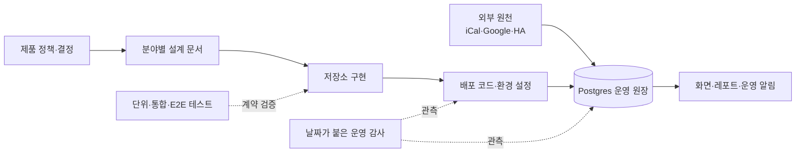

# PROPOS Documentation Traceability

> 작성일: 2026-11-13 · 통합 문서 연결 보강·재검증: 2026-11-17 · 마지막 동기화: 2026-11-26 (DP-08) (Asia/Seoul)  
> 목적: 제품 결정과 설계 문서가 실제 코드·API·데이터·테스트·운영 근거로 어떻게 이어지는지 추적  
> 프로젝트·문서 탐색: [design_overview.md](design_overview.md)  
> 사람·화면·시나리오: [actor_ui_scenarios.md](actor_ui_scenarios.md)  
> API·외부 인터페이스·협업: [runtime_interfaces_and_collaboration.md](runtime_interfaces_and_collaboration.md)  
> 오류·재시도·로그·알림: [error_observability.md](error_observability.md)  
> 문서 충돌·중복·정리 제안: [refactoring_mdfile.md](refactoring_mdfile.md)  
> 현재 작업·결정 상태: [docs/refactoring.md](docs/refactoring.md#sec-02)  
> 검색 키워드: `[TRACE]` `[POLICY]` `[CODE]` `[DATA]` `[TEST]` `[OPS]` `[GAP]`

이 문서는 기존 설계를 다시 설명하지 않는다. 각 주제의 **정책 → 설계 → 통합 해설 → 실행 코드·API → 데이터 → 테스트 → 운영 근거** 연결만 제공한다. 구현 진행 상태는 `docs/refactoring.md`, 문서 간 충돌 판정은 `refactoring_mdfile.md`에서 관리한다.

## 1. 추적 원칙 [TRACE]

| 근거 종류 | 의미 | 판정할 수 없는 것 |
| --- | --- | --- |
| 정책·결정 | 사용자가 승인한 의도와 운영 원칙 | 현재 코드·배포가 실제로 따르는지 여부 |
| 저장소 구현 | 현재 작업 트리의 코드·스키마·설정 | 운영에 배포되었는지, 환경값이 활성인지 여부 |
| 배포·운영 관측 | 특정 시점의 배포·DB·환경·실기 확인 | 관측일 이후에도 같은 상태인지 여부 |
| 외부 원천 | iCal·Google Calendar·HA 같은 원본 시스템 | 내부 원장에 성공적으로 반영되었는지 여부 |
| 내부 운영 원장 | 화면·레포트가 재구성하는 Postgres 기록 | 외부 원천과 항상 일치하는지 여부 |
| 테스트 | 명시된 입력과 계약의 회귀 방어 | 실제 외부 서비스·기기에서의 종단 성공 |
| 통합 해설 | 액터·화면·인터페이스·오류를 코드 근거에 맞춰 연결한 탐색 문서 | 정책 승인, 배포 상태, 기존 분야별 설계의 대체 |

판정 규칙:

1. 정책과 코드가 다르면 최신 날짜만 보고 선택하지 않고 `정책-구현 불일치`로 남긴다.
2. 코드가 존재해도 운영 환경과 배포 근거가 없으면 `구현 가능`으로만 판정한다.
3. 운영 관측에는 날짜와 범위를 붙이며 현재 상태로 일반화하지 않는다.
4. 외부 원천과 내부 운영 원장은 역할이 다르므로 어느 하나를 포괄적인 단일 정본이라고 부르지 않는다.
5. 아래 표의 `문서 갭`은 [refactoring_mdfile.md](refactoring_mdfile.md#review-findings)의 MD-R 항목으로 연결한다.

## 2. 근거와 데이터의 흐름 [POLICY] [DATA]

화살표는 책임과 관측 방향이다. 문서가 코드를 실행하거나 테스트가 운영 성공을 보장한다는 뜻이 아니다.

## 3. 핵심 기능 추적표 [TRACE]

### TR-01 · 숙소 상태 머신

| 구분 | 연결 근거 |
| --- | --- |
| 정책·설계 | DEC-10·11·16·17(상태 = 일정, 확인 못 하면 운영자에게 — [room-state-machine.md 0절](docs/room-state-machine.md)), [room-state-machine.md](docs/room-state-machine.md), [event-detection-design.md](docs/event-detection-design.md) |
| 실행 코드 | [roomStateDomain.js](src/domain/room-state/roomStateDomain.js), [eventTypes.js](src/config/eventTypes.js), Pi 워처 [occupancyWatcher.js](server/occupancyWatcher.js) |
| 데이터·외부 | 서버가 보내는 예약·다음 청소 일정 → Pi occupancy watcher, Home Assistant 센서, Postgres `events` |
| 검증 | [s11.room-state.test.js](tests/unit/s11.room-state.test.js), [s17.event-types.test.js](tests/unit/s17.event-types.test.js), [s30.watcher-ha.test.js](tests/integration/s30.watcher-ha.test.js), [s134 예정 퇴실](tests/unit/s134.rf29-scheduled-checkout.test.js), [s141 예정 입실](tests/unit/s141.scheduled-checkin.test.js), [s144 청소 일정](tests/unit/s144.scheduled-cleaning.test.js) |
| 문서 갭 | [MD-R02](refactoring_mdfile.md#md-r02): 10/12개 상태 복제와 코드 주석 버전, [MD-R03](refactoring_mdfile.md#md-r03): VACANT 에너지 상태 |

### TR-02 · 센서 이벤트 수신과 상태 재건

| 구분 | 연결 근거 |
| --- | --- |
| 정책·설계 | [event-detection-design.md](docs/event-detection-design.md), [data-storage-design.md](docs/data-storage-design.md), [event-ingestion-audit.md](docs/event-ingestion-audit.md) |
| 실행 코드 | [events API](api/events/[...slug].js), `src/application/eventService.js`, `src/infrastructure/eventRepository.js` |
| 데이터·외부 | Pi outbox → `/api/events/*` → Postgres `events` |
| 검증 | [s106.event-delivery.test.js](tests/unit/s106.event-delivery.test.js), [s93.event-provenance.test.js](tests/unit/s93.event-provenance.test.js), [s48.current-state-from-events.test.js](tests/unit/s48.current-state-from-events.test.js) |
| 문서 갭 | [MD-R04](refactoring_mdfile.md#md-r04): 현재 상태를 KV·HA로 설명한 과거 문구, [MD-R12](refactoring_mdfile.md#md-r12): 구현 체크리스트 시점 |

### TR-03 · 예약 동기화와 청소 작업

| 구분 | 연결 근거 |
| --- | --- |
| 정책·설계 | [cleaning-automation-design.md](docs/cleaning-automation-design.md), [cleaning-scenario-matrix.md](docs/cleaning-scenario-matrix.md), [data-architecture-and-simulator.md](docs/data-architecture-and-simulator.md) |
| 실행 코드 | [cleaning API](api/cleaning/[...slug].js), [_icalSync.js](server/cleaning/_icalSync.js), [_dispatch.js](server/cleaning/_dispatch.js), [_calendar.js](server/cleaning/_calendar.js) |
| 데이터·외부 | Airbnb iCal → `property_reservations` → `cleaning_jobs` → Google Calendar |
| 검증 | [s36.cleaning-integration.test.js](tests/unit/s36.cleaning-integration.test.js), [s115.daily-reservation-sync.test.js](tests/unit/s115.daily-reservation-sync.test.js), [s30.job-cancellation.test.js](tests/unit/s30.job-cancellation.test.js), [s78.operator-scope-handlers.test.js](tests/unit/s78.operator-scope-handlers.test.js) |
| 문서 갭 | [MD-R01](refactoring_mdfile.md#md-r01): 외부 예약 원천과 내부 운영 원장, [MD-R08](refactoring_mdfile.md#md-r08): Google 인증 방식, [MD-R18](refactoring_mdfile.md#md-r18): 청소 상태 복제 |

### TR-04 · 청소 담당자 알림

| 구분 | 연결 근거 |
| --- | --- |
| 정책·설계 | ACT-11 규칙(앱 푸시만, 문자 안 씀)·DEC-09(앱 다시 설치 시 복구)·DEC-13(하루 전 알림) — [docs/refactoring.md 6절](docs/refactoring.md#rules), [cleaning-automation-design.md](docs/cleaning-automation-design.md), [worker-app-spec.md](docs/worker-app-spec.md), [cleaning-notification-reliability-audit.md](docs/cleaning-notification-reliability-audit.md) |
| 실행 코드 | [_notify.js](server/cleaning/_notify.js), [_push.js](server/cleaning/_push.js), [_sms.js](server/cleaning/_sms.js), [_slack.js](server/cleaning/_slack.js), [workers API](api/workers/[...slug].js) |
| 데이터·외부 | `cleaners`, `cleaning_notifs`, Firebase FCM, SMS gateway 인터페이스, Slack webhook |
| 검증 | [s26.cleaning-notify-channel.test.js](tests/unit/s26.cleaning-notify-channel.test.js), [s108.cleaning-delivery-results.test.js](tests/unit/s108.cleaning-delivery-results.test.js), [s109.cleaning-initial-delivery.test.js](tests/integration/s109.cleaning-initial-delivery.test.js), [s137 앱 최초 연결](tests/integration/s137.worker-register-guard-sql.test.js), [s139 하루 전 알림](tests/unit/s139.act18-day-before-reminder.test.js) |
| 문서 갭 | [MD-R06](refactoring_mdfile.md#md-r06): Worker App 현재 상태, [MD-R07](refactoring_mdfile.md#md-r07): FCM 정책·SMS 코드·시점별 운영 관측, [MD-R11](refactoring_mdfile.md#md-r11): Slack 역할 |

### TR-05 · 레포트와 안심지수

| 구분 | 연결 근거 |
| --- | --- |
| 정책·설계 | DEC-02·RF-26([docs/refactoring.md 6절](docs/refactoring.md#rules)), [report-architecture.md 6-1](docs/report-architecture.md#safety-index), [reporting-feature-design.md](docs/reporting-feature-design.md), 표 문구의 출발점 [D-026](.claude/rules/decisions.md) |
| 실행 코드 | [stats API](api/stats.js), [reportingService.js](src/application/reportingService.js), [reportingDomain.js](src/domain/reportingDomain.js), [operationalMetricsDomain.js](src/domain/operationalMetricsDomain.js) |
| 데이터·외부 | Postgres `events`, `cleaning_jobs`, `property_reservations` |
| 검증 | [s23.stats-service.test.js](tests/unit/s23.stats-service.test.js), [s48.current-state-from-events.test.js](tests/unit/s48.current-state-from-events.test.js), [s62.operational-metrics-summary.test.js](tests/unit/s62.operational-metrics-summary.test.js), [s124.rf26-rate-eligibility.test.js](tests/unit/s124.rf26-rate-eligibility.test.js) |
| 문서 갭 | [MD-R05](refactoring_mdfile.md#md-r05) 종결(DEC-02 — 판정 기록이 없는 4개 지표 제외, 자동화 개선율은 별도), [MD-R10](refactoring_mdfile.md#md-r10): 월간 범위, [MD-R20](refactoring_mdfile.md#md-r20): 계산 규칙 중복 |

### TR-06 · 인증과 숙소 권한

| 구분 | 연결 근거 |
| --- | --- |
| 정책·설계 | [.claude/rules/decisions.md](.claude/rules/decisions.md)의 D-034·D-035, [docs/refactoring.md](docs/refactoring.md#sec-02) |
| 실행 코드 | [operatorAuth.js](server/auth/operatorAuth.js), [operatorAccounts.js](server/auth/operatorAccounts.js), `requireScope`, `guardAdmin` 호출 API |
| 데이터·외부 | 운영자 계정·숙소 범위 테이블, 서명 세션 쿠키, `PROPOS_AUTH_MODE` 환경 설정 |
| 검증 | [s76.operator-auth.test.js](tests/unit/s76.operator-auth.test.js), [s78.operator-scope-handlers.test.js](tests/unit/s78.operator-scope-handlers.test.js), [s79.operator-device-scope.test.js](tests/unit/s79.operator-device-scope.test.js) |
| 문서 갭 | [MD-R13](refactoring_mdfile.md#md-r13): 단일 관리자 가정, [MD-R26](refactoring_mdfile.md#md-r26): 운영 관측(2026-11-10~14)상 `enforce` — 날짜 없는 “강제됨” 표현은 피함 |

### TR-07 · 운영 스케줄과 하위 작업

| 구분 | 연결 근거 |
| --- | --- |
| 정책·설계 | [cleaning-automation-design.md](docs/cleaning-automation-design.md), [report-architecture.md](docs/report-architecture.md) |
| 실행 코드 | [vercel.json](vercel.json), [cron API](api/cron/[...slug].js) |
| 데이터·외부 | Vercel morning/evening 스케줄, 예약 동기화·Pi 일정 전달(RF-27·52)·보고·청소 후속·하루 전 알림(ACT-18)·Watch 갱신 하위 작업 |
| 검증 | [s34.cron-tick.test.js](tests/unit/s34.cron-tick.test.js)(실제 handler 실행), [s115.daily-reservation-sync.test.js](tests/unit/s115.daily-reservation-sync.test.js), [s125 Pi 예약 전달](tests/unit/s125.rf27-watcher-reservation-sync.test.js), [s80.token-health.test.js](tests/unit/s80.token-health.test.js) |
| 문서 갭 | [MD-R09](refactoring_mdfile.md#md-r09): 등록 스케줄·호출 가능한 handler·내부 하위 작업 혼용 |

### TR-08 · 센서 기반 입실 준비

| 구분 | 연결 근거 |
| --- | --- |
| 정책·설계 | DEC-01(센서 기반 판정)·DEC-19(겨울에는 켜지 않음)·ACT-20·21(가상 플로우 점검, IR 토글을 거실 온도 추세로 확인) — [docs/refactoring.md](docs/refactoring.md#rules), [pre-stay-optimization.md](docs/pre-stay-optimization.md), [pre-stay-field-review.md](docs/pre-stay-field-review.md), [room-state-machine.md](docs/room-state-machine.md#10-센서-기반-입실-준비--2026-11-06) |
| 실행 코드 | `src/application/preStayOptimizationController.js`, `src/domain/preStayOptimizationDomain.js`, Pi preparation watcher·outbox |
| 데이터·외부 | 예약·센서·날씨·HA 장치 → 준비 실행 → Postgres `events` |
| 검증 | [s94.pre-stay-consistency.test.js](tests/unit/s94.pre-stay-consistency.test.js), [s96.sensor-preparation.test.js](tests/unit/s96.sensor-preparation.test.js), [s95.pre-stay-context.test.js](tests/integration/s95.pre-stay-context.test.js) |
| 문서 갭 | 현장 장치·센서 계약과 운영 검증 상태는 [docs/refactoring.md](docs/refactoring.md#sec-02)의 ACT 항목에서만 관리 |

### TR-09 · 데이터 프로필과 외부 동작 경계

| 구분 | 연결 근거 |
| --- | --- |
| 정책·설계 | [data-architecture-and-simulator.md](docs/data-architecture-and-simulator.md), [data-storage-design.md](docs/data-storage-design.md) |
| 실행 코드 | [dataProfile.js](src/config/dataProfile.js), 스키마의 `data_origin`, API·cron의 REAL 외부 동작 필터 |
| 데이터·외부 | HYBRID 조회, REAL/SIMULATED 행 구분, 명시적 DEMO fixture |
| 검증 | [s70.data-profile-integrity.test.js](tests/unit/s70.data-profile-integrity.test.js), [s71.source-aware-data-contract.test.js](tests/unit/s71.source-aware-data-contract.test.js) |
| 문서 갭 | `REAL`, `SIMULATED`, `DEMO`, `HYBRID`를 환경·행 출처·fixture 의미로 구분해 사용 |

### TR-10 · 액터·권한·UI 시나리오

| 구분 | 연결 근거 |
| --- | --- |
| 정책·설계 | [docs/scenarios.yaml](docs/scenarios.yaml), [propos-usecase.uml](myPlantUML/propos-usecase.uml), D-033~D-035 |
| 통합 해설 | [actor_ui_scenarios.md](actor_ui_scenarios.md): 인증 역할과 업무 역할, 웹·Worker App Navigation Tree, 액터별 정상·예외 시나리오 |
| 실행 코드 | [main.jsx](src/main.jsx), [App.jsx](src/components/App.jsx), [AuthGate.jsx](src/components/AuthGate.jsx), [RoomStateApp.jsx](src/components/v2/RoomStateApp.jsx), [worker-app](worker-app) |
| API·데이터 | `/api/auth/*`, `/api/stats*`, `/api/cleaning/*`, `/api/workers/*`, 운영자·숙소 scope와 Room State read model |
| 검증 | [s76.operator-auth.test.js](tests/unit/s76.operator-auth.test.js), [s79.operator-device-scope.test.js](tests/unit/s79.operator-device-scope.test.js), [s31.worker-app-flow.test.js](tests/unit/s31.worker-app-flow.test.js) |
| 운영 근거 한계 | 저장소의 화면·권한 구현을 설명하며, 설치 앱·외부 연결 상태는 별도 날짜 근거가 필요. 인증 모드는 [MD-R26](refactoring_mdfile.md#md-r26)의 2026-11-10~14 관측 |
| 문서 갭 | [MD-R13](refactoring_mdfile.md#md-r13): 관리자 수, [MD-R26](refactoring_mdfile.md#md-r26): 인증 강제 여부, [MD-R28](refactoring_mdfile.md#md-r28): 수락·예약·ASSIGNED 의미 |

### TR-11 · API·외부 인터페이스·런타임 협업

| 구분 | 연결 근거 |
| --- | --- |
| 정책·설계 | 청소·보고·HA·데이터 분야별 문서와 [vercel.json](vercel.json) |
| 통합 해설 | [runtime_interfaces_and_collaboration.md](runtime_interfaces_and_collaboration.md): method/path/호출자/인증/멱등성, 외부 인터페이스, sequence, cron 하이어라키 |
| 실행 코드 | [api](api), [server](server), [src/application](src/application), [src/infrastructure](src/infrastructure) |
| API·데이터 | 12개 Vercel API 진입점, Postgres·KV, Airbnb·Google·HA·Pi·FCM·Slack |
| 검증 | [s78.operator-scope-handlers.test.js](tests/unit/s78.operator-scope-handlers.test.js), [s105.event-ingestion-contract.test.js](tests/unit/s105.event-ingestion-contract.test.js), [s109.cleaning-initial-delivery.test.js](tests/integration/s109.cleaning-initial-delivery.test.js), [s115.reservation-changes-sql.test.js](tests/integration/s115.reservation-changes-sql.test.js) |
| 운영 근거 한계 | 저장소 interface 계약과 실제 외부 접수·전달·사용자 확인은 분리 |
| 문서 갭 | [MD-R07](refactoring_mdfile.md#md-r07): 채널·운영 상태, [MD-R08](refactoring_mdfile.md#md-r08): Google 인증, [MD-R09](refactoring_mdfile.md#md-r09): cron 계층 |

### TR-12 · 오류·재시도·로그·운영 알림

| 구분 | 연결 근거 |
| --- | --- |
| 정책·설계 | 청소 알림 신뢰성 감사, event ingestion 감사, 각 API의 현재 오류 계약 |
| 통합 해설 | [error_observability.md](error_observability.md): 현재 예외·업무 상태·HTTP 오류·재시도·로그와 `TARGET · 미구현` 권장안 분리 |
| 실행 코드 | [operatorAuth.js](server/auth/operatorAuth.js), [_initialDelivery.js](server/cleaning/_initialDelivery.js), [_notify.js](server/cleaning/_notify.js), [_push.js](server/cleaning/_push.js), [_sms.js](server/cleaning/_sms.js), [cron API](api/cron/%5B...slug%5D.js) |
| 데이터·운영 채널 | delivery receipt·job status·KV watch 상태·console·Slack·UI Toast/Alert |
| 검증 | [s108.cleaning-delivery-results.test.js](tests/unit/s108.cleaning-delivery-results.test.js), [s110.worker-token-recovery.test.js](tests/unit/s110.worker-token-recovery.test.js), [s111.worker-token-sql.test.js](tests/integration/s111.worker-token-sql.test.js), [s122.watcher-auth.test.js](tests/unit/s122.watcher-auth.test.js) |
| 운영 근거 한계 | 코드의 console/Slack 경로는 확인했으나 로그 보존·검색 설정과 실제 수신 상태는 확인하지 않음 |
| 문서 갭 | [MD-R11](refactoring_mdfile.md#md-r11): Slack 책임, [MD-R27](refactoring_mdfile.md#md-r27): 현재 오류·로그와 목표 규칙 혼용 |

### TR-13 · 이상 감지와 자동화 개선율 (RF-25)

| 구분 | 연결 근거 |
| --- | --- |
| 정책·설계 | DEC-02(안심지수와 별도 지표), DEC-21(안정화 시간 마스터·숙소별 설정), DEC-22(내부 숙박·청소 의무), DEC-23(이상 상태·중복 방지), DEC-24(배정 이력으로 미배정 측정) — [docs/refactoring.md 6절](docs/refactoring.md#rules), 계산 정본 [report-architecture 6-1-1](docs/report-architecture.md#automation-rate) |
| 실행 코드 | 감지기 [noiseAnomalies.js](server/noiseAnomalies.js), [vacantEnergyAnomalies.js](server/vacantEnergyAnomalies.js), [deviceOfflineAnomalies.js](server/deviceOfflineAnomalies.js), [guestComplaintAnomalies.js](server/guestComplaintAnomalies.js), [_unassignedAnomalies.js](server/cleaning/_unassignedAnomalies.js) · 기록 [anomalyRepository.js](server/anomalyRepository.js) · 설정 [anomalyPolicySettings.js](server/anomalyPolicySettings.js) |
| 진입점 | 이벤트 저장(`/api/events/write`) 때 센서 이상 판정, Gmail 웹훅에서 게스트 불만 분류, 정기 작업 청소 후속에서 청소 미배정, 관리자 설정 `/api/cleaning/anomaly-policy` |
| 데이터·외부 | `automation_anomalies`·`automation_anomaly_history`·`automation_open_incidents`, `automation_policy_versions`·`automation_policy_values`, `property_stays`·`cleaning_obligations`, `cleaning_assignment_history`, `guest_complaint_signals`(원문 없음) — [migrate-automation-anomalies.sql](data/migrate-automation-anomalies.sql) |
| 검증 | 정책 [s147](tests/unit/s147.rf25-anomaly-policy.test.js), 기록 [s149](tests/unit/s149.rf25-anomaly-recording.test.js)·[s149 SQL](tests/integration/s149.rf25-anomaly-recording-sql.test.js), 청소 미배정 [s152](tests/unit/s152.rf25-cleaning-unassigned-detector.test.js), 소음 [s153](tests/unit/s153.rf25-noise-detector.test.js), 빈방 에너지 [s154](tests/unit/s154.rf25-vacant-energy-detector.test.js), 기기 오프라인 [s155](tests/unit/s155.rf25-device-offline-detector.test.js), 게스트 불만 [s156](tests/unit/s156.rf25-guest-complaint-sensor.test.js) — 감지기마다 `tests/integration/`에 같은 번호의 SQL 시험이 있다 |
| 운영 근거 한계 | 정본 5가지 측정 연결(이상 기록)은 2026-11-25 완료([docs/refactoring.md 5절](docs/refactoring.md#done)). 그 기록으로 비율을 계산·표시하는 코드는 아직 없다([RF-58](docs/refactoring.md#decide)). 실제 숙소에서 각 감지기가 발생·해결을 기록하는지는 날짜가 붙은 운영 관측이 따로 필요 |
| 문서 갭 | 없음 — 통합 문서에는 2026-11-26 반영 |

## 4. 교차 추적에서 드러난 우선 갭 [GAP]

| 우선순위 | 갭 | 다음 판정 위치 |
| --- | --- | --- |
| 1 | 정책은 앱 푸시만(ACT-11)인데 코드에 SMS 선택 경로가 남은 정책-구현 불일치. 날짜별 활성 채널 관측과도 섞지 않음 | [MD-R07](refactoring_mdfile.md#md-r07) |
| 2 | ~~현재 안심지수 구현과 제품 명칭의 최종 의미~~ — 종결: DEC-02로 정의 확정, 자동화 개선율은 별도 | [MD-R05](refactoring_mdfile.md#md-r05) |
| 3 | 인증 기능 존재와 운영 `enforce` 활성은 별도 증거가 필요함 — 2026-11-10~14 운영 관측 있음 | [MD-R26](refactoring_mdfile.md#md-r26) |
| 4 | 등록된 cron 두 개와 handler 내부의 여러 작업을 같은 주기로 설명하면 안 됨 | [MD-R09](refactoring_mdfile.md#md-r09) |
| 5 | 외부 예약 원천과 내부 Postgres 원장의 정본 범위를 구분해야 함 | [MD-R01](refactoring_mdfile.md#md-r01) |
| 6 | 현재 API 오류 형식과 아직 구현되지 않은 공통 오류·로그 목표를 같은 표준처럼 설명하면 안 됨 | [MD-R27](refactoring_mdfile.md#md-r27) |
| 7 | Worker의 수락 버튼, Google Calendar 예약, 내부 `ASSIGNED` 확정을 같은 순간으로 표현하면 안 됨 | [MD-R28](refactoring_mdfile.md#md-r28) |

## 5. 유지 규칙

- 새 기능 설명을 이 문서에 복사하지 않고 기존 정책·설계·코드·테스트 링크만 추가한다.
- 작업 상태·담당자·배포 결과는 `docs/refactoring.md` 또는 날짜가 붙은 감사 문서에서 관리한다.
- 문서 충돌의 중요도·판정·정리 순서는 `refactoring_mdfile.md`에서 관리한다.
- 코드나 파일이 이동하면 링크만 갱신하며, 이 문서를 새 정본으로 승격하지 않는다.
- 운영 관측을 추가할 때는 관측일·환경·검증 범위를 함께 기록한다.
