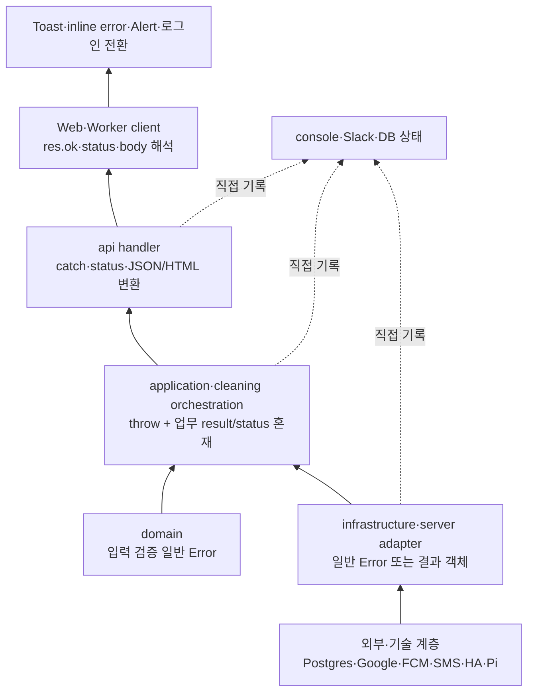
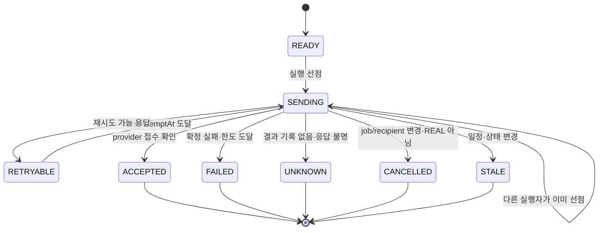
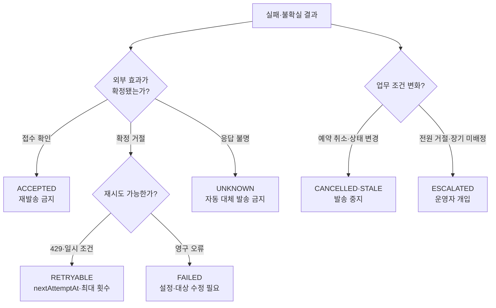
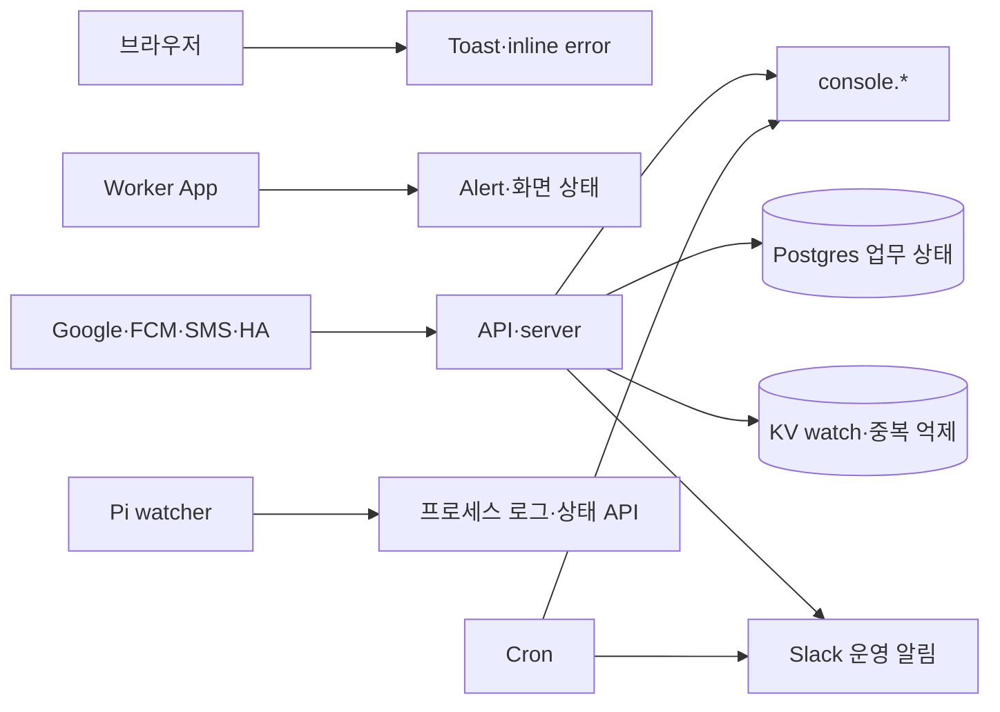
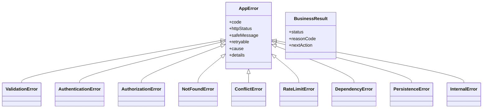
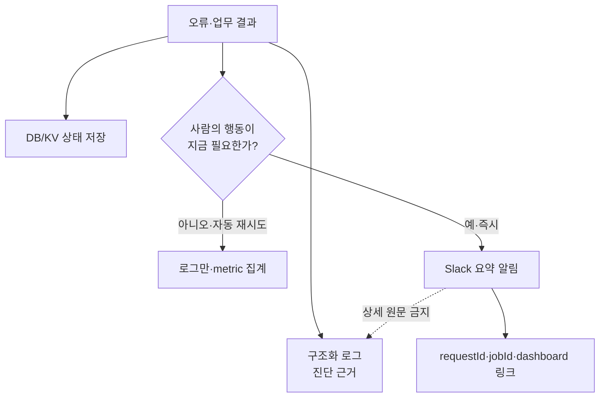

# PROPOS 오류 처리와 관측성

> 목적: 현재 코드가 실패를 어떻게 표현·전파·응답·재시도·기록하는지 설명하고, 앞으로의 권장 규칙은 별도 구역에서 명확히 분리한다.  
> 대상 독자: 개발자, 운영 담당자, 보안·개인정보 검토자, 테스트 담당자  
> 읽는 순서: [1. 실패 분류](#failure-taxonomy) → [2. 현재 구현](#current-error-model) → [4. 재시도·개입](#retry-intervention) → [5. 현재 로그](#current-observability) → [7. 권장 목표](#target-model)  
> 기준일: 2026-11-17 (Asia/Seoul)  
> 저장소 기준: [doc_plan.md의 최신 검증 기준점](doc_plan.md#validation)  
> 사실 범위: `현재 구현`과 `권장 목표·미구현`을 절대 섞지 않는다. 이 문서는 코드 변경을 수행하지 않는다.  
> 선행 문서: [runtime_interfaces_and_collaboration.md](runtime_interfaces_and_collaboration.md) · 상위 문서: [design_overview.md](design_overview.md)  
> 검색 키워드: `[ERR-]` `[CURRENT]` `[TARGET]` `[RETRY]` `[LOG]` `[PII]` `[SLACK]`

---

<a id="failure-taxonomy"></a>

## 1. 실패를 먼저 네 종류로 구분한다

| ID | 종류 | 뜻 | 예시 | 예외와의 관계 |
| --- | --- | --- | --- | --- |
| ERR-T01 | 입력·계약 오류 | 호출자가 필수값·형식·지원 범위를 어김 | invalid period, 필수 `property_id` 누락 | 보통 400; throw 또는 검증 결과로 표현 |
| ERR-T02 | 인증·권한 오류 | 신원 없음 또는 허용 범위 밖 | 401 `AUTH_REQUIRED`, 403 `FORBIDDEN`, scope 밖 404 | 예상 가능한 HTTP 경계 실패 |
| ERR-T03 | 업무 결과·충돌 | 시스템은 정상 실행됐지만 업무 조건이 맞지 않음 | 이미 ASSIGNED, 예약 취소, 전원 거절, stale state | 반드시 프로그램 예외일 필요가 없음 |
| ERR-T04 | 기술·의존성 실패 | DB·Google·FCM·HA·Pi·네트워크·저장 실패 | 502 watcher, 503 HA, DB query error | throw·provider result·HTTP 오류로 혼재 |

`FAILED`, `CANCELLED`, `UNKNOWN`, `ESCALATED`는 이름에 실패 의미가 있어도 모두 같은 종류가 아니다.

- `cleaning_jobs.status = ESCALATED`: 사람이 처리해야 하는 **업무 상태**.
- `initial_delivery_state = FAILED`: 특정 최초 발송 시도의 **지속 상태**.
- delivery `outcome = UNKNOWN`: 외부 요청 결과를 확인할 수 없는 **불확실성 상태**.
- 예약 `CANCELLED`: 예약·청소 필요가 사라졌다는 **도메인 상태**.
- HTTP 500: 요청 처리 자체가 실패했다는 **전송 계층 결과**.

이들을 전부 `Error` 하나로 묶으면 자동 재시도와 중복 외부 효과를 안전하게 판단할 수 없다.

---

<a id="current-error-model"></a>

## 2. 현재 오류 모델 [CURRENT]

<a id="current-hierarchy"></a>

### 2.1 현재 예외 전파 하이어라키



현재는 모든 계층에 공통인 exception base class나 중앙 error middleware가 없다. API별 `sendJson`·`reply`, route별 `try/catch`, 업무별 result object가 각각 경계를 만든다.

<a id="current-error-patterns"></a>

### 2.2 계층별 표현 방식

| 계층 | 현재 표현 | 대표 근거 | 현재 한계 |
| --- | --- | --- | --- |
| UI | `Toast.show`, inline `error`, React state, React Native `Alert` | [RoomStateApp](src/components/v2/RoomStateApp.jsx), [CleaningManager](src/components/v2/CleaningManager.jsx), [JobScreen](worker-app/src/screens/JobScreen.tsx) | 서버 메시지를 그대로 노출하는 경로와 고정 문구가 혼재 |
| Web auth | API 401을 전역 fetch patch로 감지해 로그인 전환 | [AuthGate](src/components/AuthGate.jsx) | 401 외 오류는 각 호출자가 처리 |
| Domain | 대부분 `throw new Error('...')` | [roomStateDomain](src/domain/room-state/roomStateDomain.js), [reportingDomain](src/domain/reportingDomain.js) | 오류 종류·안전한 사용자 메시지·HTTP 상태가 타입에 없음 |
| Application | `try/catch` 후 `status:'failed'`, 부분 결과, alert 또는 재throw | [reportingService](src/application/reportingService.js), [checkinService](src/application/checkinService.js) | 동일한 `status` 이름이 업무 상태와 기술 실패에 모두 사용될 수 있음 |
| Infrastructure | 일반 Error, provider 응답, 특정 custom error | [propertyRenameRepository](src/infrastructure/propertyRenameRepository.js), [monitoringClient](src/infrastructure/monitoringClient.js) | 공통 분류가 없음 |
| Cleaning delivery | `{outcome,state,errorCode,retryAfterMs}` 지속 결과 | [_initialDelivery](server/cleaning/_initialDelivery.js), [_notify](server/cleaning/_notify.js) | 가장 구조화돼 있으나 API 전체 표준은 아님 |
| API | `{error}`, `{error,code}`, `{ok:false,error,errorCode}`, HTML, 빈 body | [api](api) | 형식·status 매핑이 route마다 다름 |
| Cron | 단계별 또는 상위 `try/catch`, `console.error`, Slack | [cron API](api/cron/%5B...slug%5D.js) | 실행 전체를 연결하는 공통 run ID 없음 |

<a id="custom-errors"></a>

### 2.3 확인된 명시적 오류 타입·속성

| ID | 구현 | 구조 | 변환 위치 |
| --- | --- | --- | --- |
| ERR-C01 | `PropertyRenameError` | `code = INVALID/TARGET_EXISTS/CONFLICT`, safe message | cleaning API에서 400/409 + `{error,code}` |
| ERR-C02 | monitoring watcher 오류 | 일반 Error + `status` 속성 400/409/503 | watcher HTTP handler에서 status 사용 |
| ERR-C03 | `INITIAL_DELIVERY_STORAGE_FAILED` | 일반 Error에 DB `code`,`constraint`만 보존 | 상위 delivery/cron/API catch |
| ERR-C04 | `FCM_TOKEN_STORAGE_FAILED` | 일반 Error에 DB `code` 보존 | workers API 상위 catch → 500 `{error}` |
| ERR-C05 | provider delivery result | `outcome`, `provider`, `errorCode`, `retryAfterMs` | initial delivery state와 API result로 투영 |

현재 저장소에서 폭넓게 쓰이는 사용자 정의 class는 `PropertyRenameError` 한 가지가 확인됐다. 나머지는 일반 `Error`, 속성 부착, 또는 result object다.

<a id="business-failure-states"></a>

### 2.4 청소 발송의 업무 실패 상태



보완 설명:

- 실제 `initial_delivery_state`에 저장되는 값과 함수가 반환하는 `state`를 함께 그린 상위 모델이다. `STALE`, `CANCELLED`, `LEGACY`, `CLAIMED` 등은 모든 경우에 동일하게 DB 열에 저장되는 enum이라는 뜻이 아니다.
- `SENDING`이 2분 넘게 남으면 `UNKNOWN`으로 바꿔 중복 외부 발송을 피한다.
- `RETRYABLE`은 최대 3회와 `nextAttemptAt`을 가진다.
- provider 접수가 확인되지 않은 `UNKNOWN`은 SMS fallback을 자동 실행하면 중복 전달 위험이 있어 별도로 보존한다.

근거: [_initialDelivery.js](server/cleaning/_initialDelivery.js), [_push.js](server/cleaning/_push.js), [_sms.js](server/cleaning/_sms.js).

---

<a id="http-errors"></a>

## 3. 현재 HTTP 오류와 UI 처리 [CURRENT]

<a id="http-status-map"></a>

### 3.1 관측된 status 의미

| HTTP | 현재 의미 예시 | 응답 형태 예시 | UI·호출자 처리 |
| --- | --- | --- | --- |
| 400 | 필수값·형식·period·path·수동 배정 담당자 오류 | `{error}`, `{error,code}`, `{error,issues}` 또는 빈 body | 입력 보완·Toast·Alert·hook error |
| 401 | 로그인 없음·Pi secret·Worker token 없음 | `{error,code?}` 또는 빈 body | Web API 401은 AuthGate 로그인 전환; Worker는 호출별 처리 |
| 403 | role/scope·DEMO write 차단 | `{error,code}` 또는 빈 body | UI 오류; 일부 scope 보호는 404 사용 |
| 404 | 리소스 없음 또는 존재 숨김 | `{error}`·HTML·빈 body | 조회 실패·처리 불가 |
| 405 | method 불일치 | `{error}` 또는 빈 body | 일반 오류 |
| 409 | 중복·상태 충돌·소유권 충돌 | `{error}`, `{ok:false,error,errorCode}` | 재조회·수동 판단이 필요한 업무 충돌 |
| 429 | 로그인 과다 시도·provider rate limit | 로그인 `{error}`; provider는 `RETRYABLE` result | 로그인 대기; delivery는 `retryAfterMs` 고려 |
| 500 | 내부 오류·설정 오류·DB 오류 | `{error}`; 일부 실제 `err.message` | UI 오류·cron 실패 로그 |
| 502 | watcher/Google/iCal upstream 실패 | `{error}`, 빈 body | 외부 의존성 장애로 표시 |
| 503 | auth 설정·DB·HA·watcher 미설정/불가 | `{error,code?}`·빈 body | 잠시 후 재시도 또는 운영 설정 확인 |

<a id="response-shapes"></a>

### 3.2 현재 응답 body 패턴

```text
{ "error": "..." }
{ "error": "...", "code": "FORBIDDEN" }
{ "error": "...", "code": "CLEANER_REQUIRED | CLEANER_NOT_FOUND | CLEANER_INACTIVE" }
{ "error": "Invalid event", "issues": ["..."] }
{ "ok": false, "error": "...", "errorCode": "...", "deliveryState": "..." }
{ "ok": true, ... }
HTML 오류/완료 페이지          /api/cleaning/c, /d의 브라우저 모드
빈 body                       일부 401/403/405/502와 webhook 응답
binary body                   camera snapshot 성공
```

`error`가 사용자에게 그대로 보여도 안전한 메시지인지, 내부 진단용 메시지인지 구분하는 공통 필드가 없다. 예를 들어 cleaning 상위 catch는 `err.message`를 500 body로 내보내는 반면 events/stats는 고정 `Internal server error`를 사용한다.

<a id="ui-error-map"></a>

### 3.3 UI 오류 처리

| UI | 현재 처리 | 장점 | 한계 |
| --- | --- | --- | --- |
| AuthGate | 비-auth API의 401이면 로그인 화면 | 세션 만료를 중앙 처리 | 403·409·5xx는 분산 처리 |
| RoomStateApp | sync·설정·monitor operation을 Toast로 표시 | 사용자가 즉시 확인 | `error.message` 직접 노출 경로 존재 |
| CleaningManager | `apiFetch`가 body error/text를 Error로 만들고 Toast | 화면 코드가 단순 | API별 body 차이가 그대로 UI 차이가 됨 |
| reporting hooks | loading/data/error state | 비동기 화면에 적합 | status·code를 잃고 message만 남기는 경로 있음 |
| Worker App | 입력·등록·거절 결과를 Alert | 모바일 맥락에 명확 | register·heartbeat·token recovery 일부 실패가 화면에 직접 드러나지 않음 |

---

<a id="retry-intervention"></a>

## 4. 재시도·보류·운영자 개입 [CURRENT]

<a id="retry-decision"></a>

### 4.1 현재 판단 구조



<a id="retry-matrix"></a>

### 4.2 영역별 기준

| 영역 | 자동 재시도 | 보류·중지 | 운영자 개입 |
| --- | --- | --- | --- |
| 최초 청소 요청 | `RETRYABLE`, 최대 3회, 최소 시도 수×1분 또는 provider `retryAfter` | `UNKNOWN`, recipient/job 변경, REAL 아님 | `FAILED`, retry limit, delivery channel 없음 |
| FCM | quota 계열은 retryable; `UNREGISTERED`·`INVALID_ARGUMENT`은 확정 실패 후 코드상 SMS 전환 가능(정책은 앱 푸시만 — ACT-11, [MD-R07](refactoring_mdfile.md#md-r07)) | 응답 불명은 SMS 자동 fallback 금지 | token 재등록·앱 재설치 |
| SMS | detailed 초기 발송은 429만 retryable, 다른 5xx/네트워크는 UNKNOWN | 접수 여부 불명은 중복 방지 | 전달 확인·연락처 점검 |
| legacy SMS helper | 함수 내부 최대 3회·2초 간격 경로 존재 | 3회 실패 후 false | 채널·전화번호 확인 |
| VIP 청소 배정 | 접수 확인 시각부터 1시간 후 다음 tier | 예약 취소·job 상태 변경 | BULK 후 장기 미배정·전원 거절은 ESCALATED |
| iCal 예약 sync | morning/evening·Gmail trigger·수동 sync로 재실행 | 한 숙소 실패가 다른 숙소를 막지 않는 경로 | URL·원천·DB 관계 확인 |
| 예약 취소 판정 | 연속 동기화에서 부재 + 시간 조건 후 CANCELLED | 한 번 안 보인 것만으로 즉시 취소하지 않음 | 원천·기존 job 보정 확인 |
| Gmail/Calendar Watch | 경과 시간 기준 morning 자동 재등록 | token/API 실패 기록 | staleness Slack 후 OAuth·topic·webhook 점검 |
| morning cron | 하위 단계별 실패 격리 | 실패한 단계만 `ran`에서 빠짐 | console/Slack 근거로 수동 재실행 판단 |
| evening cron | iCal sync만 실패 격리; followup 실패는 결산까지 영향 가능 | 상위 500 | 운영자가 결산·followup 상태 확인 |
| HA·Pi polling | UI interval에서 다음 poll이 자연 재시도 | 이전 값 유지 또는 inactive 표시 | 장기 장애 시 watcher·HA 연결 확인 |

재시도 판단에서 가장 중요한 원칙은 “실패”와 “응답을 못 받은 것”을 구분하는 것이다. 외부 서비스가 요청을 접수했는데 응답만 유실된 경우 자동 재발송은 중복 작업을 만들 수 있다.

---

<a id="current-observability"></a>

## 5. 현재 로그·알림·상태 기록 [CURRENT]

<a id="current-log-inventory"></a>

### 5.1 코드 관측 인벤토리

2026-11-16 작업 트리의 `console.log|warn|error|info|debug` 호출 수:

| 영역 | 호출 수 |
| --- | ---: |
| `src` | 6 |
| `server` | 71 |
| `api` | 44 |
| `scripts` | 91 |
| `worker-app` | 0 |

수치는 호출 위치의 정적 개수이며 실제 로그 발생량이 아니다.

현재 확인 결과:

- 공통 structured logger library가 확인되지 않았다.
- 공통 request ID·correlation ID·trace ID 생성·전파가 확인되지 않았다.
- `console.error`, `console.warn`, `console.log`가 영역별 문자열 prefix와 함께 사용된다.
- 업무에 중요한 청소 최초 발송은 DB의 `initial_delivery_state`, `initial_delivery_data`, `initial_accepted_at`에 내구성 있는 상태를 저장한다.
- watch 갱신 시각·중복 알림 억제 등 일부 운영 메타데이터는 Vercel KV에 저장한다.
- Slack은 일일 브리핑·결산·배정 실패·watch 상태·앱 설치 등 운영 알림에 사용된다.

<a id="observability-flow"></a>

### 5.2 현재 관측 흐름



현재는 이 흐름을 하나의 correlation ID로 묶어 검색하는 수단이 없다. 대신 `job.id`, `property_id`, `cleaner.id`, event UUID, watcher ID, token health key 같은 업무 식별자를 영역별로 사용한다.

<a id="slack-vs-log-current"></a>

### 5.3 Slack과 로그의 현재 책임

| 채널 | 현재 사용 | 정본 여부 |
| --- | --- | --- |
| Postgres | 예약·이벤트·청소 job·notif·운영자·scope·delivery receipt | 업무 상태의 주 근거 |
| KV | watch 갱신·만료·중복 알림 억제 등 단기 운영 메타데이터 | 제한된 운영 상태 근거 |
| console | 함수·route·외부 호출 실패 진단 | 보존·검색·형식은 실행 환경에 의존 |
| Slack | 사람이 알아야 할 브리핑·배정 실패·복구·staleness | 알림 채널; 업무 원장·상세 로그 아님 |
| UI Toast/Alert | 현재 사용자에게 즉시 피드백 | 세션성 표시; 운영 감사 근거 아님 |

<a id="sensitive-data-current"></a>

### 5.4 민감정보 관측 [PII-CURRENT]

현재 코드에서 다음 위험 지점이 확인된다.

| 지점 | 현재 관측 | 위험 |
| --- | --- | --- |
| SMS 오류 로그 | 전화번호를 포함한 `console.error` | 로그에 개인 연락처 노출 |
| 신규 Worker Slack | 전화번호와 이메일을 Slack 본문에 포함 | 광범위한 운영 채널에 PII 노출 가능 |
| FCM token | Worker API body/query/Bearer에 사용 | URL·body dump·오류 detail에 남으면 자격정보 노출 |
| iCal URL | 환경·DB에 저장, `/api/config`·proxy에서 사용 | URL 자체가 비밀 토큰을 포함할 수 있음 |
| Google OAuth 오류 | 일부 `JSON.stringify`·provider detail | token·provider 세부정보가 섞일 가능성 |
| DB 상세 오류 | 초기 delivery는 PostgreSQL DETAIL을 safe error로 치환 | 이 경로는 private snapshot 유출을 줄이는 보호가 있음 |

이 표는 코드 변경 완료 목록이 아니다. 목표 마스킹 규칙은 [7. 권장 목표](#target-model)에 별도로 제시한다.

---

<a id="current-gaps"></a>

## 6. 현재 구조의 문서화된 한계 [CURRENT]

| ID | 한계 | 영향 | 현재 완화 |
| --- | --- | --- | --- |
| ERR-L01 | 공통 오류 class·code catalog 없음 | 같은 실패가 route마다 다른 status/body | 일부 `PropertyRenameError`, delivery errorCode |
| ERR-L02 | 중앙 error middleware 없음 | `err.message` 노출과 고정 메시지가 공존 | route별 catch |
| ERR-L03 | JSON·HTML·빈 body 혼재 | client 공통 처리 어려움 | UI별 parser·fallback |
| ERR-L04 | request/correlation ID 없음 | cron→DB→FCM→webhook 한 흐름 검색 어려움 | 업무 ID를 개별 로그에 포함 |
| ERR-L05 | structured logger·공통 level 규칙 없음 | 검색·집계·alert 기준 불일치 | 문자열 prefix |
| ERR-L06 | PII 마스킹 공통 함수 없음 | phone/email/iCal URL/token 노출 위험 | 일부 safe DB error·token 비출력 코드 |
| ERR-L07 | Slack 책임 범위가 중앙 정의되지 않음 | 상세 로그와 사람 알림이 섞일 수 있음 | 업무별 관례 |
| ERR-L08 | 일부 UI가 서버 `error.message`를 직접 표시 | 내부 문구·provider detail 노출 가능 | 일부 API는 고정 사용자 메시지 사용 |
| ERR-L09 | retry가 delivery·SMS·cron·polling에 분산 | 중첩 retry·중복 외부 효과 검토 필요 | 최초 delivery는 내구성 상태·선점 구현 |

---

<a id="target-model"></a>

## 7. 권장 목표 구조 [TARGET · 미구현]

이 절은 **문서 제안**이다. 현재 코드에 이미 존재한다고 해석하거나 이 문서를 근거로 즉시 구현하지 않는다. 실제 적용은 별도 승인·설계·마이그레이션 계획이 필요하다.

<a id="target-exception-hierarchy"></a>

### 7.1 권장 예외 하이어라키



권장 분리:

- `AppError`: 요청 처리·기술 실패를 API 경계로 전달.
- `BusinessResult`: `CANCELLED`, `ESCALATED`, `UNKNOWN`, `PARTIAL`처럼 업무적으로 보존해야 하는 결과.
- provider 원문은 `cause` 또는 제한된 내부 `details`에 두고 `safeMessage`와 분리.
- 기존 delivery result는 없애기보다 공통 오류 경계와 연결.

<a id="target-error-envelope"></a>

### 7.2 권장 HTTP 오류 envelope

```json
{
  "ok": false,
  "error": {
    "code": "DEPENDENCY_UNAVAILABLE",
    "message": "외부 서비스에 잠시 연결할 수 없습니다.",
    "retryable": true,
    "requestId": "req_..."
  }
}
```

권장 status 매핑:

| 목표 code 범주 | HTTP | 자동 재시도 기본값 | 사용자 행동 |
| --- | ---: | --- | --- |
| `VALIDATION_*` | 400 | 아니오 | 입력 수정 |
| `AUTH_REQUIRED` | 401 | 로그인 후 원 요청 재평가 | 로그인 |
| `FORBIDDEN` | 403 | 아니오 | 관리자 요청 |
| `NOT_FOUND` | 404 | 아니오 | 대상·scope 확인 |
| `CONFLICT_*` | 409 | 재조회 후 조건부 | 최신 상태 확인 |
| `RATE_LIMITED` | 429 | `Retry-After` 뒤 | 대기 |
| `UPSTREAM_BAD_RESPONSE` | 502 | 조건부 | 상태 확인 후 재시도 |
| `DEPENDENCY_UNAVAILABLE` | 503 | backoff | 잠시 후 재시도·장기면 운영자 |
| `INTERNAL_ERROR` | 500 | 기본 자동 재시도 금지 | requestId로 문의 |

<a id="target-log-rules"></a>

### 7.3 권장 로그 레벨·필수 필드 [LOG-TARGET]

| level | 사용 기준 | Slack 여부 |
| --- | --- | --- |
| `DEBUG` | 개발·진단용 세부 분기, 운영 기본 비활성 | 없음 |
| `INFO` | 정상 업무 전이·외부 접수 확인·cron 단계 완료 | 보통 없음 |
| `WARN` | 재시도 예정·부분 실패·staleness·업무 보류 | 사람이 조치해야 할 때만 |
| `ERROR` | 요청 실패·재시도 한도·데이터 저장 실패·의존성 장기 장애 | 중복 억제 후 운영 알림 가능 |
| `FATAL` | 프로세스 지속 불가·원장 무결성 위험 | 즉시 운영 알림 |

모든 서버 로그에 권장하는 필드:

| 필드 | 의미 | 비고 |
| --- | --- | --- |
| `timestamp` | UTC ISO 시각 | 표시 시 KST 변환 가능 |
| `level` | DEBUG/INFO/WARN/ERROR/FATAL | 문자열 고정 |
| `service` | `api`, `cron`, `watcher`, `cleaning` 등 | 실행 주체 |
| `operation` | `ical.sync`, `cleaning.dispatch` 등 | 검색 가능한 고정 이름 |
| `requestId` | 한 HTTP 요청 | 응답 header와 body 안전 필드에 연결 |
| `correlationId` | 예약→job→delivery→webhook 전체 | 외부 호출 header·DB receipt와 연결 검토 |
| `actorType` | admin/operator/pi/cron/worker/system | 개인 식별자는 별도 |
| `propertyId` | 업무 범위 | 민감도 검토 후 canonical ID |
| `jobId`, `eventId`, `watcherId` | 해당할 때의 업무 ID | token을 대신해 사용 |
| `outcome` | accepted/retryable/failed/unknown | 예외와 업무 결과 분리 |
| `errorCode` | 고정 catalog code | provider message와 분리 |
| `durationMs` | 외부·DB·전체 처리 시간 | 성능·timeout 분석 |

<a id="target-masking"></a>

### 7.4 권장 개인정보·자격정보 마스킹 [PII-TARGET]

| 데이터 | 로그·Slack 규칙 |
| --- | --- |
| 비밀번호·session cookie·OAuth token·FCM token·webhook secret·Pi secret | 절대 기록 금지 |
| Authorization·Cookie header | 전체 제거; 존재 여부만 boolean |
| iCal URL·booking URL | origin과 안전한 path label만; query·fragment 제거 |
| 전화번호 | 마지막 4자리만 또는 안정적 내부 worker ID 사용 |
| 이메일 | 필요 시 local 일부+domain 마스킹; 기본은 worker ID |
| guest name·메시지·숙소 상세 주소 | 운영 로그에 기본 기록 금지; 업무 UI·원장 접근 권한으로 제한 |
| provider response body | allowlist 필드만 구조화; 원문 전체 dump 금지 |
| DB error detail·query params | SQLSTATE·constraint만; row/detail·비밀 snapshot 제거 |

<a id="target-slack-boundary"></a>

### 7.5 권장 Slack·로그 책임 분리 [SLACK-TARGET]



권장 책임:

- DB/KV: 현재 업무 상태와 재시도 판단의 정본.
- 로그: 개발자·운영자가 원인을 추적할 상세 진단 근거.
- Slack: 사람이 지금 판단·조치할 사건의 짧은 요약.
- UI: 현재 사용자에게 필요한 다음 행동.
- Slack 메시지에는 token·전화번호·이메일·provider 원문을 넣지 않고 업무 ID와 안전한 dashboard 링크만 둔다.
- 같은 `correlationId + errorCode + 대상`은 시간창 내 중복 억제하고, 복구 알림은 실패 알림과 연결한다.

<a id="target-retry-policy"></a>

### 7.6 권장 공통 재시도 정책

1. 외부 효과가 시작됐는지 기록하기 전에 네트워크 호출하지 않는다.
2. `FAILED`와 `UNKNOWN`을 분리한다.
3. 멱등 키·조건부 update·provider receipt 없이 자동 재시도하지 않는다.
4. `retryable`, `nextAttemptAt`, `attempt`, `maxAttempts`를 한 소유 계층에서 결정한다.
5. 하위 transport retry와 상위 job retry가 중첩되지 않게 전체 최대 횟수를 계산한다.
6. 429는 `Retry-After`, 5xx·timeout은 provider 접수 가능성을 먼저 판정한다.
7. 재시도 한도·필수 설정 누락·영구 자격 오류는 운영자 개입으로 전환한다.
8. 재시도 성공 후 동일 incident의 복구 상태를 기록하고 필요할 때만 Slack으로 알린다.

---

<a id="implementation-path"></a>

## 8. 적용 순서 제안 [TARGET · 승인 전]

이 순서는 코드 작업 계획이며 현재 구현 상태가 아니다.

| 우선순위 | 문서·설계 작업 | 코드 적용 시 전제 |
| ---: | --- | --- |
| 1 | 현재 error code·status·응답 shape catalog 고정 | 동작 변경 없이 contract test부터 |
| 2 | 민감정보 inventory와 마스킹 규칙 승인 | 운영 로그·Slack 수신자·보존 정책 확인 |
| 3 | requestId·operation·업무 ID 최소 구조화 | 기존 console와 병행 기간 필요 |
| 4 | API error envelope adapter | 기존 client 호환 전략 필요 |
| 5 | 공통 error type 도입 | domain business result와 분리 |
| 6 | correlationId·metric·alert dedupe | DB/KV 저장 위치와 비용 결정 |
| 7 | Slack 메시지 최소화·runbook 링크 | 운영자 행동 기준 승인 |

사용자 승인 없이 이 제안을 제품 코드에 적용하지 않는다.

---

<a id="error-evidence"></a>

## 9. 근거와 검증

오류·재시도·로그→코드·API·테스트 근거는 [TR-12](documentation_traceability.md#tr-12)가 소유한다. 현재 구현의 문서 충돌·모호성은 [refactoring_mdfile.md](refactoring_mdfile.md)에만 기록하고, 실제 소스 리팩터링 작업 상태는 복제하지 않는다.
