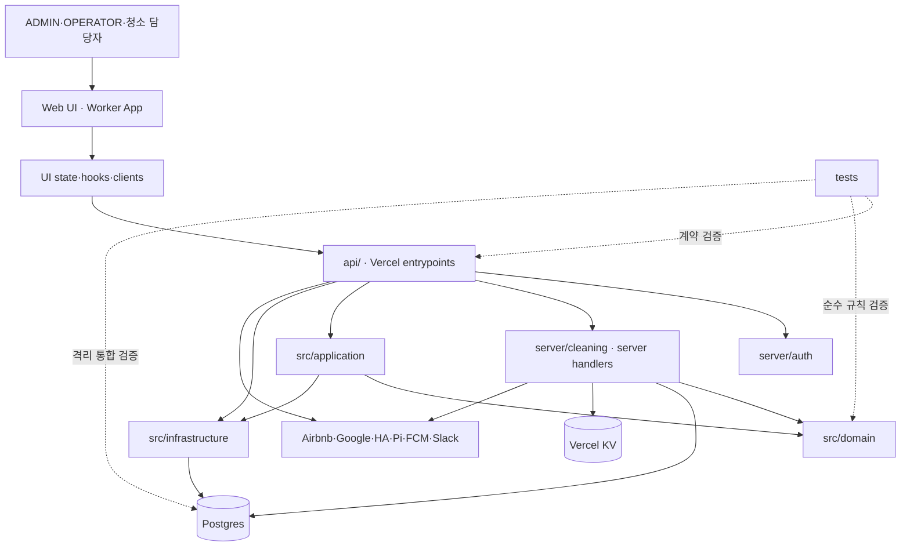
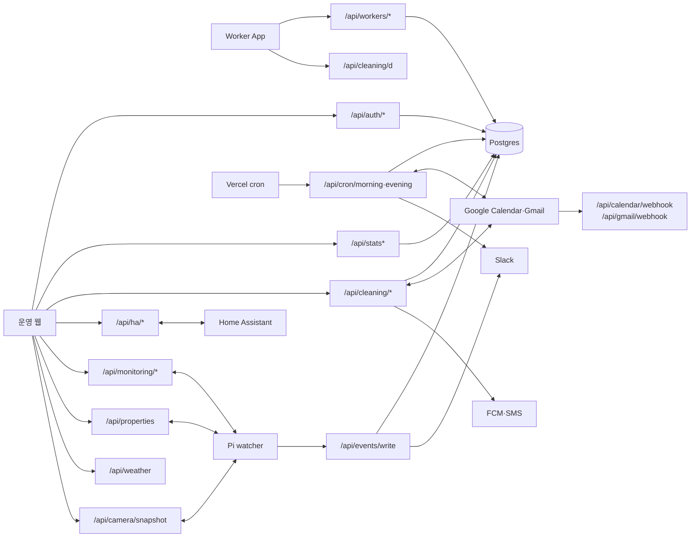
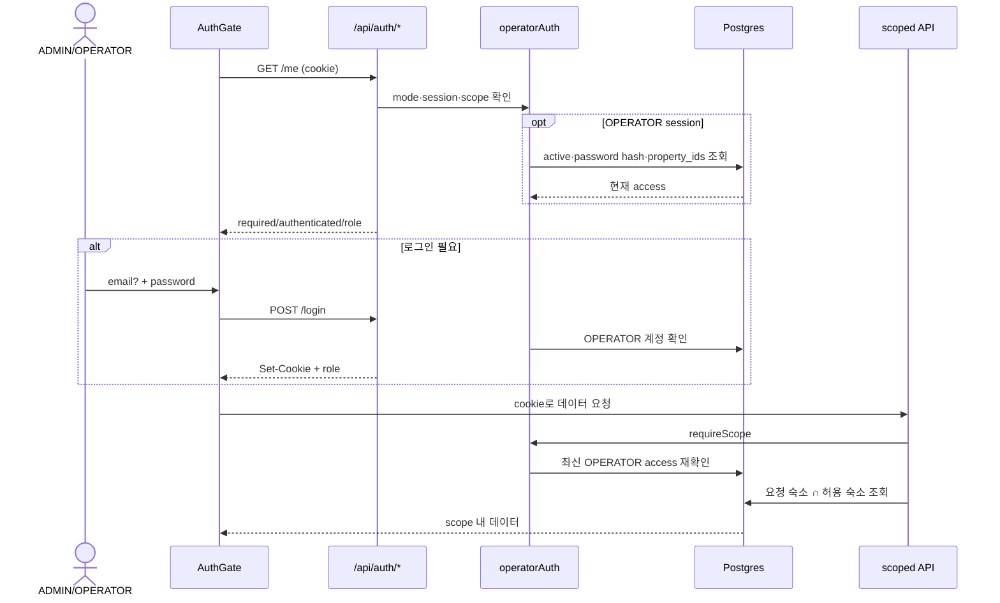
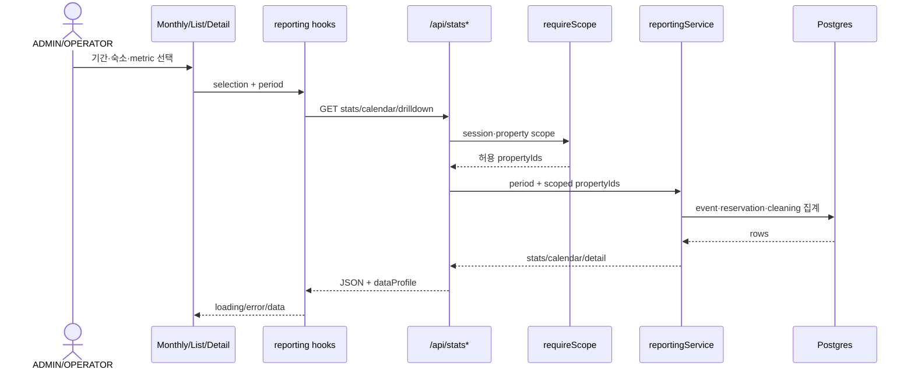
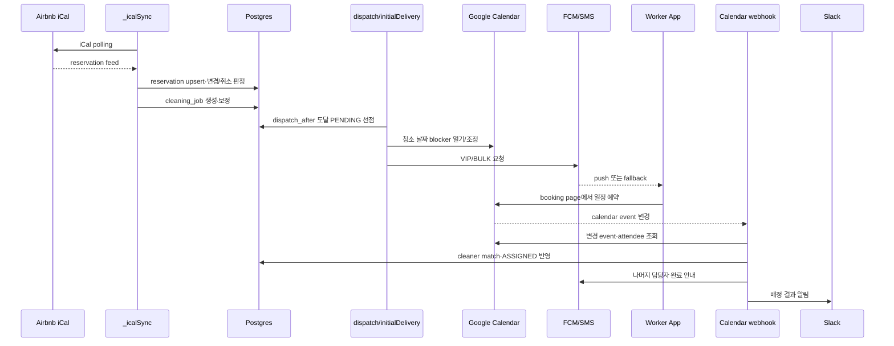
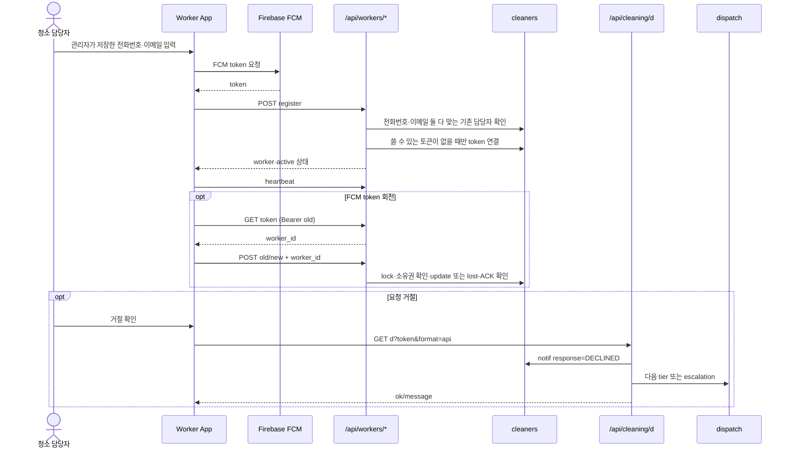
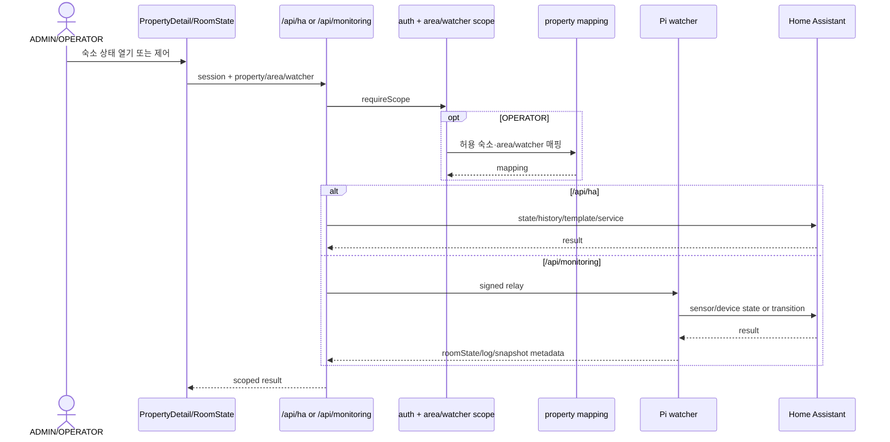
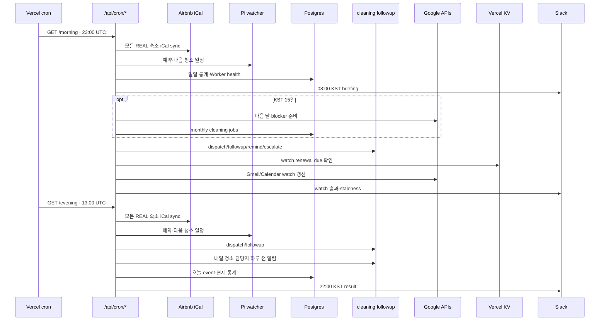
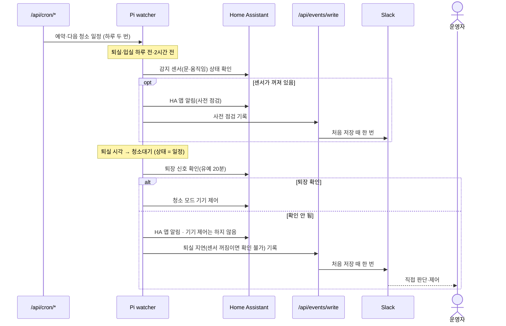

# PROPOS 런타임 인터페이스와 협업 구조

> 목적: 화면·API·서버 모듈·외부 시스템·데이터 저장소가 실제 실행 중 어떤 계약과 순서로 협업하는지 설명한다.  
> 대상 독자: 개발자, 운영 담당자, 테스트 담당자, 설계 검토자  
> 읽는 순서: [1. 런타임 지도](#runtime-map) → [3. API 계약](#api-contracts) → [4. 외부 인터페이스](#external-interfaces) → [5. 주요 시퀀스](#collaboration-sequences) → [6. cron 구조](#cron-hierarchy)  
> 마지막 동기화: 2026-11-26 (Asia/Seoul) — DP-08, 검증 기준은 [doc_plan.md](doc_plan.md#validation)  
> 사실 범위: 현재 저장소 구현. 운영 배포·외부 계정·환경변수 값은 별도 운영 근거 없이는 확정하지 않는다.  
> 선행 문서: [actor_ui_scenarios.md](actor_ui_scenarios.md) · 상위 문서: [design_overview.md](design_overview.md)  
> 검색 키워드: `[IF-]` `[SEQ-]` `[CRON-]` `[AUTH-]` `[IDEMPOTENCY]` `[DATA-PROFILE]`

---

<a id="runtime-map"></a>

## 1. 런타임 지도

<a id="runtime-layer-diagram"></a>

### 1.1 코드 계층과 의존 방향



의존 원칙을 현재 코드에 맞춰 읽는 방법:

1. `src/components`와 `worker-app`은 사람의 입력과 표시를 담당한다.
2. `src/application`은 보고·이벤트·체크인·체크아웃 같은 사용 흐름을 조합한다.
3. `src/domain`은 기간·예약·상태·배정 규칙처럼 외부 I/O와 분리 가능한 판단을 담는다.
4. `src/infrastructure`는 DB repository, HA, KV, weather 같은 기술 연결을 담당한다.
5. `api`는 HTTP 진입점·인증·profile 경계를 적용하고 `server`·application·infrastructure를 조합한다.
6. `server/cleaning`은 Google·FCM·SMS·Slack·청소 작업 저장을 함께 다루는 런타임 모듈이다.

현재 구현에는 모든 경로가 이 계층을 엄격히 지키는 단일 프레임워크가 있는 것은 아니다. 이 도식은 확인된 주 의존 방향이며, 실제 예외는 각 API 근거 링크에서 확인한다.

<a id="interface-map"></a>

### 1.2 API·외부 인터페이스 맵



---

<a id="runtime-boundaries"></a>

## 2. 공통 런타임 경계

<a id="auth-boundary"></a>

### 2.1 인증·권한 경계 [AUTH-01]

| 경계 | 식별 방식 | 현재 처리 |
| --- | --- | --- |
| 운영 웹 세션 | `propos_session` HttpOnly·SameSite=Strict 쿠키 | `admin` 또는 `operator` role, 12시간 TTL |
| ADMIN | 환경변수 관리자 비밀번호로 로그인 | 전체 숙소 scope |
| OPERATOR | DB 이메일·비밀번호 | 요청마다 계정 상태·비밀번호 지문·숙소 배정을 다시 확인 |
| Pi event ingest | `x-pi-secret` | `/api/events/write` POST에 사용(기본 주소 `/api/events`는 운영에서 404). 받는 쪽은 해시·상수 시간 비교(RF-44) |
| Cron | `Authorization: Bearer <CRON_SECRET>` | `CRON_SECRET`이 설정돼 있을 때 검사 |
| Worker App | 관리자가 미리 저장한 전화번호·이메일 일치 + FCM token | 운영 웹 세션과 별도; 문자 인증 없음; 연결 뒤 일부 endpoint가 token을 body/query/Bearer로 식별 |
| Google webhook | channel token 또는 query secret | secret 불일치는 상세 오류 대신 200으로 무시하는 경로가 있음 |
| Pi proxy | 운영 웹 session scope + Vercel→watcher 인증 header | watcher 주소와 숙소 배정을 함께 검사 |

`PROPOS_AUTH_MODE`:

| 값 | 운영 웹 API 의미 |
| --- | --- |
| `off` | 일반 guard·scope가 관리자 전체 범위로 통과 |
| `log` | 미인증 호출을 기록하되 관리자 전체 범위로 통과 |
| `enforce` | 로그인 없으면 401; 설정 누락이면 fail-closed 500 |

계정 관리 `/api/cleaning/operators*`는 예외적으로 `off`·`log`에서도 실제 ADMIN 세션을 요구한다. 근거: [operatorAuth.js](server/auth/operatorAuth.js), [cleaning API](api/cleaning/%5B...slug%5D.js).

<a id="data-profile-boundary"></a>

### 2.2 REAL·SIMULATED·DEMO 경계 [DATA-PROFILE]

| 구분 | 읽기 | 쓰기·외부 효과 | 문서 해석 |
| --- | --- | --- | --- |
| REAL | Postgres의 실제 원장 행 | Google·FCM·Slack·Pi·HA 등 운영 효과 가능 | 외부 효과 전 조건과 인증을 함께 확인 |
| SIMULATED | 일부 REAL과 같은 조회 구조로 표시 | 청소 dispatch·배정 등 외부 효과 차단 경로 존재 | 같은 화면에 보여도 운영 발송 대상으로 보면 안 됨 |
| DEMO profile | 정적·순수 demo service | DB·Google·알림·Pi·HA 쓰기를 차단 | 읽기 응답과 운영 API의 403을 구분 |
| HYBRID profile | REAL/SIMULATED를 같은 UI 모델로 병합 | 실제 외부 효과는 REAL로 제한 | `data_origin`을 잃지 않아야 함 |

근거: [dataProfile.js](src/config/dataProfile.js), [stats API](api/stats.js), [cleaning API](api/cleaning/%5B...slug%5D.js), [RoomStateApp](src/components/v2/RoomStateApp.jsx).

<a id="response-boundary"></a>

### 2.3 응답·멱등성 표기

이 문서에서 멱등성은 다음으로 표기한다.

| 표기 | 의미 |
| --- | --- |
| 읽기 | 같은 상태에서 반복해도 서버 업무 상태를 바꾸지 않음 |
| 조건부 멱등 | upsert·unique·상태 전이·확인 토큰 등으로 같은 의도의 중복을 제한 |
| 비멱등 | 반복 호출이 외부 서비스 호출·새 세션·새 이벤트 등 추가 효과를 낼 수 있음 |
| 확인 필요 | 하위 단계는 보호되지만 전체 요청의 중복 효과가 하나로 보장되는지 불명확 |

API마다 오류 body가 완전히 통일돼 있지 않다. 현재 계약에는 `{error}`, `{error, code}`, `{ok:false, error, errorCode}`, 빈 body, HTML 응답이 공존한다. 통일 목표는 후속 오류·관측 문서에서 현재 구현과 분리해 다룬다.

---

<a id="api-contracts"></a>

## 3. 주요 API 계약

<a id="auth-api"></a>

### 3.1 인증·설정 [IF-AUTH]

| Method · Path | 호출자 | 인증 | 핵심 요청 → 성공 응답 | 오류·멱등성 | 근거 |
| --- | --- | --- | --- | --- | --- |
| `GET /api/auth/me` | AuthGate | 없음 | 쿠키 → `{required, mode, authenticated, role}` | 항상 200 중심 · 읽기 | [config entry](api/config.js), [auth handler](server/auth/operatorAuth.js) |
| `POST /api/auth/login` | LoginScreen | 없음 | `{email?, password}` → cookie + `{ok, role}` | 401·429·503 · 새 세션 발급이라 비멱등 | [AuthGate](src/components/AuthGate.jsx), [operatorAuth](server/auth/operatorAuth.js) |
| `POST /api/auth/logout` | AuthGate | 현재 쿠키 선택 | 없음 → cookie 만료 + `{ok:true}` | 반복 만료 안전 · 조건부 멱등 | [operatorAuth](server/auth/operatorAuth.js) |
| `GET /api/config` | 설정 UI·관리자 | ADMIN guard | 없음 → 환경 기반 숙소 기본 설정 | 405; DEMO는 `{dataProfile:'demo'}` · 읽기 | [config API](api/config.js), [handler](server/configApiHandlers.js) |

`/api/auth/:action`은 별도 함수 파일이 아니라 [vercel.json](vercel.json)의 rewrite를 통해 `/api/config?action=:action`으로 들어온다.

<a id="report-api"></a>

### 3.2 통계·이벤트 조회 [IF-REPORT]

| Method · Path | 호출자 | 인증·scope | 핵심 요청 → 성공 응답 | 오류·멱등성 | 주요 데이터 |
| --- | --- | --- | --- | --- | --- |
| `GET /api/stats` | 보고 hook | session scope; DEMO 순수 응답 | `period`, `property_id(s)` → stats·summary·insights·`dataProfile` | 400·500 · 읽기 | events·예약·청소 집계 |
| `GET /api/stats/calendar` | `useMonthlyCalendar` | 동일 | `period`, 숙소 선택 → 월간 calendar data | 400·500 · 읽기 | 예약·상태·청소 일정 |
| `GET /api/stats/drilldown` | 보고 상세 | 동일 | `period`, `metric`, 숙소 → metric 상세 | 400·500 · 읽기 | 이벤트·기간 metric |
| `GET /api/events/history` | 운영 UI·검토 | session scope | `period`, `property_id`, `limit` → `{events,total}` | 400·500 · 읽기 | `events` |
| `GET /api/events/:uuid` | 상세 UI·검토 | session + property scope | UUID → event row | scope 밖도 404 · 읽기 | `events` |

`property_ids`는 ADMIN 요청에서는 선택 범위, OPERATOR 요청에서는 배정 scope와의 교집합이 된다. 근거: [stats API](api/stats.js), [events API](api/events/%5B...slug%5D.js), [operatorAccounts](server/auth/operatorAccounts.js).

<a id="event-api"></a>

### 3.3 Pi 이벤트 수신 [IF-EVENT]

| Method · Path | 호출자 | 인증 | 핵심 요청 → 성공 응답 | 오류·멱등성 |
| --- | --- | --- | --- | --- | --- |
| `POST /api/events/write` | Pi watcher | `x-pi-secret` | 상태전환 event → repository 결과 | 필수값 400, 검증 400, 500 · repository 중복 규칙에 의존 |
| `POST /api/events` (기본 주소) | 현재 사용하는 곳 없음 | — | 운영에서 404 — catch-all 진입점이 기본 주소를 받지 않는다. 코드에는 옛 수신 분기가 남아 있다 | 다시 쓸 일이 생길 때만 복구(RF-06.4) |

Pi는 환경파일에 적은 전체 `/api/events/write` 주소로만 보낸다. 코드 기본값은 없다(RF-55). DEMO profile에서는 쓰기가 403이다. ingest 성공은 DB 저장·처리 결과를 의미하며, Slack 등 후속 전달 성공 범위는 event service의 결과와 별도로 확인해야 한다.

<a id="cleaning-api"></a>

### 3.4 청소 운영 API [IF-CLEAN]

#### 조회·설정·작업

| Method · Path | 호출자 | 권한 | 요청 → 응답 요약 | 멱등성·주요 오류 |
| --- | --- | --- | --- | --- |
| `GET /api/cleaning/properties` | RoomState·관리 UI | ADMIN 전체 / OPERATOR scope | `view?` → 숙소·예약·청소 상태 | 읽기 |
| `POST /api/cleaning/properties` | 숙소 설정 | ADMIN | 숙소·iCal·시간·연락처 설정 → upsert row | 조건부 멱등; 이름 충돌 409 |
| `GET /api/cleaning/cleaners` | 청소 관리 | ADMIN / OPERATOR scope에 필요한 담당자만 | 담당자 목록 | 읽기 |
| `POST /api/cleaning/cleaners` | 청소 관리 | ADMIN | 담당자 생성·기존 비활성 계정 복구 가능. 복구(삭제 후 다시 추가) 때 저장된 앱 연결을 비운다 — 자동 복구가 안 될 때의 초기화 방법(ACT-11) | phone/email unique·upsert 성격 |
| `PATCH /api/cleaning/cleaners/:id` | 청소 관리 | ADMIN | 이름·연락처·tier·active 변경 | 같은 body 반복은 대체로 안정적 |
| `DELETE /api/cleaning/cleaners/:id` | 청소 관리 | ADMIN | hard delete가 아니라 `active=false` | 조건부 멱등 |
| `GET /api/cleaning/operators` | OperatorManager | 실제 ADMIN session | 운영자·숙소 배정 목록 | 읽기 |
| `POST /api/cleaning/operators` | OperatorManager | 실제 ADMIN session | 계정·비밀번호·숙소 배정 생성 | 중복·검증 오류 |
| `PATCH /api/cleaning/operators/:id` | OperatorManager | 실제 ADMIN session | active·password·property_ids 변경 | 같은 목표 상태는 조건부 멱등 |
| `GET /api/cleaning/jobs` | 청소 관리 | ADMIN / OPERATOR scope | 기간·숙소별 job 목록 | 읽기; 일부 목록 보정 부수효과는 코드 근거 확인 필요 |
| `GET /api/cleaning/jobs/:id` | 청소 관리 | property scope | job + notif detail | scope 밖 404 · 읽기 |
| `POST /api/cleaning/jobs` | 청소 관리 | ADMIN | 예약 기반 job 동기화 | unique key 기반 조건부 멱등 |
| `PATCH /api/cleaning/jobs/:id` | 청소 관리 | ADMIN; OPERATOR는 `CANCELLED`만 | 취소·수동 배정·테스트 reset | 실제 숙소 수동 배정은 활동 중인 담당자 필수; 담당자 오류 400, 상태 충돌 409 |
| `POST /api/cleaning/dispatch/:id` | 청소 관리 | ADMIN / OPERATOR scope | PENDING job 첫 요청 → `{ok}` 또는 `202 SENDING` | 상태·delivery 선점 기반 조건부 멱등; 잘못된 상태 409 |
| `GET /api/cleaning/stats` | 미래 보고 | scope | `period`, `items`, `property_ids` → 배정 집계·items | 읽기 |
| `POST /api/cleaning/ical-sync` | RoomState·cron과 별도 수동 흐름 | ADMIN 전체 / OPERATOR 자기 숙소 | `{property_id?}` → 생성 수·assignment repair | upsert/unique 기반 조건부 멱등; OP 전체 sync 금지 |

#### Google·복구·공개 링크

| Method · Path | 호출자 | 권한·검증 | 핵심 동작 | 멱등성·오류 |
| --- | --- | --- | --- | --- |
| `GET /api/cleaning/c?id=…` 또는 `/c/:id` | 청소 담당자 링크 | 공개 + 숙소 ID | Google booking URL로 302 | 읽기·redirect; 미설정 404 HTML |
| `GET /api/cleaning/d?token=…` 또는 `/d/:token` | Worker·문자 링크 | 공개 + 6자 token | 거절 기록, tier 진행·전원 거절 escalation | 이미 응답한 token은 200; 조건부 멱등 |
| `POST /api/calendar/webhook` | Google Calendar | channel secret가 있으면 검사 | 최근 변경 event 조회 → 담당자·job 배정 | 같은 이벤트 재수신은 DB 상태 조건에 의존 |
| `POST /api/gmail/webhook` | Google Pub/Sub | query secret가 있으면 검사 | 예약 메일 감지 → 전체 iCal 재동기화 | sync upsert 기반; 무관/잘못된 payload는 주로 200 |
| `GET /api/cleaning/calendar-watch` | 절차 점검 | ADMIN | KV 만료 상태 조회 | 읽기 |
| `POST /api/cleaning/calendar-watch` | 관리자·자동 복구 | ADMIN | Calendar watch 등록·만료 저장 | 호출마다 새 channel ID; 비멱등 |
| `GET /api/gmail/watch` | 절차 점검 | ADMIN | Gmail watch 만료 상태 | 읽기 |
| `POST /api/gmail/watch` | 관리자·자동 복구 | ADMIN | Gmail watch 등록·만료 저장 | 외부 구독 갱신; 비멱등 |
| `GET /api/cleaning/blockers` | 절차 점검 | ADMIN | DB blocker 목록 | 읽기 |
| `POST /api/cleaning/bootstrap` | 관리자 | ADMIN | 월 blocker 생성·재구성 | DB conflict 방어가 있으나 Google 효과 포함 · 조건부 |
| `POST /api/cleaning/blocker-cleanup` | 관리자 | ADMIN | Google의 DB 미추적 blocker 삭제 | 반복 후 안정될 수 있으나 외부 삭제 포함 |
| `GET /api/cleaning/calendar-scan` | 절차 점검 | ADMIN | Google event·blocker 조회 | 읽기 |
| `POST /api/cleaning/calendar-scan` | 복구 작업 | ADMIN | Google event를 job 배정으로 반영 | 상태·event 매칭 기반 조건부 멱등 |

청소 API의 공개 경로는 `c`, `d`, `calendar-webhook`, `gmail-webhook` 네 가지다. 나머지는 session scope를 거치고, OPERATOR 허용 목록에 없는 작업은 기본적으로 ADMIN 전용이다. 근거: [PUBLIC_CLEANING_RESOURCES·OPERATOR_ALLOWED](api/cleaning/%5B...slug%5D.js).

<a id="worker-api"></a>

### 3.5 Worker App API [IF-WORKER]

| Method · Path | 요청 식별 | 핵심 요청 → 성공 응답 | 오류·멱등성 | 데이터 |
| --- | --- | --- | --- | --- |
| `POST /api/workers/register` | body의 전화번호·이메일이 관리자가 미리 저장한 담당자와 둘 다 일치(문자 인증 없음) | `{phone,email,fcm_token}` → worker·승인 상태 | 불일치 404, 이미 다른 기기가 쓰는 번호·다른 번호에 붙은 기기 409. 새 담당자를 만들지 않고 이메일·승인·등급을 바꾸지 않는다. 살아 있는 토큰은 덮어쓰지 않는다(DEC-09). 같은 토큰 재시도는 조건부 멱등; 첫 연결은 Slack에 담당자 이름만 알림(RF-57) | `cleaners` |
| `POST /api/workers/heartbeat` | `fcm_token` | last_seen·inactive 복구 → `{ok,fcm_status}` | 반복 안전; 미등록 404 | `cleaners` |
| `GET /api/workers/token` | `Bearer <current token>` | token 소유자 → `{ok,worker_id}` | 읽기; 401·404·409 | `cleaners` |
| `POST /api/workers/token` | old/new token + 선택 `worker_id` | token 교체 또는 lost-ACK 확인 → `{ok:true}` | advisory lock·row lock·소유권 검사 · 조건부 멱등 | `cleaners` |
| `GET /api/workers/profile` | query `fcm_token` | worker profile | 읽기; token 노출 방식 주의 | `cleaners` |
| `PATCH /api/workers/profile` | body `fcm_token` | 이름만 갱신. 번호·이메일은 관리자만 — 저장값과 다르면 403, 아무것도 안 바뀜(ACT-11) | same body 안정 | `cleaners` |

현재 Worker API는 운영 웹 session 역할을 사용하지 않는다. FCM token이 실질적인 식별자·자격정보처럼 사용되는 경로가 있으므로 URL·로그·문서 예시에 실제 token을 남기면 안 된다.

<a id="ha-monitor-api"></a>

### 3.6 HA·Pi watcher·카메라 [IF-DEVICE]

| Method · Path | 호출자 | 권한 | 핵심 요청·응답 | 멱등성·오류 |
| --- | --- | --- | --- | --- |
| `POST /api/ha/service` | 웹 기기 제어 | ADMIN / OPERATOR 자기 area entity | `{domain,service,data}` → `{ok:true}` | 기기 service는 비멱등 가능; HA 실패 500 |
| `GET /api/ha/state` | 웹 | area scope | `entityId` → `{state}` | 읽기 |
| `POST /api/ha/states` | 웹 | entity 모두 area scope | `{entityIds}` → `{states}` | 읽기 성격이지만 POST |
| `GET /api/ha/all-states` | 웹 | OPERATOR 제한 판정 포함 | 전체 상태 | 읽기; scope 정책 세부는 `haScope` |
| `GET /api/ha/history` | 웹 | entity area scope | `entityId,start` → `{history}` | 읽기 |
| `POST /api/ha/template` | 웹·내부 | template 권한 판정 | `{template}` → `{result}` | template 종류에 따라 제한; 500 오류 |
| `POST /api/monitoring/config` | RoomState | ADMIN | watcher 설정 relay | 같은 설정은 대체로 안정; watcher 오류 502 |
| `GET /api/monitoring/state` | RoomState polling | ADMIN / OPERATOR 자기 watcher | watcher room state·log·preparation | 읽기; 5초 polling |
| `POST·PUT /api/monitoring/state` | 관리자 도구 | ADMIN | watcher state relay | method별 의미는 watcher 계약에 의존 |
| `POST /api/monitoring/event` | RoomState operation | ADMIN | 청소·정비 전환 event relay | 상태전이 규칙에 의존; 중복 의미 확인 필요 |
| `GET /api/properties` | RoomState | ADMIN / OPERATOR scope | watcher metadata 목록 | 읽기; OPERATOR는 허용 watcher만 필터 |
| `PUT /api/properties` | RoomState settings | ADMIN | watcher metadata 목록 저장 | 동일 body 반복은 대체로 안정 |
| `GET /api/camera/snapshot` | 숙소 상세 | ADMIN / OPERATOR 자기 watcher | 안전한 snapshot path → image bytes | 읽기; path 검증·private cache |

DEMO profile에서는 HA·monitoring·camera 운영 접근이 403이다. OPERATOR의 monitoring은 `GET state`만 허용하고 config/event/state 쓰기는 ADMIN 전용이다. 근거: [HA route](api/ha/%5B...slug%5D.js), [monitoring route](api/monitoring/%5B...slug%5D.js), [properties](api/properties.js), [camera](api/camera/snapshot.js).

<a id="support-api"></a>

### 3.7 보조 API [IF-SUPPORT]

| Method · Path | 인증 | 계약 | 오류·멱등성 |
| --- | --- | --- | --- |
| `GET /api/ical?url=…` | ADMIN guard | http/https iCal 원문 → `text/calendar` | 400 URL, 502 upstream · 읽기 |
| `GET /api/weather?district=…` | 현재 route 구현 기준 별도 session guard 없음 | 지역 날씨 JSON | 공개 지역정보 성격 · 읽기 |
| `GET /api/camera/snapshot` | session + watcher scope | 위 3.6 참조 | binary 응답이라 JSON 오류 body가 없음 |

---

<a id="external-interfaces"></a>

## 4. 외부 시스템 인터페이스

| ID | 외부 시스템 | 입력 방향 | 출력 방향 | 자격정보·식별 | 실패 처리·책임 경계 | 구현 근거 |
| --- | --- | --- | --- | --- | --- | --- |
| IF-EXT01 | Airbnb iCal | 예약 일정 feed → 서버 | HTTP GET polling | 숙소별 `ical_url` | 파싱·동기화 실패는 숙소별 격리; DB 원장과 원천 불일치 가능 | [_icalSync.js](server/cleaning/_icalSync.js), [icalParser](src/domain/room-state/icalParser.js) |
| IF-EXT02 | Google Calendar | webhook·event·attendee → 서버 | watch·event 조회·blocker·booking | OAuth token, calendar ID, webhook secret | watch 만료·OAuth·pagination·중복 event를 별도 처리 | [_calendar.js](server/cleaning/_calendar.js), [cleaning API](api/cleaning/%5B...slug%5D.js) |
| IF-EXT03 | Gmail·Pub/Sub | 예약 메일 notification → webhook | watch 등록·history/message 조회 | Gmail OAuth, topic, secret | 관련 subject만 iCal repoll; 잘못된 payload는 주로 200 무시 | [cleaning API](api/cleaning/%5B...slug%5D.js) |
| IF-EXT04 | Home Assistant | state·history·template 결과 | service·state·template 요청 | HA URL/token은 서버 환경 | area scope 확인 실패와 HA 연결 실패를 403/503으로 구분하는 route 존재 | [haProxy](server/haProxy.js), [ha route](api/ha/%5B...slug%5D.js) |
| IF-EXT05 | Pi watcher | state·snapshot·metadata | config·event·state·properties relay | watcher ID·URL map·서버 간 auth header | OPERATOR는 숙소→watcher→실제 URL 연결까지 확인 | [watcherScope](server/auth/watcherScope.js), [monitoring](api/monitoring/%5B...slug%5D.js) |
| IF-EXT06 | Firebase·FCM | token·delivery 결과 | 청소 push | service account·FCM token | provider 접수와 실기 표시·사용자 확인은 다름 | [_push.js](server/cleaning/_push.js), [fcm.ts](worker-app/src/services/fcm.ts) |
| IF-EXT07 | SMS | 없음 또는 provider 결과 | fallback·완료 안내 | 전화번호·provider 설정 | 정책상 쓰지 않는다(ACT-11 — 앱 푸시만). 코드에는 선택·전환 경로가 남아 있어 게이트웨이 설정이 있으면 보낼 수 있다. 운영에는 설정이 없으므로 앱이 없는 담당자는 요청 대상에서 건너뛰고 운영자에게 알린다(RF-56)([MD-R07](refactoring_mdfile.md#md-r07)). push fallback과 중복 전송 방지 규칙은 delivery 계층에서 관리 | [_sms.js](server/cleaning/_sms.js), [_notify.js](server/cleaning/_notify.js) |
| IF-EXT08 | Slack | 운영자가 메시지 확인 | 브리핑·실패·배정 알림 | webhook URL | Slack은 알림 채널이며 DB 상태·로그 정본이 아님 | [_slack.js](server/cleaning/_slack.js), [slackNotifier](server/slackNotifier.js) |
| IF-EXT09 | Vercel cron | 정해진 UTC schedule로 HTTP GET | `{ok,ran}` 또는 결과 | platform auth + 선택 `CRON_SECRET` | 등록된 schedule과 handler 내부 하위 작업을 구분 | [vercel.json](vercel.json), [cron API](api/cron/%5B...slug%5D.js) |

---

<a id="collaboration-sequences"></a>

## 5. 주요 컴포넌트 Collaboration/Sequence

<a id="seq-login"></a>

### SEQ-01 · 로그인과 숙소 scope



- 보여주는 것: 로그인 시점뿐 아니라 요청마다 OPERATOR 상태·배정을 다시 확인하는 흐름.
- 보여주지 않는 것: 비밀번호 hashing 내부와 login throttling 자료구조.
- 관련 테스트: [s76.operator-auth](tests/unit/s76.operator-auth.test.js), [s77.operator-accounts](tests/unit/s77.operator-accounts.test.js), [s78.operator-scope-handlers](tests/unit/s78.operator-scope-handlers.test.js).

<a id="seq-report"></a>

### SEQ-02 · 레포트 조회와 drilldown



- 보여주는 것: UI 선택 범위와 서버 권한 범위가 교차되는 위치.
- 미검증 범위: 운영 DB 데이터의 완전성.
- 관련 테스트: [s23.stats-service](tests/unit/s23.stats-service.test.js), [s43.multi-property-stats](tests/unit/s43.multi-property-stats.test.js), [s45.report-scope-audit](tests/unit/s45.report-scope-audit.test.js), [s92.report-contract](tests/unit/s92.report-contract.test.js).

<a id="seq-reservation-cleaning"></a>

<a id="seq-03"></a>

### SEQ-03 · 예약 → 청소 작업 → 담당자 배정



- 보여주는 것: Worker의 “수락”과 내부 `ASSIGNED` 확정 사이에 Google Calendar webhook이 있음을 보여준다.
- 보여주지 않는 것: VIP tier별 정확한 시간과 모든 상태 전이.
- 멱등성 핵심: reservation/job unique, initial delivery 선점, job 상태 조건, calendar event match.
- 관련 테스트: [s108 delivery results](tests/unit/s108.cleaning-delivery-results.test.js), [s109 integration](tests/integration/s109.cleaning-initial-delivery.test.js), [s112 cleaning plan](tests/unit/s112.cleaning-plan-unified.test.js), [s115 reservation SQL](tests/integration/s115.reservation-changes-sql.test.js).

<a id="seq-worker"></a>

### SEQ-04 · Worker App 등록·token 복구·거절



- 보여주는 것: 앱은 관리자가 먼저 만든 담당자에게만 연결되고(문자 인증 없음, `4ea6801`), 앱 연결과 업무 승인 상태가 분리되며, token 갱신이 lost-ACK 복구를 포함하는 구조.
- 실물 반영: 설치용 앱(APK)에는 아직 반영되지 않았다 — [docs/refactoring.md 3절](docs/refactoring.md).
- 관련 테스트: [s31 worker flow](tests/unit/s31.worker-app-flow.test.js), [s33 worker API](tests/unit/s33.worker-api.test.js), [s110 token recovery](tests/unit/s110.worker-token-recovery.test.js), [s111 token SQL](tests/integration/s111.worker-token-sql.test.js).

<a id="seq-ha"></a>

### SEQ-05 · HA 조회·제어와 Pi watcher



- 보여주는 것: 인증 role만이 아니라 숙소→area/entity 또는 숙소→watcher URL까지 검사하는 흐름.
- 관련 테스트: [s79 operator device scope](tests/unit/s79.operator-device-scope.test.js), [s30 watcher-HA integration](tests/integration/s30.watcher-ha.test.js), [s102 monitoring client](tests/unit/s102.monitoring-client.test.js), [s122 watcher auth](tests/unit/s122.watcher-auth.test.js).

<a id="seq-cron"></a>

### SEQ-06 · morning/evening cron



- 보여주는 것: 등록 schedule 두 개와 각 handler가 실행하는 하위 작업.
- 보여주지 않는 것: 별도 외부 스케줄러 여부. 저장소에서 확인된 것은 Vercel 두 schedule뿐이다.
- 관련 테스트: [s34](tests/unit/s34.cron-tick.test.js)는 실제 morning/evening handler를 가짜 DB·외부 호출로 실행해 경로·인증·하위 작업을 검증한다(ACT-08에서 로직 복사 시험을 교체).

<a id="seq-handoff"></a>

### SEQ-07 · 일정 시각에 Pi가 확인하고, 안 되면 운영자에게 넘김



- 보여주는 것: 상태는 일정 시각에 바뀌고 확인은 따로 한다. 확인하지 못하면 자동 제어 없이 사람에게 넘긴다(DEC-10·11·12·16). 입실(그날 자정까지 미확인이면 `입실 미감지`)과 청소(배정된 청소에 아무도 안 오면 `청소 미감지`)도 같은 모양이다.
- 정본: [room-state-machine.md 0절](docs/room-state-machine.md).
- 관련 테스트: [s134 예정 퇴실](tests/unit/s134.rf29-scheduled-checkout.test.js), [s141 예정 입실](tests/unit/s141.scheduled-checkin.test.js), [s142 센서 사전 점검](tests/unit/s142.sensor-precheck.test.js), [s144 청소 일정](tests/unit/s144.scheduled-cleaning.test.js).

---

<a id="cron-hierarchy"></a>

## 6. morning/evening cron 하이어라키

<a id="cron-registration"></a>

### 6.1 실제 등록 schedule [CRON-01]

| 등록 path | UTC cron | KST | 상위 목적 |
| --- | --- | --- | --- |
| `/api/cron/morning` | `0 23 * * *` | 매일 08:00 | 예약 최신화, Pi 일정 전달, 아침 브리핑, health, 월간 준비, 청소 followup, watch 관리 |
| `/api/cron/evening` | `0 13 * * *` | 매일 22:00 | 예약 최신화, Pi 일정 전달, 청소 followup, 담당자 하루 전 알림, 하루 결산 |

정본: [vercel.json](vercel.json). 주석이나 과거 설계에 있는 개별 cron이 실제 등록됐다고 가정하지 않는다.

<a id="cron-task-tree"></a>

### 6.2 하위 작업 트리 [CRON-02]

```text
/api/cron/morning
├─ syncAllPropertiesIcal                    매일 · 먼저 실행 · 실패 격리
├─ pushCurrentReservationsToWatchers        매일 · Pi에 예약·다음 청소 일정 전달(RF-27·52) · 실패 격리
├─ handleDailyPlan                          매일 · Slack 아침 브리핑 · 실패 격리
├─ handleWorkerHealthCheck                  매일 · 장기 미접속 상태 점검 · 실패 격리
├─ handleMonthlyClean                       KST 15일만 · 실패 격리
│  ├─ 다음 달 Google blocker 생성
│  ├─ Airbnb iCal에서 다음 달 checkout 추출
│  ├─ cleaning_jobs 조건부 생성
│  └─ dispatch_after가 된 PENDING job 보정
├─ handleCleaningFollowup                   매일 · 실패 격리
│  ├─ 청소 미배정 이상 기록·해결            다음 체크인 12시간 전부터, 배정 이력 기준(RF-25·DEC-24)
│  ├─ 청소 시작 시각에 담당자 없음 문제 기록  청소 1건에 1번(RF-32)
│  ├─ 미확정 최초 전달 복구
│  ├─ dispatch_after 도달 job 요청
│  ├─ VIP 후속 단계
│  ├─ BULK reminder
│  └─ 장기 미배정 escalation
├─ Gmail Watch renewal                      경과 시간 기준 · 필요할 때
├─ Calendar Watch renewal                   경과 시간 기준 · 필요할 때
└─ Gmail/Calendar staleness check            매일

/api/cron/evening
├─ syncAllPropertiesIcal                    실패 격리
├─ pushCurrentReservationsToWatchers        Pi에 예약·다음 청소 일정 전달 · 실패 격리
├─ handleCleaningFollowup                   실패 시 상위 catch로 종료 (하위 작업은 morning과 같음)
├─ remindTomorrowCleanings                  내일(한국 날짜) 배정된 청소를 담당자에게 한 번 알림(ACT-18) · 못 보내면 운영자 Slack
└─ handleDailyResult                        Slack 저녁 결산
```

개별 action도 handler에 존재한다: `daily-plan`, `daily-result`, `monthly-cleaning`, `cleaning-followup`, `worker-health-check`. 하지만 [vercel.json](vercel.json)에 직접 등록된 것은 `morning`과 `evening`뿐이다.

<a id="cron-failure-boundary"></a>

### 6.3 cron 실패 격리 경계

| 구간 | 현재 실패 처리 | 영향 |
| --- | --- | --- |
| morning 핵심 5단계 | 단계별 `try/catch` | 하나가 실패해도 다음 단계 계속 |
| morning watch 갱신 | 종류별 `try/catch` + token failure 보고 | Gmail 실패가 Calendar·staleness를 막지 않음 |
| evening iCal sync | 자체 `try/catch` | 이전 원장 기준으로 followup 계속 가능 |
| Pi 예약 전달(morning·evening) | 자체 `try/catch`, 보낸 워처가 있을 때만 완료로 기록 | 실패해도 다음 단계 계속. Pi는 직전 예약 기준으로 동작 |
| evening cleaning followup | 상위 catch | 실패하면 하루 전 알림·daily result까지 못 갈 수 있음 |
| evening 하루 전 알림 | 자체 `try/catch` + 운영자 Slack("직접 연락해 주세요") | 실패해도 daily result는 나감 |
| 개별 action | 상위 catch | 500 `{error}` |
| DEMO | 상위에서 차단 | 403, DB·외부 쓰기 없음 |

이 표는 개선안이 아니라 현재 제어 흐름이다. retry 횟수와 운영자 개입 기준은 오류·관측 문서에서 업무 상태와 함께 정리한다.

---

<a id="data-collaboration"></a>

## 7. 데이터 흐름 찾기

상위 데이터 계보는 [design_overview.md](design_overview.md#core-flows)가 소유한다. 이 문서에서는 각 API 계약 표의 `데이터·효과` 열과 SEQ-01~06으로 실제 읽기·쓰기 순서만 설명한다. 테이블 관계는 [요약 ERD](myPlantUML/PROPOS_DB_ERD_summary.png)를 본다.

---

<a id="interface-validation"></a>

## 8. 인터페이스 검증과 한계

API·외부 인터페이스→코드·데이터·테스트의 대표 매핑은 [TR-11](documentation_traceability.md#tr-11)이 소유한다.

### 8.1 현재 확인된 한계

| ID | 한계 | 문서 처리 |
| --- | --- | --- |
| IF-L01 | 실제 배포의 data profile·secret 설정값 미확인. 인증은 운영 관측(2026-11-10~14)상 로그인 없는 호출이 401(`enforce`) | 저장소 구현과 분리, 인증은 [MD-R26](refactoring_mdfile.md#md-r26) |
| IF-L02 | 일부 API가 body·query의 FCM token을 실질 자격정보로 사용 | 실제 token을 문서·로그에 남기지 않음 |
| IF-L03 | API 오류 body·status·HTML/JSON 형식이 통일돼 있지 않음 | 현재 계약은 이 문서, 통일 목표는 [오류·관측 문서](error_observability.md#target-model)에서 분리 |
| IF-L04 | cron 개별 action은 존재하지만 실제 등록은 morning/evening 두 개 | 등록과 내부 action을 분리 |
| IF-L06 | 외부 API 접수 성공이 실기·사용자 확인을 뜻하지 않음 | FCM·SMS·Slack·Google 결과 단계를 구분 |

문서 간 충돌과 용어 모호성은 [refactoring_mdfile.md](refactoring_mdfile.md)에 기록하고, 실제 소스 리팩터링 상태는 이 문서에 복제하지 않는다.
